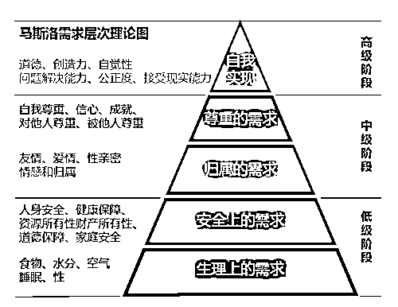
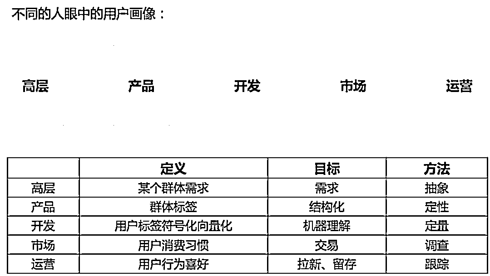
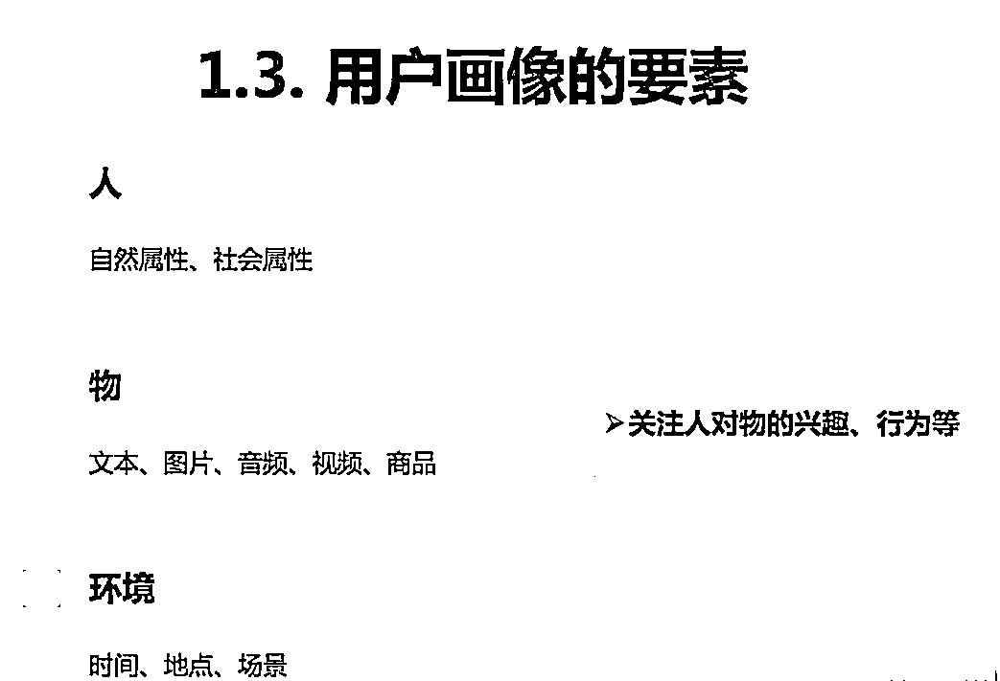
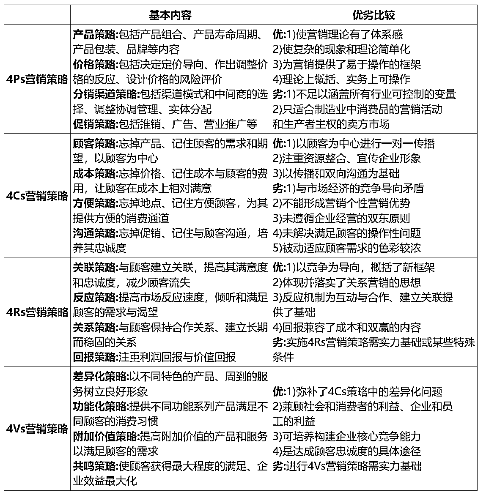

# 想找合伙人、拉团队或谈融资？先把项目讲明白

无论你是在筹备创业、拓展副业，还是寻找投资人，一份清晰的商业计划书都很重要。它不只是展示项目的材料，更是梳理思路、吸引伙伴、争取资源的工具。

## 一、商业计划书究竟是什么？

商业计划书（Business Plan）是一份系统介绍企业或项目的文件，通常会说明产品与服务、目标市场、竞争情况、经营方式、发展安排、潜在风险以及资金需求等内容。

它主要有三个作用：

- **帮自己理清方向**：把商业逻辑写下来，检视想法是否成立，也让后续行动更有依据。
- **让投资人愿意继续了解**：重点明确、表达简洁的计划书，是开启融资沟通的第一步。
- **找到志同道合的人**：把项目讲透，才能吸引愿意一起投入时间和能力的伙伴。

## 二、别人最想听懂哪些问题？

介绍项目时，尽量围绕几个核心点展开：**用户遇到了什么问题，你提供什么办法，服务哪些人，为什么由你来做。**

### 1. 你究竟要做什么？

先用一句通俗的话讲清产品的定位、服务对象和解决的问题。创业早期，这句话甚至可以直接作为计划书的标题，也可以成为产品的核心口号。

例如，一款体育场馆预订应用，可以概括为：“让运动爱好者和场馆快速找到彼此。”

一句话不必复杂，但要让听众马上知道你在做什么。

### 2. 你准备怎么做？

介绍用户需求、解决方案和产品优势时，重点是把问题讲具体，而不是只堆概念。你需要回答：

- 用户正在经历什么困难？
- 为什么这个问题值得解决？
- 你的产品或服务如何应对？
- 相比现有选择，你有什么特别之处？
- 为什么现在是合适的时机？

“痛点”并不只有一种形式，大致可以从三个角度理解：

1. **心理上的不适或愿望受阻**：例如思乡、害怕抽血、担心隐私泄露，或好奇心没有得到满足。这类感受可能被某种外部情境激发，也可能长期存在。
2. **使用后形成依赖或偏好**：体验过某种产品后，用户如果不再使用会觉得不适应。习惯了某款饮料，或投入网络游戏后难以抽身，都是常见例子。
3. **购买过程中的不便与等待**：有些产品会让顾客经历排队、限量等不便，但最终获得产品时的满足感足够强，用户便愿意接受这些代价。苹果新品发布时有人彻夜排队，就是典型场景。

第三种情形与前两种不同：它可能来自资源有限，也可能是企业主动舍弃部分附加服务，把力量集中在核心产品上。只要等待和不便没有超过用户最终获得的价值，这类阻碍就可能被接受。关键在于让产品足够有吸引力，降低用户对不便的在意。

论证需求时，要说明它从何而来、为什么当下存在，以及你的方案如何满足它。可以结合人的需求层次、环境变化、市场空缺等因素，证明这不是臆想出来的机会。

所谓“缝隙市场”，是指大企业或主流玩家没有充分服务的细分领域。企业可以先聚焦其中一个小范围，努力成为这个领域的领先者，再逐步拓展到更广阔的市场，同时建立不易复制的优势。

能成长为大型公司的项目，往往瞄准人们更基本、更长期的刚性需求；一些特色鲜明的小众项目，则可能满足更高层次的品质、兴趣或情感需求。无论是哪一种，都要用具体场景说明用户遇到了什么麻烦，以及产品怎样帮助他们。

不少创业项目失败，并非因为缺少创意，而是没找到真实需求，也没有建立可靠的商业模式。广告语之所以容易被记住，往往是因为它把用户问题和产品利益说得直接明白。例如，补肾产品曾用“他好我也好”突出使用者关系；凉茶则用“怕上火”直接对应消费者担忧。

### 3. 你的用户是谁？

产品不能只说“面向所有人”。明确目标用户，既能帮助你打磨产品，也能指导获客方式。

以饮用水为例，不同产品对应不同人群：

- **山泉水、井水**：通常取用成本低，更适合住在山边或农村的人，并非人人都需要。
- **自来水**：价格便宜、获取方便，主要供家庭日常使用。
- **娃哈哈、怡宝、农夫山泉等瓶装水**：价格相对亲民，适合日常购买的上班族和普通消费者。
- **百岁山**：包装和定位更偏品质消费，主要吸引收入稍高的上班族及小中产，在不同地区的接受度也可能不同。
- **依云、巴黎水**：价格较高，有时也会被用于餐饮场景或作为价格参照，主要面向高消费人群以及部分约会、社交场景。

同样是“水”，价格、包装、使用场合和顾客都不一样。你的项目也要想清楚：究竟是为哪类人提供什么价值？

#### 划分细分市场

一个大行业往往包含许多小赛道。以自媒体为例，可以按平台分为公众号、视频号、小红书、头条等；小红书还可继续区分为店铺经营、商品推广、笔记创作、日常分享等；创作内容又能分出母婴、养生、副业等领域。此外，还有聚光投放、蒲公英服务及相关培训等业务。

你需要把自己放进具体的细分领域里，让别人准确理解项目所在的位置，而不是只说“我做自媒体”或“我做电商”。

#### 描绘典型用户

用户画像是对目标用户的具体化描述，帮助团队把用户的属性、行为、需求和期待联系起来。它不应凭空想象，而要从真实用户和市场观察中提炼，形成具有代表性的用户类型。

一个产品通常可以建立大约4至8种用户画像。若你的项目定位在更窄的赛道，就继续细分人群。聚焦得越准确，越有机会在小领域里形成领先优势。

#### 选择合适的获客方式

营销策略要从顾客需求出发，结合购买能力、市场反馈和企业目标，协调产品、价格、渠道与推广等环节，为用户提供合适的商品或服务。

常见策略并没有统一的优劣之分。要先判断产品适合谁，再根据目标人群选择渠道和方法。

#### 如何获得第一批用户？

早期用户应尽量以较低成本获取，但首先要保证人群找对了。用户数量并非越多越好，适量、匹配度高的种子用户，通常更有利于验证产品。

你可以借助合伙人的资源、自有社群，或能够低成本触达目标人群的渠道开始测试。不要等产品十全十美才行动——早期用户的反馈，正是发现问题、调整产品和校准客群的依据。采取小步试错的方式，能减少一次性投入过多的风险。

如果产品尚未得到充分验证，先控制试用规模尤其重要。一旦出现口碑问题，也更容易及时处理。

有个常被提起的例子：一种心脏类药物在临床试验中，对原本目标疾病的效果并不理想，但部分男性使用者却对它的另一种作用评价很高。厂家据此调整方向，后来发展出广为人知的“伟哥”。这说明早期反馈有时不只帮助改进产品，也可能揭示新的市场机会。

#### 后续怎样扩大用户规模？

随着验证推进，可以考虑不同的增长路径：

- 持续优化产品和服务，依靠满意度与口碑传播；
- 投入资金进行市场推广；
- 鼓励首批用户成为分销者或推广者，通过利益机制加强合作；
- 寻找更匹配、效率更高的推广渠道。

没有放之四海皆准的方案，关键是根据产品阶段、客户特点和自身资源作出选择。

### 4. 赛道里有哪些玩家？

竞争者存在，不等于项目就不能做；行业里有知名公司，也不代表新团队没有机会。需要判断的是：市场当前有多大、未来可能增长到什么程度、已有玩家分别服务哪些人，以及是否存在尚未被做好或被忽略的需求。

红海或下行市场也不一定没有空间。过去DVD行业竞争激烈，但如今仍有人瞄准尚未普及网络的农村市场，围绕特定需求经营，反而避开了正面竞争。赛道是否值得进入，最终要看能否找到合适的目标市场和切入口。

做竞争分析时，可以关注：

- **竞争对手**：区分直接对手、间接对手和可能进入市场的潜在玩家，了解他们的业务重点、方向与做法。
- **核心能力和进入壁垒**：分析专利、许可、独有资源、团队技术、商业模式以及复制成本等。
- **渠道资源**：考察团队或企业是否拥有明星影响力、成熟渠道、员工关系网络等优势。
- **差异化策略**：结合竞品特点与自身能力，确定集中力量突破的方向。

### 5. 为什么由你们来做？

项目值得关注，团队同样重要。投资人常看重的一点是：优秀的人即使遇到普通项目，也可能创造新的机会；反过来，只有好点子、缺少合适执行者，项目也很难走远。

介绍团队时，可以说明：

- **创始人的经验与判断力**：是否具备创业所需的行动力，是否了解相关领域，对项目有没有自己的认识。
- **成员之间是否互补**：过往经历不必完全相同，关键是各自能力能否支撑当前分工。要突出成员适合承担什么职责，而不只是罗列履历。
- **团队是否稳定**：稳定协作有助于推进计划、应对风险，也更容易获得外部信任。

数据也能增强说服力。市场需求、产品增长和运营表现都可以用数字呈现，例如相关产品销量、新品渗透情况、潜在用户特征等。运营数据则能展示产品发展进度，适合用关键节点和规模区间来说明。

比如，互联网应用上线数月后的用户量级、日活水平、传播效果；有收入的项目可以展示营收、利润和平均客单价，并解释这些数字如何计算、是否合理。数据不是装饰，而是帮助听众判断需求与执行能力的依据。

### 6. 现在能做到什么，未来希望走到哪里？

除了前面提到的优势，你还可以说明项目的独特资源、能力或机会——它们可能是吸引伙伴加入的关键。

需要讲清楚商业模式：

- 产品或服务具体是什么？
- 生产、交付或服务流程如何运转？
- 面向哪些客户？
- 通过什么方式收费？
- 价格如何确定？

同时，介绍营销计划和发展路径：如何推广、计划在多长时间内触达多少用户、市场如何扩展；第一年要完成哪些工作，靠什么关键行动超越对手；如果初期进展顺利，之后准备向哪个方向发展。

投资人关心的不只是眼前的产品，也会评估它能否发展成一家持续经营的公司。因此，长期规划同样需要交代。

### 7. 项目需要什么资源，市场能承载多大规模？

先说明项目面向的市场范围，再分析：

- 整体市场容量和目标细分市场份额；
- 目标用户与相关需求未来几年的变化趋势；
- 同类产品需求的发展情况；
- 痛点所对应的商业价值，以及项目希望达到的市场份额；
- 结合定价和用户规模，估算可实现的收入，并用简洁的话概括市场空间与发展前景。

行业数据不是越多越好。重点是通过分析说明你对市场的判断，而不是把资料简单堆在一起。

盈利模式必须经得起推敲。创业者应尽早想明白靠什么获得收入；如果暂时没有成熟的收费方式，也至少要清楚产品为用户创造了什么价值。

### 8. 资金、经营计划与财务预测

商业计划要写明发展策略，包括如何推广、如何拓展市场、计划用多久达到预期用户规模，以及各阶段的重点任务。

财务部分可结合项目情况，估算未来3至5年的收入、投入和成本，包括固定资产、运营资金及经营期间的主要开支，并据此预测利润和项目经济效益。

但市场变化难以准确预测，过分乐观的数字反而会损害可信度。更务实的做法，是先把关键问题说清楚：

1. 未来半年或一年需要多少资金，分别用在什么地方？每月固定支出和运营费用是多少？
2. 预计什么时候实现收支平衡？
3. 业务顺利时何时可能盈利？如果遇到困难，现有资金还能支撑多久？

不要用夸张回报代替可靠分析。对财务数字没有把握时，宁可暂缓给出过度精确的预测。周鸿祎也曾表达过类似观点：没有依据的财务测算不如不说。

### 9. 项目可能遭遇哪些风险？

风险分析可以按三个步骤展开：

- **识别风险**：考虑技术、市场、管理、财务、政策以及其他不确定因素。
- **评估影响**：说明风险可能怎样影响销量、价格、成本、经营能力和发展计划；必要时进行量化分析。
- **准备应对方案**：针对主要风险提出实际可行的控制和防范措施。

只列风险名称是不够的，还要让人看到你理解它的后果，并且已经思考如何处理。

### 10. 谁出资、谁做事，收益如何分配？

项目通常既需要资金，也需要执行者。即使有人愿意不计报酬参与，或有人能提供免费渠道，这类情况也不能当作稳定前提。

合作开始前就要把规则谈清楚：每个人负责什么，投入多少时间与资源，达到什么目标；只出资的人是否参与日常决策；项目取得阶段性成果后，收益拿出多少、按照什么规则分配；出钱、出力、出专业能力的人分别如何计算贡献。

把账目与职责提前约定，不是伤感情，而是减少未来争执。合伙人之间越熟悉，越要把规则说在前面。现实中，不少小公司也曾因控制权和公章等问题闹得不可开交。

此外，还要约定项目达到什么条件算初步成功，以及成员退出时如何处理。股权结构和退出机制越清楚，后续合作越有保障。

## 三、最后，判断项目是否站得住脚

介绍项目时，可以从以下六个维度自查：

1. **市场空间够不够大，增长趋势是否明确？**
2. **产品是否真正有价值，业务逻辑是否成立？**
3. **数据有没有持续改善，关键指标是否经得起检验？**
4. **商业模式是否清晰，收入能否实现？**
5. **团队能力是否匹配，核心负责人是否可靠？**
6. **资金需求是否合理，融资条件是否恰当？**

把这些问题讲清楚，你的项目才更容易被潜在合伙人、团队成员和投资人理解，也才有机会获得他们的信任与支持。