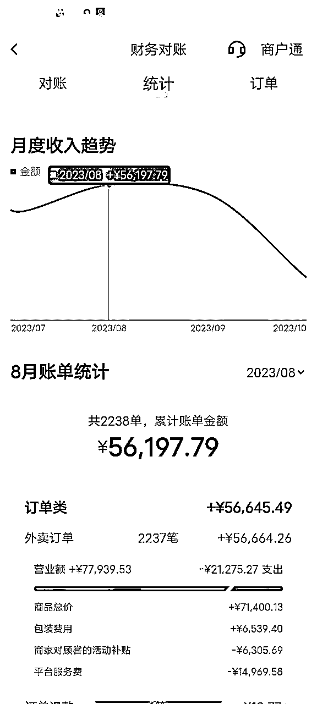
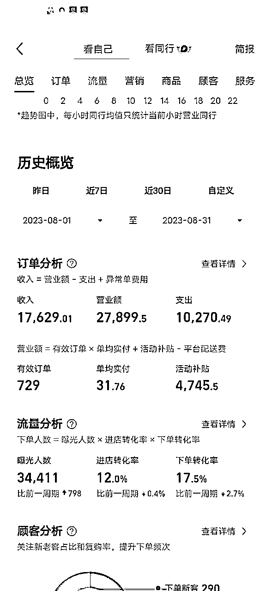
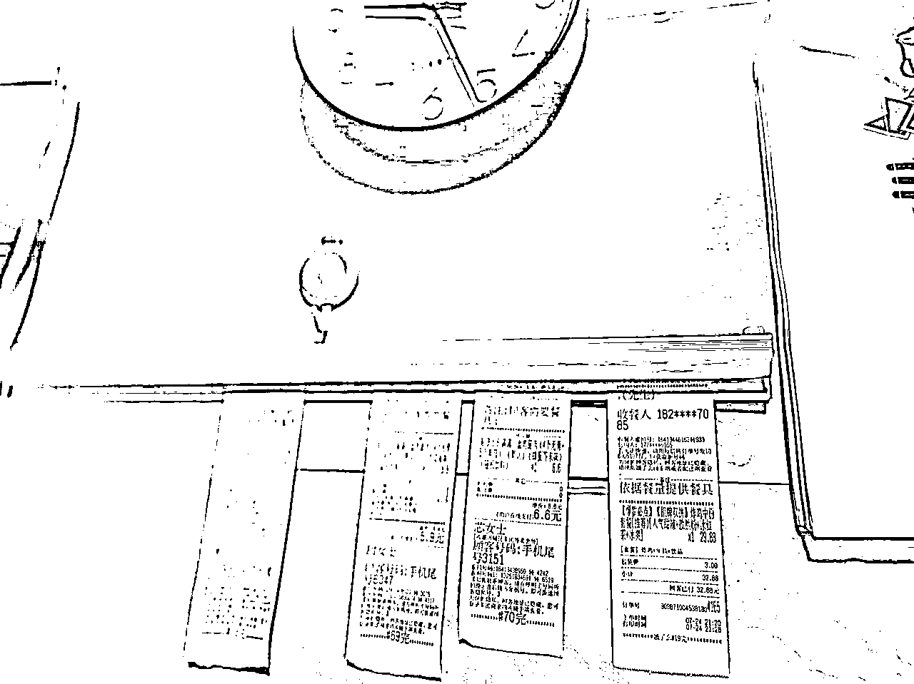
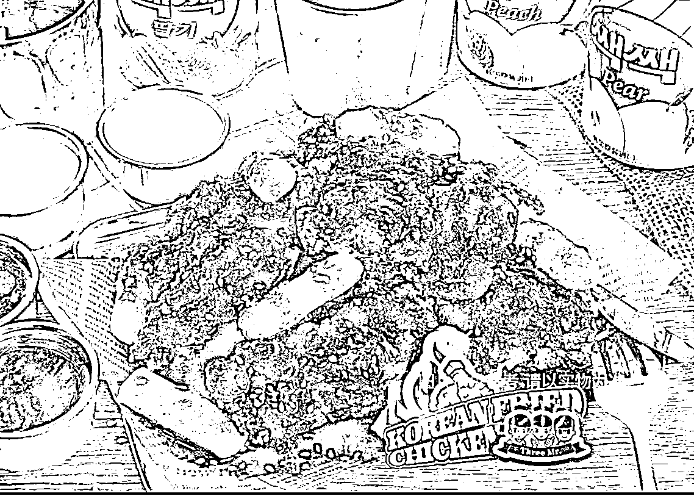
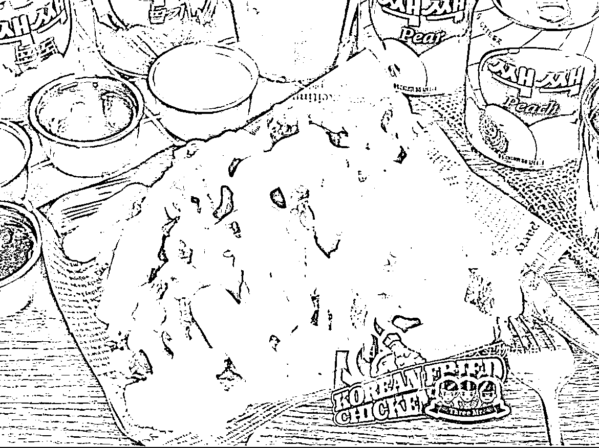
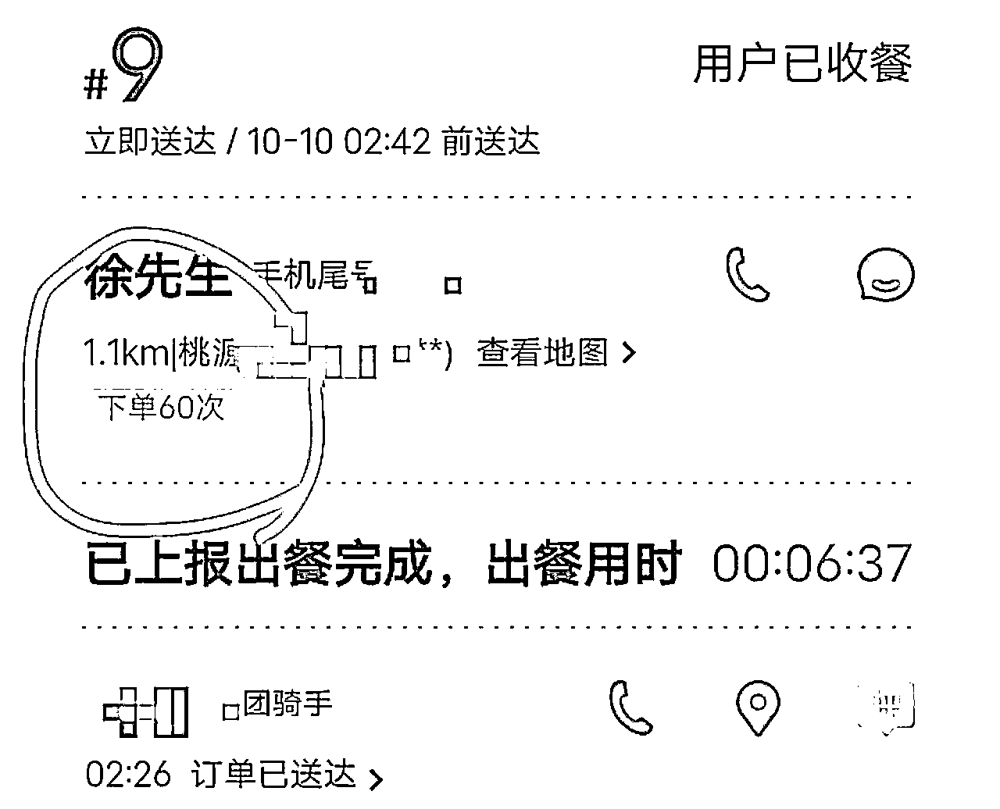
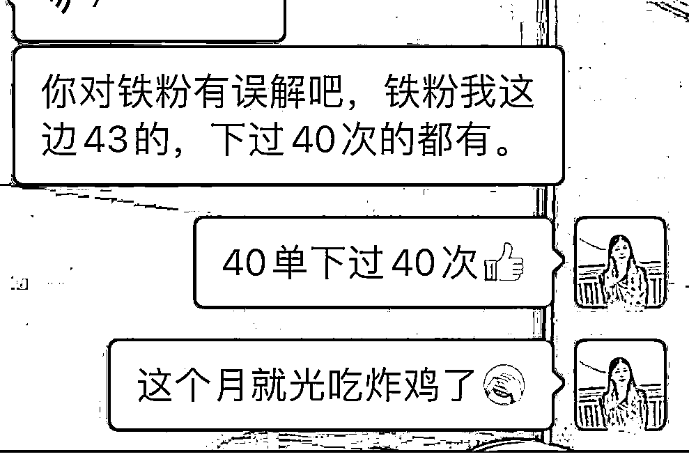
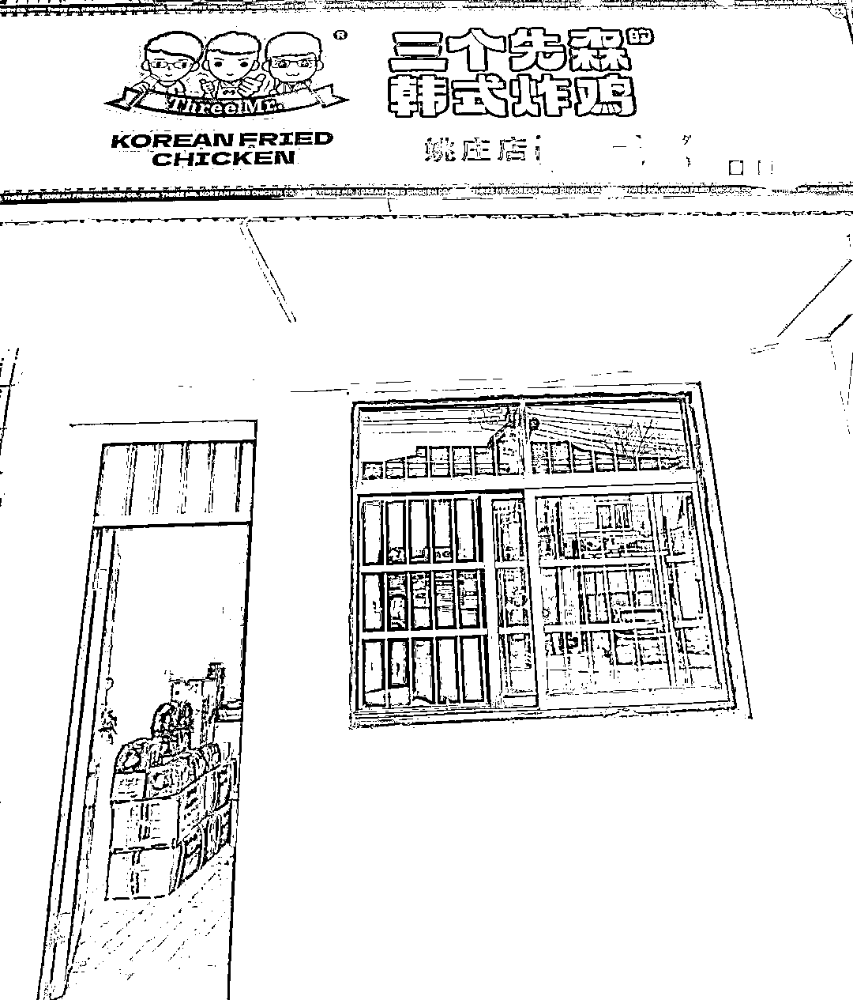

从20平米的小铺面做到月收入六位数，一个95后姑娘只花了不到半年。在嘉善县的镇上，她开的炸鸡铺，回头客里下单最多的一位，点了60多次。她把整个过程写成了细致透顶的复盘，我从中挑出真正能落地的经验，整理成这份参考。

她最初接触搞钱圈子，是因为听了那档《搞钱女孩》播客。主播说了一句“想赚钱就得来生财”，她第二天就入了圈。最初翻看那些高手的帖子，她自嘲是三脚猫功夫，不敢吱声。后来读《能断金刚》学到布施带来财富的逻辑，又听人说“举手才有机会”，这才鼓起勇气把自己的经历拿出来分享。

一、选品牌，她到底在挑什么？

那阵子县城里做炸鸡的牌子不少，但她没有盲目跟风。她挑牌子的标准很简单：分量要足，口味要有层次，肉质不能柴。当地人的舌头偏爱微微的甜口，恰好有一家韩式风味的炸鸡，招牌酱正是甜辣那种，甜和辣都克制，不会抢味。拍板前她问过一圈朋友，大家也点头认可。为了放心，她又花两天专门跑了沪苏两地，试过几家口碑店，最终确定了这家。

二、铺面怎么找？先想清楚怎么做生意

选址这件事，她坚持“渠道倒推位置”。如果主打堂食，当然要选人气旺的商圈，路过的客人就是现金流。但她做的是外卖为主，炸鸡的单价本来就不高，硬挤进高租金地段，利润会被吃光。所以她起初就锁定了租金低的角落。

过程并不顺利。她先看中一间十五平左右的商场铺，年租5万，准备签约时对方突然多收8600元管理杂费，预算超了，只好放弃。后来又相中年租2万的门面，但原店主回老家了，不提前交房，证照也没法换。最后找到一间民房，年租8400元，最关键的是问过主管部门，这个地址能办餐饮证照。写到这里，她复盘了三个关键点：

第一，踩准换租节点。她大年初九开始扫街，年初正是年前经营不善的门店集中挂出的时候，空房多、价格好谈。那三处房源都是这个窗口期捞到的。找铺子要耐得住性子，把整条路段来回走够三遍，藏在旮旯里的铺子才会露出来。与此同时，这个节点接店常常还能免掉顶手费——干不下去的老板往往直接走人，后来者只需付房租。遇到那种年租5万还要收10万顶手费的门面，对小本买卖来说实在不划算。

第二，务必先核实证照。看中地址后，先拿计划经营的品类去当地政务窗口问清楚：这里能不能批餐饮许可。对方在系统里一查，确认可以，再回头谈价格和结算周期。顺序一旦反了，房租装修全砸进去，证照却批不下来，就真的白忙一场。

第三，主动扩大配送范围。外卖的配送边界不是规整的圆形，很多边缘地带得自己去争取。她的铺子往东到一片住宅区是边界，但住宅区外面还有大片厂区，她找到平台业务员把这个片区划了进来，厂区订单直接占到四成；南边桥头过去有个老小区，也申请纳进来，又贡献了8%的单量。这些需求都要自己提出来，别等着平台主动给。

三、线上运营，是一套组合拳

新铺子最怕没声量。开业前她拉着朋友来免费尝味道，唯一要求是吃完在社交动态上发一句，等于提前在小镇传开了消息。新客上门打7.5折，再送饮品，很快就有人闻讯而来。

平台会倾斜流量给新开的铺子，头7天曝光明显高。她顺势把菜单做成阶梯价格：6.9元的小份尝鲜款负责引流，15元单人餐、25元双人餐、50元多人餐，分别对应不同人数。这样单人来也行，一桌人来也够，能触达的人群一下子广了。

总部还会安排本地有几千粉的达人探店，拍视频挂团购链接。当时上的是15.8元送饮品的套餐，限定10天到店里验证。等客人拿着二维码过来核销，店员会适时补一句：“这个团购分量偏小，加点钱能换成大份，再送你一种蘸酱。”十个客人里通常有八个人愿意升级。

这个品牌以前只在县城开过，小镇没有，老客们一听味道跟县城一致，天然就有一波流量。为了攒口碑，金珠还会告诉顾客：下单后在平台给个好评，附上备注，下次来多加肉。前期她也叫上几位熟人真实下单、写评语。评价要看出是真人，十条里两条带图的长文，剩下八条短句随意，甚至可以带一点点缺点，比如“口味还行就是量太大，根本消灭不掉”或者“店主忙起来手套忘放了”。这种真实感反而更让人信服。

单量起来之后，好评也会跟着多，平台算法会给更多曝光，进店下单的客越来越多，形成雪球效应。中期她也没松劲，偶尔有人打差评，甚至可能是竞对故意抹黑，她基本不理，服务好八成客人就够了。到了稳定期，她还做过一场活动：每逢周三单量最低，就搞前30名下单送一份刮刮乐彩票，成本就一块钱，却让那天的互动热闹了不少。

四、十万元启动资金，每一份都花在刀刃上

她见过反面案例：同学在县城开店砸了30多万，装修和选址样样都用顶配，遇到疫情一年多就停了。金珠自己只有10万预算，反而被逼着想尽办法省钱。

她的投入清单大致是：品牌授权费3.98万，押金8000，年度服务费6000，三项合计5.38万。装潢上，门头3000、墙面粉刷500、施工和瓷砖及人工共约1.15万。设备几乎都是二手淘来的：双开门冷柜1600，二手料理台800，总部配的调料锅5000，两只小炸锅400，二手桌椅840，吧台从网上买400，二手排烟罩500，加在一起9340元。首批包装盒、蘸料这些耗材约1.5万；首批冻品鸡肉、小吃和油花了8000，够用四天。全部加起来，97640元。

正因为所有钱都押进去了，她不允许自己偷懒。头两个月动作不够利索，天天被外卖骑手催。两个月后，她老公已经能独立接管整个后厨，公公在旁边搭手，第17天的时候，平台单量超过2000单。

五、比同行晚收工一小时，也可能成为优势

当地不少炸鸡铺凌晨1点就关了，金珠的铺子硬是开到凌晨2点。别小看这多出来的一个小时，夏天吃宵夜的人多，这一小时能多接30单，日常平均每天130单。

她复盘后总结，自己比同行做得好的地方无外乎三点：第一，套餐选择足够丰富，覆盖的人群广；第二，口味稳定且比邻店好，客人吃过就会回头；第三，出摊时间更长，捡漏深夜订单。前两点能淘汰不少人，第三点又拉开一个身位。别人没有的她要提供，别人拿得出的她要打磨得更好，光是这几条，就足以挤进最前面的行列。

她说，很多人以为创业要有厚家底，但她用亲身经历说明：资金紧张反倒让人更清醒。真正撑起这间铺子的，是选牌子的用心、找铺子的细心、运营上的耐心，以及每天多熬一小时的恒心。炸鸡铺只是她副业里的一条线，后面还有更大的布局在慢慢展开。如果你也正在考虑一门镇上的小本买卖，希望她的这些经验能给你一点底气：普通人翻盘的机会，往往就藏在最具体的小事里。

欢迎同频的朋友们去和她交流，她说自己知道的全都愿意讲出来。