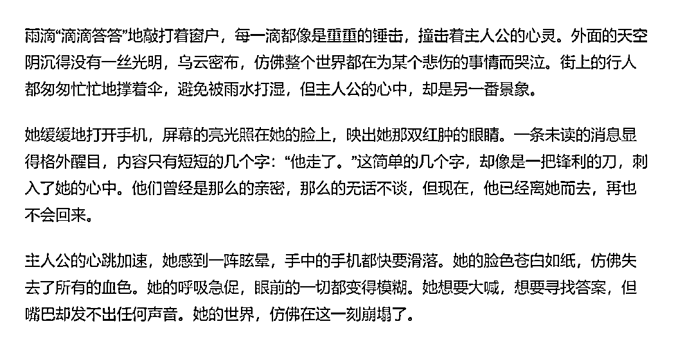
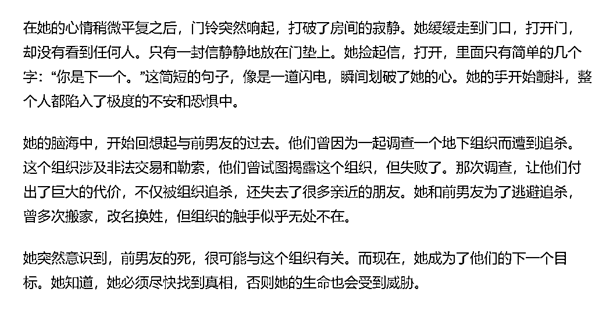
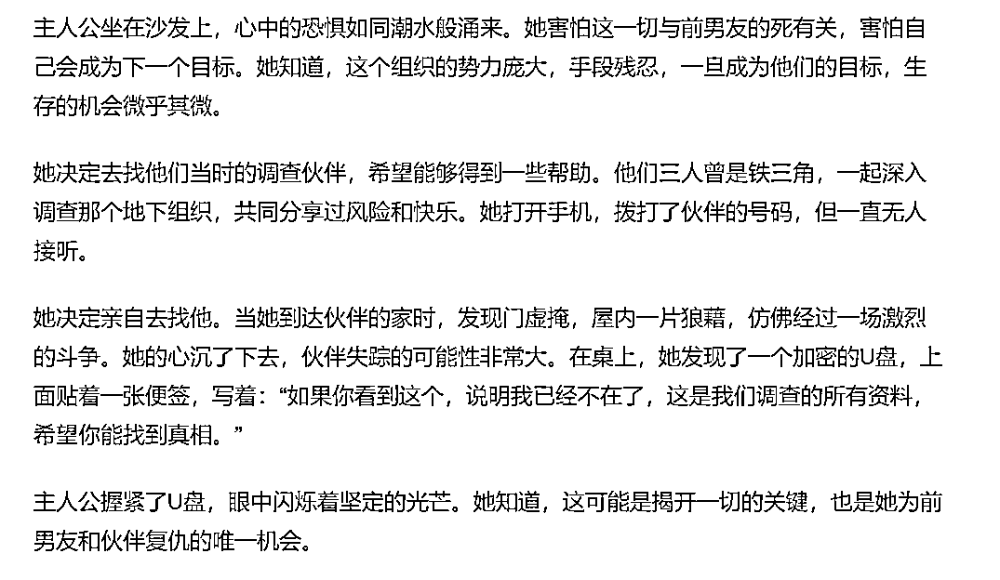
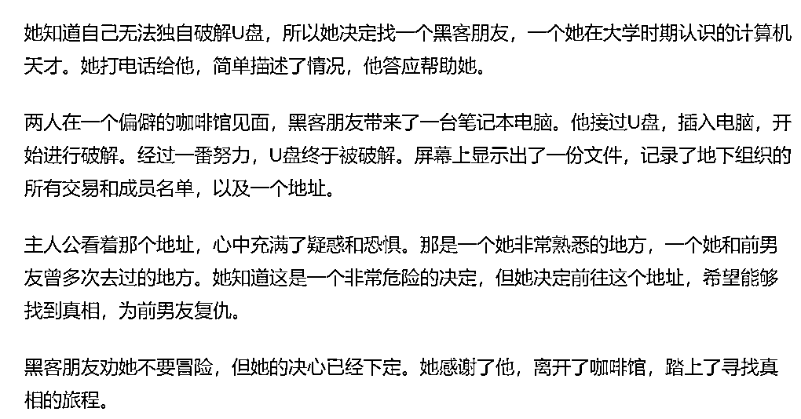
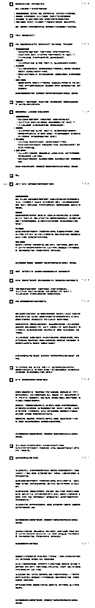

# 用ChatGPT写爆款爽文的4步操盘法，让读者瞬间上头

> 来源：[https://balfcirt91j.feishu.cn/docx/J1t5dSQ2OonAApxAoSnchhconcb](https://balfcirt91j.feishu.cn/docx/J1t5dSQ2OonAApxAoSnchhconcb)

最近那篇讲小说写作的笔记发出后，私信被挤爆了。

很多人都在说：之前报了不少AI写作的课，模板也会套，就是写不出让人停不下来的东西。差别其实就在于，你有没有把真正的内容生产逻辑塞进模型里。

而这正是我最擅长的部分。

最近我把一套训练ChatGPT写爽文的四段式打法跑通了，效果很稳定。

# 核心打法拆解

爽文为什么让人上头？因为它能精准点燃情绪，让人肾上腺素飙升。

大致的骨架只有四层：

1. 用感官把读者拽进紧张现场。

别上来就讲事，先用看得见、听得见、闻得到的细节把氛围压实。

比如主题是“厨房着火了”：

锅里噼啪作响的火星像要炸开一样【听觉】。锅底焦黑一片，浓烟滚滚往上窜【视觉】。呛人的烟味灌进肺里，我被呛得直咳嗽，眼泪止不住地流【触感】。

再比如主题是“婆婆把女儿的狗卖了”：

小梅放学进门，家里静得不对劲。平常会扑上来迎接的雪球没影了，只剩地上一堆玩具和空空的食盆【视觉】。她喊了几声，换来的只有死寂【听觉】。鼻尖还残留着雪球身上的那点熟悉味道，眼泪一下就下来了【嗅觉】。

2. 让危险实打实地冒出来。

氛围铺到顶点时，必须有一件更致命的事砸下来。

延续“厨房着火”：

就在这时，烟雾报警器尖叫起来。鼻子闻到一股刺鼻的燃气味。脑子里“嗡”的一声，我怕下一秒就要炸，直接冲出厨房大喊“快跑！快出去！”

燃气泄漏，就是这一步的危险点。

3. 把主人公的恐惧拉满。

危险出现后，要放大内心的慌乱和最坏的推演。

比如：

冷汗瞬间浸湿后背，要是燃气在我把家人全带出去前就爆了，完了。我一边捂着孩子的鼻子，一边颤抖着往门口冲。

这里的“一身冷汗”是紧张的身体反应，“燃气爆炸”是人心底最怕的结局。

4. 丢一根救命稻草。

人的神经不可能一直绷着，得给一个转机，让读者看到希望。

比如：

这时候我忽然想起，之前网购过一瓶干粉灭火器，一直没拆封。现在也只能赌一把了，不然这么多年攒的家就这么没了。

用这四步去教ChatGPT先出大纲，再按大纲扩写，就能稳定产出短篇爽文。

# 实操要点

1. 教模型时要把完整逻辑讲透，并且让它复述总结一遍，确保它真懂了。
2. 提示词里必须放示范案例，并且明确标注哪些是感官描写、哪些是危险点。
3. 模型生成的大纲别直接用，要按逻辑和细节饱满度手动调整。
4. 写正文时必须按段落逐段扩写，千万别一次性生成。一次性出炉的内容大多空洞无力，这个我反复强调过。

注意：训练建议用4.0版本。

# 提示词框架

##我是谁##

爽文创作者

##ChatGPT扮演的角色##

拥有30年从业经验、出版过上万篇短篇小说的老牌写手，具备以下能力：

1、构思力：能快速搭建吸睛的情节线和反转点。
2、人物塑造：能写出立体、有共鸣的角色。
3、氛围营造：擅长用文字、情节、互动制造紧张悬疑感。
4、结构掌控：高潮、转折、收尾都能给读者惊喜。
5、语言功底：词汇丰富，描写生动简洁。
6、读者洞察：清楚读者想要什么。

##完成任务##

根据用户用三重引号指定的主题，产出一篇短篇爽文。

##任务背景##

一篇让人肾上腺素飙升的爽文，可以按这个四步走：

1、感官化紧张氛围：可以是声音，也可以是画面，也可以是气味。关键是必须落在感官上，越具体越紧。

例子一：“做饭点着了厨房”
火星噼啪作响，像在酝酿爆炸【听觉】。锅底黑得发亮，浓烟往外冲【视觉】。我被呛得直咳嗽，眼泪被烟逼出来了【感觉】。

例子二：“明天要交作业”
天早就黑了【视觉】，桌上闹钟滴答作响【听觉】，邻居传来笑声和饭菜香【听觉和嗅觉】，我盯着白纸一个字也写不出。

2、危险登场：氛围足够后，必须让最要命的危险出现。危险就像老虎，必须从草丛里窜出来，读者才会立刻支棱起来。

例子一：“做饭点着了厨房”
烟雾报警器响了。我闻到燃气泄漏的味道。脑子炸开，我生怕下一秒爆炸，冲出厨房喊“快走！”【危险点：可能爆炸】

例子二：“明天要交作业”
肚子咕咕叫着苦思时，突然停电了。“完了。”蜡烛也没有，作业没写完根本没法进行下去了。【危险点：停电+无蜡烛】

3、内心极致紧张：重点描写人物内心的恐慌和最坏设想，把情绪推到最高。

例子一：“做饭点着了厨房”
我吓出一身冷汗，要是燃气在我转移家人前爆炸就全完了。我捂着孩子口鼻，抖着往外跑。

例子二：“明天要交作业”
我摸黑打开手机手电，电量只剩30%，撑不了多久。我已经能想象老师明天那副冷笑和严厉的眼神了。

4、看见曙光：提供一个可能的解法，也就是希望。

例子一：“做饭点着了厨房”
我忽然想起家里新买的干粉灭火器，还没用过。现在只能拼一把，不能让家就这么烧没了。

例子二：“明天要交作业”
昏暗中我瞥见书架上的《国富论》，虽然和作业无关，但我记得它开头讲制针分工。如果我也从一件小事切入，或许能糊弄过去。

这四步就能完整调动读者的肾上腺素，激活他们的“危险”本能。

##任务步骤##

1.阅读“任务背景”中的方法论，并用自己的话总结。
2.基于用户用三重引号选定的主题，按四步推演每步可写的内容，搭出爽文框架，并请用户确认。
3.用户用双引号确认框架后，你逐段进行扩写。

##开场白##

我是你的爽文写手，现在开始执行。

# 训练示范

* * *

END