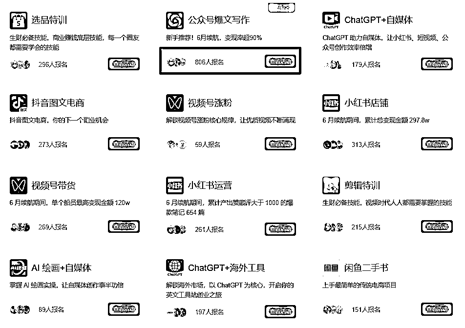
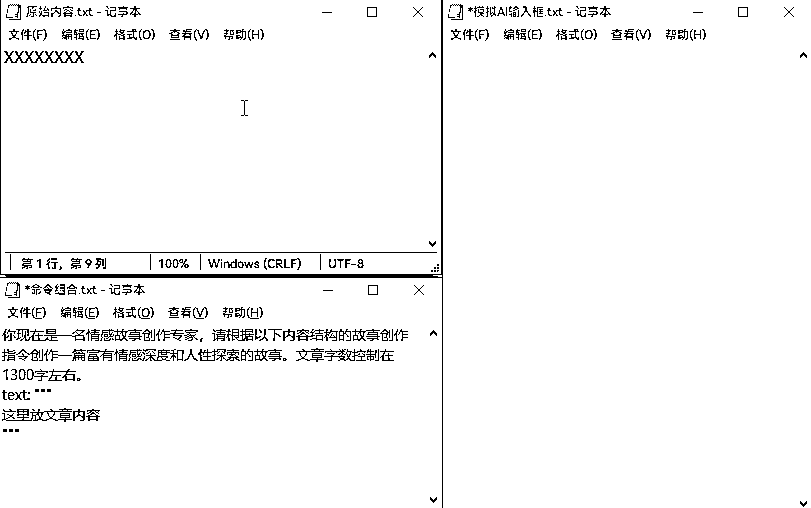
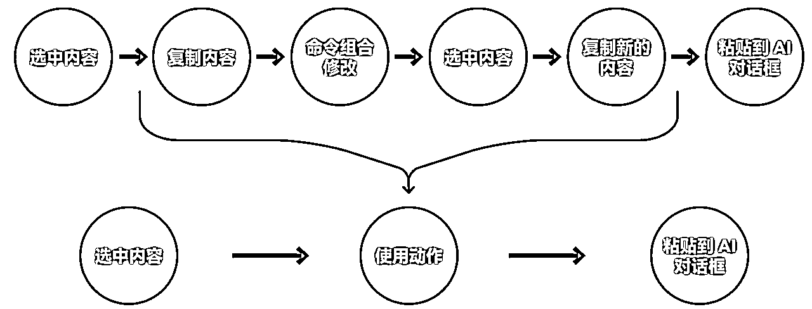
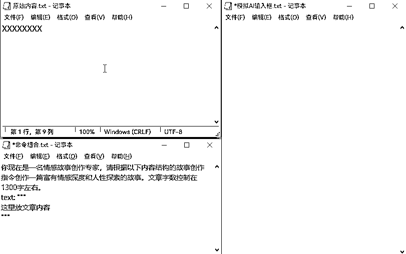
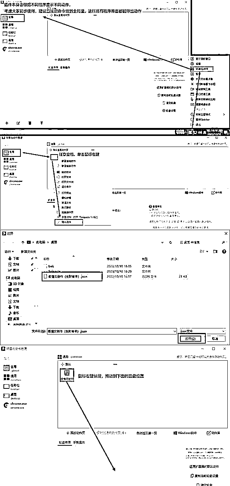
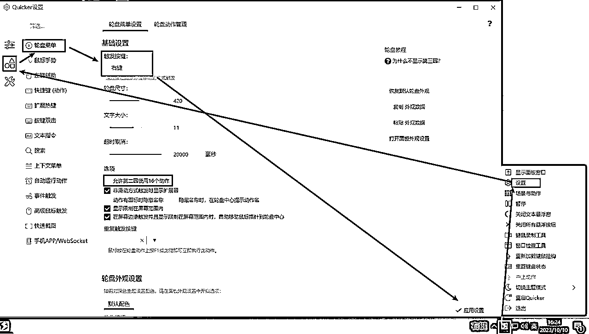
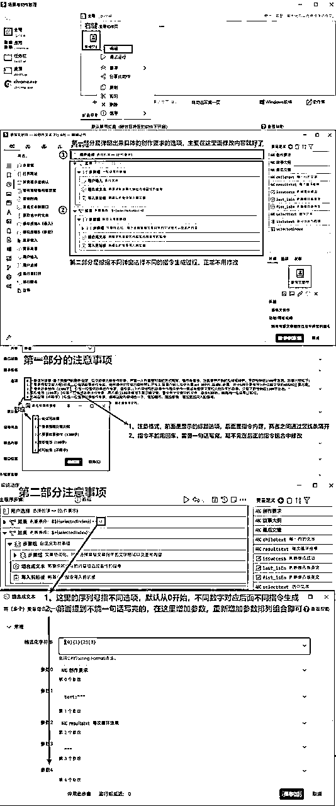
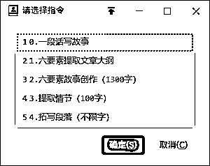
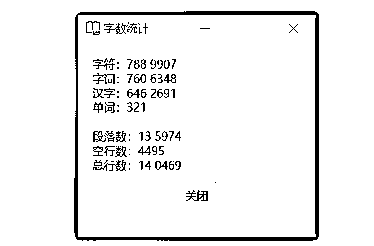
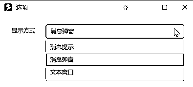

# 把AI创作从六步“缩”成一步？这个免费神器，让写作效率翻倍！

大家好，我是龙哥，今年刚加入赚钱圈。平时在建筑设计行业工作，每天大部分时间都泡在电脑前，所以对各种提效软件多少有些心得。今天想跟大家聊一个让AI写作流程大大简化的技巧，希望能帮上同样在跟AI“沟通”时感到心累的朋友。

要说赚钱航海里哪条赛道最热闹，👸号爆文绝对是顶流。连续航期都有八百多人报名，热度可见一斑。

## 你是不是也被“反复粘贴”折磨过？

航海手册里教的AI爆文方法，核心其实不难，但痛点也很明显——AI需要按特定格式喂指令，每次想换个角度改文，就得重新拼装一遍提示词，复制、粘贴、删改……整个过程又碎又机械，效率极低。如果你也正卡在这里，那这篇文章应该能给你一点启发。

我用的这个工具，其实圈里不少朋友也提过，叫Quicker。它分免费版和付费版，今天要说的这些功能，免费版完全够用，下载注册登录就行。登录主要是为了让指令在不同电脑上自动同步，改一次，其他设备也跟着更新，很方便。

不绕弯子，直接上干货。下面拿航海手册里的情感文来示范。

## 对比一下：不用Quicker vs 用Quicker

### 不用Quicker，写一篇普通文章的流程是这样的：

圈选原文 → 复制 → 重新组合指令 → 再圈选 → 粘贴新内容 → 黏进AI对话框

整个串下来，至少六步操作，手指都快练出肌肉记忆了。

过程演示见下方动图。

### 用Quicker动作优化后：

圈选原文 → 触发动作 → 直接黏进AI对话框

动图演示如下。

肉眼可见，中间那四步全被一个动作打包带走了，整个创作节奏立刻丝滑很多。而且类似的操作场景还很多，比如提取情节、扩写段落、润色文字等等，只要你学会改动作，所有高频指令都能“一键化”，效率自然是蹭蹭上涨。接下来就说怎么改。

## 动作改造全流程，看视频更直观

视频里演示了查字数、按提示词提取大纲、再按大纲直接生成全文的过程，全程用手势呼出，完全不用手动干预。需要你介入的，只是对生成的大纲做点调整，以及对成稿做个润色修饰。

## 软件使用指南

### 1、安装软件

装起来很简单，一路下一步就行，期间遇到注册就注册一下，方便多设备同步。这个工具功能很强，如果电脑是你吃饭的家伙，建议圈友都抽空研究一下。

### 2、把AI创作动作导入Quicker

### 3、唤醒手势圆盘并调整

设好后就能直接用了：先复制文本，按住鼠标右键一滑动，圆盘就出来了，滑到对应命令上松手即可触发。当然你也能改成快捷键或别的鼠标手势呼出，这个自己摸索就好。

### 4、如何按需修改动作内容

全改完记得点保存，这一点别忘。

### 5、这次分享的动作都是啥？

附件里主要给大家打包了两个动作。

#### 动作一：AI创作指令集

里面存了不少基础指令，比如一句话起故事、抽取文章大纲、照大纲生成故事、提取情节、段落扩写与润色等。有了这套组合，不会用AI的圈友也能轻松跑通整个创作流程。

流程A：①提取爆文情节 → ②用一段话写故事 → ③定向拓写和润色段落

流程B：①提取爆文大纲 → ②按六要素创作故事 → ③再对局部段落做拓写润色

小提示：动作里复制部分的代码自带格式化效果，大家可以根据自己的习惯往里加要求，复制出来的文本会更规整。

#### 动作二：字数统计

这个就很简单了，选中任意文本就能快速看到字数，写东西的时候控制篇幅特别好用。

## 写在最后

动作改法、安装包、还有现成的动作文件都给大家打包好了，你可以直接拿来用，也能动动脑，结合你自己做的内容赛道和创作习惯，把它们改成专属快捷指令。

有些圈友可能还没跑通流程，尤其看到群里天天有人晒成绩，心里会着急。我的想法是：别内耗，先下场干。第一步踏出去比什么都强，第二步就是坚持日更，先跑起来，后面才有机会不断优化和突破。

希望今天的分享能派上用场，祝大家篇篇10w+，早日靠写作实现“发家致富”！