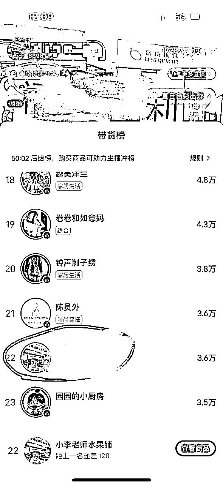
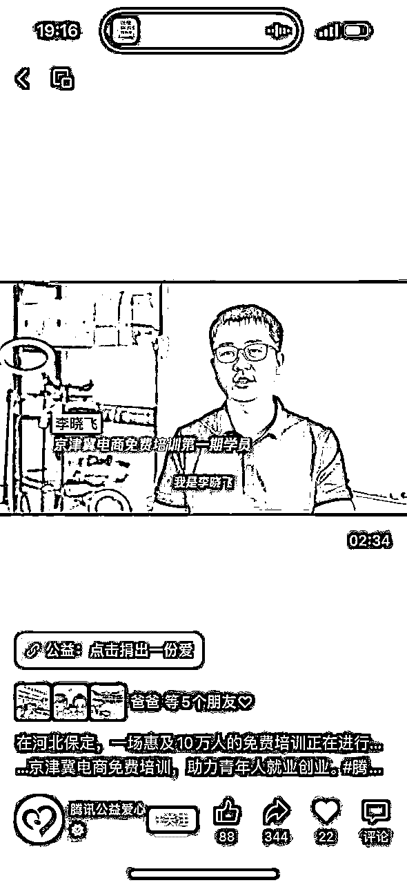
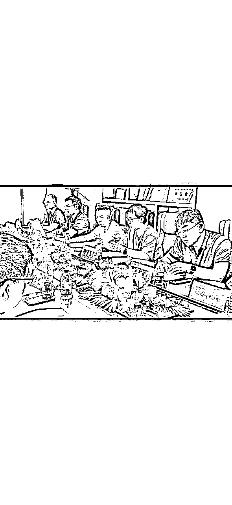
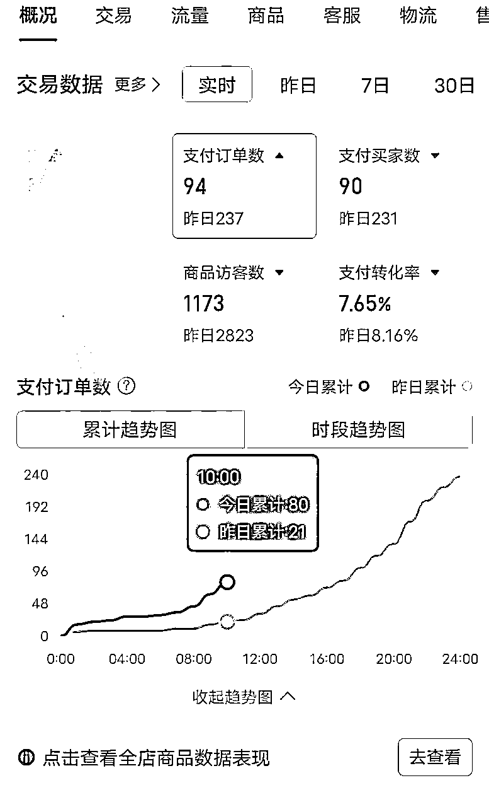
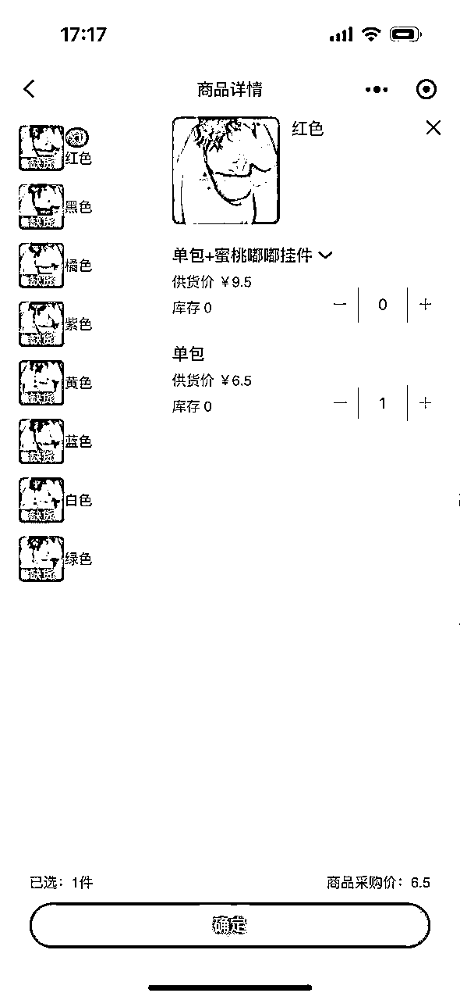
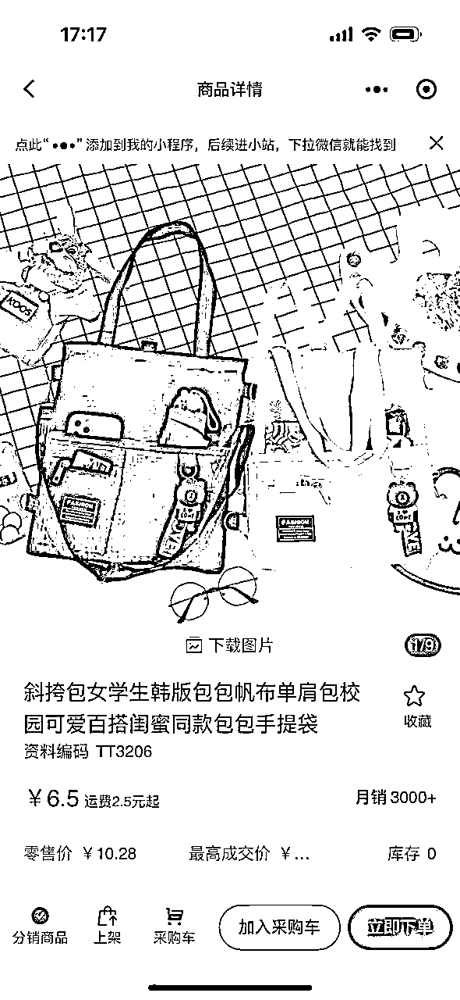
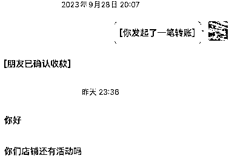
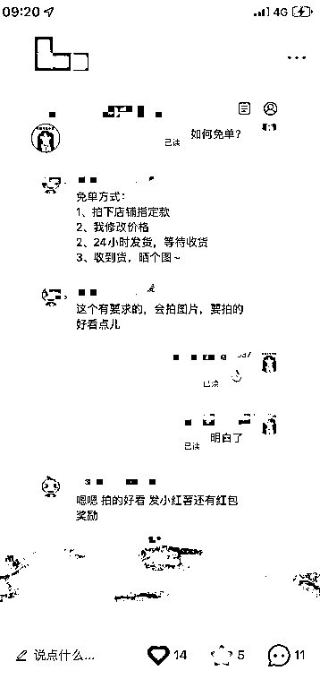
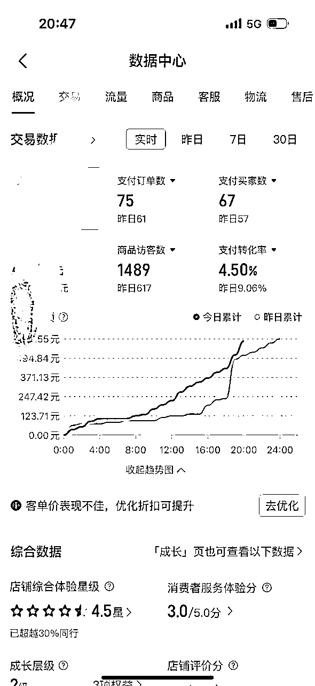

我是小李哥，这段时间攒了不少体会，趁今天有空，跟大伙儿好好扯扯。这半年里让我触动最深的一件事，就是去朋友那儿取经，他那边的单量峰值一天能冲到将近两万单。在河北走了一圈才真正感受到，箱包在PDD上卷得有多离谱，七块钱一个包还包邮，简直没法看。

## 先聊水果那摊事

### 1、小红书直播干到带货榜第22名

作为一个新人，能做到这个位置，我自己也意外。复盘下来，功劳最大的其实是选品——挑的东西正好踩中小红书用户的审美和需求，品本身又自带吸引力。直播间的场景是我照着别的主播扒的，话术就是天天蹲直播学来的。另外，有场控帮忙热场子，氛围确实不一样，转化也会好很多。

### 2、跟市长同桌开会、给培训班讲课、被媒体采访

能拿到这些机会，是因为批发市场跟政fu联合搞培训活动，我算是被挑中的那一批。平心而论，不是自己有多强，是线下那帮同行确实太弱，我才显得稍微亮眼一点。后来我就琢磨明白一个事：政fu这边的资源、背书、低息贷款政策，只要你敢开口去对接，其实并不难拿。

### 3、自己也开过训练营，但结果很打脸

学费是赚到了，但能不能教别人，我心里有数。自己真正靠项目赚到钱，才有资格去带人，现在我能力、精力都还没到那个份上。

## 进入正题：箱包电商

先声明：这部分很多思路是我朋友启发的，就是那个一天两万单的男人。

### 底层认知：单量是面子，利润才是里子

河北这边做电商，圈子里有个说法——不是为了赚钱，就是为了一天发几千单快递，说出去有面子。这话听起来好笑，但真实。价格战打到什么程度？眼睛都睁不开的那种。但话说回来，价格战里也有值得偷师的东西，比如控成本。电商做到最后拼的就是供应链，供应链的核心，就是在质量不崩的前提下，把成本压到极致。

### 1、我把快速降成本的路子，从头到尾捋了一遍

#### 1）先冲单量

单量一起来，商品进货价、快递费、人工打包费、场地费，全都会往下走。想快速起量，最简单粗暴的就是低价，尤其PDD这个平台，价格低就有单，而且不像直播带货那样一阵一阵的，它是稳稳当当持续出。我现在快递能压到1.5左右，找合作的再掏1块人工包装费，成本就是这么一毛一毛抠出来的。

#### 2）用价格战的视角去选品

看到一个品，先别上头，问自己两个问题：假设这品起量了，我能不能干得过对手？就算干过了，有意义吗？

给你算笔账：你一天只有10单，快递费6块，商品成本8块，人工3块，综合成本17块。结果你一看对手，售价才14块。凉了，没法玩。

那如果你一天能跑1000单呢？快递费降到1.5，商品成本7块，人工1块，综合成本变成9.5。这时候再回来跟竞品比价，如果还有利润空间，就可以干；如果没有，果断放弃。

另外还得盯一下对手的销量，确认市场足够大。如果对手一天也就出个50单，这盘子太小，算了。

当然，如果你手里有资本，把1000单换成1万单，公式照样成立。等订单量到了目标线，就可以回头跟各方重新谈价格，把成本继续压低。链接权重起来之后，再慢慢提利润，自然就赚到钱了。

#### 3）低价到底怎么实现的？

**3.1 把商品成本打下来**

直接去产业链最源头找厂家。厂家拿原料便宜，你拿货价自然就低。拿包包举例，价格从高到低是：广州、河北白沟、河北高碑店市新城镇。一个新款包出来，大概的路径是：广州卖50，白沟过几天干到40，新城再过两天直接30。最好找那种小作坊，全家老小齐上阵的那种，他们对利润要求不高，而且你量一旦大了，话语权就在你这边，压价、压货款都有的谈。

**3.2 物流和人工成本**

这个没什么花活，量大了自然就降。

**3.3 亏钱本身就是一种策略**

前期亏钱，是为了用最快的速度冲到目标单量，把基本盘搭起来。举个具体的数字：你一天300单，一单亏4块，一天亏1200。但等你干到一天1000单，各环节成本全下来了，很可能就不亏了。

后期新起链接也可以亏一阵，但关键是盯住涨价之后的出单情况，算一算多久回本。其实真亏不了多少，一单亏1块，一天100单也才100块。但在PDD上，1块钱的差价对用户来说就是很明显。

我自己有个化妆包，报活动每单亏5毛，一天跑100多单，等链接稳了我就涨价、开投产比，利润能做到30%左右。现在每天稳定十来单，基本不用管。

再说一个思路：多链接、多商品、多店铺同时铺开，大力出奇迹。只押一个链接，大概率没戏。

**3.4 把补单成本打下来（甚至可以做到5块钱2-3单）**

渠道不挑，淘宝、PDD、视频号、小红书都能用。核心玩法：用免单小礼品让用户做任务，基本都是真人操作。

具体操作是这样：

1. 在小红书发一篇帖子，内容做成淘宝用户和商家对话的截图，聊的是怎么做免单。比如“拍好看的商品图+晒图就免单”之类的要求。注意，店铺名一定要露出来，最好是小号店铺。
2. 有人来问，就发一个文档过去，里面放小礼品图片和需要完成的任务。
3. 配合淘宝的惊喜码或者关键词搜索，也可以直接丢链接。还可以要求对方多做几单，微信一定要加上——后续怎么变现我还没想好，但人有的是，思路可以慢慢碰。有兴趣的圈友也可以来找我合计合计。
4. 返款节奏：下单先返一半，晒单再返剩下那一半。客单价整体控制在10块以内。
5. 这种玩法适合的人群：不限人群，或者以年轻学生为主；尤其适合需要补店铺评分的店。

至于选什么礼品有吸引力，这个可以单独找我聊，货源什么的都现成。我节前测了两天，人太多根本忙不过来，小红书帖子半天就藏了。

以上，就是降成本的全部思路。

### 2、心态建设到位，才能真正玩转PDD

你必须建立一种“我是上帝”的底气：让链接起量就起量，让它下去就下去，别被系统牵着鼻子走。

我的操作习惯：每个商品上三个不同链接，两个店铺来回操作。今天数据不好，想提数据？扔几张优惠券出去，只要转化率比昨天好，第二天流量肯定比今天多。流量涨不动的时候，我想赚钱，就把优惠券金额减小，利润马上回来，单少一点无所谓，赚钱就行。链接一旦有了权重，基本不用管。按一周维度看，转化率要是低了，再扔几张券拉一把。

一句话总结：你是老板，平台是给你打工的。你可以做一些动作去迎合它，但迎合的目的是让它更好地服务你，而不是反过来。

### 3、时机比努力更重要

比如周末数据通常好，那你周五就得提前扔券预热。再比如寒暑假开学，双肩包卖爆；夏天是包包旺季，因为女孩衣服没口袋，小包特别好卖；每次换季也是一波流量。

### 4、会用工具，省心十倍

做水果那会儿，选品、流量、进货、打包、发货、运营、售后，全是我一个人扛，精力全被撕碎了。现在做包包，我只管销售就行。这里必须夸一下【聚水潭】，真的把我从无货源里救出来了，不需要二次拍单，基本24小时内就能发出去。简单说说功能：一键铺货到多个店铺、订单后台自动同步、售后自动处理、随时看订单利润。App、网页、小程序全都能操作，而且免费。唯一的缺点：上面的商家还不够多。

### 5、小红书上卖包卖不好，多数问题出在自己身上

常见的毛病：给自己设限、舍不得付费、不去学新玩法、被过去的经验框住、看不起别人觉得Low的玩法、心急、一遇困难就撤。

反过来，该怎么做？突破自己的局限、敢为认知付费、紧跟最新玩法、把自己当小白空杯心态、认真琢磨别人的操作、保持耐心、多试几次，哪怕反馈不好也要再扛一扛。

### 实操记录

#### 1、PDD上架完整流程

一个店上3个同款链接。定价上做文章：高客单价、SKU文字、图片都要打磨。SKU布局要有三档：利润款、平价款、引流款。卡高投产——不是高投产就不能开。限时限量促销走一波。然后选一个或者多个动作：扔限定数量优惠券、开搜索快速定位人群、报名各种活动也行。接着盯数据看访客情况，效果不好直接放弃；数据好但没转化，就补几条评价；数据跟订单持平之后，刷大额坑产试试能不能再往上顶；如果订单数怎么都上不去了，就适当涨价拿利润。

#### 2、选品永远是第一位的

顺序是：测款大于选款，选款大于培养款。测出来不行，怎么培养都没用。这就像学校只给好学生更多资源，不会费力去拔一个差生。

#### 3、最重要的数据指标：转化率

想尽办法通过定价、补单把转化率抬起来。不是靠评价数量把品打爆，而是靠转化率拉动流量。

4、不要老是想着“必须做成什么样”。只要数据在变好、趋势往上走，顺着势头努力就行。

5、注意：发立减券会计入历史最低价，关注券不会计入。

6、SKU怎么设？引流款可以低于成本，买的人其实不多，主要吸引人点击。畅销款是大多数人会买的那档，薄利多销。利润款则突出质量、尺寸、性价比。

7、PDD一个电脑能登N个账号，不像淘宝各种限制；一个手机也能来回切几十个号。

8、PDD的问题确实一堆，比如“仅退款”这种，玩得人心态崩。但换个角度看，把它当成成本的一部分。只要利润空间还能兜得住，就继续干。

PDD的坑很多，入坑需谨慎！

## 最后说点别的

1、创业找合伙人，一旦发现人不合适，第一时间止损。不要怕重新找人。第一次发现有问题就结束，一定是成本最低的。比如对方刻意隐瞒某些事，或者同一件事反复沟通反复出问题——这种就别拖了。

2、要想办法把事情放大，方法越简单越好，最好能“傻瓜式”复制。

3、前期多尝试各种项目很正常，别把自己锁死在“什么都干不好”的思维里。你只是在找方向，找到了，就往死里干。

4、供应链的打法是：先在PDD上把订单冲上去，把各环节成本压下来，然后回到淘宝或者其他平台上赚钱。

下一步我打算试试短视频带货，等有结果了再来跟大家汇报。