# 一个体制内二宝妈的副业开荒笔记
作者：龙哥

一、第一次尝到网赚的滋味

大家好，我是龙哥，二胎妈妈一枚。今年三月加入赚钱，一来就沉浸在各种帖子里，跟一群圈友短暂交集过，虽说没人真认识我，但大家的魄力和赚钱思路真的让人上头。特别感谢靠谱、芷蓝，离我近了一些，也让我感受到他们的那种“超能力”。今天就把我的副业摸索历程掏出来聊聊。

我从2021年11月开始碰网赚。每个入行的人都有个起点，我的缘起是贵州嫁到广西，在小县城体制内上班。为了解决夫妻两地分居，也想回娘家更方便，于是瞄准市级单位的遴选。遴选资料在闲鱼上买，800多块一套虚拟资料也不便宜。买完我忽然想，反正也是虚拟的，能不能我自己也在闲鱼上挂一份？说做就做，翻出自己的商家号，照着卖家的样子去摆。很快就有咨询，没多久第一单就来了。至今记得第一笔净赚210块，当时特别兴奋，原来这样也能赚钱。那次尝到甜头后，我就一头扎进网赚，对遴选考试却越来越没心思。很感谢那个卖家，在我心里他是带我入门互联网的第一人，现在也成了很好的朋友。虚拟资料售卖我一直坚持到今年7月，差不多两年时间累计卖了30W+。跟圈里大佬比不算多，但比起主业收入，这已是一笔可观的“第一桶金”。

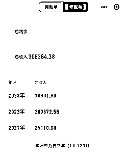

二、撞见新赛道

8月中旬刷抖音时，偶然看到一个用直播科普社保知识的间，瞬间联想到自己本职就是做社保的，干了十年，这不就是主业和副业结合的绝佳机会吗？接着我在知识星球搜“养老”，看到龙哥大大8月18日转发LimBo的加精风向标帖，重点聊了养老金赛道的想法，众多圈友也跟帖分享，结合我多年在一线的社保经验，这条路在我心里更坚定了。随后我找了几个标杆博主，蹲了几天社保直播间，把从引流到成交的全链路大概理清了。

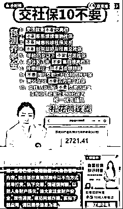

引流打法大致是：

1、开播讲社保干货，解答疑问，现场测算养老金，把人拉进来
1.  产出社保相关的短视频和图文内容

变现路径：

1、直播间售卖社保规划课程
2、连麦打赏收音浪
3、导流到私域做异地参保代办，这才是社保直播的变现核心

社保几乎人人相关：在职员工公司一般缴五险一金，养老医疗失业工伤生育加公积金，企业和个人按比例分摊，企业多个人少；没单位的可以以灵活就业身份交养老医疗；个体户法人则要自掏腰包交五险；还有一种挂靠缴存，国家不认，属于违法，一旦被查年限清零。[图为五险一金详解]

大多数人知道社保，却不明白门道，踩坑常有。比如：以前单位缴过，后来失业自己以灵活就业续缴，之前的年限会不会断？领了失业金，以后退休金会不会受影响？灵活就业交得越高越好吗？等等。很多常识性误区导致福利没吃满。所以直播间才有了社保规划书的角色，和商业保险类似，核心是投入产出比，用更少的成本撬动更高的待遇。主要客群是灵活就业人群，他们想提额，却不懂养老金构成。

养老金=基础养老金+个人账户养老金
基础养老金=社平工资×(1+平均缴费指数)÷2×缴费年限×1%
个人账户养老金=个人账户累计储存额÷计发月数

举例：缴费指数60%，按最低基数缴15年，当地社平9500元，60岁退休，个人账户累积约85964元，则：
基础养老金：9500×1.6÷2×15×1%=1140元
个人账户养老金：85964÷139≈618.45元
合计约1758.45元/月

由此可见，决定养老金高低的正是基础养老金，影响排序为：社平>缴费年限>缴费档次>退休年龄。社平高、缴得早、年限够，退休金才好看。

社保遵循“多缴多得、长缴多得”，但档次越高回报率越低，回本周期越长，高档位更适合企业替员工扛大头的在职人群，个人盲目冲高并不划算。

社平：

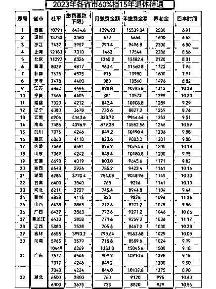

社平高低直接决定待遇水平。图中最高社平深圳13730，最低河南5965，相差近一倍，折算到退休金每月可差500+，一年差6000+，复利滚几年就是几万、十几万、几十万的差距。

各省社平不同，且多数省份已放开外地户籍以灵活就业方式参保：

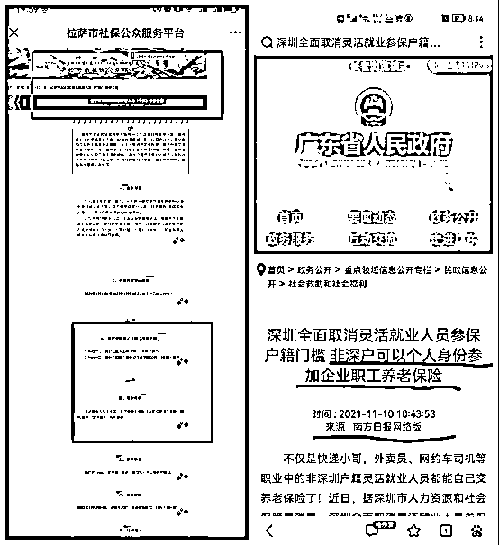

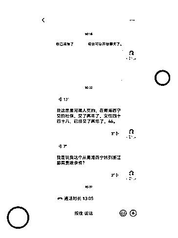

异地参保是提升退休金最直接的手段。核心操作是变更参保地，选择社平高的城市，目前主流选择有这几个，性价比各有优势：

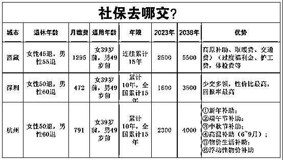

去异地参保除了锁定高额养老金，还能实现提前退休，主攻灵活就业女性。除了西藏女45岁可退，其余地区普遍50岁可退，但各地门槛不同：如辽宁要求首次参保在企业；黑龙江要求企业连续累计5年以上且不间断；吉林要求企业累计3年。门槛苛刻的地方，可考虑西藏、深圳、四川、内蒙等条件相对宽松的地区。

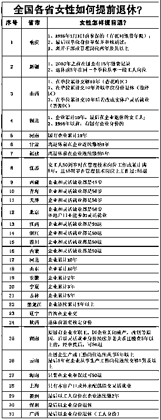

比如张大姐38岁、李大哥48岁，河北户口，跟随儿子在深圳落户居住，办好居住登记后在当地社保中心建了一般账户，在深圳缴纳社保。要求是深圳累计缴满10年、全国累计15年，最后参保地为深圳，即可在深圳退休，退休后回河北居住，仍享受深圳待遇，远比河北划算。

自己跑异地办手续成本高、流程熟练度要求高，大多数人选择代办更省心。付费连麦答疑是第一步变现；卖社保规划书是第二步，课程只是引子，规划书售价99、59、49、39不等，服务内核相似。注意抖音开课需粉丝≥1000。终极变现是异地代办参保，收费3000-8000+不等，按城市定价，深圳相对便宜，西藏最贵。整个抖音社保知识的闭环就是这样。

引流分三步走：

8月18日发了第一条社保朋友圈，8月24日做了人生第一次直播

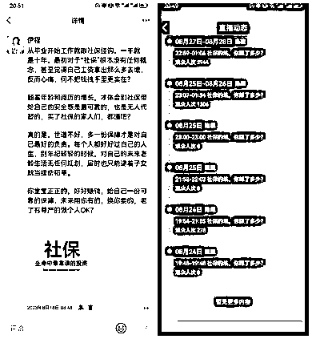

1.  私域：

我本身是社保从业者，走个人IP路线，从身边熟人破冰。连父母都觉得异地参保是骗局，更别说外人了，前期推广很难，因为认知基础几乎为零。但朋友圈必须每日经营，这是我的个人产品陈列馆，也是客户最直观的触点。怎么发、怎么戳痛点、怎么体现卖点，我都是边学边模仿。朋友圈从无人问津到亲友纷纷来咨询，9月5日拿下第一单，信心瞬间被点燃，也坚信赛道选对了。

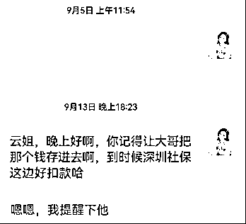

1.  公域：抖音、📕以短视频、图文、直播为主
锁定对标账号，模仿直播分享。用两台手机，一台看直播、一台用WPS转语音稿，整理后再优化。

直播准备：
（一）开播前置
1.  社保话术提纲，一小时大纲
1.  不露脸：手机+支架，苹果机更稳定
1.  露脸：电脑+麦克风+1080P以上摄像头+音响+背景+计算器+实名认证抖音号

*   数据指标
1.  点赞、停留时长、互动、涨粉、灯牌，新手期重点关注
1.  首周数据建议不找亲友刷，主页流量会干扰官方自然推
1.  固定时段开播，新号需每天稳定
1.  每天至少一场，一场≥1小时，抖音不推自热流可结束

*   内容打法
1、围绕用户最关心的社保话题列大纲，用颜色标注重点，像大字报一样对着屏幕讲。
2、直播间测养老金，可用支付宝小程序“2023养老金测算”吸人。

开播最难的是张嘴，怕讲错、怕尴尬、怕节奏乱，都很正常。把自己当成跟朋友科普，状态放平，一场不行明天再来。直播间空也有时要坚持播完，抖音会给账号打标签，需要周期沉淀。话术要不断打磨，多看留存高的同行，从开场到收尾都要熟练，这是投入最多精力的部分。

短视频和图文每日更新，在平台上刷高赞高收藏的社保内容去模仿。目前还没出爆款，选题、文案都在迭代优化中。

3、盘活存量流量。通过老客户转介绍，每日主动触达若干潜在客户，承诺转介绍成功赠送一年付费课程。

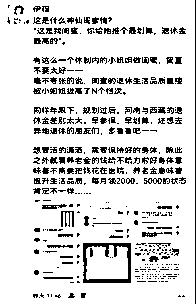

目前用这三种方式引流，运营40天已成交3单，收入9000元。

除个人参保，我还做企业参保。社保对企业是较大人力成本，帮助企业异地参保可降低成本，主做深圳和厦门，费用如下：

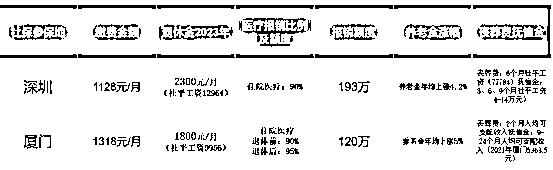

我从毕业就进入体制，与社保结缘十余年，参保到退休全流程都轮转过，政策解读、知识拆解对我来说是优势。把知识点讲明白就能转化。目前异地参保认知还没普及，相信未来会迎来爆发，当然政策收紧风险也存在，早布局社平高的城市更稳妥。

三、角色切换

朋友、同事、客户常问：怎么兼顾主业还能把副业做起来？我的答案是：在体制内做60分选手，在体制外做卷王。当然还没完全卷起来，但方向明确。在体制内，我的生存法则是只求60分，业务能力在线，但不把时间价值过度透支，多一分都觉得亏。

几个月前职级晋升，喜悦感远不如卖出一单副业产品来得满足。主业的意外收获只是锦上添花，副业带来的却是价值感、人脉、资源和认知的整合。时间花在哪，回报就在哪体现。体制内十年，让我自动断舍离那些无用的职场情怀，对不友好的人刚硬，对无效的人事物说不。一定要给自己找点事做，不然真的会废掉。

最后特别感谢我的贵人靠谱，我想成为的目标人物，在迷茫时帮我梳理现状并给予鼓励。也感谢赚钱，它像一个工具库和知识库，极大节省了试错成本，让项目更快见效。能和大家在同一个圈子里很幸运，希望自己的认知和能力能跟上大家的脚步。平时也爱交朋友，若你对社保感兴趣，欢迎来聊！