# 用影刀RPA把👸号内容做到多平台分发的全流程拆解

## 一、先搞懂影刀 RPA 是什么

做👸号爆文矩阵，最大的瓶颈不是想法不够，而是人手不够。靠人工去复制、去搬运、去发布，效率太低了。这时候一套可视化的自动化工具就能把重复劳动接管。

影刀能帮你完成选品筛选，也能完成自动引流、定时发布等任务。市面上绝大多数单调重复的操作，基本都可以用它实现。

听起来像是程序员的专属技能？其实完全不需要。影刀把所有代码逻辑都封装成了中文菜单，零基础也能上手。

关于安装和入门，这里不做展开。直接去官网下载，学院里有系统课程可以跟着学。
影刀官网地址：https://www.yingdao.com/
学院地址：https://college.yingdao.com/

新手建议先把学院的基础课过一遍。虽然不需要写代码，但了解底层运行逻辑很重要。只有明白机器人是怎么一步步执行的，才能真正把降本增效做到位。

跟着学下去，你很快也能像我一样，让工作和生活的效率被成倍放大！

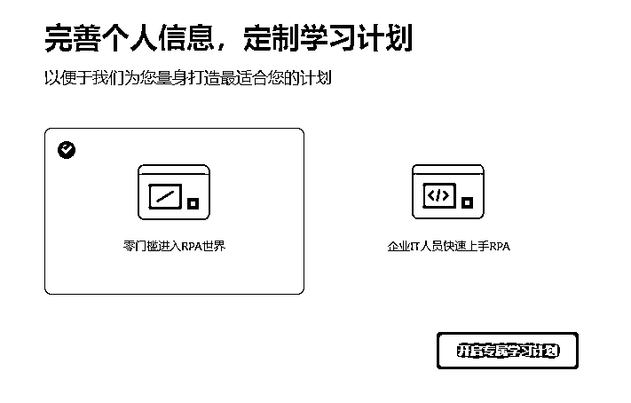

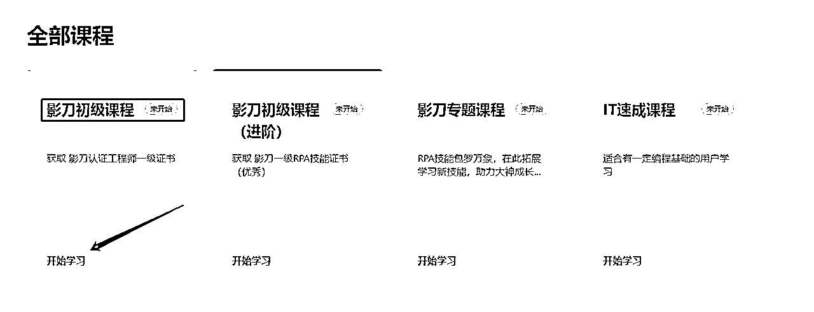

掌握基础后就能独立搭建自己的机器人。若想应对更复杂的场景，进阶课就很有必要了，可以做出更贴合实际业务的自动化流程。

进阶学习建议影刀学院配合 B站上搜索“影刀RPA”教程一起看，效果会更明显。

## 二、影刀 RPA 在👸号爆文项目里的实战用法

RPA 的核心思路是先由人演示一遍，工具记录下每一步操作，再把这段“操作录像”变成可重复执行的流程。先手动走通，再交给机器人跑。

### 应用一：批量抓取对标👸号文章

做爆文需要素材。找到同类型的文章批量下载下来，喂给GPT学习风格，再生成新稿，这就是常见的打法。

手动做要登录后台→点图文→点链接→选👸号→逐篇打开。量一大就非常耗时。

用影刀怎么实现？
先手动走到选择👸号文章的页面。第一轮让机器人记住流程：填入👸号名称，复制第一篇标题，点击查看并记录链接，一起存进表格。

记录完步骤后直接运行，机器人会自动逐篇点击，依次抓取标题和链接写入表格。

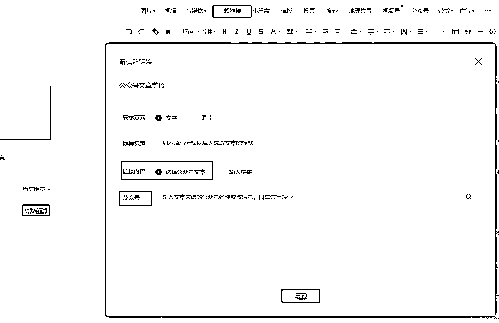

拿到表格数据后，再配合一键导出👸号全量文章的工具，就能完整收工了。整个过程影刀几分钟就能完成，远比人工扒拉省心。

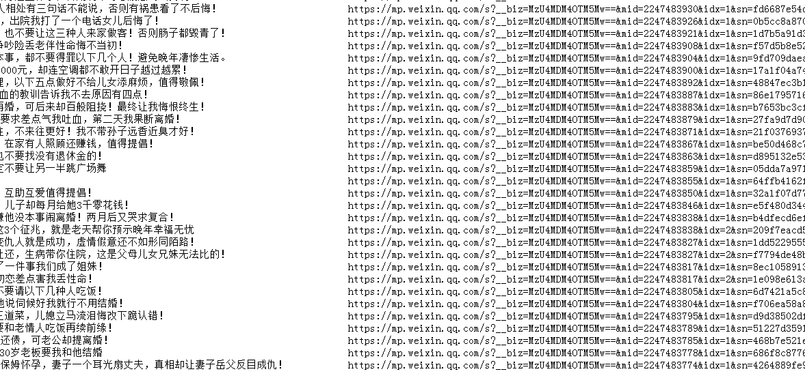

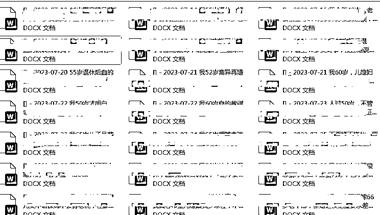

源代码如下

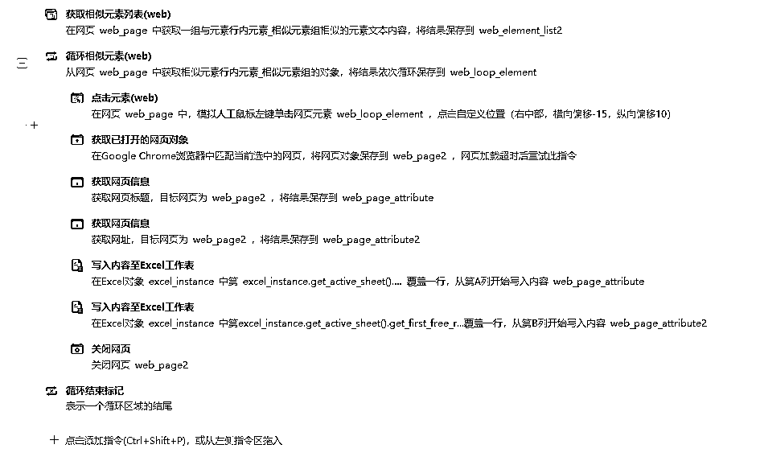

### 应用二：把生成好的文章自动存进👸号草稿箱

前文提到用 RPA+ChatGPT 批量生成爆款文，文案层面不再赘述。

重点是生成后怎么高效入库。因为目前👸号只能定时发布当天和次日的群发，所以先存草稿是刚需。

#### 第一步：Word 完成排版
把 AI 输出的文章粘到 Word 里，按自家👸号的视觉风格排版。标题颜色、正文颜色、字号大小等都可以先在 Word 里统一。

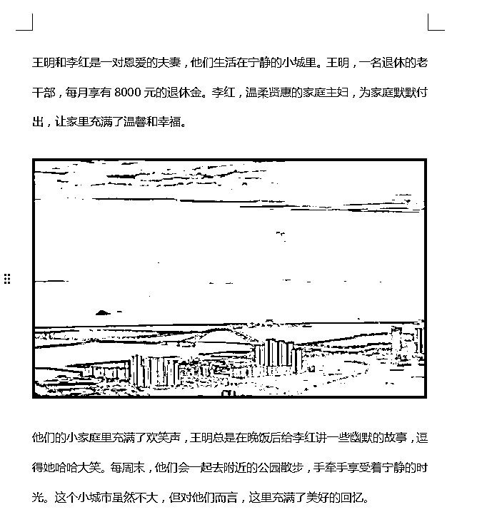

#### 第二步：整理素材表
把排版好的文档路径和封面图路径整理到一张表格里。

小问题留给大家：怎么快速拿到文档的文件地址？最先答对的三位送礼物！
提示：按住 Shift+鼠标右键即可。答对的老板可免费领取自动完成 8 篇文章入库的流程。

#### 第三步：准备原创信息
把👸号原创作者名称填入表格对应列。

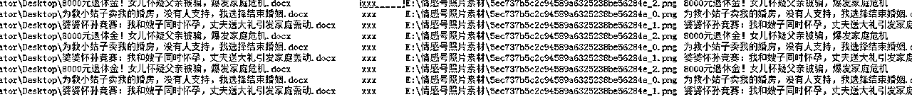

#### 第四步：机器人执行
打开👸号后台→图文消息→运行影刀应用，完成后自动保存为草稿。

源代码分享

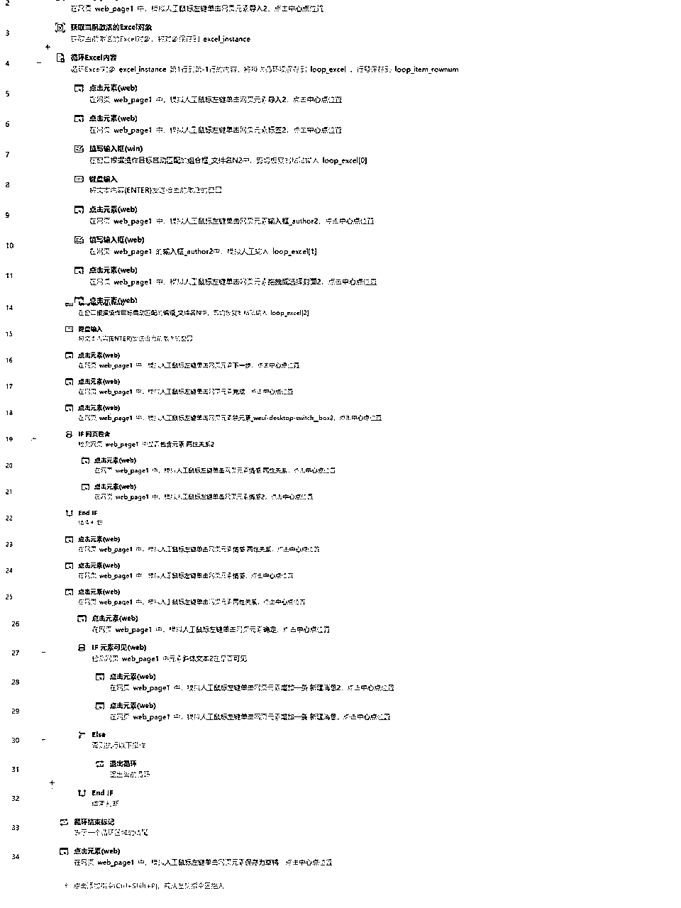

### 应用三：借助影刀实现一鱼多吃的多平台分发

文章在👸号发好了，别浪费。同步推到其他平台，收益自然叠加。

现在比较主流的分发渠道有百家号、今日头条、大鱼号、企鹅号。

操作逻辑和前面一致：先把标题、正文、配图、封面等材料整理成 Excel，机器人读取表格内容，自动填充到各个平台的发布页面。

以下是自动分发的源代码：

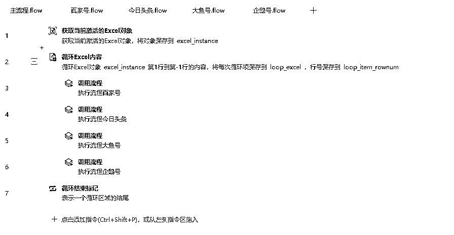

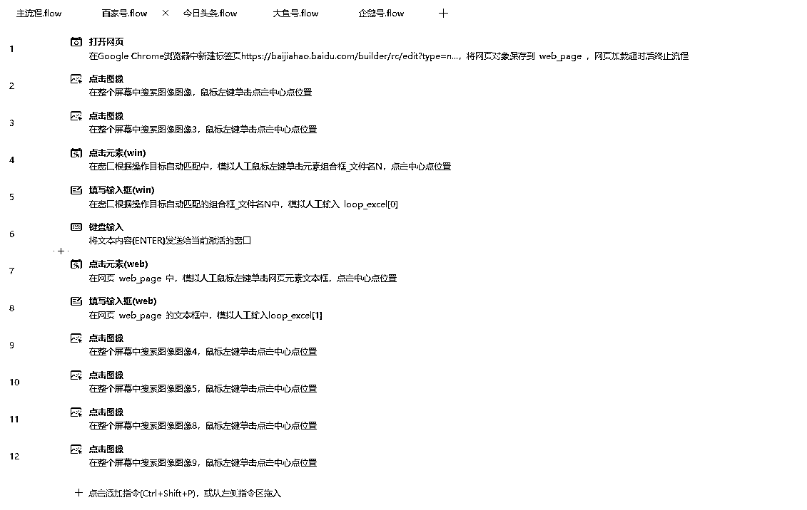

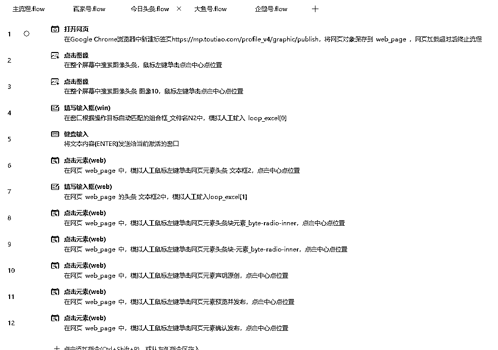

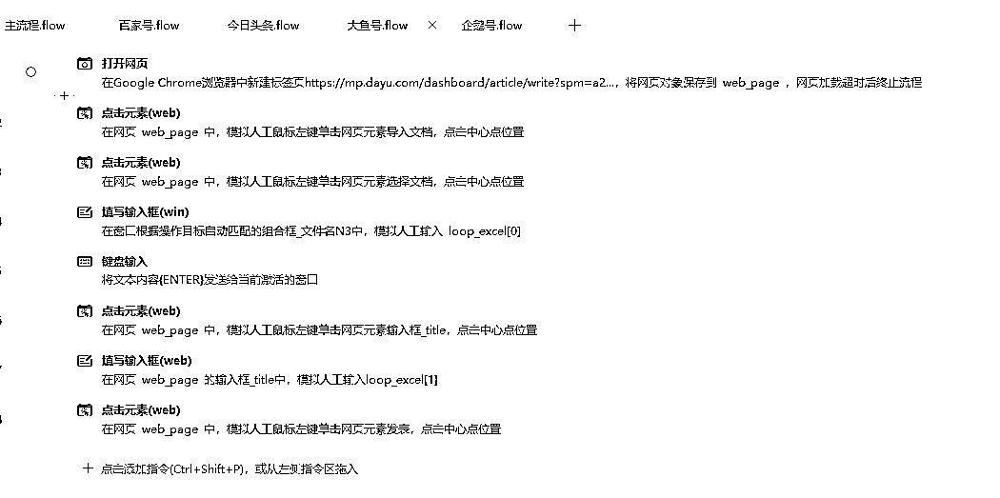

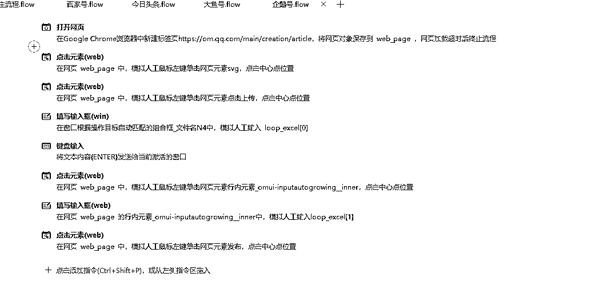

### 应用四：结合 GPT 自动洗稿

### 其他可拓展场景

影刀的适用面远不止内容领域，还可以用来做：
* 视频号视频定时自动发布
* 抖音视频/图文定时自动发布
* 📕视频/图文定时自动发布
* 快手视频/图文定时自动发布
* B站、百家号、西瓜、今日头条的自动发布
* 抖音、📕、快手下拉词获取
* 文件批量重命名，图片批量去重
* 私域运营：批量加好友、批量加标签、聊天记录导出、团队订单汇总等

只要是重复性的劳动，大概率都能用 RPA 解决。如果你不确定某个场景能不能自动化，欢迎随时交流，我知无不言。

## 三、结语

有人问我，花时间学影刀 RPA 真的值得吗？我的看法很明确：如果你不懂代码，又想系统性提升效率，强烈建议学。

学了会后悔怎么没早点知道这个效率利器，不学也会一直懊恼效率上不去。

能在这里和大家分享，我也很感恩。我自己也是从 6 月才开始接触影刀，过程中帮别人做定制机器人不断升级，才意识到过去错过了多少。

感谢赚钱让我认识影刀，感谢自己的持续钻研，也感谢小霸王给我这次输出的机会。

我是马小威，一名专注于影刀 RPA 降本增效的 95 后奶爸，祝大家都能龙哥盟！

想进一步提升效率的朋友，欢迎一起交流~V:mxw4260