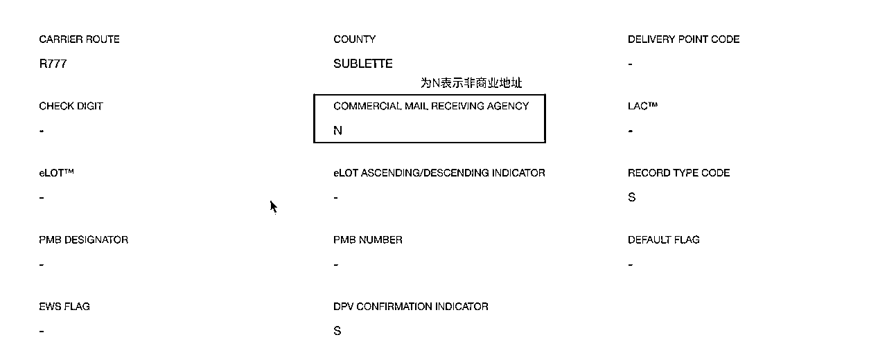
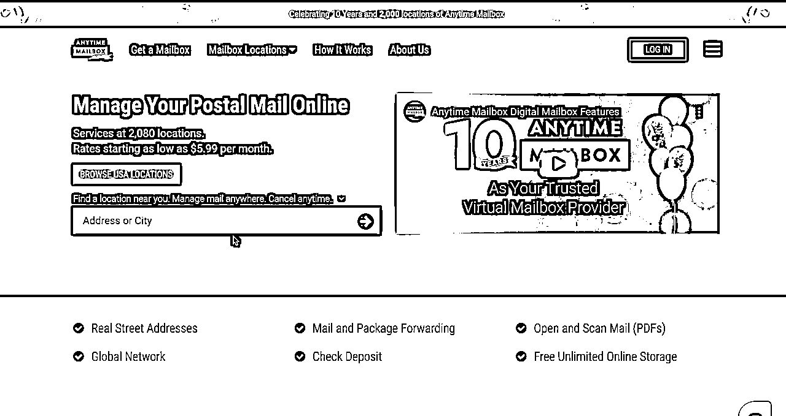
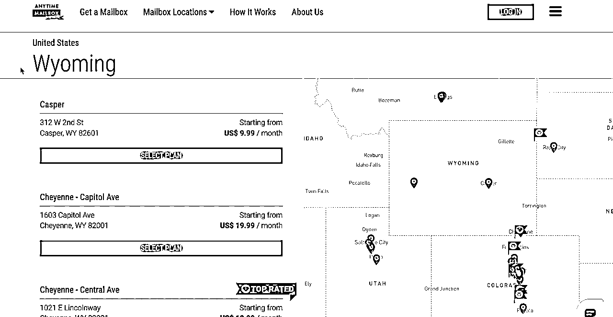
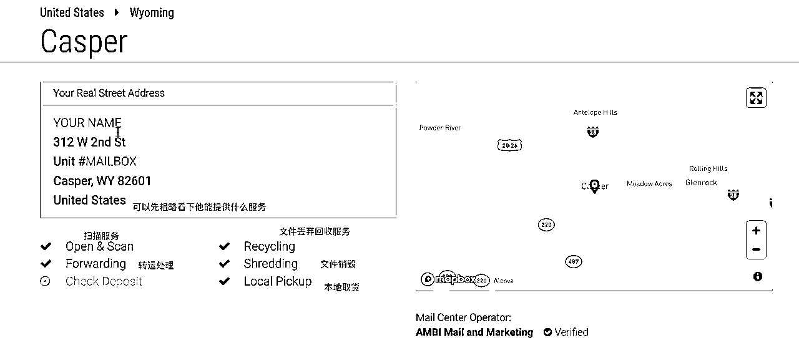
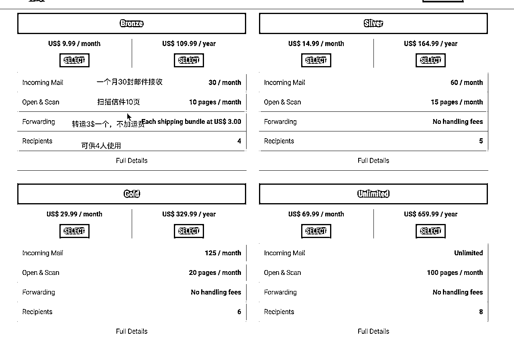
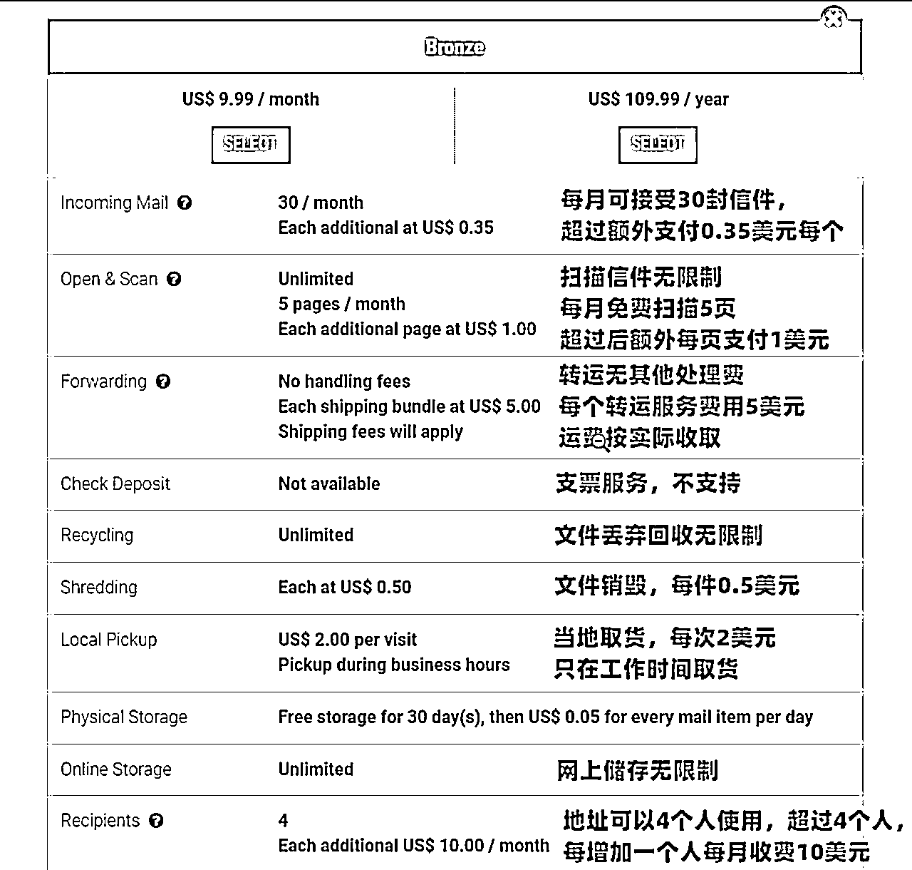
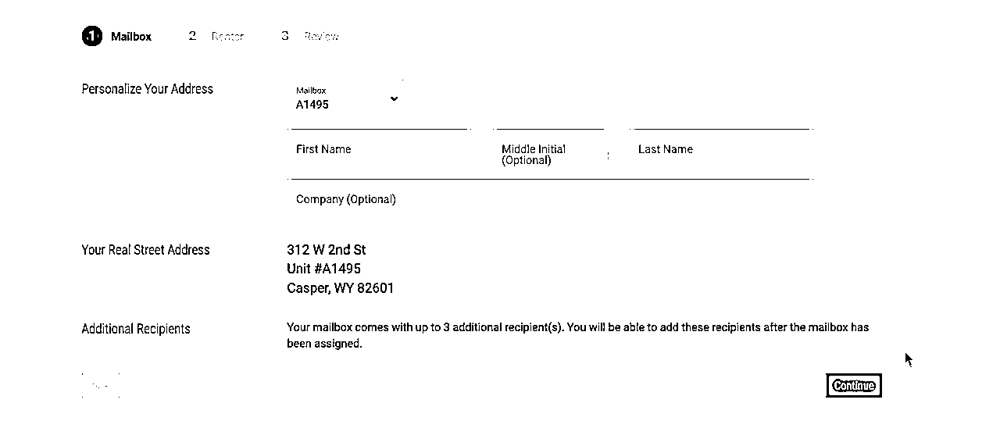
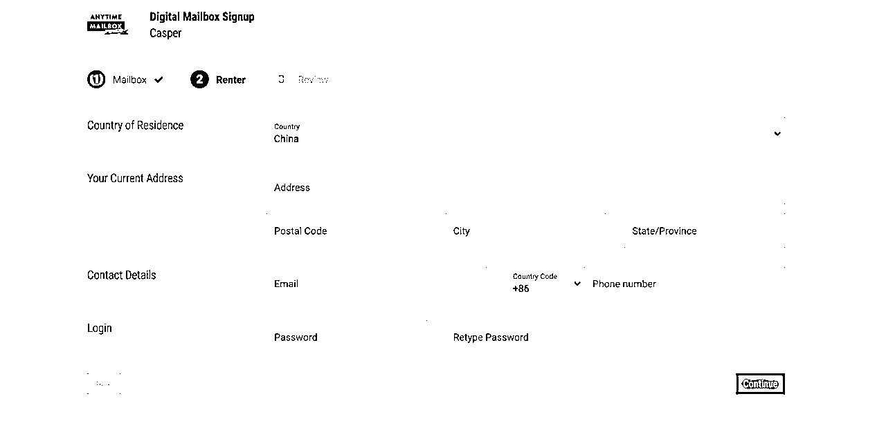
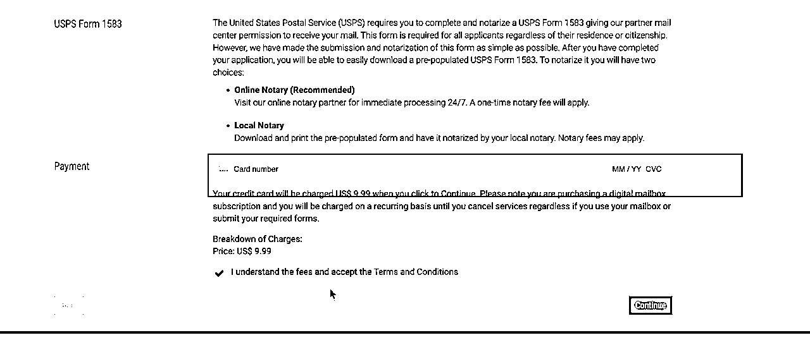

# 美国私人地址
作者：龙哥

想办美国信用卡、开美国银行账户、收美元支票，或是接收从美国寄来的官方信件？第一步就是把美国地址搞定。可人在国内，地址不会凭空出现——这就是为什么越来越多人选择租一个美国私人地址。

这类服务解决的就是这个痛点：租一个真实存在的美国地址，代收信函和支票，App上随时能查看信件扫描件。

要说最老牌的虚拟邮箱服务商，Anytime Mailbox 绝对占一席。它从2013年运营至今，背后是美国Bugo LLC公司，在菲律宾、新加坡都设有办公点。业务覆盖全球几十个国家的一千五百多个地址，用户量在同类里排得上第一梯队。

为什么它地址这么多？加盟模式是关键，和国内菜鸟驿站一个路子。

这种模式优点和缺点都很明显。好处是地址数量大，甚至能选到住宅地址，注册银行账户、申请信用卡都方便；风险则是服务商水平参差不齐，碰运气成分大。

**地址怎么挑？分情况看**

注册公司：认准注册州内的非商业地址。非商业地址是后续申请银行卡的前提，确认方式很简单，USPS官网查询工具一查便知。

需要收纸质支票：比如广告联盟、northwest推荐奖励这类还靠支票付款的，就选支持Check Deposit服务的地址。

海淘购物：优先选西海岸地址。物流速度优势明显，包裹直接走洛杉矶国际中转中心；东海岸则要先转西海岸再飞中国。海淘党还可以关注俄勒冈州，全美五个免税州之一，另外四个是阿拉斯加、特拉华、蒙大拿、新罕布什尔。

**租用流程**

锁定目标州，下单买地址就行。

注意：地址租好了并不代表马上能合法使用，还必须完成USPS Form 1583表格并公证。

登录Anytime Mailbox，系统会提示你完成地址认证。这里有个大坑千万避开：不要点“Notarize Online Now”。在线认证只对有SSN的美国用户开放，我们没有SSN根本走不通。一旦误点，费用秒扣，退款还得找客服，费时费力。

Anytime Mailbox会提供1583表格，填好后导出保存，再进入公证环节。

公证怎么做？两条路可选：

一是自己找在线公证平台，费用75美元，全程英语交流，性价比不高。

二是上Fiverr找中文卖家代办，30美元搞定，专人负责预约和翻译，2-3天就能完成，明显更省心。

公证完成后，回到Anytime Mailbox上传认证表格，等网站审核处理完，邮箱就正式启用了。

恭喜，到这里你就拥有一个属于自己的美国地址了。