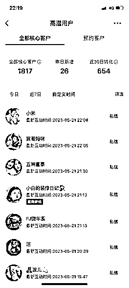
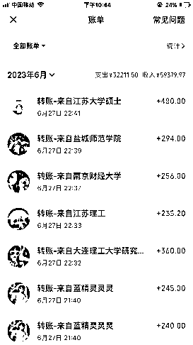
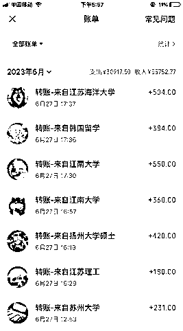
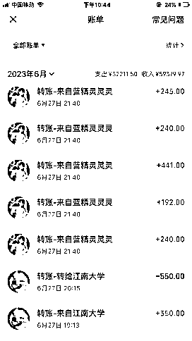

# 从零投入到四个月营收30万：我做家教撮合的实战记录

大家好，我叫鸣风，姓马。主业是经营一家以设计和软件开发为核心的信息科技公司，业余时间也尝试着做过几个项目。今天想聊聊家教中介这门生意。

从5月开始，我靠家教撮合项目获得了超过30万元收入。相关收款记录我会用🛰️截图视频展示，支付宝的金额相对少一些，就不另外放了。

这件事的启动成本很低：除了两部业务手机，以及我自己的业余时间，基本没有额外投入。

## 一、先弄清楚怎么收费

家教中介常见的收费方式有两类，各有利弊。

**第一种：家长和老师两端都收费。**  
这样可以同时获得两部分收入，也更容易降低家长临时变卦的概率。不过，有些家长沟通起来比较费心，服务过程中可能会提出不少要求。

**第二种：不向家长收费，只收学生端的信息费。**  
这种模式能减少与家长之间的纠缠，毕竟家长没有付费，沟通时不必过度迁就。但也可能遇到不太靠谱的家长：你花时间匹配好老师，对方却临时爽约，确实容易让人窝火。

## 二、家长从哪里来：线上与线下并行

### 线上渠道

目前主要是抖音和视频号。

抖音是我这边最重要的流量入口。找到有效的内容形式后，一个月最多能带来上千条咨询线索。不过，平台对家教类内容的管理也在变化，不能只依赖一种打法，需要持续测试、及时调整，寻找更适合当下规则的内容方式。

下面的截图可以看到，曾经一个月就积累了上千条客户信息，多到当时都来不及逐一对接。

视频号也能带来流量，只是整体表现不如抖音。后来因为精力有限，我主要把时间放在抖音上。如果你对视频号感兴趣，也可以尝试，虽然转化率相对低一些，但仍有一定机会。

### 线下渠道

线下获客的方式也不少，比如在学校周边发放小礼品，和母婴平台、私域社群合作推广，或者直接开展地推活动。

这类方式需要投入更多体力，但只要执行到位，每天都能积累一批潜在客户。它的优势是，一旦渠道稳定下来，就不必总是跟着平台规则变化调整，能够持续获取线索，慢慢沉淀出稳定的流量来源。

## 三、老师从哪里招

老师资源可以从几个方向补充：

1. **招聘平台。** BOSS直聘、智联招聘、前程无忧、58同城等都可以尝试，其中我更推荐BOSS直聘。具体操作方法网上有很多教程，这里就不展开讲了。
2. **学校资源。** 可以到高校内部组织活动，例如在大学生活动中心摆摊。每天花几百元，往往就能吸引不少想做家教兼职的学生留下联系方式。
3. **招募校园代理。** 当手上的订单变多、现有老师不够用时，可以找大学生代理合作。学生在校内组织兼职群并不难，通常能触达不少潜在老师。
4. **和同行合作。** 遇到暂时无法安排，或比较难匹配的订单，可以转给同行处理，再根据事先约定的方式分成。

## 四、收费规则要提前说清楚

家教服务的收费和售后，常见有两种做法：

- 如果订单没能安排成功，或后续出现问题，就向学生退费；
- 收费后不退款，但允许学生更换订单。

这两种方式在市场上都有人采用，可以根据自己的实际情况选择。截图展示的是6月27日当天某个城市的收款情况。

## 五、做撮合生意，要能接受爽约

家教中介本质上是在线撮合，爽约几乎无法完全避免。遇到的情况大多是家长临时取消，也有一部分来自老师。

刚开始做时，很多人会因为频繁变动而情绪受影响。但坚持一两个月后，往往会逐渐适应。尤其在前期，要提醒自己保持平常心，把爽约当作业务中可能出现的状况，而不是每次都被它牵着情绪走。

## 六、一个城市跑通后，可以考虑复制

我分享的交易记录，都来自同一个城市。如果你的客户主要通过线上获取，可以在单城业务稳定后，进一步考虑拓展多个城市：组建工作室、搭建城市团队，形成城市矩阵。

城市扩张有机会让收入实现数倍增长，甚至更多。关键还是要持续优化内容和短视频获客方法，稳定地获得线上线索，再把成熟的模式复制到更多城市。

我是鸣风，第一次在平台上分享自己的经历，感谢大家看到这里。