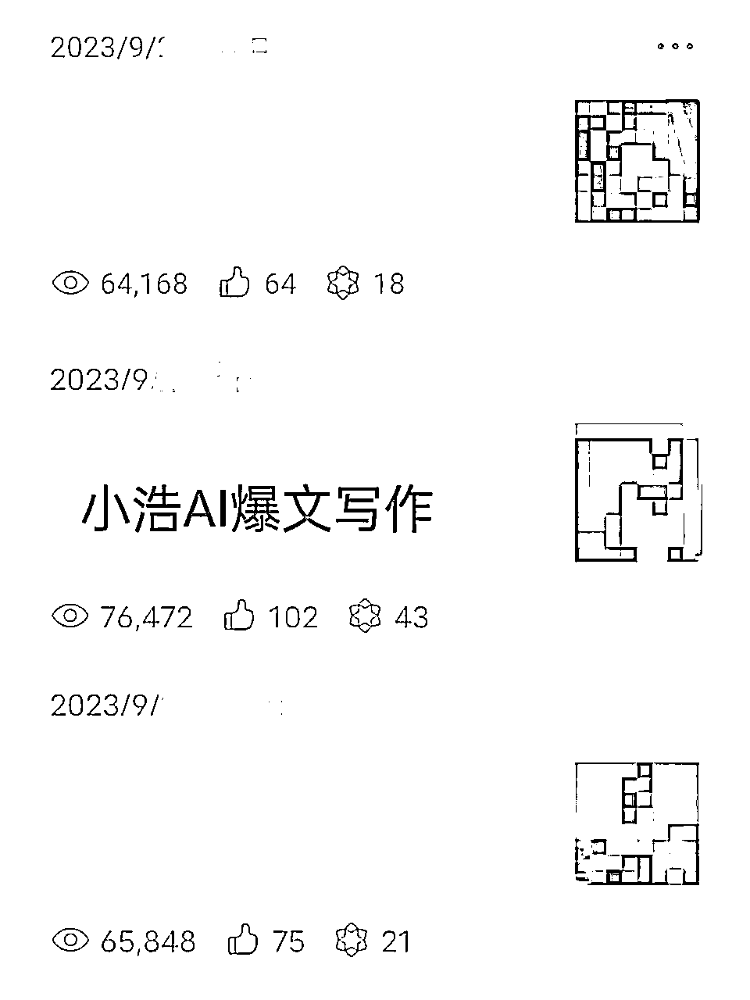
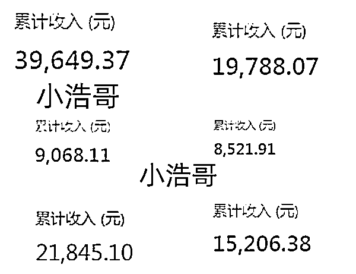
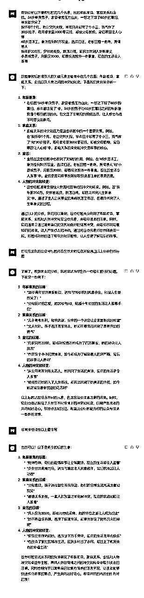
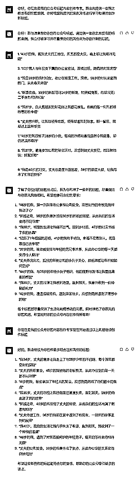
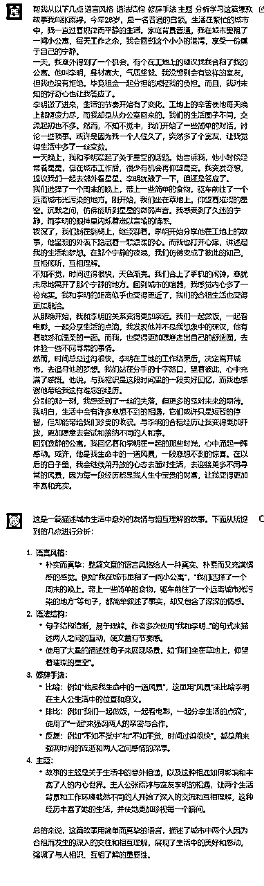
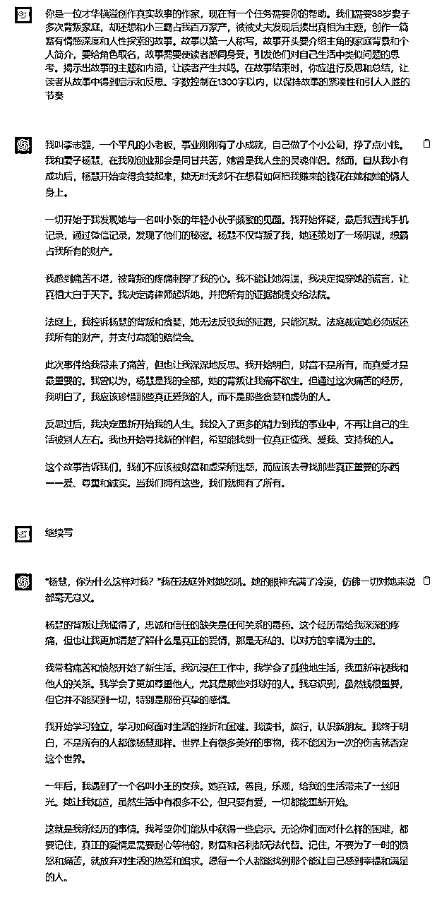

# GPT辅助公众号矩阵爆文写作，3个月实现收益10万+复盘

三个月，公众号收入从0到10万+：这是我的GPT爆文写作复盘

大家好，我是小浩哥。参加过两期公众号爆文写作航海。今天不聊虚的，就说说我怎样借助一个AI神器，把自己的公众号写作收益从零拉到六位数。

公众号改版后，公域推荐开始放开，内容创作者的机会明显变多了。门槛降低，哪怕一个0粉丝的新号，只要文章质量过硬，同样有机会被大流量砸中，跑出10万+爆文。

今年3月，我第一次接触GPT，一下子就被迷住了。之后我买了不少课程资料，疯狂学习和摸索。效果也很直接：我的写文速度从最初的一小时1篇，飙升到一小时20篇，一天稳定产出100篇也不稀奇。靠着这种产能，我先后铺了20多个公众号做成矩阵运营。

不过，这一路并非顺风顺水。最开始的一个月，流量平平，收入也几乎为零。我没急着要结果，稳住心态持续写，最后才等来爆发。这里放几张当时的后台数据反馈图：

接下来，我从实操层面拆解：怎么用ChatGPT批量做出高阅读量的爆款内容。

一、先定赛道：热爱+擅长，缺一不可
选领域是启动的第一步，千万别犯“什么都想做”的毛病。最好的定位，是找到你真正喜欢又擅长的那一块，比如情感故事、名人名言、影视点评，这三个方向对新手比较友好。先在这个池子里扎深，再考虑拓展。

注册公众号不难，手机和电脑都能操作。注册后，重点想清楚两件事：人设如何吸引粉丝，以及名字简介是否好记、是否匹配内容。变现方面，主要靠广告和打赏；粉丝满500后，就可以开通流量主分成和打赏功能。

二、爆文的四个零件：素材、选题、正文、标题
写任何文章，都离不开这四样。

1. 素材收集
做自媒体最大的难点之一，就是持续找到好素材。我的习惯是：平时多留意生活里的小事，在社交平台收集有意思的故事，也会直接和读者聊天，获取一手灵感。生活处处都有素材，加上GPT的整理能力，写作真的没那么难。情感类内容，可以取材于真实经历、网络热门话题，或者读者分享的自身故事。

2. 确认选题
选题要新，同时必须符合公众号的定位。要知道，爆款内容大多赢在选题上。你不妨多去拆解自己赛道里那些10万+爆文，从中找出选题规律，再围绕目标用户真正关心的话题去创作。

3. 制作正文
结合素材，把故事写得抓人，是正文的核心任务。输出前先想清楚：这篇文章能让读者获得什么？是情绪共鸣，还是观点启发？

4. 完成标题
好标题是打开率的第一道关卡。一篇真正的好文章，要有吸睛标题、原创内容、新的信息增量、和日常新闻的差异感，以及正向的情绪能量。

三、标题有公式，爆款有套路
关于起标题，我总结了几条心得。

爆款标题的四个要素：
- 调动读者情绪：喜悦、愤怒、悲伤、好奇，至少占一样；
- 放上具体数字或数据，给人明确的感知；
- 适当使用极端或夸张的用词，增加冲击力；
- 保持简洁，让重点一眼可见。

一个很好用的标题公式：突出主题+制造矛盾冲突+留下悬念。比如：
- 原来写：“50岁单身汉，被46岁寡妇骗进家，干完活后偷偷跑了”
- 润色后：“50岁单身汉，被46岁寡妇骗进家，干完体力活后寡妇却笑容满面”

是不是更有代入感了？再比如：
- 原来写：“新娘缺席婚宴，丈夫分居十几年，妻子态度一直没变”
- 润色后：“新娘缺席婚宴，丈夫报复性分居十几年，晚上妻子却笑容满面，等着隔壁老汉反击”

润色时，还可以植入一些有情绪张力的流量热词，比如“疲惫不堪”“心满意足”“笑容满面”。语言尽量具体、生动，通过场景、角色、反转来制造钩子。

四、GPT怎么帮你批量产出标题
先用5到20个自己领域里5万到10万+的爆款标题，丢给ChatGPT做分析，让它学习这类标题的共性：

再给它一条模仿指令，让它在学习基础上批量生成新标题：

到这一步，GPT已经能按指令产出不少可用的标题。你可以直接挑，也可以结合上面的润色方法二次加工，让标题更带感。

五、GPT怎么写正文
正文生成同样有套路。先找5到10篇同类型的爆款文章，投喂给GPT，让它吸收结构和语言风格：

然后套用一个模板指令，比如：

你是一位擅长写真实故事的作家，现在请你以“38岁妻子多次背叛家庭，还想和小三霸占百万家产，被丈夫发现后揍出真相”为主题，写一篇有情感深度、有人性探索的故事。要求用第一人称，开头交代主角的家庭背景和个人介绍，给角色取好名字；让读者能共情，并联想到自己生活中的类似问题。结尾要有反思和总结，字数控制在1300字以内，保持节奏紧凑。

这样就能产出一篇完整的故事草稿，删掉重复啰嗦的部分，就能拿来用。

六、把这套项目跑通的关键心法
总结这几个月的运营经验，我认为最核心的是两点：找对可以模仿的对标，想清楚自己的能力边界。别一看到别人赚钱就换方向。我自己始终深耕情感故事这一块，所有动作都以这个领域为中心。先学行业内厉害的人的方法，再对照自己的资源和能量去做调整。

项目推进过程中，要盯住每一环，缺哪里补哪里。比如新号跑了一个月还没进流量池，标题和内容都没问题，那就不如注销重开一个，重新起号。策略必须不停迭代，项目才能顺利走起来。

还有一点：少内耗，多行动。与其陷在“假如当初”“想当然”里，不如把每个计划执行到位。那些假设往往只消耗精力，不产生任何结果。如果你发现自己老在纠结，那说明还没有真正扎进项目里。只有全力推进，才能看见成果；如果试过之后没有正反馈，可能是你还没用上全部力气。

放下顾虑，先做再说，在行动中优化。这就是我一直信奉的成功路径。

七、最后聊聊心态
每个人都有自己的节奏和路线。别总盯着别人，要和昨天的自己比，只要在进步就很好。这世上没有什么天选之子，只有不动声色努力的人。请相信，你的潜力远比自己想的大，继续往前，别放弃。

无论你是专业写手，还是业余兴趣爱好者，我都希望这段经历能给你一点启发：善用AI，你的写作价值可以被放大很多倍。有梦想，有决心，再加上AI这个杠杆，惊喜并不遥远。

愿你在创作的道路上得偿所愿，早日写出自己的10W+，走向属于你的高光时刻。