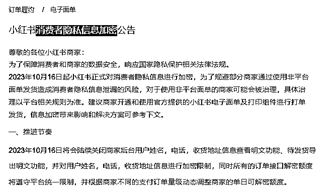
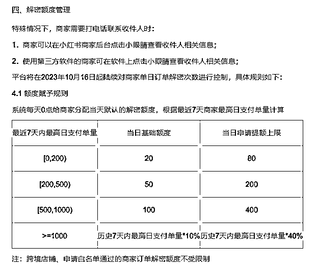
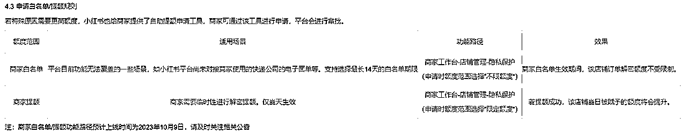
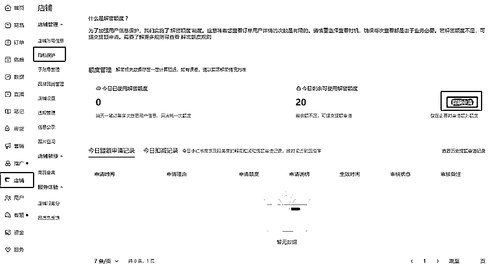
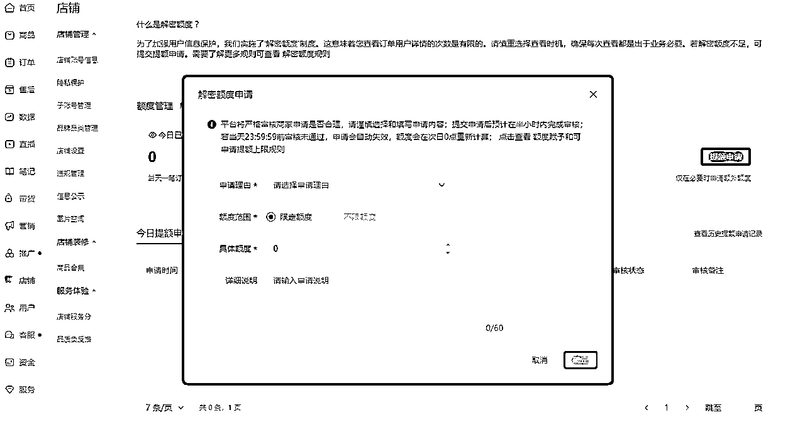
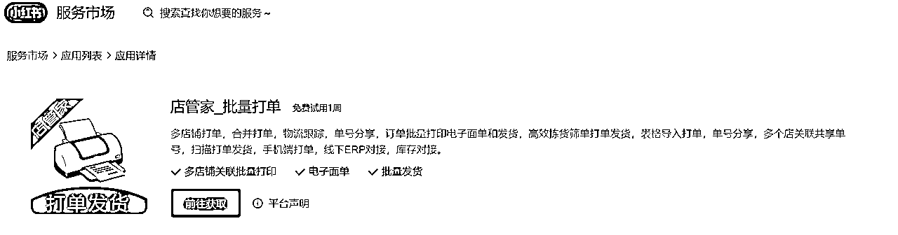
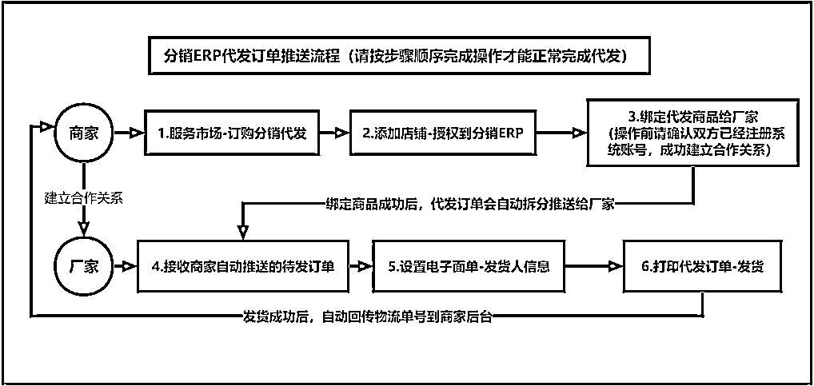

最近很多做小红书的商家都在讨论一件事：平台又出新规则了，而且这次直接关系到你能不能正常发货。

简单说，从2023年10月16日开始，小红书正式落地执行《消费者隐私信息加密公告》。这份公告其实在9月26日和10月10日已经预告过两次。落地之后，用户下单，你作为商家，复制不了完整的收件信息，只能看到用星号隐藏的部分。平台确实给了一点解密额度，但说实话，对大多数商家来说，这点额度根本不够用。再加上小红书强制要求大家使用自家电子面单，不切换的店铺连打单发货都会出问题。

这一连串动作，从之前打击无货源代拍，到推行小红书面单，再到现在的消费者信息加密，环环相扣。说白了，就是让商家必须走平台自己的发货体系。每次新规出来，都会有一批人选择退场，但从另一个角度看，这未必是坏事——你的竞争对手变少了。与其焦虑，不如稳住心态，跟着平台的节奏走，适应规则、用好规则，反而能跑得更轻松。

先聊聊大家最关心的解密额度问题。

平台是按“最近7天内最高日支付单量”来分配额度的。拿0-200单这个档位举例：如果你最近7天的最高日单量在200单以内，那么每天0点会刷新20单的基础解密额度。也就是说，你每天最多能查看20个客户的完整信息。如果你日单量本来就不到20单，甚至基本没什么单，那完全不用担心——这20个名额够你用了，直接复制用户信息给厂家，或者去1688拍单，都行。

如果是去淘宝或拼多多代拍，其实也有更省事的办法：用中转仓。走中转仓不需要解密客户信息，直接用拍单软件下单到中转仓，由中转仓帮你处理发货。换句话说，用中转仓发货，隐私加密的问题根本碰不到你。

那如果一天20单额度不够用怎么办？可以申请提额。

提额的入口在：商家工作台—店铺管理—隐私保护。注意，你得先去“订单—打单发货—申请电子面单”这个路径走一遍，隐私保护的板块才会出现。

申请提额的时候，理由要写清楚，常见的几个方向：

1. 自己是代发商家，需要供应商那边直接发货；
2. 合作的快递不在小红书电子面单支持的范围内（要在说明里注明具体的快递公司）；
3. 发货仓库暂时还没有对接小红书电子面单；
4. 卖的是虚拟商品；
5. 其他特殊情况（同样要在说明里写清楚具体原因）。

如果你是无货源商家，单量本身不大，但也需要偶尔看一下客户信息，用上面这个申请提额的办法操作就可以了。先把规则搞明白、把额度申请好，免得真要看订单信息的时候手忙脚乱。

接下来，重点说说无货源商家该怎么应对。

这里给你四条解决路径，不同阶段、不同体量，用不同的方案，灵活变通就行。

第一条路：自己进货、自己发货。这个方案需要你先囤货，然后自己去谈快递合作，再去申请平台的电子面单，配置好面单模板，下载并运行打印组件。具体的操作步骤可以去看小红书官方发布的“订购小红书电子面单”和“手动打单发货”教程。

第二条路：走中转仓，适合单量不大的情况。中转仓的好处很明显——不需要消耗解密额度，还能顺带解决黄牛短信、电子面单之类的问题，也能帮你规避无货源判定。如果你单量小，但有多个上家，而且是在不同平台代拍的，用中转仓是更稳的选择。单量少的时候，额度够用的话，1688直接下单也没问题，但有一点要留意：跟1688合作的商家一定问清楚，别用其他平台的机器去打单，不然可能被判定为无货源。

第三条路：用店管家这类软件，适合订单量比较大的商家。操作逻辑是：商家通过系统和厂家建立绑定关系，订单推送给厂家，厂家那边同步收到信息后直接打单发货，而商家的后台也会自动完成发货同步。商家教程和厂家教程都有对应链接，直接照着操作就行。

第四条路：子账号发给上家，适合单量大、且有固定合作上家的情况。你创建子账号，开好对应权限给上家，上家再根据教程开通电子面单、绑定打印机，就能帮你打单发货了。具体的店铺子账号配置指南和小红书电子面单操作指南都有官方文档可以参考。

不过综合来看，还是更推荐用店管家。为什么？因为订单信息一目了然，跟上家对账方便，出现售后也好处理。但也要说句实话：如果你单量比较少，让上家专门去开关店管家、折腾子账号绑定打印机，对方不一定愿意配合。所以更务实的打法是这样的——前期单量少，先问问上家有没有店管家，有就直接绑定使用；没有就先走中转仓过渡。等单量真正起来之后，再谈让上家配合使用店管家，到时候对方也更愿意配合，因为你的单量能给他带来实际收益，对账和售后也省心。

说到底，小红书的规则只会越来越多、越来越严，但规则背后也意味着门槛——别人嫌麻烦退出了，你留下来、把流程理顺了，反而是你的机会。