# 抖音抖店无货源月利润6w+保姆级教程及避坑指南

做抖店，别再把眼光死盯着达人带货了。

圈子里都在卷达人分销，佣金被砍到薄如纸，真正闷声赚钱的其实是商品卡流量。今天不扯虚的，直接把我自己跑通的路子连同踩过的坑一起倒出来，希望给正在做或者准备做抖音小店的朋友一点参考。

先交代背景：今年5月份开始正式起盘，做到过单日销售破200万，月销冲上千万。不过那个体量需要极强的供应链和售后支撑，普通人很难复制。今天重点聊的是另一条路——无货源模式，照样能跑出一个月利润6万+的模型。下面这两组数据是实际跑出来的，可以参考一下：

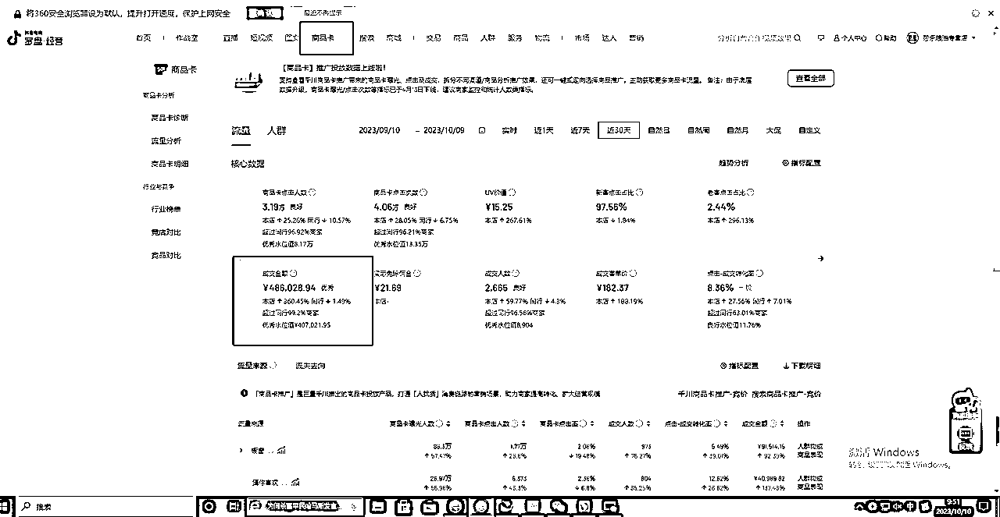

“莎乐粮油专营店”，商品卡月销48.6万，占比25%，净利润22%。

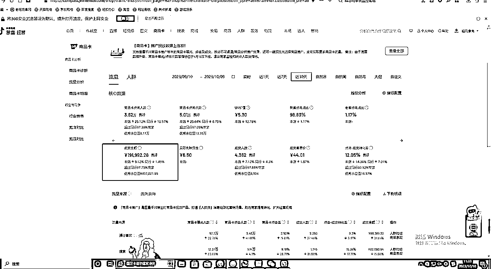

另一家“超凡食尚”，月销19.1万，商品卡占比高达87%，净利18%。这家店全部产品都是一件代发，因为代发成本比自己囤货多出4%，所以利润被稀释了一些，但胜在商品卡占比高、几乎不需要自己压货。

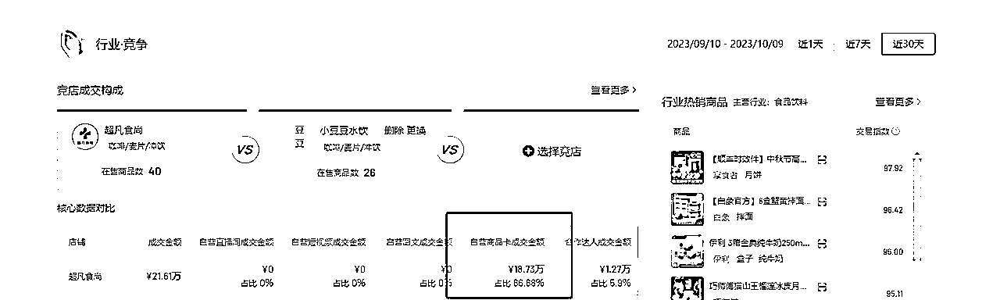

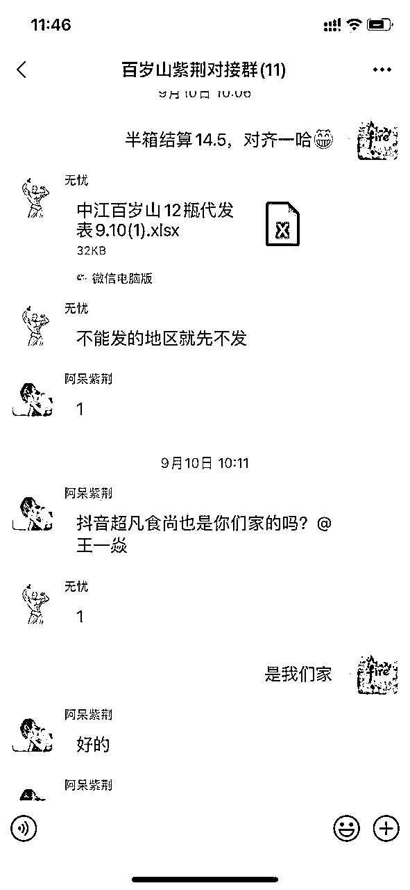

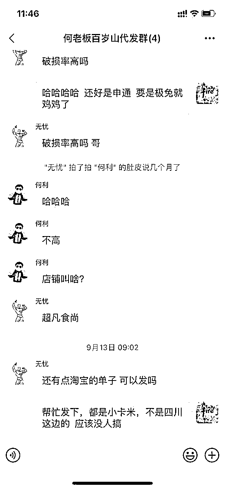

现在这批店主要是我带着一个小兄弟在打理，资金不够就找同行代发，每天结算，基本只需要垫当天的发货资金。

结合这套跑通的模型，我把实操思路和避坑要点通通整理在下面。

**先说操作层面的东西，大概五步。**

**第一步，死磕核心达人，但别只会加微信。**

我现在一直在做达人档案库，专门研究食品饮料领域谁真正能出货。链接的达人越多，你的资源势能就越大，说白了这东西随时能变钱。有人总说联系不上达人，其实是你没动力去够他们罢了。给你们举两个例子，赵奕欢、王李丹妮，懂的都懂，我当初就是怀着梦想去建联的。

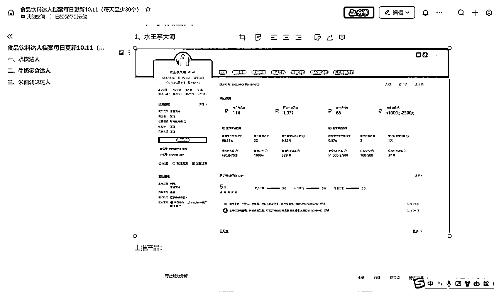

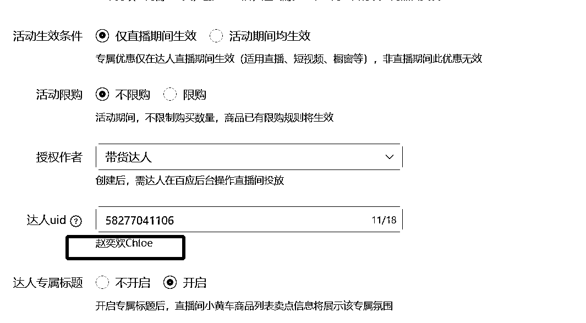

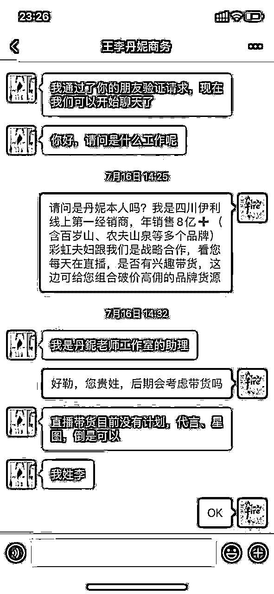

只要你有足够的动力，几乎人人够得到。搞定关系的时候可以稍微吹点牛，但心里要有数，一年实际卖不了那么多货。记住一个核心：达人的信任就是你手里的牌。有了链接，接下来就是大量整合供应商货盘。这里有点类似团长做的事，但实际上比团长高级多了。现在的团长其实处在很尴尬的位置——商家和达人都嫌他们只是动动嘴就想抽几个点。市场已经卷到信息透明，凭啥让你白拿？

正因为这样，你直接去撮合商家和达人，反而能坐上“第一顺位”。达人递品优先给你，供应商的独家资源也优先给你。之前我用这个思路帮一个供应商清了几万箱百岁山，关系一下拉近不少。前端有店铺接着，赚自己该赚那份就够。别想着吃太大差价，那不符合市场规律。只要你在一顺位，单量自然大，供应链给到的代发价也是全市场最低的——比如百岁山代发价28元、控价37元，代发净利能有24%，比我自己去拿货（成本28.5左右）还便宜。他们体量大，成本低，这就是优势。

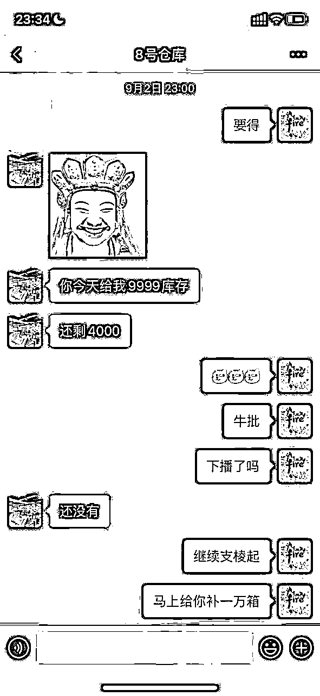

一顺位就像优先择偶权，出货量完全不是一个量级。

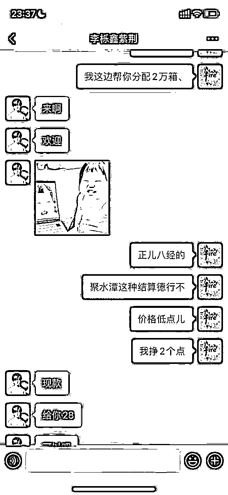

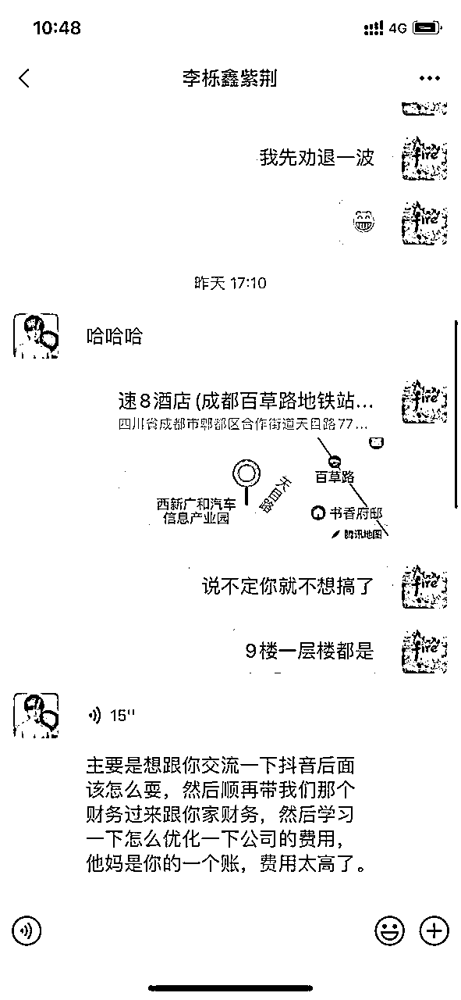

**那怎么跟达人或者达人商务保持深度关系？**

三个很实际的招：

第一，情绪价值拉满。除了搭配货盘，多唠嗑、聊聊生活、交交朋友。别小看这个，有时候达人真的会为了兄弟情分，用1%—2%的佣金带你几波货。到那个阶段就不是谈判了，是交情。

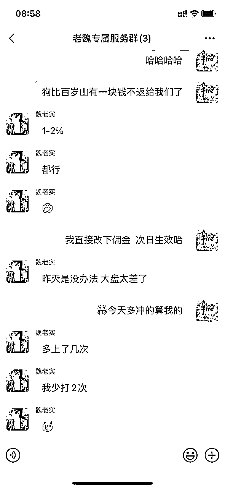

第二，重点搞定商务，记住是商务。能稳定出货的达人都有商务对接人，你搞定商务就行。怎么搞定？直接点，能钱解决就钱解决，能许愿就许愿——比如来成都我全包安排，平时多聊多寄样品。我遇到比较厉害的达人或商务，直接寄30箱样品，让他们自己喝，这个诚意是很直观的。

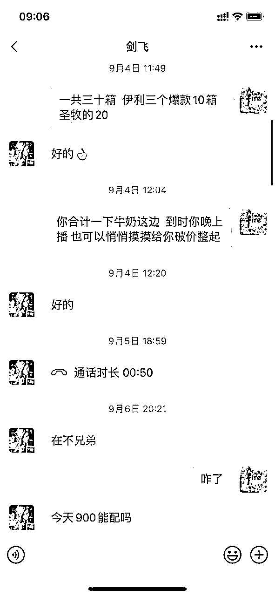

第三，主动帮达人做货盘。拿水饮举例，夏天确实好卖，但天一转凉销量就断崖。这时候你主动帮他们组合牛奶、零食这类应季货盘，他们会很感激，关系一下就变得牢靠了。

**第二步，无限链接玩法，上新就有流量。**

这点挺关键的：一个单品，你可以铺无数条链接。只要把主图和标题换一换，抖音的查重算法基本认不出来。每上一个新链接就会拿到一波自然流量。

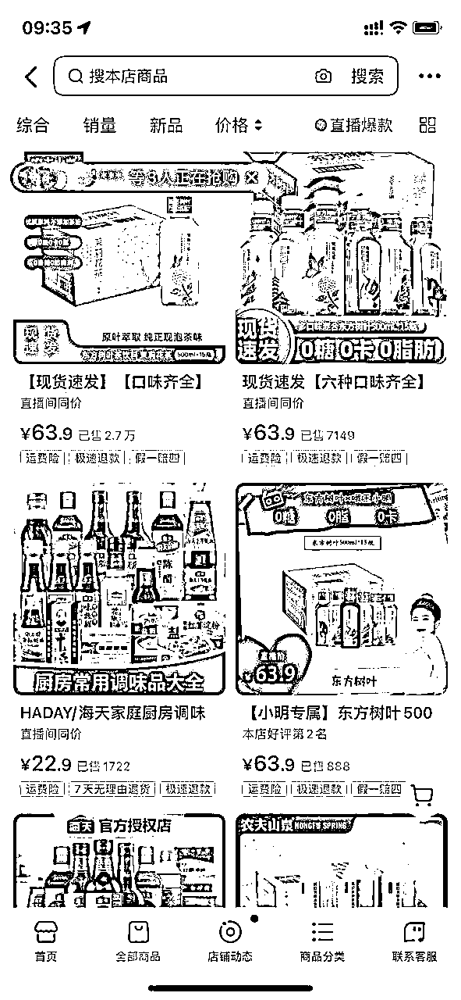

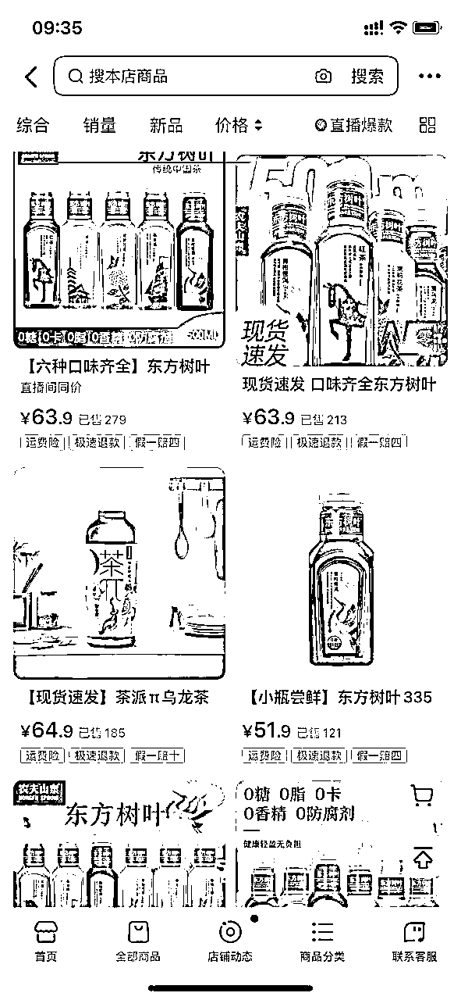

理论上单品链接数量没有上限，多测几条就多卖几箱。不试白不试，平台识别不出来就是机会。

**第三步，所有平台活动，能报就报。**

链接多有个好处：你可以适当提价，然后把抖音上的所有活动挨个报一遍。算好毛利就行，这是商品卡运营中最关键的一环，细节不展开了，但方向一定要重视。

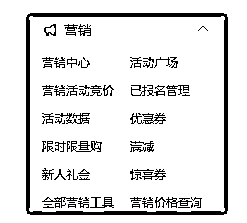

**第四步，错位竞争，冲自己能把控的榜首。**

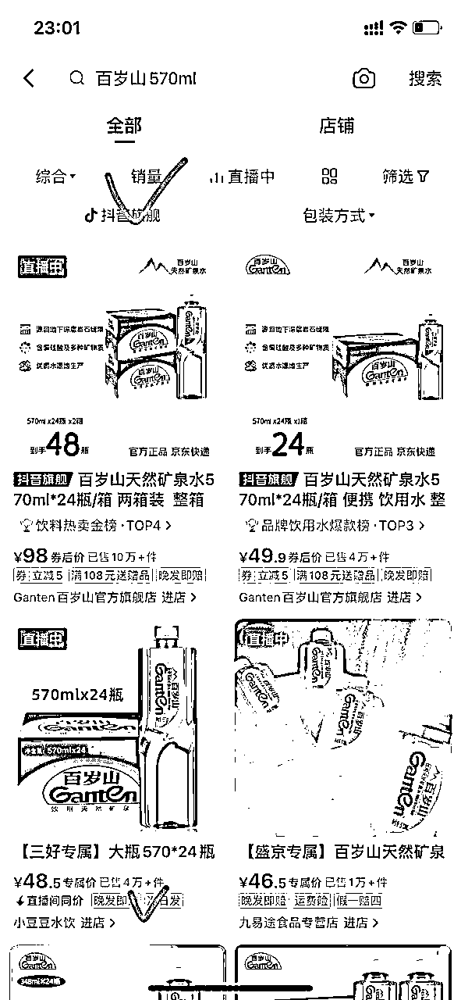

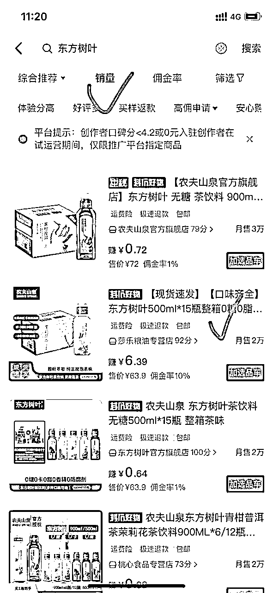

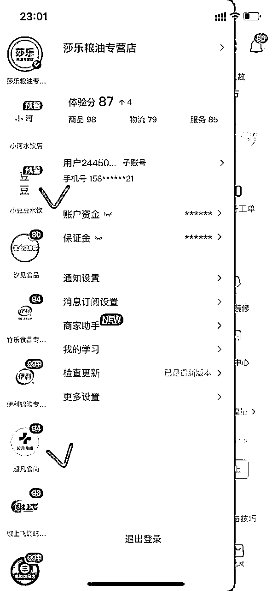

别硬刚大红海。比如百岁山570ml和东方树叶500ml这两个规格，除了官方旗舰店，我们基本排到第一。但真正爆的其实是348ml和900ml的规格，我不去那边抢，我就挑没人注意的细分规格，集中精力打穿透。红海深处挖蓝海，多做几个品类榜首，自然流会源源不断。

**第五步，店铺分维护的“特殊手段”。**

电商后台不能直接删差评，但可以举报。而且这个操作极容易通过。

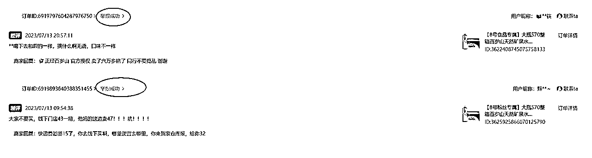

具体流程是这样的：
a、客户给了差评，先把这个顾客的个人信息完整复制下来，包括昵称头像。
b、然后拿这个号在自己的店里下一单，接着直接找客服开骂，威胁“不退钱就差评”，这种情况下系统会大概率判定对方是恶意买家，举报基本100%通过。

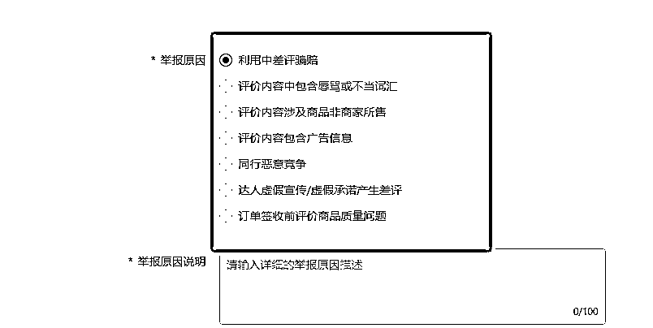

这条细节可以好好研究一下。

还有一个方向值得注意——有些达人组织体量很大，类似于“511、588”那种十几万人的团队，花个几百块就能进内部。如果能搞定这些组织的头头，店铺流量基本稳了，我自己还没亲测打入内部，但值得关注。

**接下面说说避坑指南，这部分每一句都是用真金白银换来的。**

1、能开企业店就别开个体店。之前我也觉得没区别，后来发现个体店很多活动报不了，比如“超值购”。不过企业店记得做账报税，别图省事。

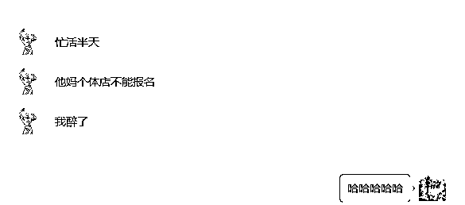

2、类目千万别放错。每个类目保证金不一样，放错了抖音会认定你在偷逃保证金，属于重罚红线。

3、千万别刷单！抖音识别刷单能力极强，70%的订单会被判废。食品饮料类目起店，我这边可以帮你对接一次达人带货，比刷单靠谱多了。

4、不要设全国包邮。甘青宁、西藏、新疆、内蒙、海南这些地方，快递费根本盖不住。还要特别注意转单陷阱，我吃过一次亏——西安发出的单被转到新疆，15kg的重货，一笔运费就干了200多块。

5、扒同行素材的时候，仔细检查有没有其它平台的水印，平台严查这个。

6、夸大宣传和违禁词，碰都不要碰。建议把抖店后台的官方规则老老实实读几遍，我起店能走顺，很大程度靠这个。

7、遇到无理的客户投诉差评，不要什么都认。记住你是商家，是在给平台创造收入的人。该申诉就申诉，该硬刚就硬刚。我之前遇到平台误判，直接留言说再这么判就起诉顾客诽谤，平台最后还是妥协了。规则还没完全成熟，有理的时候别怂。

8、90%的团长真的坑。可能得罪人，但还是要说——纯动嘴撮合就想抽点，在这个信息透明的市场里就是春秋大梦。尤其是那种“团长托管计划”，谁提谁拉黑。

9、主动找你带货、一上来就要你寄样品的，绝大多数是骗子。正常的合作是先聊得差不多了再寄样品。开口就是样品的，直接pass。

10、尽量每天上新品。抖音规则就是这样，上新品就会分配一定流量，哪怕只是换主图换标题。

11、价格和佣金设置，一定要反复检查。这个一旦填错，损失是以万甚至十万为单位计算的，店铺基本就废了。

12、别买什么达人分销软件。热度云一年69800，这跟抢钱有什么区别。老老实实建一个飞书表格，自己整理达人档案，一个一个攻克，效果比软件好得多。

最后再唠叨两句。抖店这门生意，门槛真的不在技术，而在商务能力。达人大多晚上出没，晚上别缺勤，持续去聊、持续去跑，早晚会得到不错的结果。希望这篇手记能帮到正在这条路上摸索的你，也欢迎交流互通有无。