国庆中秋双节将至，先祝各位节日快乐！每年到这个时候，跟“祖国生日”相关的话题热度都会迅速攀升，视频号里也冒出了不少容易上手、投入不大的小项目。今天这篇文章，就帮大家把三个值得一试的玩法拆开揉碎讲清楚，想趁着假期赚点零花钱的朋友，不妨往下看。

**玩法一：定制国庆头像**

现在微信的活跃用户越来越多，每逢国庆，总有一大批人会换上带有国旗、红绸等元素的专属头像，用这种方式表达对祖国的热爱。可问题来了——大多数人并不会自己动手做这类图片，需求摆在那里，机会也就跟着来了。

怎么变现？思路主要有三条：第一，在视频号发国庆相关视频吸引关注，开直播带相关商品；第二，把视频号和公众号绑定起来，用公众号承接这波流量；第三，在公众号里写国庆头像教程类文章，靠插广告赚分成，也可以留下个人微信做私域，提供付费定制头像的服务。

这个玩法不只在国庆能玩，春节等传统节日同样有人需要新头像，完全可以长期复用。

操作流程分三步走：

**第一步：注册公众号并完成绑定**

先登录微信公众平台，选“订阅号”，按系统提示填好资料完成注册。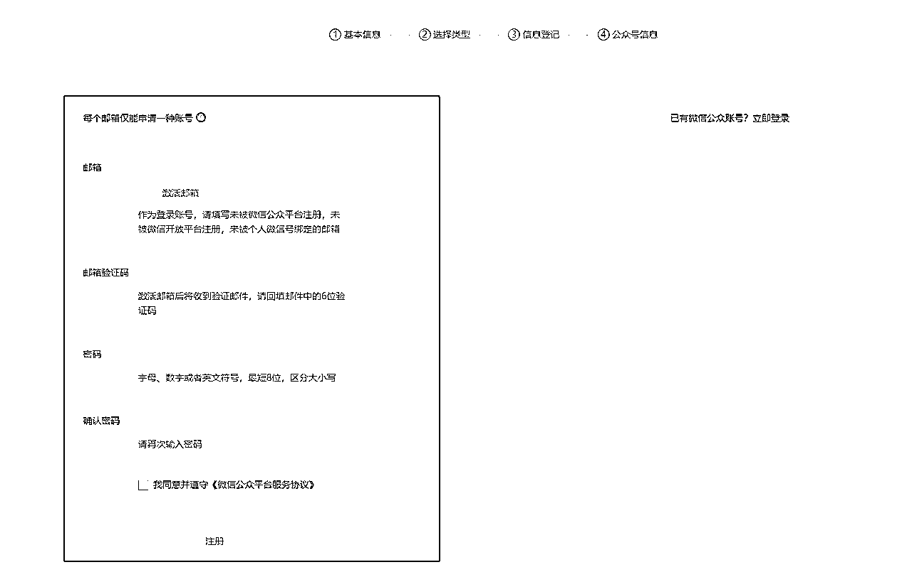注册完回到首页登录。接着要开通流量主——这是主要变现渠道，靠广告分成或返佣赚钱。开通门槛是公众号得有100个粉丝才能申请，不过建议先涨到500粉以上，因为广告功能要求粉丝数达到500人。想快速涨粉的话可以找我交流。在公众号后台找到“广告与服务”→“流量主”，点击开通。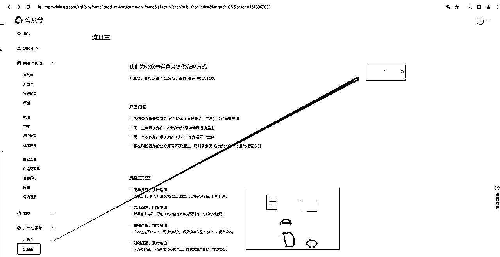开通后在流量主概览页的导航栏里进入“广告管理”，设置广告位。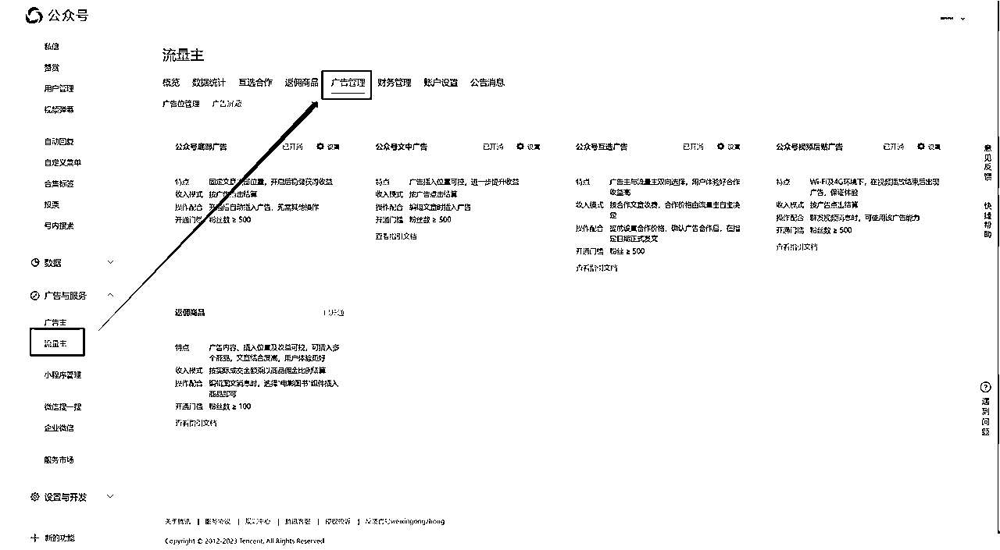

接下来绑定视频号：在公众号后台的“新的创作”里找到“视频消息”→“视频号”，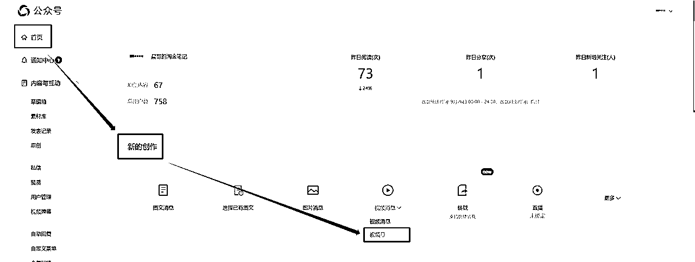点“去绑定”，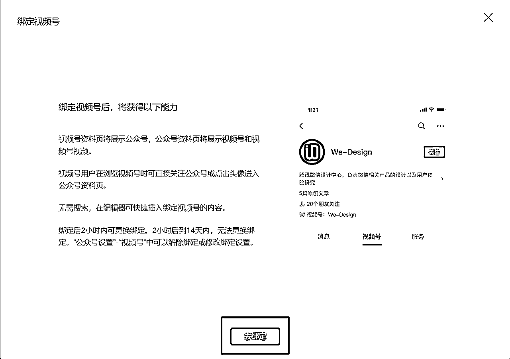用视频号管理员的微信扫码即可完成。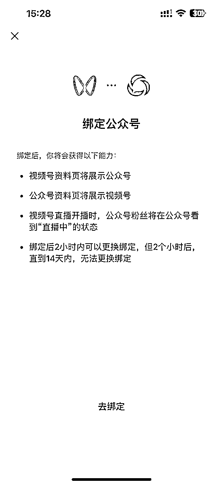

**第二步：搭好视频号内容**

新手自己设计头像太费劲，直接微信搜一搜“国庆头像”，找那些专门做头像的小程序，做好后保存到手机相册就行。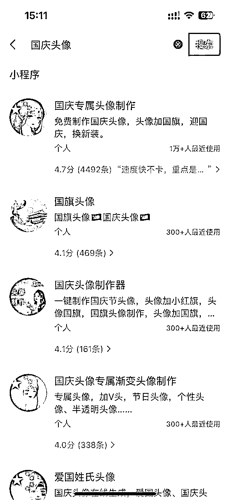然后打开视频号，点发布视频，从相册里选中刚才做好的头像，生成图文视频。背景音乐可以挑“五星红旗随风飘扬”“我爱你中国”这类经典爱国歌曲，再加上“我爱你中国”等热门话题标签。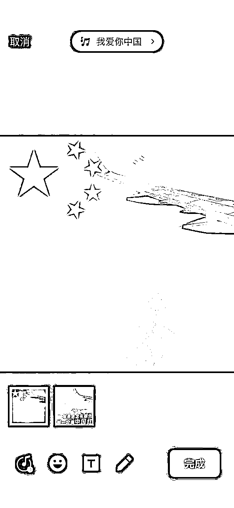最后，在视频标题的位置放上公众号的引流信息。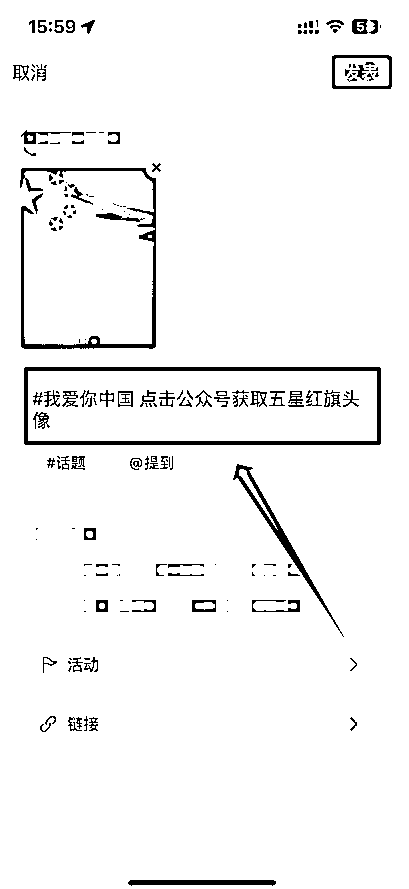

**第三步：发布公众号文章**

公众号后台上传图文内容时，可以只做广告赚分成，也可以顺手放个人微信二维码，把读者导进私域。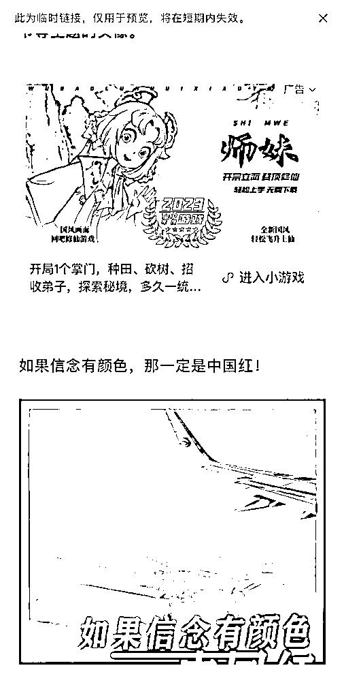需要提醒几个细节：想插广告得先完成第一步里的流量主开通；广告前后正文内容要超过300字；文章越长可放的广告位越多，收入也越高；放不放微信二维码全看个人需要。

**玩法二：手抄报模板**

一到国庆、中秋这种节点，中小学基本都会布置手抄报作业，孩子不会做，家长也没时间辅导。这个项目的目标人群就是这些家长，靠“轻松搞定手抄报”的便利性来吸引流量。

变现逻辑很简单：拍短视频展示用模板做手抄报有多方便，吸引学生家长关注后，通过短视频带货或直播带货赚佣金。手抄报模板不是一次性生意，每个传统节日都有需求，长期都能卖。

具体操作如下：

在抖音等平台搜“手抄报模板”，找热度高的视频，复制链接后去轻抖里去水印下载。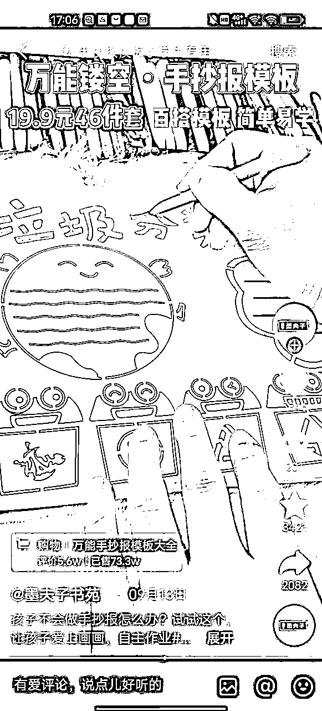打开剪映导入素材，把原视频字幕删掉、原声关掉。用轻抖提取原视频文案，再自己重新仿写一版。把新文案放进剪映，可以自己录音，也可以直接用文本朗读配音。把视频里最能体现手抄报模板特点的片段挑出来，重新排列组合，做去重处理。再配上一段欢快的BGM，发布视频就好。商品方面，在视频号选品中心或1688、拼夕夕等渠道搜索“手抄报模板”，上架到橱窗即可。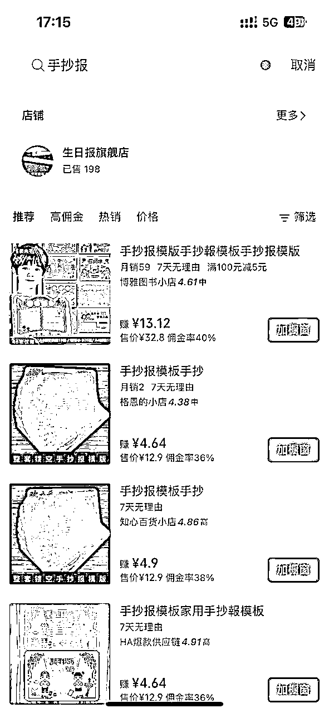

**玩法三：国庆车贴**

每逢国庆，不少车主都喜欢在车上贴一面小国旗或爱国车贴应景。这个项目就是围绕车贴做文章。

推广方式：发布给爱车贴国旗车贴的短视频，配上爱国文案和音乐，蹭上国庆热度，吸引流量后带货赚佣金。

素材搬运：在抖音等平台搜“国庆车贴”，找播放量高的视频，复制链接到轻抖去水印下载。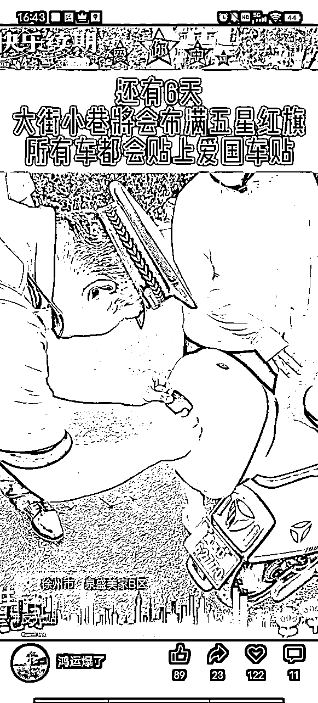建议优先挑选有公信力的人出镜的视频，比如交警入镜那种，更容易让用户信任。

处理素材时，把有交警的片段当作开头，多余的剪掉；用字幕、特效、贴纸等方式做二次创作，增强去重效果；关掉原声，换上爱国歌曲作为背景音乐；最后发布视频即可。商品同样可以去视频号选品中心或其他渠道搜索“国庆车贴”上架。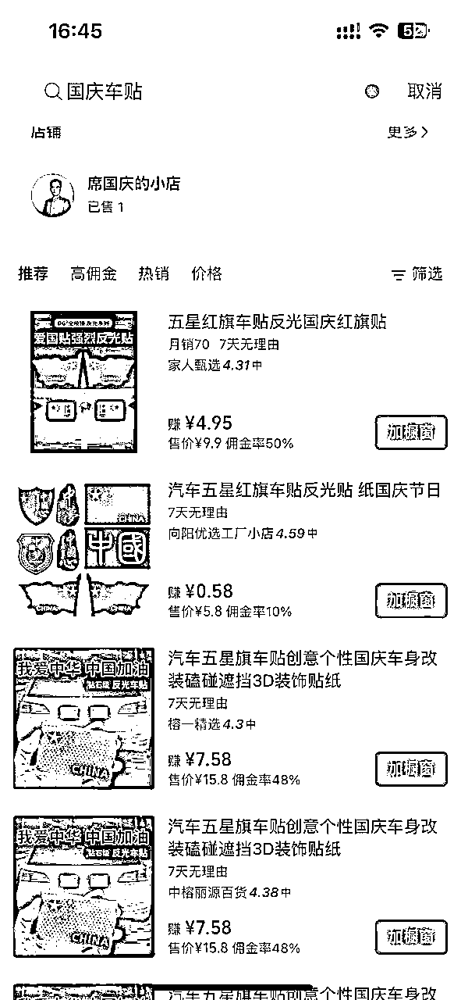

以上三个玩法，都是每年国庆期间反复出现的热门方向，操作难度不高，适合新人尝试。更多细节玩法，欢迎大家一起交流探讨。最后再次祝大家中秋国庆双节快乐，阖家平安喜乐！