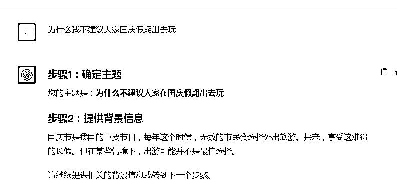
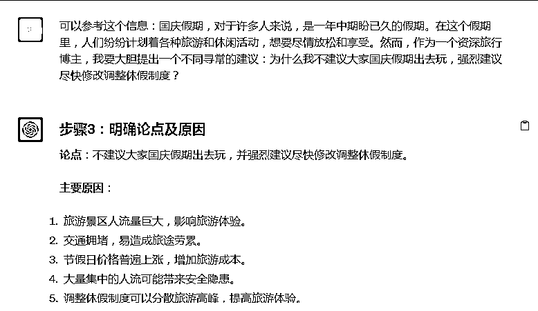
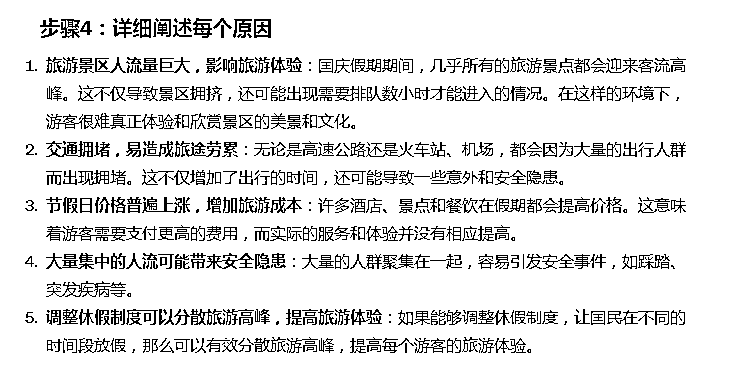
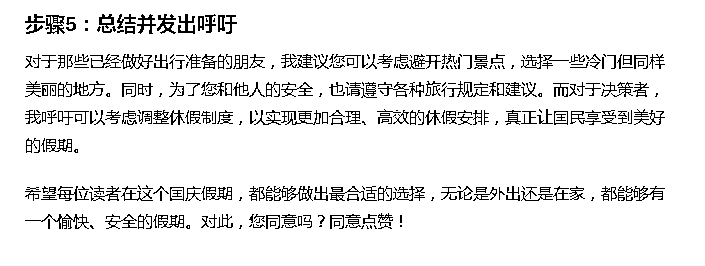
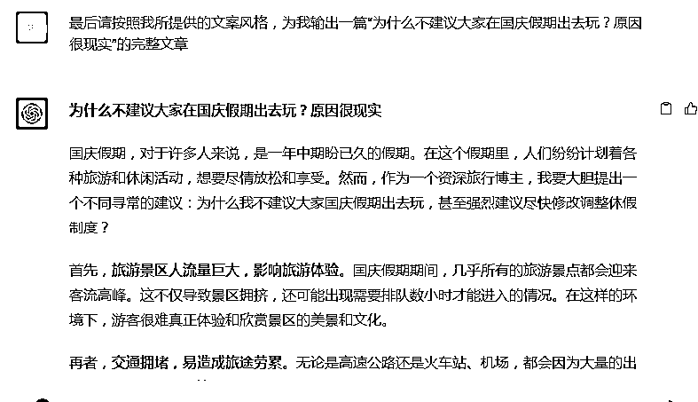
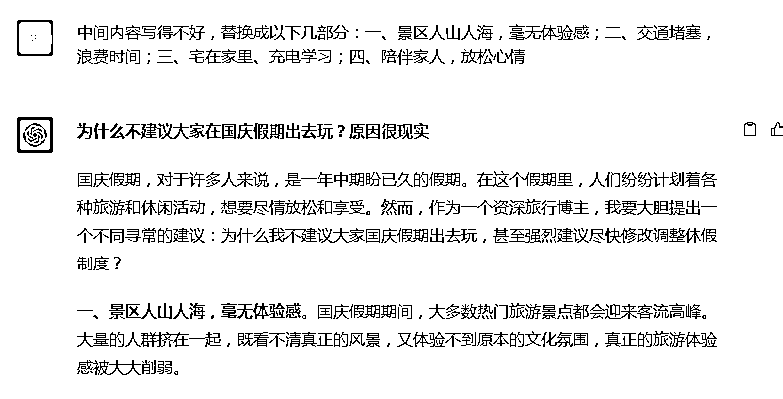

# 如何借助GPT把👸号文章做成10万+

# 先说下我的背景

我是90后创业者，曾在龙哥盟多次复盘过自己的创业路。早年我搭建过国内规模最大的90后社区论坛，峰值时有50万用户在里面活跃。大学毕业后进入一家报社工作，后来拿着天使投资自己出来创业，方向横跨内容电商、直播带货、拼多多运营，虽说规模不大但都做出了可观的成绩。2023年我基本把重心压在了GPT的实战上，4月份上线了一门关于GPT应用的课程，视频号渠道卖出了约1万份。9月份报名了👸号的航海计划，一个月左右的变现就突破了9000元。

# 我是怎么在20天内写出7篇10w+的

到目前为止，20天时间里我已经稳定产出7篇阅读破10万的文章。我的打法可以浓缩成三个字：看、抄、写。

### 一、看：先把自己送进🛰️的推荐池

👸号在9月份完成升级后，推荐机制被大大强化，新号也有机会被分发。🛰️生态越来越像信息流平台。

想进池子，核心逻辑和账号权重有关。老号因为历史积累更容易被推，而新号要想挤进去，就要抓住平台的流量入口。👸号爆发式增长的背后，是“看一看”“问一问”“视频号”三驾马车的驱动。尤其是看一看，这个流量盘极其庞大。

看一看的界面结构是三块：好友在看、短视频、热点。好友在看代表社交圈的情绪共振，能证明内容对同类人群有吸引力。热点则紧贴时事，抓的是用户高频搜索和转发需求，一键能发到群里和朋友圈。视频则承接用户兴趣沉淀，为私域二次转化创造机会。

基于这点，我找素材基本只在🛰️内部完成，既省时间，又能更贴合平台调性。

要想提高被看一看收录的概率，我总结了三点做法：

1、坚持原创。尽量用GPT完成原创成文，我的独家提示词会在第三部分拆解。
2、避开红线。用易撰这类检测工具提前筛查敏感词，避免违规降权。
3、保持频率。起步阶段建议日更或隔日更，让系统持续感知你的活跃度。

爆款的本质是基于爆款的复刻。写一个选题前，我起码要通读十篇同类高阅读文章，揣摩走红的共通点。

### 二、抄：把别人的高分拆解成自己的素材库

1、抄标题
翻看大量10w+文章会发现，内容本身往往很普通，真正拉开差距的是标题。我归纳了几类高频标题模型可以直接套用：

提出疑问型：人物+为何+事件；人物+经历+凭啥。例：《千聊、荔枝上育儿课那么多，为何李老师的课卖得最火？》《14岁辍学，29岁身价过亿，这个90后凭什么》

制造悬念型：如何/为何+表象+反转。例：《如何用10秒让堵住的鼻子瞬间通畅？喷一下，一天都舒服！》《孩子越长大越不愿沟通？99%的家长都忽略了》

数字诱惑型：数字+干货+福利。例：《我整理了200页干货PPT，20个冷门文案技巧免费领》

热点嫁接型：把标题和当下热点绑定。例：《杭州亚运会开幕，可你还记得33年前在北京高唱亚洲雄风的刘欢，如今老成这样？》

对比反差型：制造落差感。例：《真正聪明的人，反而很少交朋友》《35岁月薪3500，你靠什么立足》《方便面能出大牌，挂面为何没有》

权威稀缺型：提供独家信息感。例：《张小龙首次内部演讲，全文无删减公开》《离职前，我把黄埔军校级别的运营笔记全公开》

总之，吸睛的标题往往越口语化越好，像大妈大爷的说话方式，文采反而不重要。

2、抄内容
文章也是抄出来的，关键看会不会用。

抄契合自己风格的。先锁定选题方向，再去找同类文章里别人是怎么表述的，挑出与自己语气匹配的句子吸收。

抄高频重复的信息。像新生儿出生率这类议题，数据必须来自权威机构，不可能自己编造，这类信息就是可以合法照搬的。名著开头、经典金句也是永恒素材，用得好能提升质感。

抄最新鲜的素材。老梗要舍弃，多留意今日头条、🧣热搜，那里基本就是下一个爆点的苗圃。

抄前先分类。创业、社会政策、房产等不同领域混在一起积累只会混乱，建议先建好分类标签再做摘抄，效率会高很多。

### 三、写：用GPT完成仿写和原创

1、用GPT仿写爆文
在今日头条找一篇爆款，直接让GPT改写，风险是可能被判定为洗稿，需要谨慎。

我常用的指令是：
你现在是一名擅长👸号创作的文案专家，熟悉传播逻辑和用户心理，能对文章进行二次创作。接下来我会给你一篇范文，请你在不改变原意的前提下，对段落里的个别词语和句式进行改写，让文章读起来更流畅。如果我有额外修改需求，会放在文章末尾用（）标注。请确认理解后开始执行。

把文章和修改要求一起丢进去，通常几分钟就能拿到一个新版本。

2、用GPT创造爆文
我会追踪“彪悍猫先生”这个号，他的文章几乎篇篇10w+。我把他的历史文章全部喂给GPT做拆解，得到的结论如下：

写作思路：
从时事或普遍现象切入引出问题；深度剖析现象成因和影响；埋设疑问点激发好奇；引入行业或专家观点提升可信度；最后给出建议或解决方案。

写作结构：
标题要抓眼球且点题；开头交代背景铺垫主线；主体分小标题逐层展开；结尾收束观点并引导互动。

写作手法：
用数据背书增强说服力；用小故事案例增加可读性；用对话式语言拉近距离，例如“你认同吗”；结构清晰，用数字和小标题引导阅读。

方法论提炼：
选定与时事相关的选题；做充分调研收集数据、案例、专家看法；搭建清晰的起承转合；文中设问提升参与感；借助数据和故事提升质感；结尾做互动留存用户。

具体操作步骤：
步骤1：确定核心议题
步骤2：补充背景说明为何此刻值得讨论
步骤3：提供数据支撑，没有则用泛化描述
步骤4：提供案例或故事，没有则描述场景让模型构建
步骤5：加入行业或专家视角，没有则模拟观点
步骤6：给出你的立场和建议

每完成一步就推进下一步，最后由模型整合输出成文。

GPT不可能一次就给出完美稿件，需要多轮打磨和细节优化，最终才能产出真正原创的稿子。以上方法只是起步，选一个对标号，把他的全部内容喂给GPT做风格拆解，再进行模仿创作，效率更高。最后别忘了人工润色一下，补上机器缺少的情绪和温度。