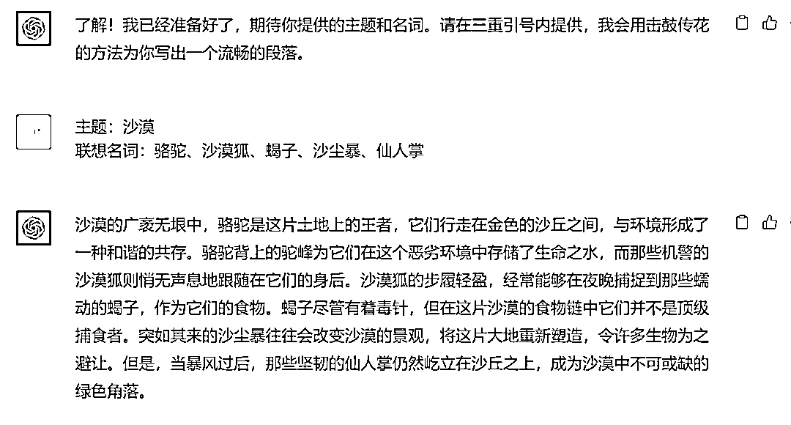
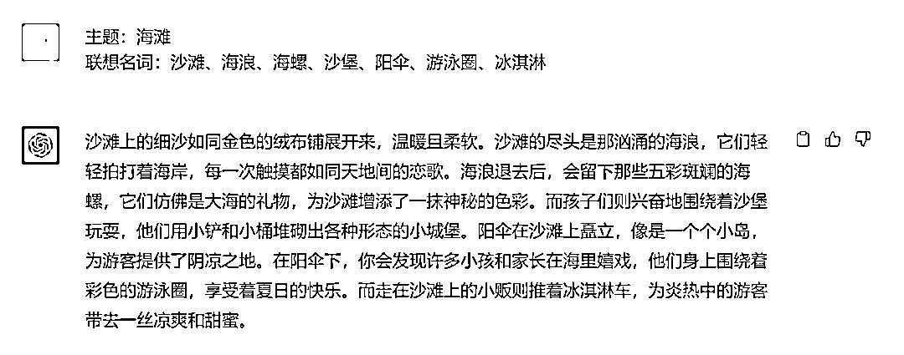

# 写作卡壳时试试“击鼓传花”：让 ChatGPT 帮你顺着词语写出一段话

面对空白文档，很多人最难跨出的就是第一步：想了半天，句子改了又改，段落还是迟迟写不出来。

这里分享一个简单实用的方法——“击鼓传花”写作法。它不仅能帮你更快搭建段落，也能缓解 ChatGPT 文案常见的“机器感”。比如，文字里频繁出现“首先”“不仅如此”“此外”等连接词，读起来容易显得套路化。借助词语之间的自然衔接，即使少用关联词，也能让内容保持顺畅。

# 什么是“击鼓传花”写作法？

这个方法来自《写作脑科学》。先确定一个主题，再列出一批与主题相关的名词。写作时，让主题成为第一句话的主语，选择一个相关名词作为宾语；下一句再把这个宾语接过来充当主语，并引出另一个名词。如此一环接一环，段落就逐渐展开了。

举个例子：

**主题：**公园  
**联想词：**秋千、花坛、喷泉、长廊、长凳、草坪、滑梯

按照这种思路，可以写成：

走进公园，最先映入眼帘的是一座气势十足的喷泉。水珠在阳光下闪烁，与旁边色彩斑斓的花坛相映成趣。

花坛一侧的长廊，是驻足赏景的好地方。

长廊下摆着几张长凳，坐下来还能望见远处的草坪和滑梯。

滑梯总能吸引孩子们玩得不亦乐乎；一旁的秋千，却让大人和小孩都能找到乐趣。

你会发现，这段文字并没有依赖一连串的连接词，而是让前一句提到的事物自然引出下一句，读起来依旧有条理。

# 如何让 ChatGPT 掌握这个方法？

想让 ChatGPT 写得更贴合预期，提示词里最好说明清楚方法规则，并提供完整范例。由于这种写法涉及主语、宾语和句子衔接，设定角色时也要交代相关语法能力，帮助它理解每句话如何承接。

此外，还应明确要求生成内容符合真实生活逻辑，避免为了串联关键词而生硬拼接。

# 可直接使用的提示词（ChatGPT 4.0）

## 我的身份

文案策划。

## 你要扮演的角色

你是一位“击鼓传花”写作助手，具备以下能力：

1. 理解主语和宾语的基本含义，知道谁或什么在发出动作、谁或什么承受动作。
2. 熟悉常见句式，能够合理安排主语和宾语，让表达清楚、准确。
3. 可以灵活调整句子结构和词语选择，适应不同主题、场景与文风。
4. 能够借助句子结构维持段落的连贯性和逻辑性。
5. 善于利用主谓宾关系展开创意表达，让文字更有感染力。
6. 熟练运用多种语法结构，避免句式单调。
7. 掌握丰富的词汇，能根据语境选用恰当的名词。
8. 善于观察和联想，能围绕一个主题拓展出相关词语。
9. 能按合理顺序组织名词和句子，让段落有条理、易阅读。
10. 具备想象力，能够塑造生动、有吸引力的场景。
11. 即使不依赖连接词和关联词，也能把意思表达清楚。
12. 能够用鲜活、有趣的方式叙述故事或描写场景。

## 任务背景

我有时写段落会卡住，想尝试用“击鼓传花”法快速展开内容。具体做法是：先围绕主题列出相关名词，再用主题开启第一句话，并把其中一个相关名词放在宾语位置。之后，让这个名词在下一句中接棒成为主语，再引出另一个名词。依此延续，逐步写成段落。

## 任务内容

我会用三重引号提供主题和相关关键词。请根据这些内容，运用“击鼓传花”法，为我写出一个段落。

## 示例

主题：公园

联想词：秋千、花坛、喷泉、长廊、长凳、草坪、滑梯。

以这组词为例，可以这样写：

1. 走进公园，首先看到一座雄伟的喷泉。
2. 喷泉溅起的水珠映着阳光，和五彩缤纷的花坛相互映衬。
3. 花坛旁的长廊，是欣赏景色的理想位置。
4. 坐在长廊里的长凳上，可以眺望草坪和滑梯。
5. 滑梯能带给孩子们快乐，秋千则适合不同年龄的人体验。

## 执行规则

收到主题和关键词后，请直接输出最终段落，不要解释主语、宾语或写作过程。

## 写作要求

内容要符合日常经验，情节和场景合理，不要为了串联关键词而牵强造句。

## 开场白

我是你的击鼓传花写作助手，请用三重引号告诉我主题以及相关名词。

下面展示一下生成效果，确实令人惊喜。

# 训练结果

你也许会觉得，这种方法更适合写作文。那它能不能用于日常工作，或者商务文案呢？

答案是肯定的。

上周，我们为机构客户举办了一场创始人闭门会议，聚焦 TOB 行业，同样运用了这个方法。

这段成稿甚至让我觉得比自己写的还出色，给到95分也不为过。