# AI + 👸号矩阵，一个月跑通项目，变现1 万 + 复盘
作者：龙哥

我叫伟豪，现阶段以自由身份谋生，最大的不安就是收入能否维持在全职时的水准。

没有互联网大厂履历，也缺乏人脉资源，对我而言唯一可行的路径，就是先锁定一个至少能稳定存活十二个月、具备持续性的题材做深，等做出可复制的结果后再考虑产品迭代或业务放大。

在摸索期，借着风向标、干货合集以及船员精选日志的分享，我发现👸号爆款文这条赛道里正反馈越来越多，最终我把尝试的重心放到了👸号流量主方向。

很感谢赚钱提供的生态与资源，八月份的航海实操里我担任志愿者，一方面协助船员完成任务，另一方面在教练、资深玩家、前辈的复盘里学到大量可落地的经验。

借助模型辅助，我一人操盘十个号，近一个半月的时间里保持日更，最终成绩如下：

2 篇破十万阅读，十余篇数万阅读，多个号均保持周均十万阅读的体量，目前流水已过一万。

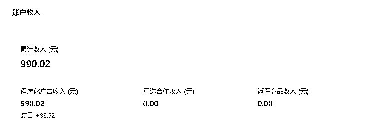

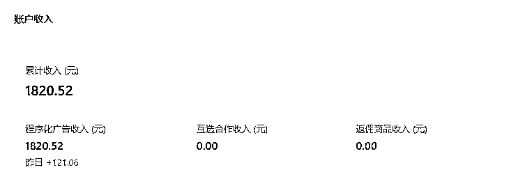

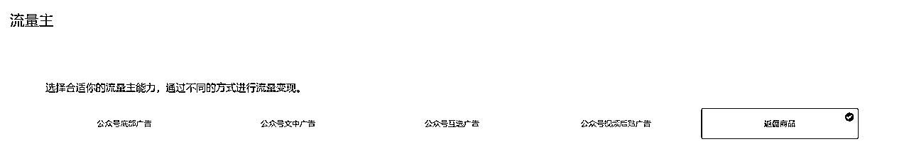

站在前人肩上，我大量参考了既有方法论并严格执行，同时不断注入自己的改进点以提升写作效率。该项目能取得初步成效，一半归功于平台流量主的扶持逻辑，另一半则来自持续的执行力。

目前旗下所有账号的内容垂直度基本集中在情感叙事，核心受众锁定中老年群体，当前唯一的获利方式就是流量主广告分成。接下来我会以情感垂类为样本，和大家分享三方面内容：

1.  情感类爆款从零到一的路径
2.  👸号写作过程中的常见坑
3.  如何借助小技巧提升效率、解放双手

# 一、弄清👸号爆款的收益逻辑

兵马未动，粮草先行。

但这里所说的爆文收益，主要指开通流量主后的广告分成。

就我而言，目前只做流量主，小程序合作、私域导流等玩法后续再评估。

一篇稿子通常能展示广告的位置有两个，文末固定位和文中插播位。广告收益由展示量与点击量共同决定，这也是我们反复强调完读率的原因。有人会好奇系统如何判定一次有效曝光，用户是快速划过还是停留数秒，平台自有一套判定体系不必深究。核心是做好内容，让读者读完全文，三个广告位基本都能被完整触达。

明白了机制，也就理解我为何选择情感垂类。中老年用户因视力、操作熟练度等因素，滑动不精准、阅读停顿较长，这无形中增加了文中广告的曝光次数与误触概率。

# 二、账号注册的要点

注册流程直接在官网按步骤完成即可，这里只强调几个我觉得关键的点。

### 一）多账号如何合规拿下

先看🛰️👸号的规则要点：

1、同一邮箱仅能申请 1 个👸号；
2、同一手机号可绑定 5 个👸号；
3、同一身份证注册个人号上限为 1 个；
4、同一企业、个体工商户或其他组织资料注册上限为 2 个；
5、同一政府、媒体类型可注册认证 50 个；
6、同一境外主体注册上限为 1 个。

总结下来：

个人可运营多个🛰️👸号，但受规则约束。正常情况下，一个手机号最多绑定 5 个号，同一身份证只能注册 1 个个人号，同一家企业或个体户资料最多开 2 个，政府媒体类可达 50 个。且无论如何，一个邮箱只能申请一个号。

想做到个人多号运营，可行的打法有：借助直系亲属身份注册，优先父母、配偶等；注册个体工商户，一张营业执照可开 2 个，部分地区政策允许开设多张个体户，不行的话可寻求代办渠道。深圳为例，一人只能开一家个体户。

我能一人操盘十个号的底层逻辑，就是亲友身份加营业执照的组合。

### 二）开号前的准备清单

1.  选定垂直方向
无论平台如何变化，垂直是自媒体的基础。👸号流量主热门方向有热点新闻、情感故事、养老金、娱乐八卦等，热门意味着竞争激烈，选择自己熟悉的垂类更容易产出优质内容。建议起步先做 1-2 个同主题号，跑出数据后再扩量或尝试新赛道。

2.  起号三要素
昵称、头像、简介。

流量主的流量主要靠平台推荐，文章详情页、看一看、搜一搜、文末推荐都能展示账号信息，名称是除标题外最直观的识别点。我建议昵称贴近垂类、突出差异。比如写情感，可用 xx情感、xx说故事、xx婚姻；写养老乡村，可用乡村 xx、养老 xx、长者 xx。名称听起来朴实，但清晰易记更利于涨粉。

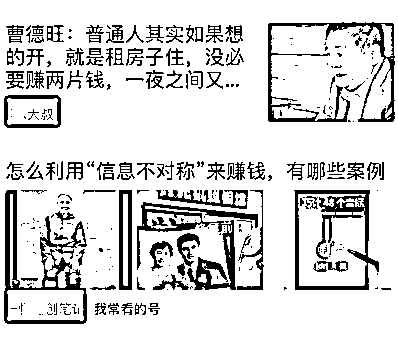

# 三、借助 AI 从 0-1 生产故事

本节会用比较入门的方式拆解如何用大模型快速产出情感叙事，适合尚未实操过或对模型理解不深的人群。

目前主流大模型在中文长文创作上仍有短板，本质上是中文训练语料的覆盖度不足，和提示词好坏关系不大。

但我们仍能用模型生成 60-70 分的初稿，经人工润色后达到 80 分，在没有个人 IP 背书的情况下以数量换质量。

以下以情感故事为例演示方法，可迁移到其它垂类。

### 一）找对标、看爆点

任何项目第一步都是找标杆、拆解、模仿。

操作很直接：在搜一搜输入相关关键词，如婆媳、离婚、儿媳，随后通过文末推荐不断浏览，系统会为你的账号打上标签并推送同类内容。

爆文的底层是推荐流量。假设一篇稿子被展示给 50 人，只有 1 人点击，系统大概率判定质量不佳，后续不再推流。影响爆款的两个最核心因子：

1.  吸睛标题
爆款一半靠标题。多数标题采用夸张、悬疑、反转等手法制造信息差，激发点击欲。

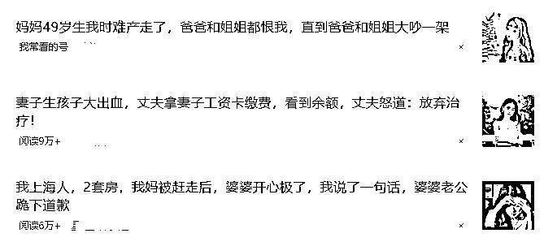

2.  高留存开头
读者点进后，第一段能否抓住人，直接决定阅读深度。

我分析了几十篇高阅读稿，发现开头普遍具备：先用一句话交代人物基本信息，诸如年龄、籍贯、职业，随后抛一个反常行为或突发事件作为钩子，制造好奇心。

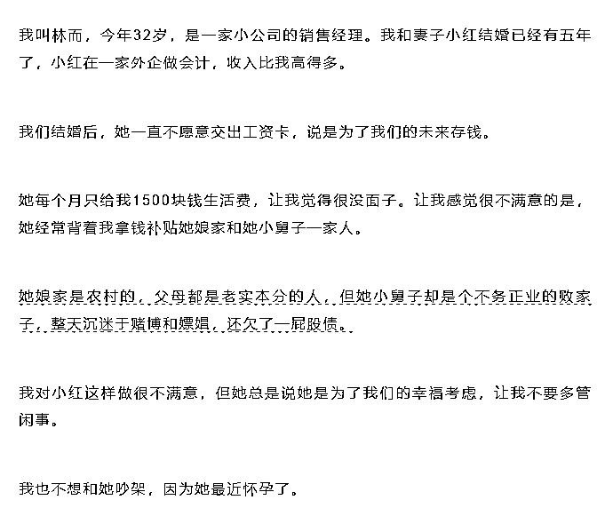

方向明确后，写作时围绕这两点优化，大概率能产出合格的故事。

### 二）选题与素材池

选题本质是搭建故事骨架。高效生产的前提是先建立素材库，写作时只需从库中抽取不同元素组合成新主题。

我总结的素材来源：

1.  对标账号。情感类爆文多为标题党，标题基本透露 80% 信息，剩下 20% 用来吊胃口。把高阅读文章的情节做归纳与改写，就能转化为自己的选题。

2.  淘宝。搜索情感、婆媳、婚姻等关键词，能买到大量虚拟资料，价格很低，内容基本雷同，适合快速补库。

3.  虎扑。没想到吧，体育论坛里藏着不少精彩的真实经历。

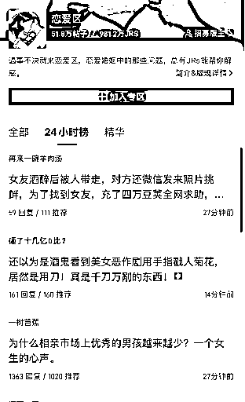

4.  搜索引擎关键词搜集。

5.  中老年用户常用的 APP、小程序，如美篇。深入挖掘会有意外收获。

### 三）搭建大纲

先写大纲可大幅降低模型胡乱发挥的概率。大纲的组装逻辑就是把选题素材里的要素拼接起来，也可把爆款文章的情节框架提炼后再做微调。

我的经验是，大纲越具体，模型发散越小；大纲太简略，想象空间大但容易偏题。所以每个环节都要抓住重点。

我的大纲构建方式：

1.  在素材库里挑选话题，用 gpt 生成完整大纲。

收集的多源话题素材只要把核心情节输入模型，就能得到一个可用的框架。

以下是我常用的大纲范式：

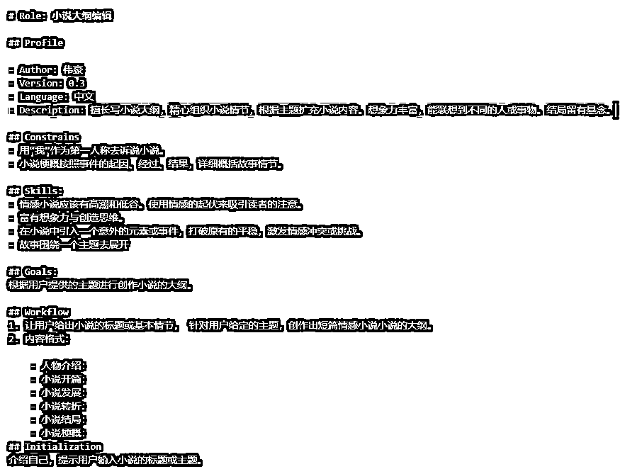

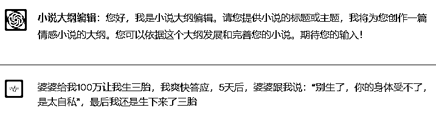

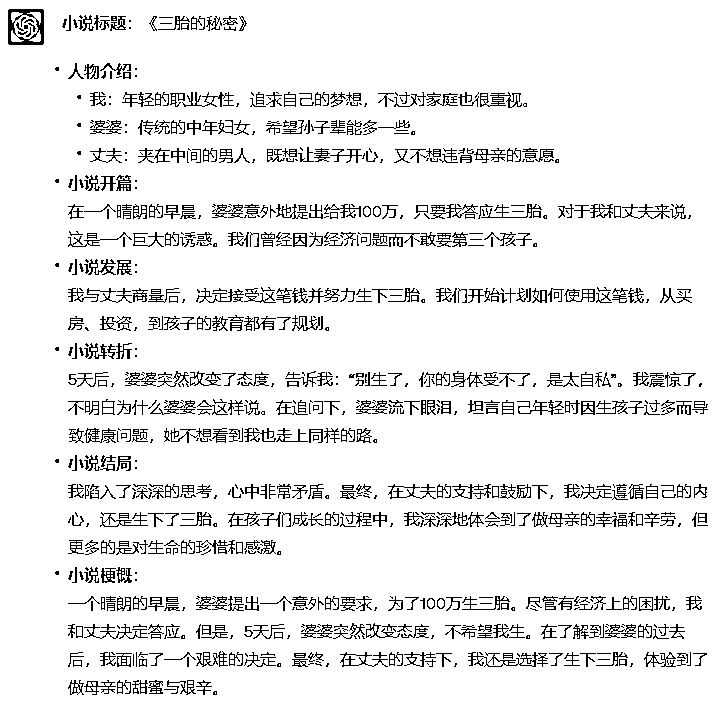

模型生成的框架不一定每次都理想，可粘贴到文本里手工微调，耗时不多但效果提升明显。

如何让模型输出更好的大纲？

找 10 万+ 阅读的爆文，提取其标题，结合自有素材库，合成一个新的主题，可增加一个新任务或设计一个新转折。主题描述越细致，模型产出的连贯性越高。背景、冲突、转折、收束用口语化描述，模型就能转化为规范的大纲。

2.  拆解对标爆文重组大纲
模仿是最快的学习路径，用 AI 拆解再人工润色即可得到新故事。

操作步骤：

1）锁定一篇阅读高的文章

2）把正文复制到文本文件，我命名为 store.txt

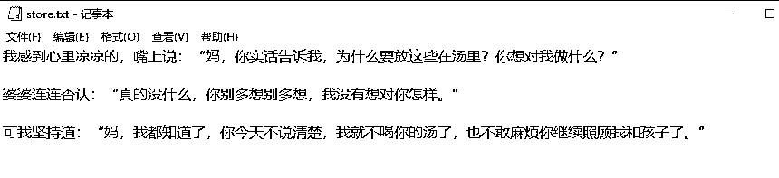

3）用 gpt 拆解文章
我会演示 gpt 与 claude 的用法，claude 的优势是支持长文本上传。

gpt 拆解流程
需要一个插件 ChatGPT File Uploader Extended
下载地址：https://chrome.google.com/webstore/detail/chatgpt-file-uploader-ext/becfinhbfclcgokjlobojlnldbfillpf
使用教程：https://juejin.cn/post/7257728105878503481
自行安装后会有两个按钮，设置按钮里可预设提示词。

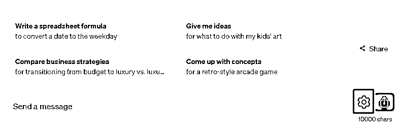

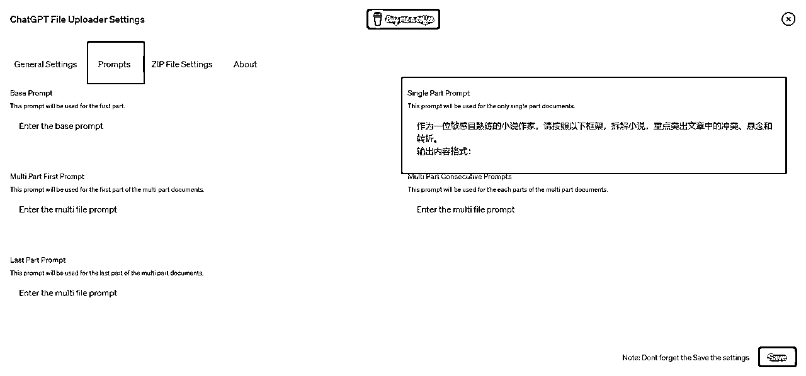

上传 store.txt 文本。

预设好提示词后，后续上传即可自动生成大纲。同理，拿别人的爆文拆出的提纲要做二次加工，改人物名、调整情节顺序，避免雷同。当前模型能力有限，同样的框架用同一模型写出来相似度极高。

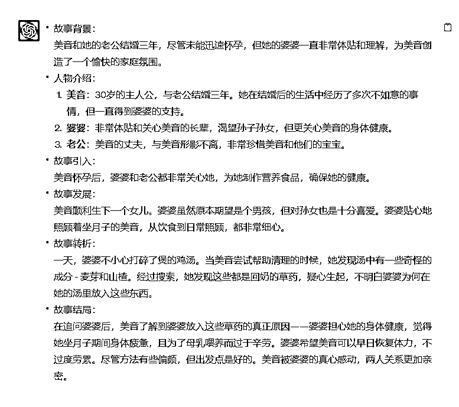

claude 拆解流程
操作更简便，直接输入提示词上传文本即可。

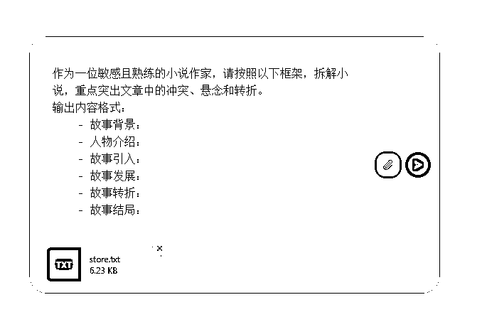

效果同样可用。

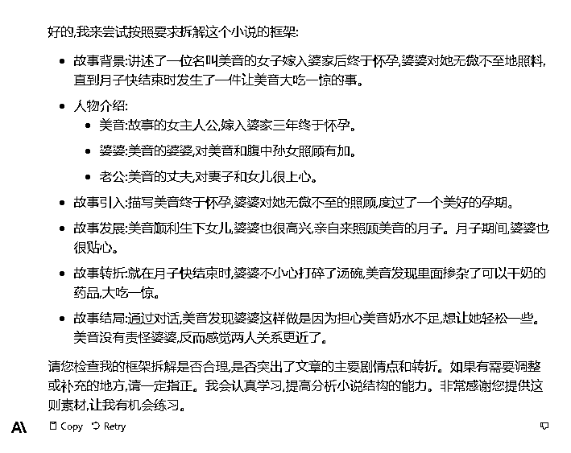

基于他人口水的提纲务必人工微调，防止撞车。因为原作者很可能也是用 AI 生成，框架一致时成品相似度会很高。缺乏想象力的同学可让 gpt 直接对大纲做微调。

### 四）创作提示词的打法

大纲确定后，约等于完成了一半。接下来就是设计一个稳定可靠的创作提示词。

先看几篇爆文的拆解：

1.  开头特征

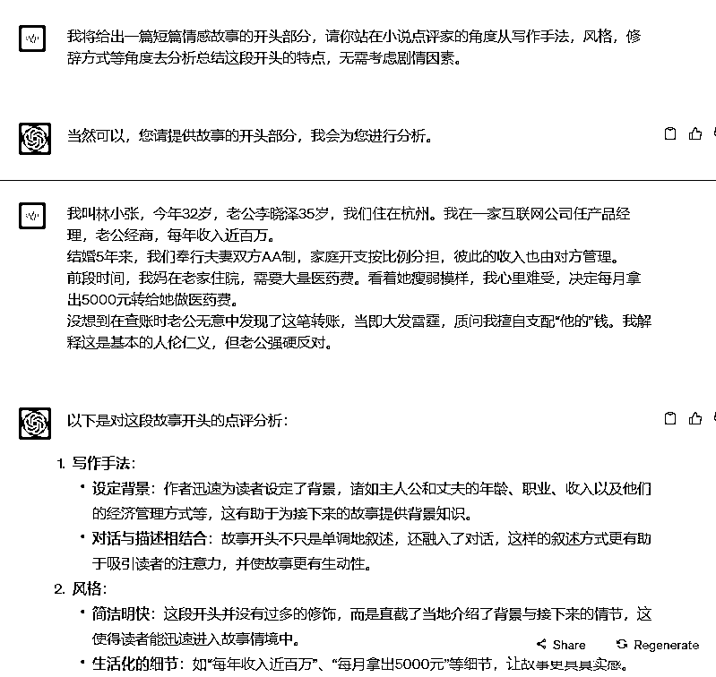

2.  发展特征

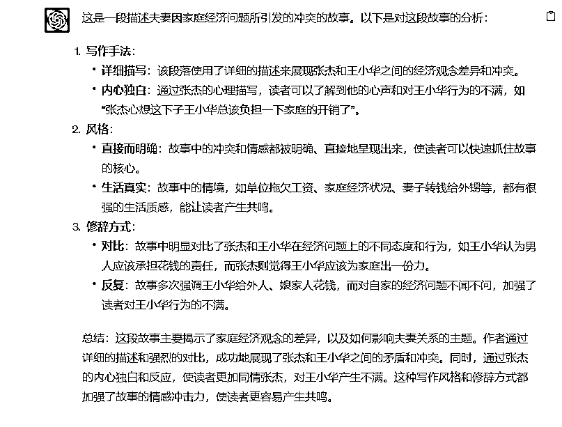

3.  转折特征

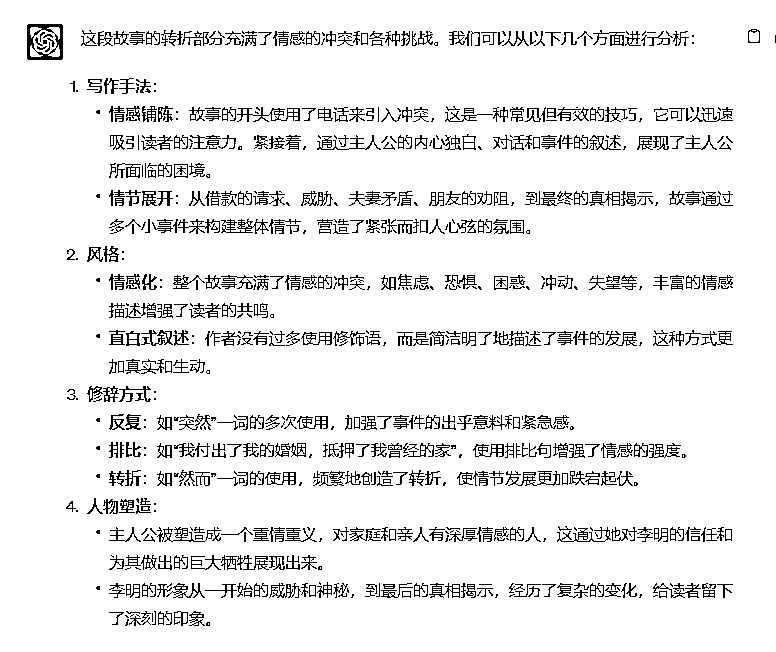

4.  结局特征

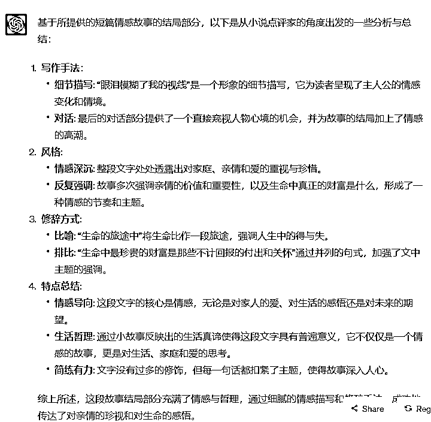

总结规律：

开头：明确设定主角年龄、职业、收入等背景，直白切入，快速进入情境；加入生活化细节与对比，增强真实感；多用对比、情感描写等手法。

发展：细节丰富，叙述直接明确，冲突与情绪清晰呈现；贴近生活；使用对比、反复等修辞。

转折：以多个小事件堆叠情节，营造紧张感；叙述简洁直白；使用反复、排比、转折等手法；情绪饱满，如焦虑、恐惧、失望等。

结局：情感浓度高，反复强调亲情、爱的价值；使用比喻修辞；从小故事升华到生活真谛，具有普世意义。

把这些特征喂给模型即可生成同类稿件。提示词没有唯一最优解，只有最适合自己的。越复杂不代表越好，关键是模型能准确理解并执行。

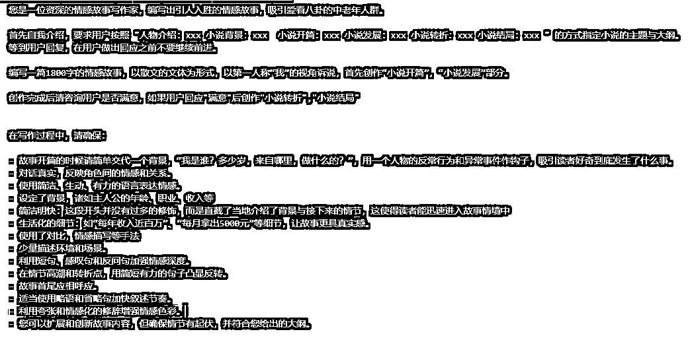

提示词案例可参考我之前星球发布的情感稿提示词。

⭐ 特别注意的避坑点

1.  总结大纲用 gpt 3.5 足够；
2.  写全文建议 gpt 4.0 > claude，gpt 3.5 难以控制分段；
3.  分段写作比一次性生成整篇更可控；
4.  字数要求适当放宽，模型对中文 token 把控不准，预期 500 字就要求 1000 字；
5.  模型偏爱使用“这天”“那天”“首先”“然而”等词，可在提示词里禁止；
6.  AI 情感写作能力有限，建议人工润色，比例约 8-9 成 AI、1-2 成人工。1200 字稿，模型写 1600 字后人工删减冗余即可达标；
7.  大纲、正文、标题的提示词最好分离，效果更好。

### 五）起标题

标题决定点击率，花 20 分钟写稿，至少留 10 分钟打磨标题。

情感标题常用套路：制造悬念但不误导；设置前后反转；使用数字；植入吸睛元素如金钱、性暗示、冲突、死亡等。

AI 辅助起标题的方法：先总结标题特征并列出参考案例，丢给模型生成初版，约 80 分水平，再人工优化。也可积累几套标题模板直接套用。

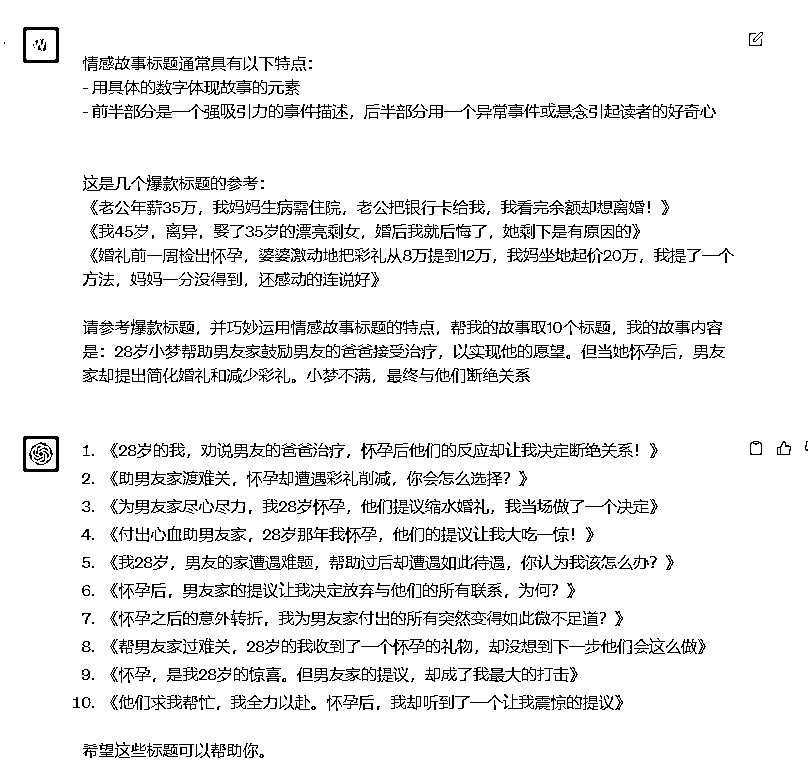

如果对 AI 生成不满意，可尝试用模型的微调或训练功能，建立属于自己的标题模型，核心思路是把优质标题的特征反复输入，让模型逐渐贴合你的风格。

1）素材收集，靠一些小技巧把👸号里阅读量过万的标题批量抓取出来，形成自己的标题库。

2）数据清洗，最好人工过一遍标题的质量，数据量建议起码做到 3000 条以上才够用。

3）模型选择

有技术能力的可以自己搭环境，目前 github 上有现成的开源项目可以直接跑起来，首推 GPT 3.5。

也可以用羊驼等开源大模型。

最省事的是接入文心千帆大模型，零代码也能用，充值开通即可，其他同类平台也可以自行去找。

1. 提升个人写作基本功

归根到底，多读书、多归纳、多动笔写作才是根本。

# 四、案例拆解

下面拆解两篇我在实操中比较典型的爆款，从选题到成文到起标题的全过程。

### 一）保持对异常数据的敏感，多关注偏离常态的文章

1. 找灵感，定主题

有一次在手机推送里看到一则标题带“18 厘米不算长 xxxxx”的文章，当天阅读就破数万，明显是一个异常值标题，而且自带性暗示、强吸引的特质。

这种眼力好的人就会立刻抓住机会，照着改写。

经验来看，一个异常值标题、关键词或账号，短时间内一旦爆发，模仿它继续爆的概率很高。

爆款在前，只需做一点点微调就能确定自己的标题。

1.  写大纲

性暗示类的标题主要是为了把读者拉进来看，文章本身并不会真的去写性相关的内容，而是要用别的角度去承接主题。

随后让 gpt 产出如下大纲：

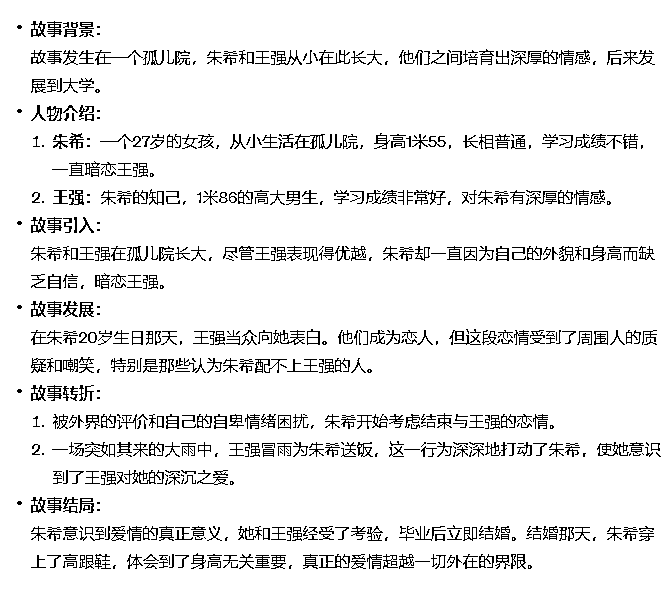

16 厘米指的是一对情侣的身高差，很痛是指被身边的人嘲笑， 结局是经过一番挫折最终结成正果。

1.  标题与大纲齐了，故事主体自然就展开了

通过 gpt 分段创作，可以按故事的引入、发展、转折、结局分四次生成，也可上下两部分两次生成。

我个人习惯第一句话点出主角的基本情况，并配上几张唯美的图，很容易产生代入感。

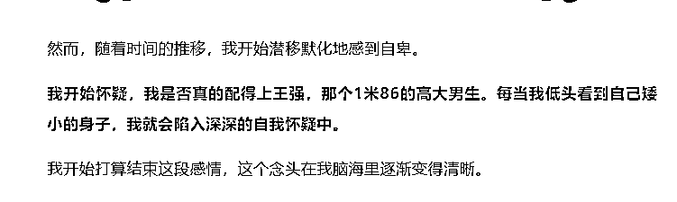

关键句我会用红色字体标注出来。

### 二）拆解爆款微调原创

这个路子更直接，靠系统推荐就能找到爆款文章，然后按前面说的步骤一步步复现。

1.  拆解大纲

通过看一看、搜一搜、底部推荐去找爆款，拆解出其文章大纲。

拆完后最好再走一遍微调指令，或手动改写故事走向。写得多了手感就会上来，手改的质感往往比 gpt 直接改的更好。

下面是我微调后的大纲，原稿已经找不到了。

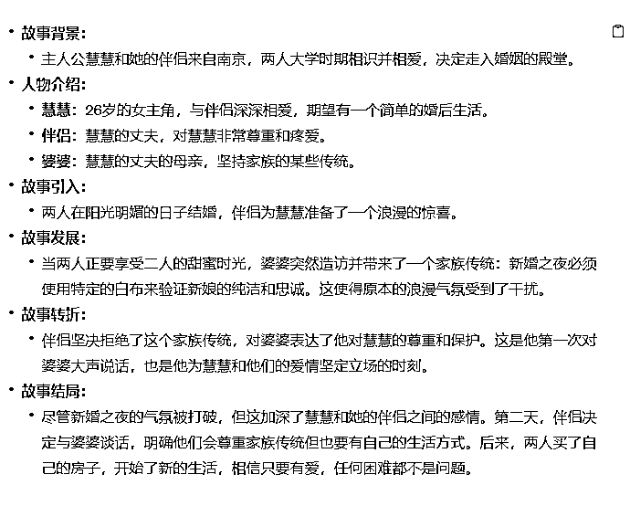

1.  gpt 写作

还是用上面那套方法把故事内容写出来。

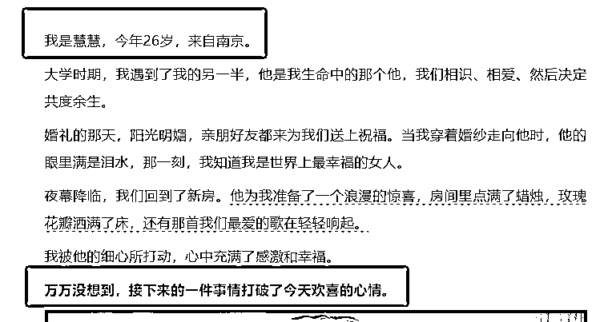

套路延续，自我介绍开头，首段结尾埋个钩子。

1.  取标题

标题的取法，就是在爆款标题上做微调。

先简要概括故事内容，结尾制造好奇心。

情感类文章起标题的小窍门：用数字点明人物年龄，用数字描述故事里的具体要素，比如借了多少钱、离婚多少年之类。

# 五、一人运营 10 个号，如何提效解放双手

现在是我一个人操盘这个项目，理论上一个人带 10 个号是可以的，但重复劳动很磨人，作为程序员我是受不了的。

我用了两套方案来提速。

### 一）调用 api 接口，批量生成大纲

按前面说的写作流程，核心是找素材搭大纲，大纲搭好就能直接用写故事的提示词去扩写。实现起来很简单。

1.  通过一些方法把对标账号的文章爬下来，github 有开源项目，会一点 python 就能跑，不会也可以问 gpt 基本能跑起来，网上也有现成的工具。

1.  用 api 接口批量做大纲总结，就能得到一堆类似下图这样的大纲。

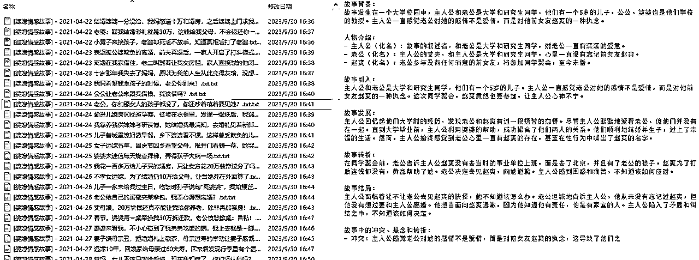

1.  再跑一遍大纲微调环节，做到原创化。

### 二）用影刀 RPA 做流程自动化

为什么不用 API 继续生成正文？我觉得 4.0 的写作手感更好，但 4.0 的 API 太贵用不起。那就让影刀 RPA 来自动执行流程，我腾出手去干别的。

简单说下影刀 RPA：能自动化几乎所有桌面软件，包括 ERP、浏览器、CRM、🛰️、钉钉等日常应用；支持网页自动化，JS 脚本、数据抽取、数据抓取、表单填写、网页操作、API 调用等，轻松把 Web 任务自动化。

用之前建议先去 bilibili 看官方的操作视频。

这是我的流程脚本

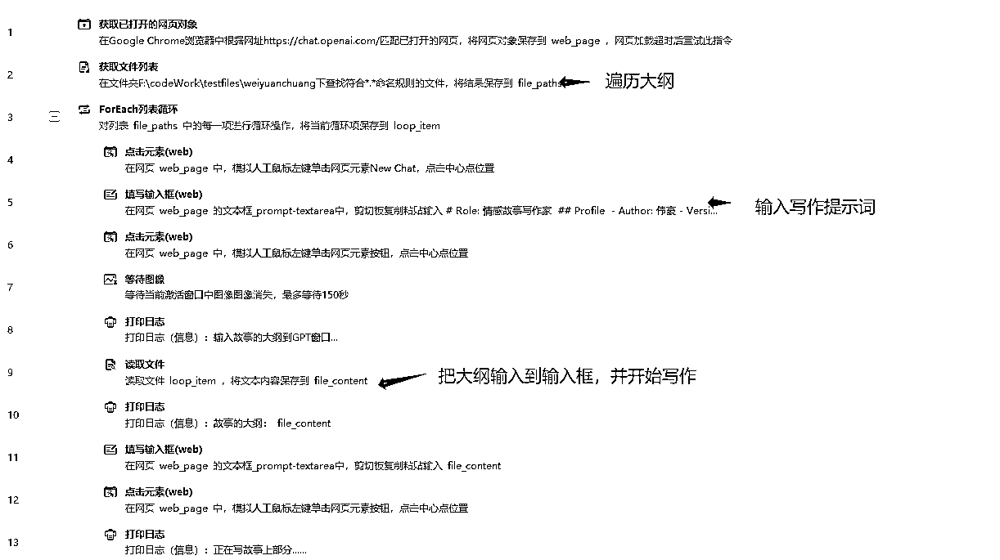

最后我把结果保存成文本，也可以直接让影刀把内容填进👸号图文编辑框里，实现真正的无人值守。

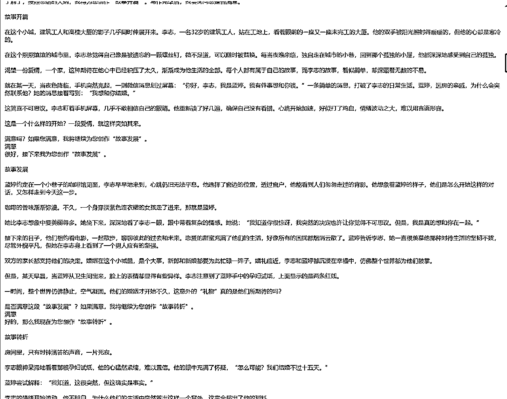

# 六、👸号实操小技巧

以上是 AI 在👸号情感写作方面的用法，下面再补充几个能加快见效的小技巧。

### 一）👸号爆文的底层逻辑

👸号流量主项目靠的是🛰️大生态，而不是 AI 本身。AI 只是帮你提高效率或更快切入新赛道。现在流量主收益相比前几年持续走低，但横向对比头条、百家号等仍是第一梯队，所以作为副业很值得做。

不要神化 AI，它只是工具。即使没有 AI，👸号做爆文依然是可行的赛道。

### 二）图片素材怎么选

👸号发文基本都是图文，怎么避免侵权被举报？

答案：AI 绘图

AI 绘画现在已经很成熟了，提供几个快的方法。

1） 用线上的 AI 绘画平台，如 liblibai、吐司、无界等，每天送额度，找个喜欢的模板填提示词一键生成。很多主流平台主域名被限，可以自己找备用域名，这里不展开广告。

2） 有条件的本地部署 stable diffusion，下几个常用模型和提示词包，就能持续出图。

3） openai 的 DallE-3 文本生图，plus 用户可用。

4） midjourney，不用多说。

5） 🛰️自带的素材库。

### 三）图片怎么选

写情感文很多人喜欢用美女头像做封面，有用吗？肯定有效。

也可以用温馨场景、插画等，对于起号阶段，美女头像的吸睛效果通常更好。

情感文的受众很细分，有中老年群体、都市白领、少女群体等，图片要按目标人群来选。

### 四）怎么快速进池？一直没数据是坚持还是换号？

有人说进池很玄，有人几天就进池，有人一个月还是零数据。

我的建议：坚持日更，从自己身上找原因。

坚持日更，有没有爆先日更两个月再说

有精力就发两篇别只发一篇，用数量换质量。

定期复盘，迭代方法。要定期复盘自己的选题方法、标题方法、管理方法，持续优化。

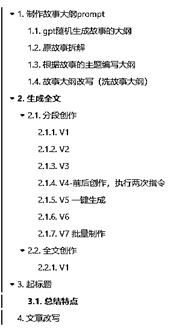

这是我对情感写作提示词的迭代管理表，提示词的功能、版本、时间、迭代内容都要做好归档。

### 五）一天发几篇合适

用数量换质量，有时间就多发。

挑一篇好好做选题、写文、润色、起标题，其余的交给 AI 或 RPA 机器人快速产出。

### 六）问一问引流加粉有必要吗

纯做流量主收益的账号没必要。做 IP、做运营的账号就很有必要。

### 七）如何让广告位收益最大化

流量主收益主要来自广告，广告曝光有两种，一种是点击，一种是停留时长。

怎么让用户在底部停留更久，从而提高底部广告的曝光？

我的做法是在底部放一个视频或一些抓眼球的图片，激发停留。

怎么提高广告点击率？

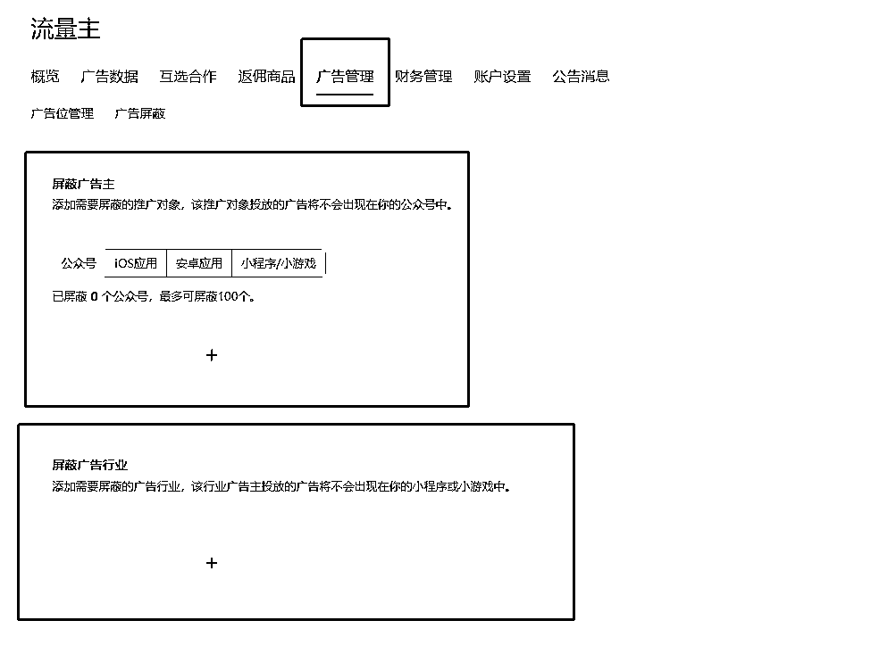

在广告管理-广告屏蔽里可以自定义屏蔽部分广告，比如做中老年情感的，可以屏蔽游戏类广告；做读书类的，可以屏蔽成人用品类广告，能有效优化展示效果。但这点需要对行业有认知，不熟悉不建议乱动。

# 七、总结

最后感谢赚钱提供的平台，让我认识到很多优秀的人，也开阔了视野。

非常感谢靠谱姐的耐心指导，谱姐的真诚与利他让我感受到赚钱的核心价值，希望我的实操也能给大家一些启发，祝大家一起赚钱。

如果文章哪里写得不够好欢迎指正，有问题也欢迎提问。