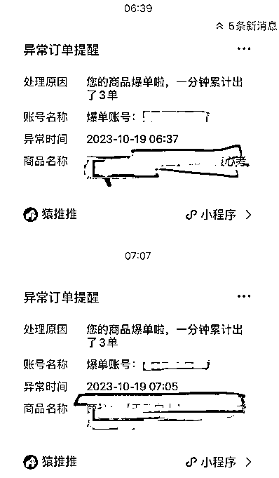
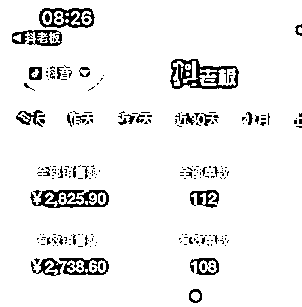
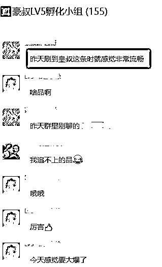
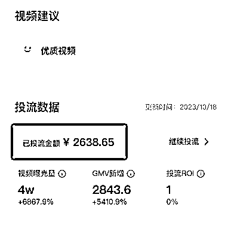

# 凌晨刷到108单的那个清晨，刘皇叔把爆单拆成三步走
作者：龙哥

多年后再回想起抖音的推送，2023年10月19日早晨的情形仍很清晰。猿推推在手机上连续震动，提醒异常频繁地跳了出来。

顺手点进抖老板查看详情。

早上8点26分，有效订单数显示108。

那种感觉，说不清，像被一束光直接照到。

做抖音带货快一年了，偶尔的小高峰见过，但与单日破千的大神比起来，比如豪叔@猎音狮 ，差距还是很明显。尤其是清晨八点出头就破百，这在过去从未出现过。

这次运气撞上了，也正好借着这条跑开的素材，把自己这一年的摸索梳理一遍。核心其实就一个字：改。换视角、换打法、不断微调，让表现越来越顺。

# 1、镜头前的样子

只要有人来请教入行做带货，我的习惯性建议都是从口播入手。

口播更容易沉淀个人标签，品牌方也更偏爱这种直给的内容形态。

之前导演小策跟我说过一句让我印象很深的话：观众可以免费看你的内容，但看完之后，你最好能在他心里留下痕迹。

那怎样的呈现方式最有效？我的经验是，没有放之四海而皆准的公式，只能靠自己反复验证。

我个人的试错记录很长。端坐正经的风格试过，背后放布景也弄过，绿幕抠像也玩过，数据都不理想。后来尝试过情绪外放的喊话风格，拍摄过程很过瘾但很耗体力，转化表现也一般，估计演绎上也有些生硬。

再后来改成平铺直叙的聊天感，跟观众拉家常。为了制造记忆点，我还戴了顶绿色的帽子，老婆看完直呼：要不干脆送你一顶真的吧？

最终这种松弛的聊天感最贴合我，熟悉的人看完反馈也很舒服。

# 2、合作的品牌方

做教辅品类有个隐形福利，多数供应商品牌愿意为达人加码投放。

所以创作者这边的任务很清晰：持续输出、不断打磨内容。至于具体投了多少钱、回本情况如何，更多是品牌方去权衡。

我这次走量的这条素材，对方累计投放已超过两千，而且从趋势看，后续投入还会加大。

不过这里有个关键点，品牌方同样需要筛选和优化。

投放绝非口头一说就能落地。有些品牌称自己是人工控价，结果后台显示的花费只有几毛钱，等于白说。更难受的是那些前期承诺满满，等视频做完后又追加各种前置条件，这样的合作可以直接终止。

哪些伙伴靠谱，哪些不适合，基本只能靠长期接触慢慢摸清。

# 3、持续做片

前两点确认下来，第三步自然就顺了。

选定一个可配合的商家，看好他们旗下的某个单品后，就要进入高频制作阶段。文案换一套、呈现换一版，反复以不同形式去试。做完后把链接交给商家，由他们来投放测试。

到最后，创作者能做的，就是第二天早起打开手机，看有没有新的惊喜。