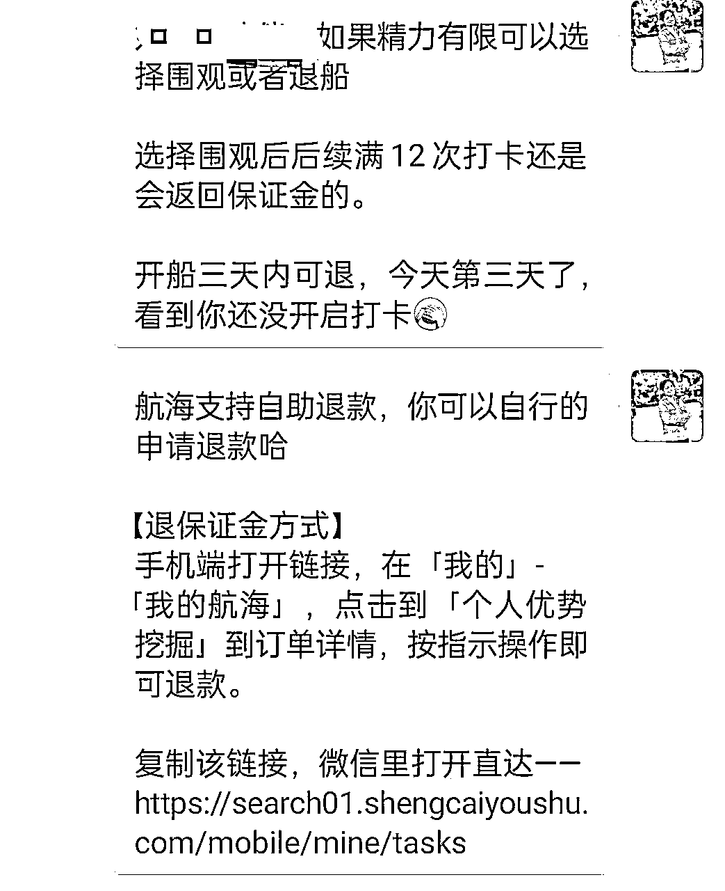
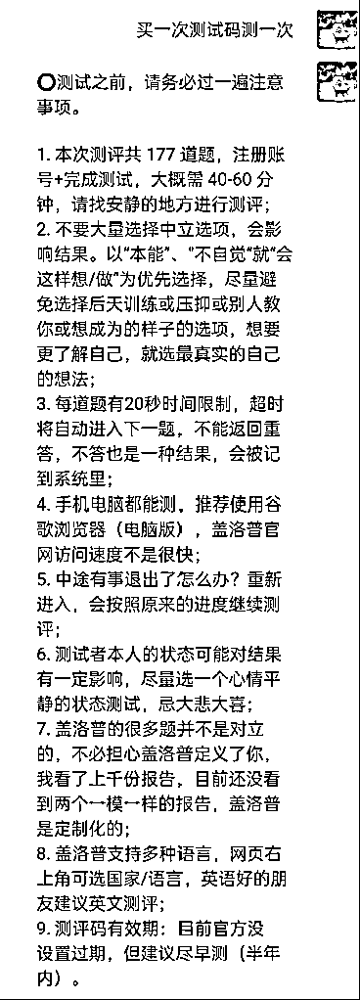
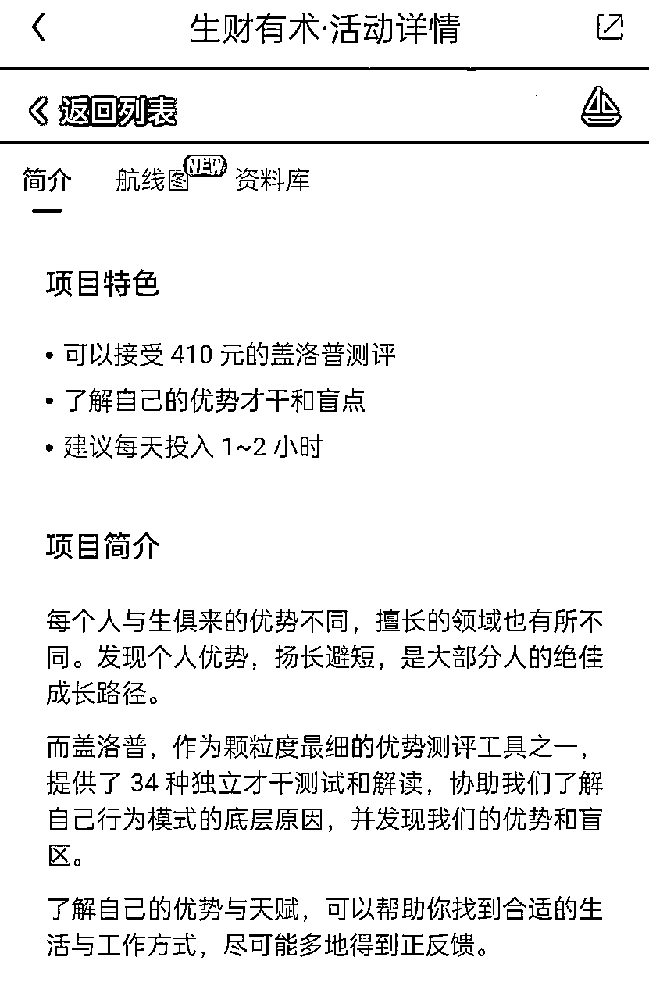
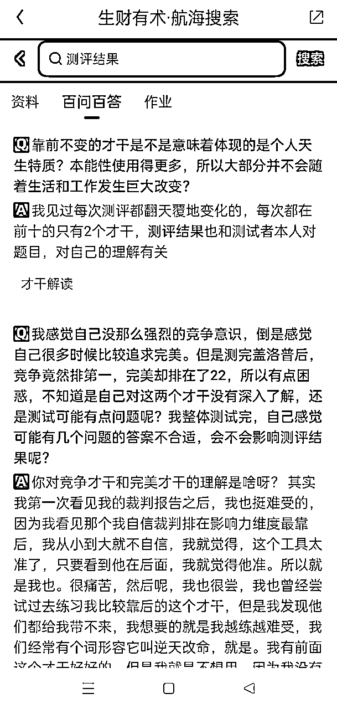

# 第一次做航海志愿者？这份“避坑地图”请收好，帮你丝滑上手指南

> 分享人：陈艳
> 连续三届航海志愿者，从“小白”到“熟手”的真实经验复盘

大家好，我是陈艳。

今年我连着做了三回航海志愿者。从最开始对生财志愿者团队充满好奇又忐忑，担心自己干不来，到真正加入后，被这个满是正能量的组织深深吸引——这一路，踩过坑、也攒了不少心得。

现在八月航海收尾了，我把这段经历里的思考和做法重新梳理了一遍，作为下一程的迭代素材。主要聚焦下面三个方向，希望给刚上手的你一点灵感：

**① 三张表帮你稳住志愿者全场**
**② 志愿者常遇的高频问题与破解思路**
**③ 提高效率的几个借力小技巧**

---

## 一、肚子有“表”，心里不慌

所谓“三张表”，其实是在航海手册和优秀志愿者经验基础上，结合我自己的实操习惯沉淀出来的。目的在于让自己开船前从容迎接船员，开船后有序推进每一项任务，真正帮船员抵达彼岸。

### 第一张：船员基础信息统计表（志愿者自用）

这张表的价值，在于提前摸清船员的基本盘，让邀请进群、打卡节奏跟进变得更有抓手。船员是谁、目标打几次卡、什么时间方便被提醒，一目了然。表格第一行有填写说明，直接复制改一改就能变成自己的工具。

### 第二张：航海目标及需求调研表（船员配合填写）

这张表最妙的地方在于：它像一根线，把志愿者和船员在21天里紧紧串起来。双方对目标、节奏有了共识，沟通成本大幅降低，也更容易帮对方拿到阶段性结果。

小建议：复制模板后，可以加上自己航道的项目名称和特有要求。如果是实操型航海，尽量把目标量化成可衡量的数字。

这张表不用急，开船前填完即可，或者船员一进群就顺势邀约。

**话术参考：**

> 开船前想邀请您做一个航海小调研
> 关于您的航海目标、提醒频次及方便交流的时间段等
> 咱们一起努力，让这次航行顺顺利利，一起生财有术
> 知道您在忙，不多打扰，填完记得回个消息哈，感谢
> 直接点击链接参与：https://www.wjx.cn/vm/rmuVX4W.aspx#

### 第三张：志愿者任务检查清单（志愿者自用）

这张表适合用来对照交付成果、记录待办和注意点，方便下一期继续优化迭代。模板同样可以复制后改成自己喜欢的样子。

---

## 二、高频问题，见招拆招

### （一）邀请船员阶段

**1. 船员有两个微信号，想用非星球账号参加？**

非星球账号完全可以参与，只要提供生财有术的信息编号截图即可。但注意：大小群只能进一个微信。

**2. 群公告由谁写？**

可以先建群，等领队发统一模板；有经验的志愿者也可以先写一版供参考。

**3. 加船员好友一直不通过？**

自查一下好友申请里是否写清了志愿者身份和来意。多发两次申请后未通过，可以转用短信、知识星球留言，必要时打电话，也可以求助领队或鱼丸。如果对方只是忙，适当拉长提醒间隔，别死缠烂打。

**话术参考：**

> a) 知道您忙，不多打扰。您通过后回个消息哈，进航海群前需要跟您对齐一下流程和注意事项。
> b) 对方答应后又没动静，可以第二天再提醒：“航海明天就开船啦，想再确认一下您这边是否参加？还是后台帮您标注围观或退出？空时回复我一下，感谢支持。”

**4. 邀请时提示“请仔细核实对方身份，保护自身财产安全”？**

这提示不一定是你的号有问题，也可能是对方账号有风险。可以稍等再邀；邀请时尽量分批少量，别集中猛拉。新号尤其容易触发，建议先养一段时间号。

**5. 老船员觉得流程熟，希望直接进群？**

哪怕再熟悉，每一期流程都要重新过一遍，对齐信息能避免后面不必要的摩擦。

**话术参考：**

> 知道您对航海流程已经很熟啦，后续开船后期待您多多带带氛围。另外也想请您配合一下：每期航海不论新老船员，流程都要一起走一遍、对齐信息。咱们快速搞定，然后我邀请您进大小圈哈，谢谢啦。

**6. 后台显示37人，实际只有36人？**

多出的那个就是你自己，别慌。

**7. 船员想围观，怎么处理？**

先在后台备注“无需提醒”，同时同步领队。围观船员若在航行中表现积极，也可以提醒一下：围观满12次打卡，保证金照常全额退。但志愿者不用单独去催围观船员打卡。

**8. 开船三天了还没打卡？**

私信提供退船/退款链接，一般船员都会回应。

**话术参考：**

> xxx伙伴，若精力有限可以选择围观或退船。
> 围观后只要满12次打卡，保证金还是会退的。
> 开船三天内可退，今天最后一天了，还没看到你开卡，有点担心你错过啦[捂脸]
> 航海可以自助退款，你随时自行操作。
> 【退保证金方式】
> 手机打开链接，「我的」-「我的航海」-找到对应订单详情，按提示退款即可。
> 复制这条链接在微信里打开：https://search01.shengcaiyoushu.com/mobile/mine/tasks

**9. 后台发现船员默默退出了？**

如果对方没进过航海群，可以忽略；如果已经进群了，请对方自己退群即可。

**话术参考：**

> 你好，后台显示您已退出本次航海
> 麻烦动动手指，抽空退一下大小群哈，感谢。
> 对方没看到的话，可以善意再提醒一次。

### （二）开船后阶段

**1. 航海手册能打印吗？**

目前只能通过电脑或手机登录生财有术查看，没有可打印版本。

**2. 遇到“水日志”怎么办？**

先结合打卡内容和后台数据判断：对方是否同时跑多条船导致精力分散？或是航海内容和预期不符、本职工作太忙？只有了解背后原因，才能真正帮对方上岸。同时提醒对方：水日志不计数，要满12篇有效日志才能退回保证金。

### （三）个人优势挖掘航道的常见问题

这类航海常涉及盖洛普测评，针对没有报告的船员，高频问题如下：

**1. 没有盖洛普报告还能参加吗？**

可以，航海手册照常能看。只是个人优势挖掘是围绕测评报告展开的，有了报告才能更好地深入认识自己。

**2. 没报告对打卡有影响吗？**

可以发1至2篇往期优质打卡日志、航海手册和高手分享给船员，让对方自行了解模式并做判断。

**3. 盖洛普测试码只能用一次？**

是的，一次测试码只能测一次。测前务必提醒对方注意这几点：
- 共177道题，注册+测试约需40-60分钟，找安静环境做
- 别大量选择中立项，优先选“本能的第一反应”，不要揣测“应该怎么答”
- 每道题限时20秒，超时自动跳题且不能回改，不答也会被记录
- 电脑手机都能测，推荐谷歌浏览器，官网速度偏慢
- 中途退出没事，重进会从上次进度继续
- 尽量情绪平稳时测，忌大悲大喜
- 不用担心被“定义”，我见过上千份报告，目前没有两份完全一样的
- 右上角可切换语言，英语好建议直接英文版
- 测评码官方尚未设过期，但还是建议半年内用完

**4. 船员以为测评是航海赠送的，结果发现要付费？**

需要明确告知：测评单独收费，可配图直接说明。

**5. 船员不知道怎么买测评报告？**

有人早买好了，有人头一回听说。航海优势大群有专门的教练负责，志愿者提前加教练好友，把教练名片推给船员，提醒对方申请时备注“参与个人优势挖掘的xxx，需要购买测评码”。测试前的注意事项也要同步转发给对方。

**6. 测评结果有疑问怎么办？**

可帮对方在航海资料里搜索相关关键词并分享；也可以引导对方去优势大群直接举手提问。

---

## 三、巧妙借力，效率翻倍

### ① 借力“志愿者大群”

这个群是一座宝库。进去先看群公告，最新版航海SOP和邀请材料都在这里。平时多刷刷当日讨论，很多问题和任务节点高度相关，别人的坑可能就是你的坑。提问前先在群内搜关键词，找不到答案再开口问。

### ② 借力“手册 + 后台”

志愿者手册、航海手册和后台自带的规则，其实已经覆盖了大多数问题——善用搜索，答案就在那里。

### ③ 借力“领队 + 志愿者小群”

大群信息爆炸时，小群提问更精准。新手照着领队给的todo清单，一天天推进，遇到问题多问就好。

### ④ 邀请阶段的几个细节

- 给船员做备注时，尽量使用统一符号或图形标记。开船前审核大群昵称、入群状态时，识别度高的符号会替你省很多力气，在大群中也能一眼锁定自己的组员。
- 一般有三天邀请期，强烈建议分批邀请，别集中操作，降低风险。
- 信息从后台复制到微信对话框，可以用手机发好友申请，电脑同步走航海流程，效率更高。

---

一篇经验，难免受限。若有不当之处，请一定包涵并指正。

每期航海都会迭代，遇到问题随时找领队、鱼丸和相关工作人员。

感谢优秀的船员们、领队们、志愿者们、教练们和生财团队，让我一路抄作业抄到现在。感恩遇见，看见了更多可能。

愿我们在生财之路上互学共进，持续破浪，一起生财有术。