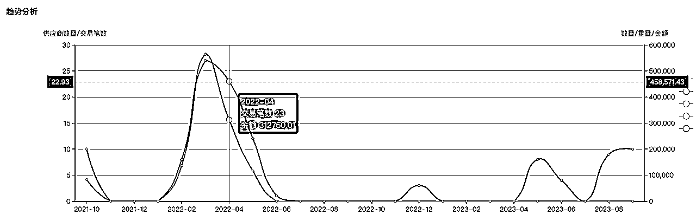
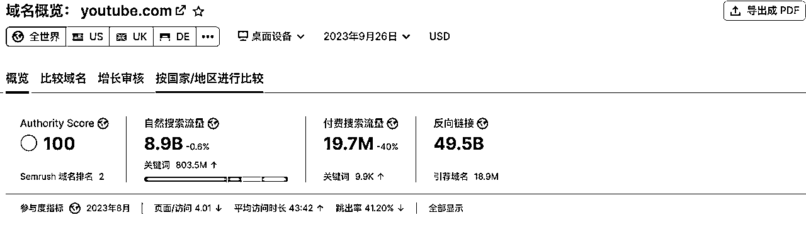
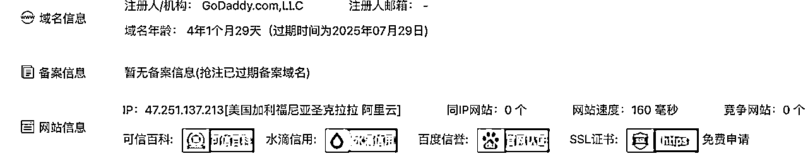
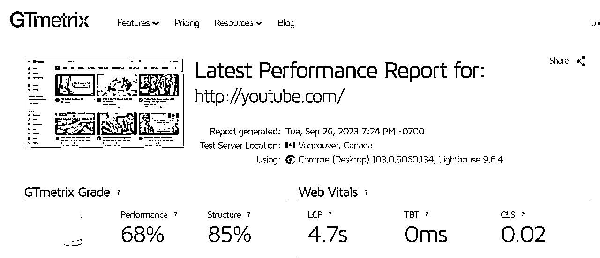
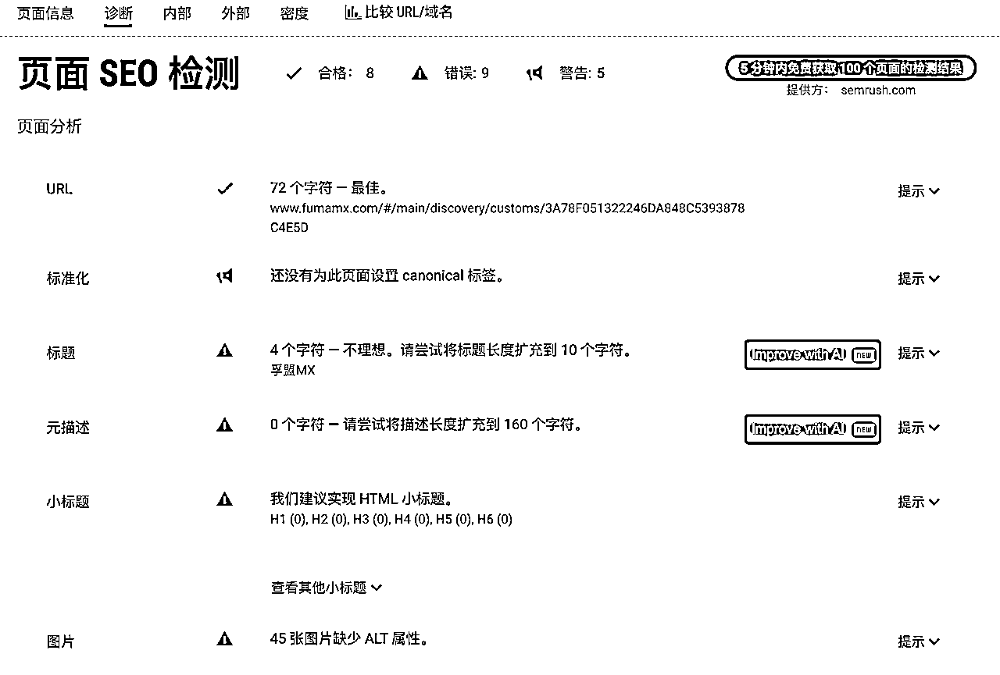

# 外贸入局指南：从0到1，这6条出路哪个适合你？

做外贸这件事，好像人人都听说过，但真正想迈出那一步时，很多人又卡住了。B2B跨境电商确实是一条帮助企业拓宽国际市场的重要通道，选对了模式，能省成本、拉销量、增强竞争力；可要是选错了，真金白银砸下去，连个响都听不到。大多数想出海的企业，最纠结的往往不是产品，而是——下一步到底该做什么、该怎么做，甚至有人因为焦虑而跟风乱选。

我是龙哥，一名干了4年外贸运营的“老油条”。过去也一直在圈里潜水学习，听了不少故事，也经历了不少头脑风暴。这次受鱼丸老师鼓励，把自己的一些心得整理成文，和大家聊聊外贸这摊事。

本文就按“为什么做外贸—出口方式拆解—入局准备清单”三部分来说。

## 一、为什么非要做外贸？

1. **再也不用被“回款”拖死。** 做过国内生意的老板都懂，最头疼的不是签单，而是催款。钱到不了账，现金流就断了，逢年过节还得送礼请客，酒桌上赔笑，心累。外贸虽然也有售后问题，但应酬少得多，回款也规矩得多。

2. **利润空间真的不一样。** 国内现在几乎所有行业都卷疯了，供应商一个比一个能压价，最后赚的还不够交房租。除非你有老客户、有稳定渠道，否则利润薄得可怜。国际市场呢？供需并不平等，很多地区在特定时期特别缺货。比如前两年欧洲天然气供应紧张，北欧遇上超级寒冬，整个欧洲都在抢火炉、采暖设备；卡塔尔世界杯前，为了安置游客，当地大量采购中国的活动板房和集装箱房。这种机会，国内卷不出。

3. **鸡蛋别放一个篮子里。** 把市场局限在国内，一有波动就受影响。卖向全球，等于给自己多开几扇窗。

## 二、六种出口模式，逐一拆给你看

### 1. 海外办事处/分公司
这是所有方式里最难啃的骨头，没有之一：投入大、管理难，但一旦做顺了，优势也最明显。
- 在东南亚这类地区设点，能享受到便宜的人工和土地，而且当地人口结构年轻（44岁以下占70%左右），电商还处在上升期，红利很大。
- 对供应链复杂、对技术安装有严格要求的公司来说，海外设点能更好地管供应链、缩短交货周期、做好落地服务。
- 开拓市场也更接地气，能直接对接当地经销商、代理商，客户服务更到位。

当然，到底投入多少，得看当地人力地价和设备成本，上限不低。

### 2. 行业展会
展会一直是圈里公认的“快速获客”渠道。像德国汉诺威工业展、广交会、法兰克福车展、上海车展、柏林IFA、拉斯维加斯CES，都是业内顶级舞台。去展会的好处是：企业实力、规模、产品能集中展示，精准意向客户会主动找上门，谈起来也直接。

但参展也有不少门道：
- 热门的展会需要提前一年甚至几年占位，正规展会多是实名制，黄牛基本没法掺和；但那些不实名制的展会，热门位子常被关系户和黄牛把持，想拿就得高价收。
- 很多地方商务局会根据当地特色产业链（比如济宁的工程机械、潍坊黄楼镇的矿山机械、深圳的LED屏和键鼠）集中申请展位，再分给本地企业，这是一条又便宜又正规的渠道。
- 展会也不是一定有效。疫情让展会停摆过，今年春季广交会，国内企业都憋着一口气去参展，结果到场的海外客户大多是东南亚、非洲地区的，欧美高端买家很少，很多人名片都没发完。当然，这不影响部分行业照样拿单，但总体要理性看待。

投入从几万到几十万上百万都有可能，展位大小、装修、差旅都能控制，预算比较灵活。

### 3. 跨境电商B2B平台
新手入门，这条路门槛最低。国内三大平台各有脾气：

**阿里巴巴国际站**
1999年创立，背靠阿里，品类几乎覆盖全球所有行业，日用品、快消品是强项。平台全球砸钱做广告，流量巨大，信用保障体系能帮助成交。支持群发询盘，客户回复率高，还提供采购代理、质检、仓储物流、支付结算等增值服务；触屏端和PC端用户比例大约7:3。缺点也明显：规则经常变，非常吃运营；运营水平一般的话，只能靠加广告费补流量。有人用很低预算拿到红利，也有人砸了几十万没动静。首年续约率近年来不到50%。年费从几万到百万都有，上不封顶。

**中国制造网**
1998年上线，母公司焦点科技是A股上市公司（002315）。名字自带“Made in China”光环，工业机械、建材五金是优势类目。和不少海外展会、商会有合作，会有商会内推订单（RFQ）。平台规则简单，一对一问询，后台操作傻瓜式，一个人就能打理。触屏和PC端用户比例大约4:6，B端客户占比高达95%（2021年10月数据），性价比突出，首年续约率约60%，其中很多是工业机械类企业。母公司还在布局独立站、谷歌SEO、CRM、外贸培训、海外仓等全链路服务。年费大概几万到几十万。

**环球资源**
1971年在香港创办，1995年上市，是行业里最早的上市公司之一；最早从杂志起家，后来逐渐拓展到展会和线上平台，现在被黑石集团收购。电子行业是强项，对产品审核比较严格，供应商分六个星级。但2017年被收购后，因为背后资本方严控广告投入，流量下滑明显，年费也一路走低，早年十几万，现在几万两年都有。选择它的企业主要集中在广东一带。一般年费10-20万。

**流量方面**：阿里最大，中国制造其次，环球资源最弱。而且阿里的流量C端占比高，来源包括亚马逊、速卖通、谷歌，不少企业反馈它越来越偏向C端；中国制造网虽然总量不大，但六成多来自谷歌和B端渠道，买家质量更纯。

### 4. 海关数据
这是外贸人做背景调查、主动开发客户的“侦察兵”。通过海关数据，你能看到目标客户采购数量、采购频率、主要货源地、采购金额，从而判断对方是不是优质买家。市面上的海关数据价格差异大，主要受几个因素影响：数据全不全面（有些国家不开放）、有没有反推技术（比如美国只公布数量不公布金额，需要从出口国数据反推）、更新频次（月更、季度更价格不同）、数据完整度。

海关数据最大的痛点是：即便知道客户公司，却很难找到采购决策人（采购经理、CEO、创始人）的邮箱、电话或WhatsApp。有些软件能靠算法标注关键联系人，但准确性还得自己判断。

### 5. 谷歌SEO/SEM
谷歌是全球最大的搜索引擎，2021年9月统计显示，92%的网民都用它。对于做外贸的公司来说，谷歌几乎是流量的“咽喉”。

两种打法：
- **SEM（付费点击）**：砸钱买流量，见效快，但烧钱也很快。
- **SEO（自然排名）**：通过内容原创、关键词布局、网站结构、导航、安全协议、响应速度、外链、用户行为数据等综合手段，让网站尽量排到首页。SEO见效慢，但一旦跑起来，流量成本很低，不过吃技术、吃运营。

想评估网站优化情况，有几个实用工具：
- **SEMrush**：能看网站自然流量和付费流量数据，注册就能用，不用🪜。自然流量越高，说明SEO做得越好。

- **站长工具**：输入域名就能查网站年龄、同IP站点和服务器位置，不用🪜。

- **GTmetrix**：测试网站速度和SEO评级，需要🪜。评分越低说明优化越差，越高越好。另外，网站加载速度要匹配目标市场，如果你做的是发展中国家，页面打不开，客户扭头就走。

- **SEOquake**：一个浏览器扩展插件，能全维度诊断网站问题，哪里符合谷歌收录规则、哪里需要改进一目了然。下载安装时可能要🪜，但使用时在对应网页打开即可。

别只盯着谷歌，很多地区有本土搜索引擎：俄罗斯的Yandex、韩国的Naver、还有Bing、Yahoo、Ask、DuckDuckGo等。小语种市场，比如德国的Web.de、英国的Oscobo、捷克的Seznam，也可以研究一下。

### 6. 海外社媒推广
Facebook、Twitter、YouTube、Instagram、LinkedIn、TikTok，这些平台现在已经是外贸人的标配。社媒的核心思路不是“等客户来”，而是“主动找人”。你要在产品和品牌定位清楚的前提下，去分析目标市场的人群结构、消费习惯、文化背景，然后把内容精准推给潜在买家。

社媒的优势是：成本相对低，成长空间大，靠研究平台算法能触达精准人群，长期回报可观。缺点是：用户本质是C端个人，很难直接成单，信任度低、没有平台背书；另外内容拍摄、剪辑、发布节奏、互动运营都有门槛，尤其短视频起来之后，比传统货架电商和展会地推更难玩；短期内很难见到收益，需要放长线钓大鱼。目前这个领域的服务商多为工作室和个人，成规模的公司不多，收费也五花八门，按播放量、粉丝数、软文推送、视频拍摄、爆款数量等计价。

## 三、入局外贸前，这些准备一个都别省

**官方手续，先办齐** ：工商注册、海关注册、外汇银行账户、税务登记、退税申请，这是基本动作。

**盯紧扶持政策**：加入当地商务局的官方群，很多地方会给出口企业发“红包”，包括展会补贴、线上展会补贴、B2B平台补贴等。通常港口城市补贴少，内陆鼓励出口的城市更积极，高新开发区的补贴金额往往比老城区高，到账也更快。

**理解国家战略**：“一带一路”倡议、RCEP全面经济伙伴关系协定，带来的是真金白银的关税减免和贸易程序简化，成员国之间互信增强，成交率也会提高。

**产品与市场定位**：你的产品用什么行业？哪些国家是目标？当地有没有苛刻的认证或准入要求？比如欧盟、美国、印尼等对部分中国商品有反倾销政策，欧盟还有一些特定产品认证，不搞清楚就冲进去，很容易踩坑。

**选对货代**：货运代理基本包办运输、清关等一揽子环节，找一个靠谱、专业的货代能省很多事。

**预算规划**：人员招聘、办公场地、推广渠道，都要用钱，量入为出，别一上来就铺太大。

**给新手的路径建议**：先从B2B平台和海关数据切入。平台自带积累多年的买家资源，你只管发布产品、投广告，就能等来询盘；海关数据则用来做买家背景调查、筛选优质客户，几乎人手必备。等到外贸业务跑顺了，再考虑布局谷歌推广和参加海外展会，那才是进阶的玩法。

最后，真心推荐每个外贸团队都配一套CRM客户管理系统（具体哪家就不打广告了，自己研究）。它能让客户二次跟进更有条理，也能防止业务员离职把客户一起带走，提高成交转化率。

外贸这条路上没有捷径，但每一步走得稳，就能少交很多学费。愿大家都能在海外市场找到属于自己的那片花田。