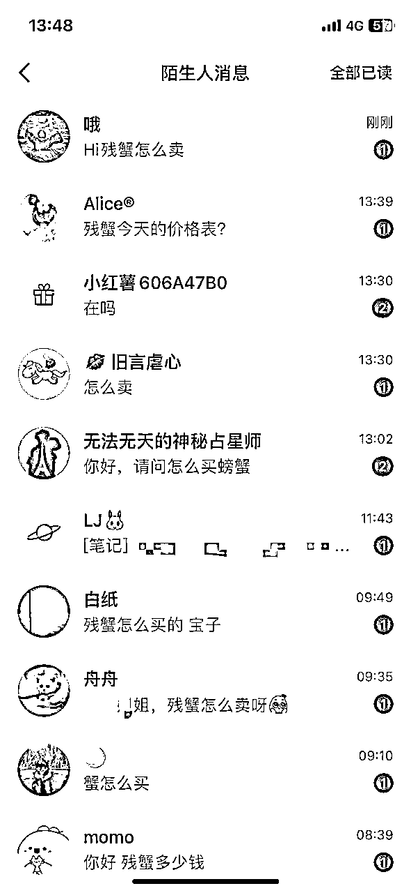
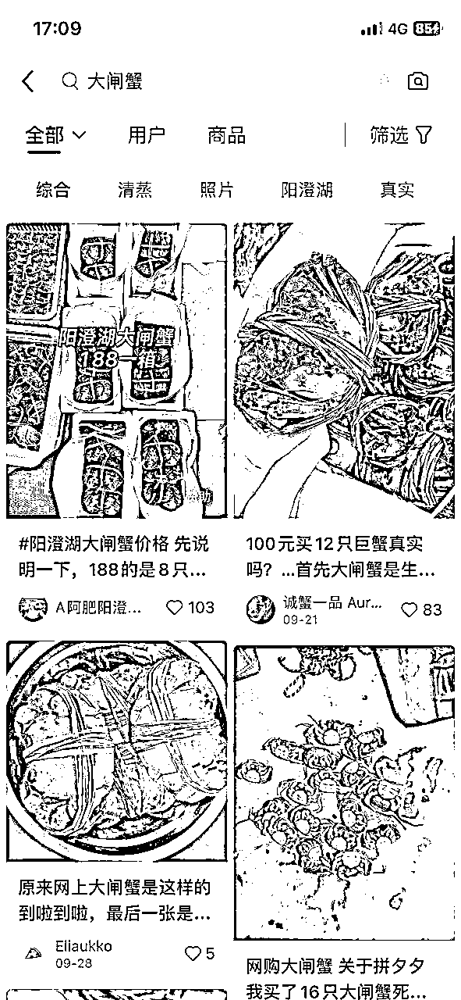
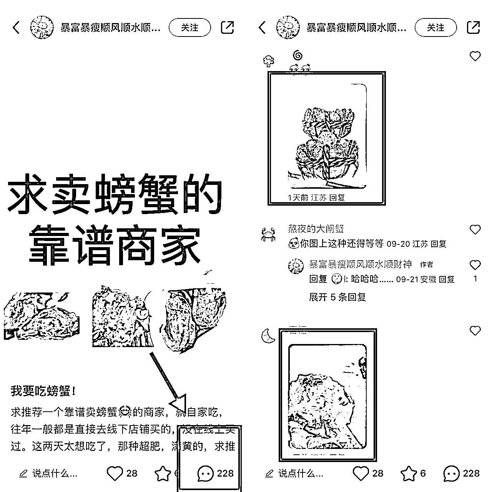
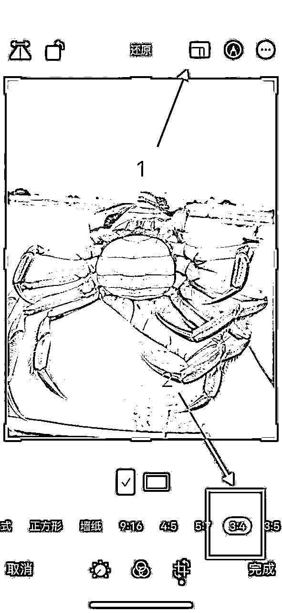
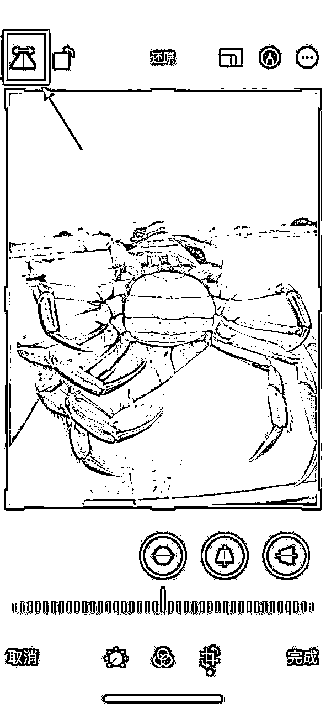
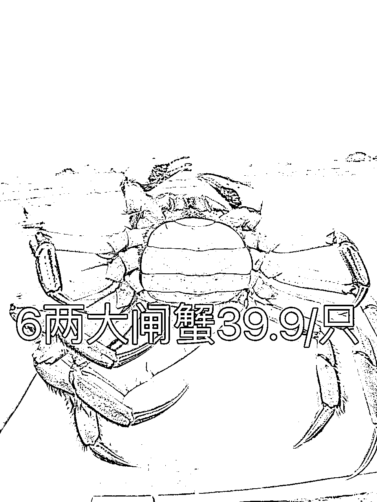
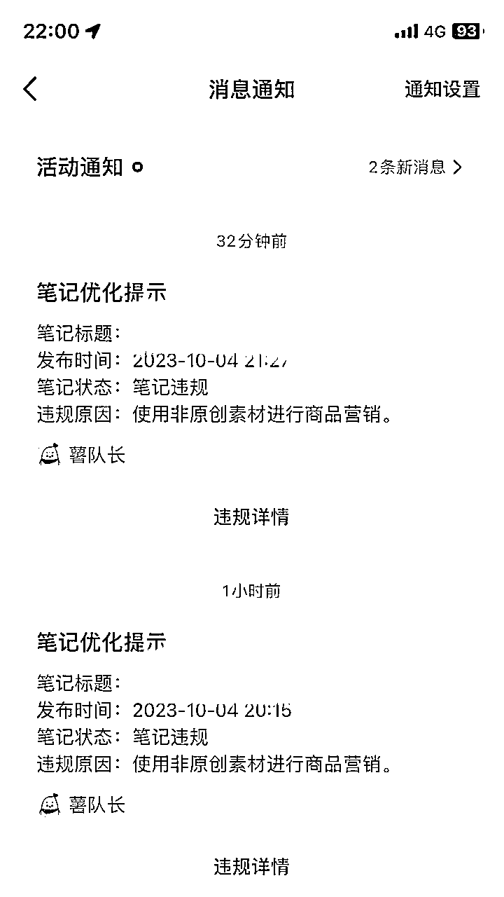
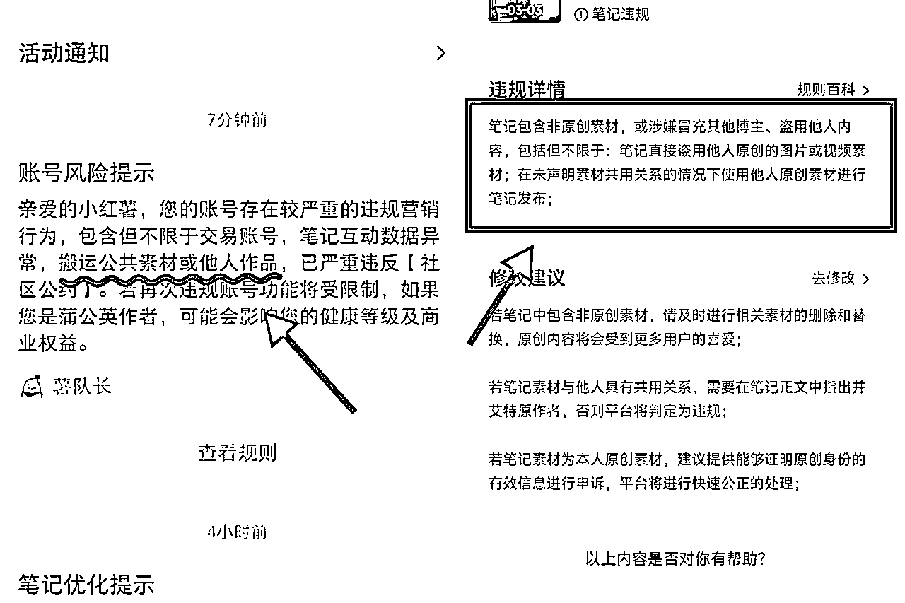
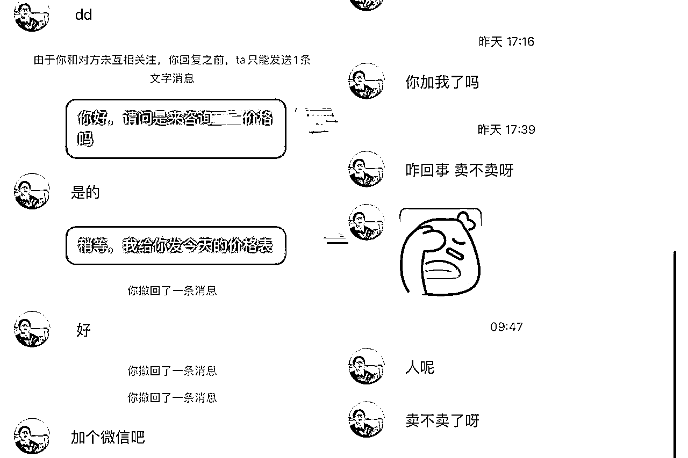
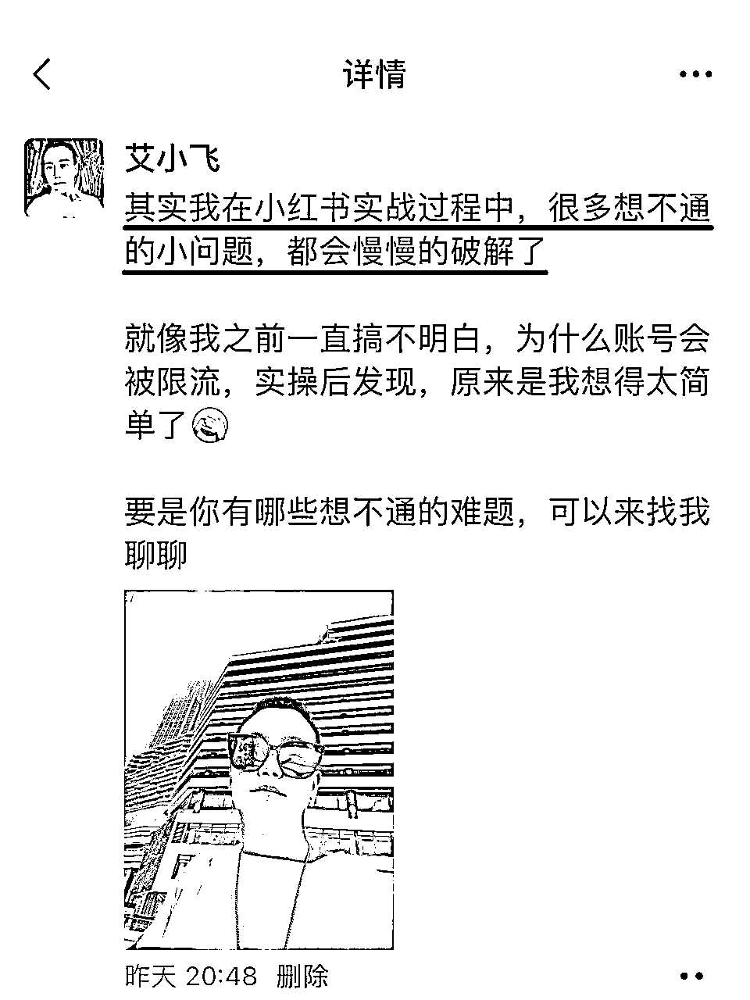

# 小某书采集内容也能做出好业绩？我的螃蟹项目实测复盘
作者：龙哥

我一直专注在小某书上帮别人做获客，也有不少圈友私底下问我：采集这条路到底能不能走？

说实话，我身边想干这件事的人很多，但真正敢下场的很少。原因不外乎是怕发出去后平台直接给警告，甚至是悄悄降权，最后把号废掉。我翻过网上各种教程，要么空话连篇，要么全是编出来的“假经验”，看完该怎么干还是不知道。

前几天我在做螃蟹品类的项目，从获客、转化到成交，全程用的都是采集玩法。结果呢？没被限制不说，精准买家还陆续找上门。新号次日就拿下首单，隔天再开一个新号，高意向咨询马上出现。

所以这次我结合自己的真实操作经历，把这套玩法一层层拆开来讲，希望能给你一些真正有用的参考。

咱们直接开始。

## 内容从哪里找

不少朋友卡住的第一件事，就是去哪里找内容。抖音？淘宝？还是别的平台？

我的答案很简单：就在这个平台内部找。

有人就嘀咕了：在小某书上采集小某书的内容，不是更危险吗？

直接照抄当然不行，但方法用对，完全能绕开风险。

拿我的例子来说。当时我打算卖螃蟹，但我住在广西，身边根本没有江苏的货源，也不可能亲自跑去产地拍图。所以我做的第一件事，就是在小某书上搜“螃蟹”。

碰见一个从买家角度分享吃蟹体验的帖子。

然后我把这个作者的留言区翻了个遍，专门挑那些画面诱人、卖相很好的买家晒图。只要是我自己看了都忍不住想买的，马上截屏存进相册。连续逛完20个同类账号，图片库就够用挺长一段时间了。

为何偏选留言区？

因为在留言区晒图的，大多是买家亲自拍的照片，真实、接地气，能让人很快产生信任。更关键的是，这些图基本进不了平台的内容库，被判定为采集的风险相对更低，所以我囤内容的主力渠道就是这里。

如果其他品类也愁找不到合适的图片，完全可以套用这个思路。但有一点要记住：只能截屏，千万别把原图保存到手机里。别下载原图！别下载原图！别下载原图！重要的话说三遍。

## 图片到手后怎么处理

图片攒够了，真正的考验才到来。

不少号主就是栽在这一步，费了好大劲攒来的那点数据，转眼又让平台给按了下去，刚燃起的希望瞬间熄灭。

我的处理流程是这样的：先把所有图片筛一遍，淘汰掉10%到20%画质粗糙、缺少质感的，其余图片统一调整为3:4的竖版尺寸。

再用左右翻转功能，把画面整体镜像一遍。

之后放进修图软件，叠一层色调特效，再配上简短的文案，基础的降重就算完成了。

不过要声明，任何采集玩法都无法做到绝对安全。比如这个截图案例：

就引来了系统警告。

## 被警告后如何处理

做采集的人被提醒是很正常的，风险本来就如影随形。

重点是，提醒来了别慌，先判断怎么应对。

还拿我那个螃蟹项目说事。当时平台提示我去优化内容，我心里很疑惑：图是我从留言区截的，整个小某书都没见过同款，怎么就说我不是原创？我猜多半是被人恶意投诉了，平台手里没证据，只能先给我一个提醒。所以当时我试了个巧招：点开编辑，内容一处不改，直接重新发布。

大约半个钟头后，提醒消失了，新数据居然比之前那篇还好。

坦白讲，这个操作背后的原理，我至今也没完全想通，但每次遇到这种轻量级提醒，我都会用这招，基本都能化解，流量还会小幅上涨。有类似情况的朋友，可以照做试试。

但另有一类提醒，就千万不能随便重发了。

收到这样的系统通知，多半意味着你的号已经进了对手的视线，很可能是被人投诉，同时平台也对你添加了标记。

这种时候别慌，分两层来处理。

头一步，赶紧把被警告的内容删掉，再复盘一下：图片上是否有别人的水印？有没有可能来自站外？之前的处理步骤有没有偷懒？平台能盯上你，肯定是你某个细节没做到位。那个图片文件，以后也别再重复使用了。换一张平台内从没出现过的图，认真做几轮处理再发新的。连续更新几篇，权重会逐步恢复。

接着，把警惕性拉满，开始排查可疑对手。

内容被判违规，大概率是遭了投诉。谁投诉了你，平台不会明说，只能靠自己在私信和留言区里留意，最近有谁行为不太对劲。

拿昨天的事来说，我就撞见一位：

他一开始正常问螃蟹价格，我把价目表发了过去，他马上提出“加个VX吧”。我当时便觉得异样，赶紧把刚才的回复和报价单收了回来。

ps：那张价目表里带着敏感词，很容易被人借题发挥。

真正有心购买的人，不会一开口就要联系方式。对方心里还没建立起信任感，一般会先问一堆细节问题，觉得靠谱了才愿意加VX。所以一旦遇到行为反常的人，就要多留个心眼，别给对方留下把柄，不然对方想投诉你相当容易。

留言区有恶意留言或来搅局导流的，也马上删掉。自己同样要避免在公开区域留下联系方式或敏感词句，公开留言区就是对手收集证据最方便的地方。

分享一个我常用的筛人方法，不一定适合每个人，仅当参考：

有人来咨询时，不要急着发资料，先多聊几句，多抛几句话回去。

如果对方表现得很急躁，就适当冷一下。真有诚意购买的，自然会继续聊。等他明确表达了购买意愿，再让他主动留下VX号，由你去加。

千万注意：自己绝对不能主动留VX，这是做获客最忌讳的一点。

## 最后

说回最初的话题，采集内容这件事本身不难，难的是把每一个细节都做扎实。只要肯花时间去练，很多当下让人头疼的问题都会逐渐化解。

这也正是我发的那条状态里说的：

在这个平台上实战得越久，越发现：许多难以理解的问题，都会因为动手做而变得清晰。

行动是最好的答案，干起来，问题才会一个一个被解开。

感谢你看到这里。

我是小飞，下次再见。

本文系小飞原创，转发请先私信招呼，谢绝任何形式的抄袭或挪用。

VX：aifei9977（加我请注明来意）