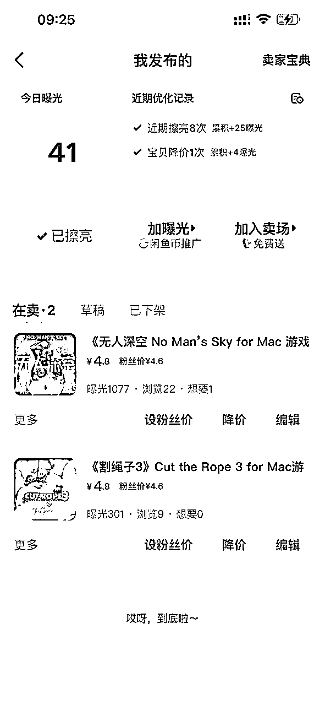
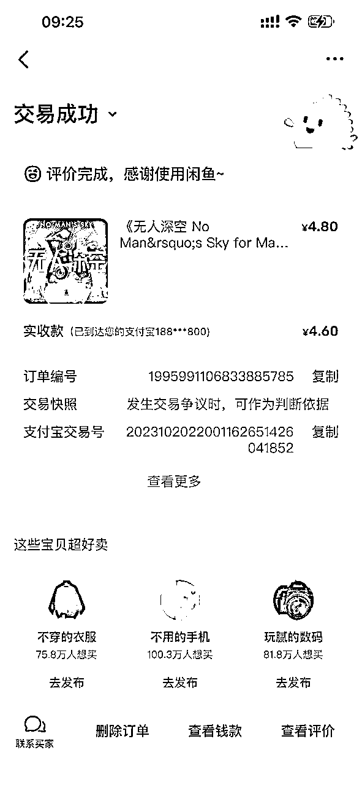
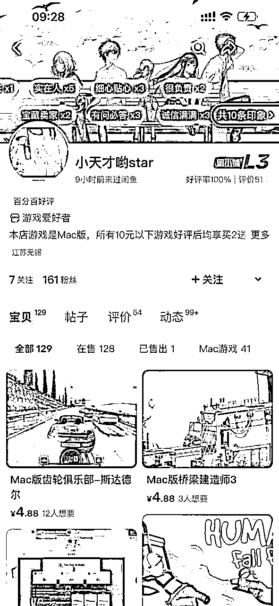

# 闲鱼虚拟产品—从上架到出单，只需要两步。

【闲鱼卖Mac游戏，从发布到出单，两步就能搞定】

很多人想在闲鱼找点副业，但不知道卖什么。今天分享一个门槛低、已经跑通的项目——虚拟产品。不用囤货、不用发快递，很适合新手。我们团队也实测过，一个新号挂两款游戏就顺利开单了，反馈速度比想象中快。

那什么是虚拟产品？简单说就是不用寄快递、拍下就能交付的东西，比如教程、资料、素材、软件等。以前闲鱼明确禁止卖这类商品，现在平台放开了，但敏感内容仍然不能卖，比如ChatGPT之类的。

这次我们选的是Mac游戏软件。先看测试结果：

这是我新申请的账号，只上了两个产品就来了订单。再看看那些对标号，早就铺了几十个商品，现在每天干的事就是点发货，一天几百块就赚到手了。

具体怎么操作？

第一步，找几个靠谱的Mac游戏资源站。要求很简单：游戏能下载、资源够多、更新勤快。我自己收藏的几个网址都是付费的，就不直接公布了。不过大家用心搜一搜不难找到，万一找不到也可以来找我拿。

第二步，把网站里的游戏截图和介绍拿过来，重新排一下版，发布到闲鱼。整个流程快的话10分钟之内能搞定。每天发布5个商品就足够了。

再分享一个“偷懒”技巧：直接保存同行的图片和文案，把水印裁掉，然后原样传上去。熟练之后2分钟就能上一个品，10分钟完成一天的量。

有人问自动发货怎么办？可以看这个项目工具：https://www.agiso.com/detail/151 ，设置方法写得很具体。

当然，卖Mac游戏也有风险。国内开发的Mac游戏尽量别碰，版权问题容易惹麻烦；国外游戏相对没那么敏感，赚点零花钱问题不大。

如果想放大收益，可以试这几个路子：

1. 做买赠促销，比如“买2送1”，既提高销量也拉高客单价；
2. 升级付费会员，设199、299、599元三档，包月/包季/包年任选，会员可随意下载全部游戏；
3. 做源头供应商，自己通过其他渠道把游戏弄回来，打包成dmg安装包，长期引流变现。

说到底，闲鱼卖虚拟产品真的很简单，核心就是找到资源，然后上架。只要你坚持每天上新，一般3到7天就能出单，正反馈来得特别快。

最后，尽量自己去搜资源，锻炼一下动手能力。实在找不到，可以加🛰️：askteas 聊聊。