# 零基础玩转影刀RPA：15分钟自动拉取200条📕笔记，电商自媒体提效攻略

各位朋友，我是阿盛，现居广州。去年起专心研究影刀RPA，已在这套自动化工具上落地了上百个实用案例，也顺利加入了影刀官方优质开发者社区。

今年4月份写过一篇影刀RPA的实操分享，事后陆续有圈内人来找我，想了解RPA如何运用到📕、🛰️、抖音及各类电商平台。线下同城局里，我还办过一场教学沙龙，现场演示RPA搭建流程。沟通中我发现，很多人早就听说过这个效率神器，却不知道从何处迈出第一步。

于是有了这篇入门攻略。这次我们用“自动采集📕笔记”这条具体任务来展示，怎样从零开始做出一个可运行的RPA程序，希望各位圈友能早日把它变成“第二双手”，让赚钱效率再提一档。

## RPA到底能用在哪些地方？

先列几个自媒体/电商常用的例子：

- 内容分发：批量在📕发图文/视频，其他支持网页后台的平台也能沿用。
- 销量监控：抓取📕店铺商品销量，为选品和运营策略做参考。
- 资源收集：根据关键词抓取TikTok/INS红人主页资料，拿到联系方式后方便邀约。
- 🛰️内容获取：通过🛰️搜一搜批量抓取👸号爆文或最新推送。
- 软件操作：比如🛰️的批量加好友、导出通讯录、群发图文/群成员去重。
- AI配合：自动操作ChatGPT、Midjourney、Stable Diffusion等，批量生成素材。

接下来要分享的，就是从零基础起步，搭一个自动抓取📕笔记的应用。完整运行效果如下：

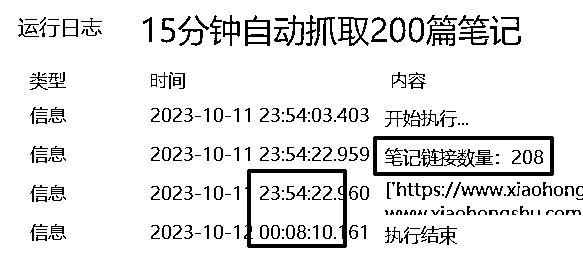

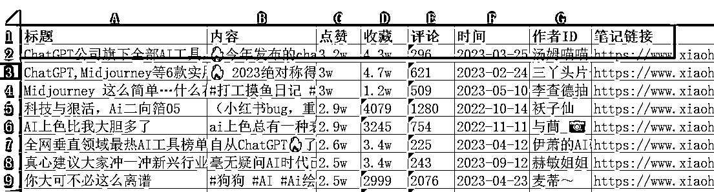

## 先做心理建设

零编程基础的朋友，最担心的往往是一个问题：我到底学不学得会？

现实中不少人“入门即放弃”，根本原因是痛点不够强烈。当一个人带着“实在不想再手动重复”的念头去学，动力自然就来了。我在线下分享时，会要求大家带上电脑，并且提前选定一个自己真正想解决的需求。另一个关键点是及时得到正反馈，所以我故意从3步就能运行的最小应用讲起，让大家很快尝到甜头。

只要完整跑通过一次，你就打开了新世界。以后哪怕不自己做，也能判断某个需求适不适合用RPA实现，并且能清晰描述需求，省下大量来回沟通的时间。

影刀官方有视频教程，但很多人嫌长不看。本文用图文+📕笔记采集案例，为你划出重点。

## 一点点背景知识

开始操作前，还是有必要说清楚RPA到底是什么，以及它和普通软件有什么不同。RPA即机器人流程自动化，指的是用软件模拟人类在电脑上的操作，从而自动搞定那些重复性任务，比如录入数据、发邮件、操作网页、控制软件等。

请注意加粗这句话：模拟人类在电脑上的操作。

按我的理解，RPA可以说是“软件的软件”。它能模仿鼠标、键盘或指令去控制其他软件（浏览器也算一种软件），同时还能做数据处理、调用API接口等需要代码才能完成的事情。

并且多数RPA工具是可视化/低代码设计，影刀就把各种基础能力封装成了可拖拽的积木块。看我用影刀做的📕笔记采集应用，编辑界面中核心步骤只有12行。

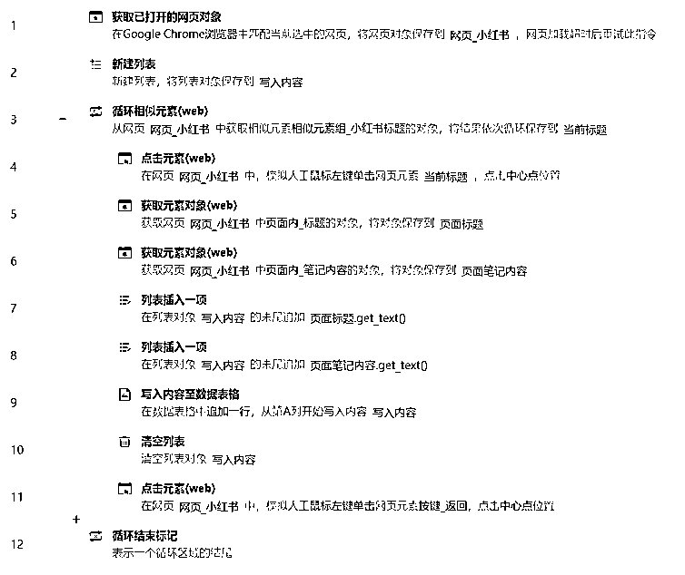

龙哥曾发过一条动态，说在GPT辅助下用python实现了网页数据抓取。配置环境和第一次成功运行确实最有成就感，但这也是劝退新手最严重的一环。而影刀RPA属于开箱即用，装完软件再加一个浏览器插件，就能在网页端操作。

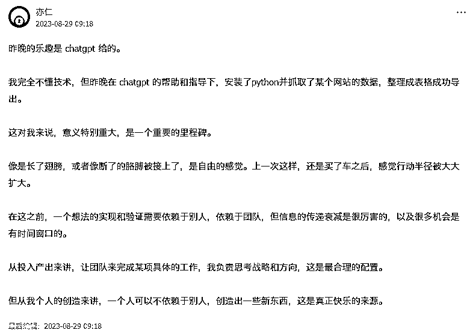

## 开始动手

闲话少说，先用一个小案例找找手感。

案例01

需求：自动打开📕主页，搜索指定关键词。流程：这种单页操作，用截图就能说清楚步骤；如果涉及多页面，则要画流程图。输入：网址、关键词。输出：无。

先从官网下载最新版本并注册账号。装好软件后，建议在常用浏览器里安装影刀插件，否则调用浏览器时容易报错。安装路径：点头像-工具-自动化插件，选择对应浏览器版本即可，比如Chrome、360等。

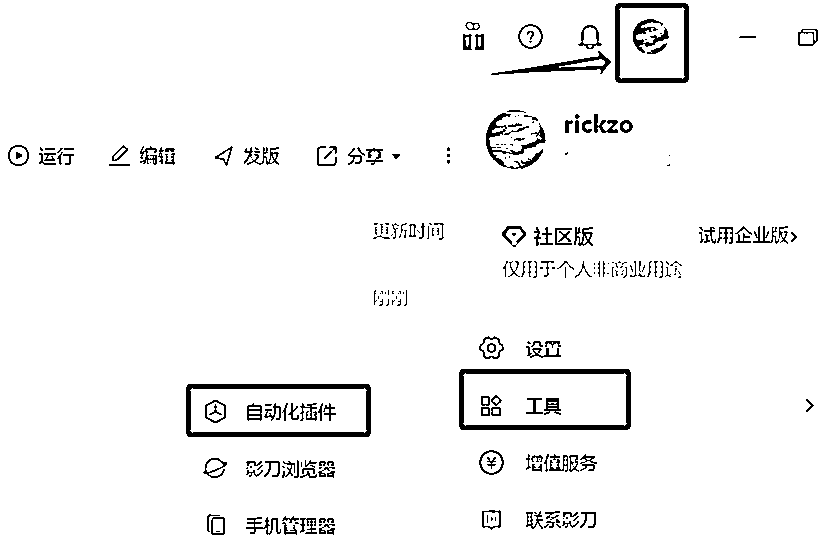

### 创建应用

点左上角的新建-PC自动化应用，会自动进入编辑页面。

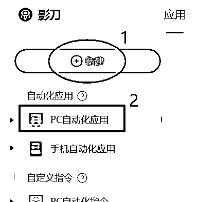

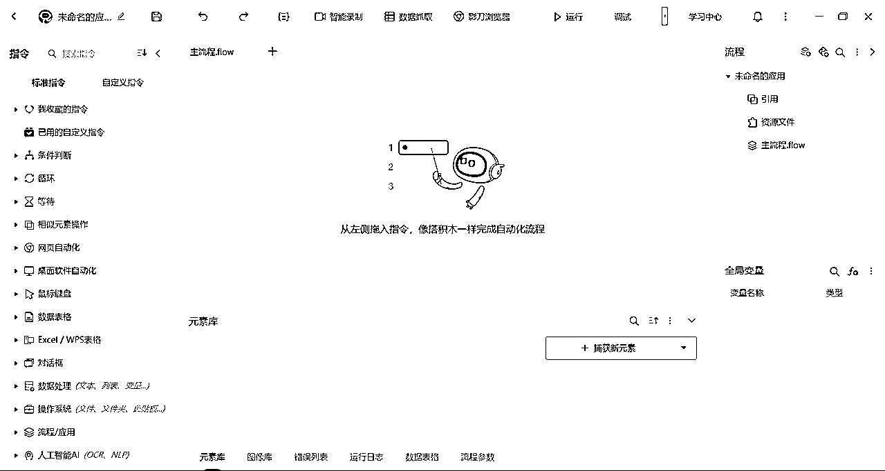

### 元素捕获

这里不用急着写指令，而是先把后面要用到的“控件”保存下来。RPA和传统编程有一个显著差异，就是需要先做控件捕获。控件就是流程中要操作的对象，比如网页上的按钮、链接、输入框等。把它们捕获保存后，才能放进指令中使用。

这个案例需要操作输入框和搜索键，所以捕获两个控件即可。注意：在哪个浏览器里运行，就要在哪个浏览器里捕获控件。捕获方法：鼠标移到目标位置，按Ctrl+鼠标左键，确认保存即可，之后能在元素库里看到。

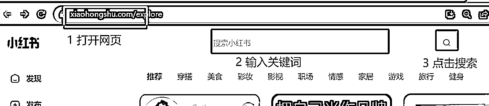

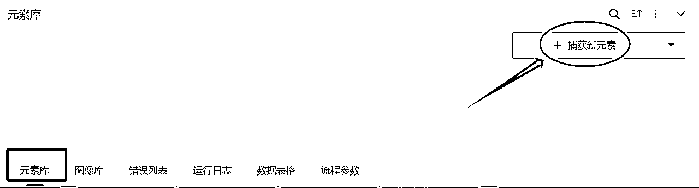

### 编写指令

接着在左侧指令区把需要的指令拖进来，在弹出的编辑框中指定对应控件或填写内容。

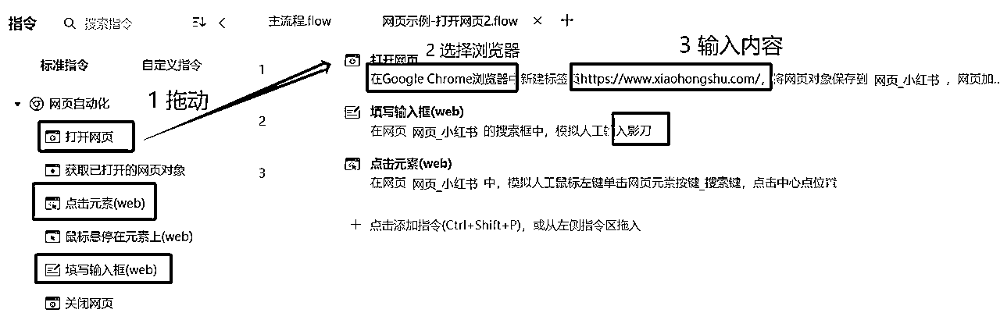

### 运行/调试

最后点击运行，看它能否自动跑完。如果报错，到底部运行日志中排查原因。新手最常见的问题就是浏览器插件没装好。

一旦成功运行，恭喜，你已经做好了一个RPA程序，是不是感觉“有手就行”？

你或许会觉得它没啥实用性，不如手动快点。别急，我们把它挪到真实业务场景中，就是接下来的实战案例。

## 实战案例：抓取📕笔记

做📕项目，找对标爆款是日常需求。虽然网页版能复制笔记内容，但手工整理实在费劲。只要写好一次应用，就能反复自动采集。先看演示视频：📕内容抓取笔记。

案例02

需求：打开搜索结果中的每篇笔记，抓取内容并保存到表格。流程：在搜索结果页逐篇点开笔记，抓取内容，返回搜索页，再继续下一篇。输入：无。输出：数据表格，表头为：标题|内容|点赞|收藏|评论|时间|作者ID|笔记链接。

第一个版本可以先只抓标题和内容，跑通之后再按同样方式补上其他字段。核心代码在下面，可以照着尝试。

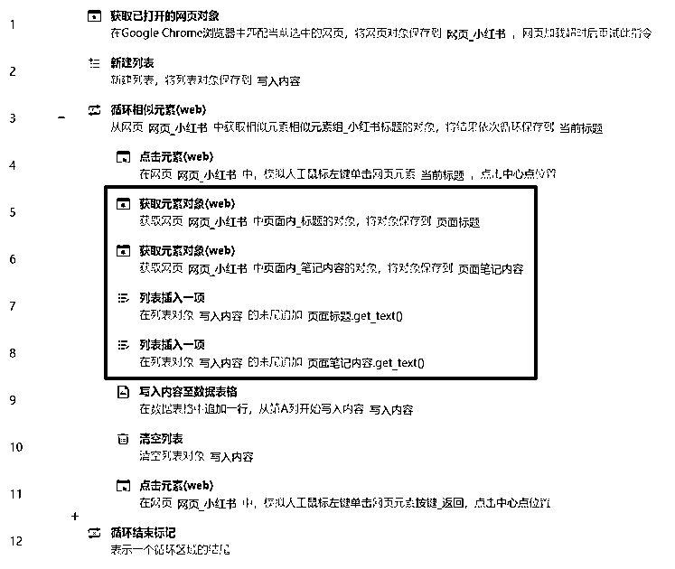

看起来比上一个小程序复杂，但只要掌握以下4个常用操作，就能理解：

### 1. 捕获相似元素组

捕获一个控件后，点击上方的捕获相似元素，再选择另一个同类控件，比如另一个标题。之后系统会在页面上标出所有相似控件，用校验元素确认是否为目标。命名建议用相似元素组_XXX，以便和单个控件区分。能否把需要的控件准确捕获，基本决定了整个应用能不能成。

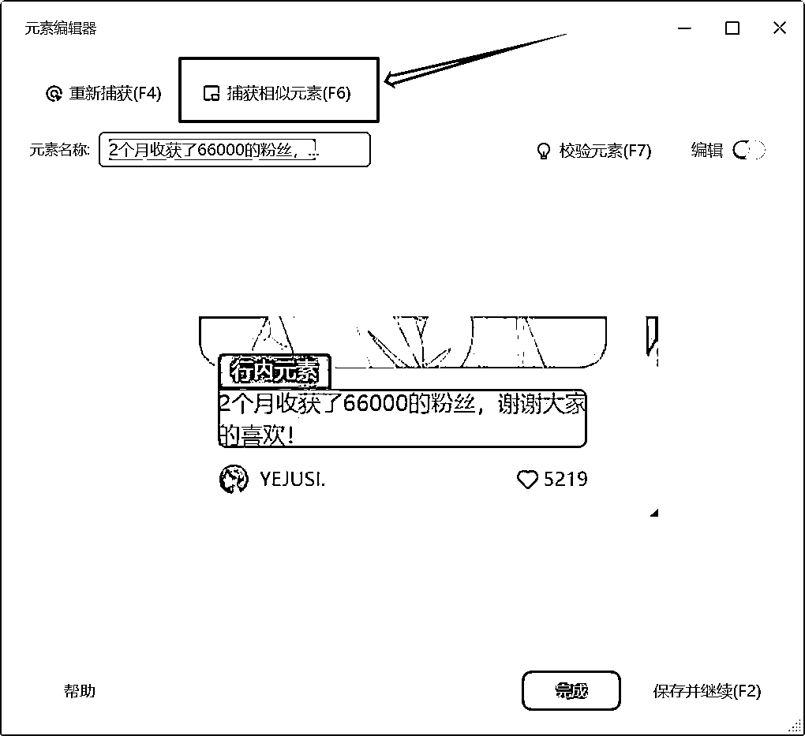

### 2. 设置列表

列表也叫数组，在编程里非常常用，尤其是数据处理场景。先说说变量：很多指令的最后都有“保存到XXX”，XXX就是变量名；你可以把变量想象成一个盒子，用来存放运行过程中产生的数据，贴上标签后随时调用。列表则像抽屉，可以按顺序放多个变量盒子。表格里的一行，就相当于一个列表，每个单元格是一个变量。抓取笔记数据要写入表格时，先把标题、内容、点赞数等统统放进一个列表，然后一次性写入一行，比逐个格子操作高效得多。提醒一点：把标题或内容插入列表时，按下图示例选择控件对象的文本内容。

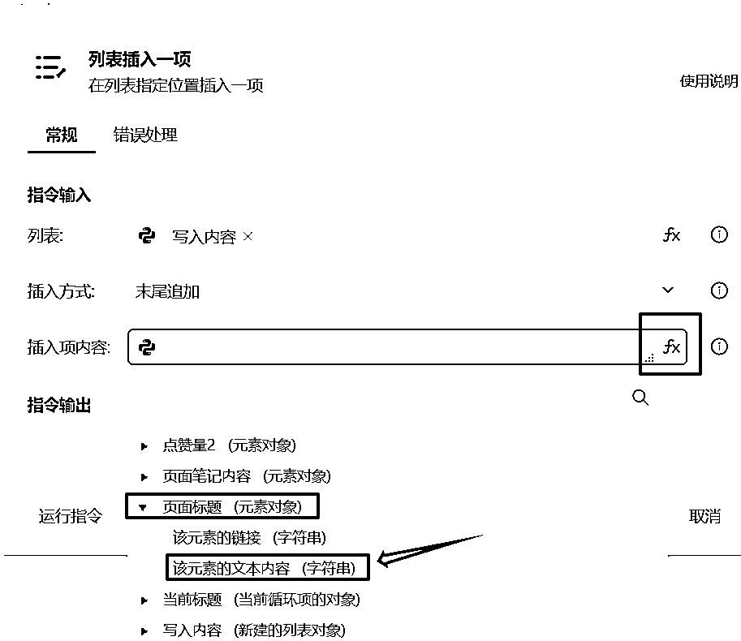

### 3. 设置循环

编程的本质是编排流程，而流程只有三种：顺序、循环、分支。这个应用里用到的是相似元素组循环。相似元素组本身是一个列表，循环就是把列表里的元素逐个取出，在循环体里操作，完成后再取下一个。运行时会看到鼠标自动点开笔记、获取数据、返回、再点下一篇。理解循环是RPA开发的重点。有兴趣的话，可以自己做一个小循环试试，更容易明白。

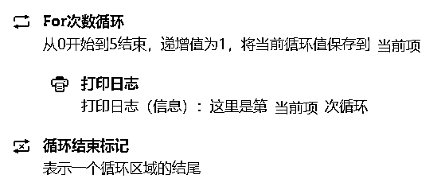

### 4. 写入数据表格

影刀自带数据表格功能，抓取到的数据可以先放在这里，全部抓完再统一导出为Excel，比直接写入Excel文件速度更快。本例使用写入内容至数据表格指令，从A列开始逐行写入，按截图配置即可；想深入了解可点右上角的使用说明。循环、列表、数据表格相关指令我已经做了标记，如果忘了在哪个菜单，可以在指令搜索框输入名称快速定位。

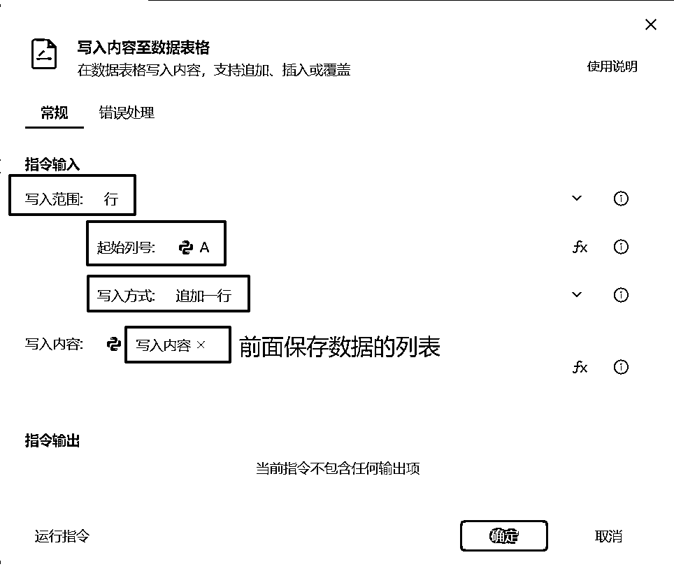

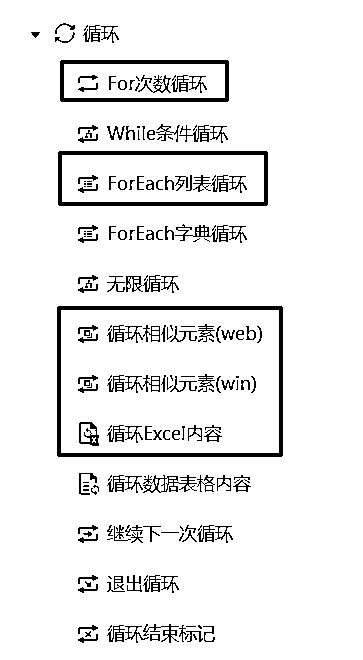

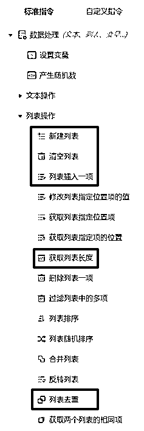

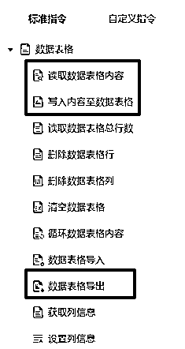

当你成功运行这个程序，在数据表格里看到抓取结果时，会特别有成就感，这就是解放双手的快乐。

同时你可能会发现，一次只能抓到约20条数据？这正是本应用真正的难点：📕页面上的笔记是逐步加载的。突破这个限制后，绝大多数网页数据抓取都能搞定。关键思路如下：

- 一页内的抓取逻辑保持不变，这部分不用动。  
- 先获取搜索页面中所有笔记的链接，再逐个通过链接进入笔记页面抓取。  
- 获取链接要使用影刀自带的数据抓取功能，它位于编辑页顶部功能区，操作方法按提示走。这里放出示例截图：

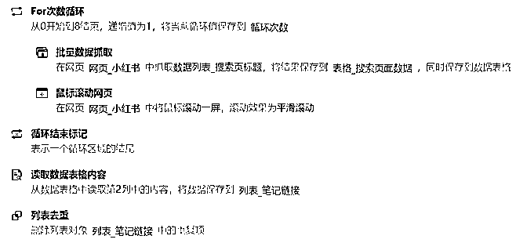

最后附上完整版应用分享，新注册账号30天内可以领取。运行完成后，表格会自动放在桌面。

影刀RPA应用-📕笔记内容抓取：
https://api.winrobot360.com/redirect/robot/share?inviteKey=a4fb02c7371708d7

如果遇到问题，可以联系我。

## 开发要点

说三个我认为最关键的开发心法：

### 1. 先理清完整操作流程

RPA不是魔法，它只是把你手动操作的步骤自动执行一遍。所以当你被重复劳动困扰时，先把自己手动操作的流程逐步拆解，写下来或画成流程图。这样无论是自己开发还是找人做，思路都会很清晰。刚接手新项目时，不要急着自动化，先手动跑几遍，观察可能出现的异常。比如加🛰️这个简单任务，可能会遇到🛰️号不存在、对方操作频繁、隐私设置、自动通过、自己操作太频繁等情况；想让应用稳定运行，就要把这些情况都考虑进来，设计好应对逻辑。

### 2. 确认输入和输出

做应用前要想清楚输入什么：自动加好友需要🛰️清单，自动AI绘画要在意提示词，批量发笔记要准备内容素材。输入数据少的话，可以直接写进应用；数据多时建议存到表格。运行完成后是否需要输出？输出为表格还是文档？保存到哪个路径？这些都要提前定好。

### 3. 判断适用场景

最适合RPA的场景，我总结为：高频重复、对时效性要求不高、暂时没有现成工具能完整满足需求。很多人初次接触RPA，会把它等同于爬虫，但它真正的优势是操作软件本身，比如🛰️/钉钉自动发消息、电商后台订单处理、MJ自动出图、ERP系统内操作或数据导出等。手机端App也能操作，但建议先熟悉网页端和电脑软件后再尝试，不然容易踩坑。

## 总结

看到这里，你对RPA应该已经有了初步了解，也尝到了解放双手的甜头。更重要的是，希望你能理解RPA自动化的思考方式：把重复工作交给机器，用这套思路去梳理业务流程，将来还可以把流程交给AI来优化。最后感谢阅读，期待和你交流，一起加快搞钱效率~

* * *

## 附录

影刀帮助中心：https://www.yingdao.com/qa/  
RPA在手机端的案例：