# 《如何在撸货与票务行业快速破冰》

双11前必看：撸货与票务到底怎么玩？从几百元差价到上千元利润的实操拆解

每年大促前，总有人问我：普通人想靠信息差搞点外快，究竟从哪一步开始？今天我就把撸货和票务两个赛道的门道一次性讲透。不用你有多高的技术门槛，只要你有人头、有资金、会执行，就能快速上手。这篇文章没有虚的，全是可以直接照着做的东西。

先来说撸货里的百亿补贴。

你掏出手机，打开拼多多，进百亿补贴频道，翻一翻苹果手机、茅台、美妆、游戏机这些品类，就能看到不少机会。就按当前行情举例。

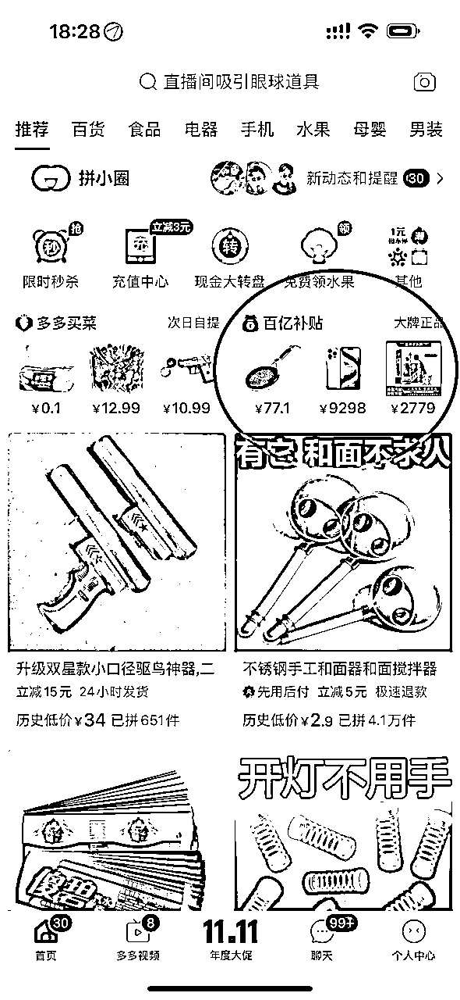
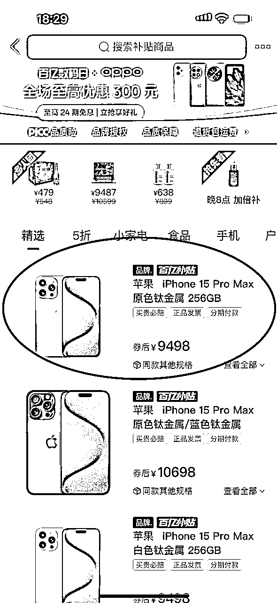
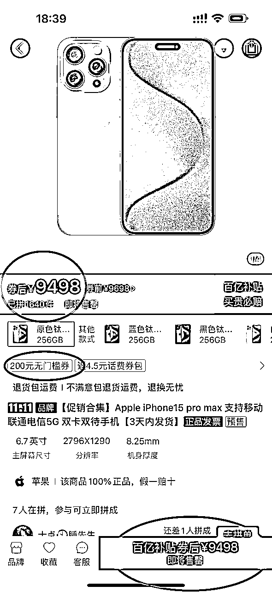

iPhone 15 Pro Max 256G原色款，页面下单价9498元，但要凑整点领券才有这个价。再看看此刻的回收行情是9850元。一进一出，352元落袋。9850减9498等于352，这就是这一单的利润。

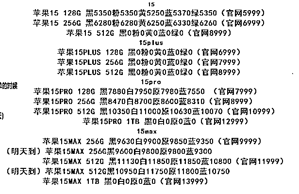

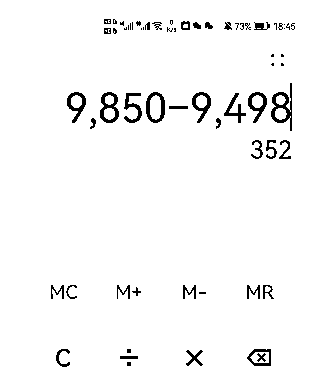

再看茅台。下单价5169元，市场实时回收行情单瓶2670元。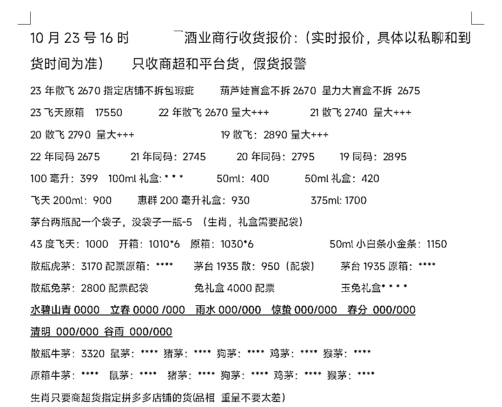注意正常是一单两瓶，两瓶就是5340元。5340减5169，利润171元。

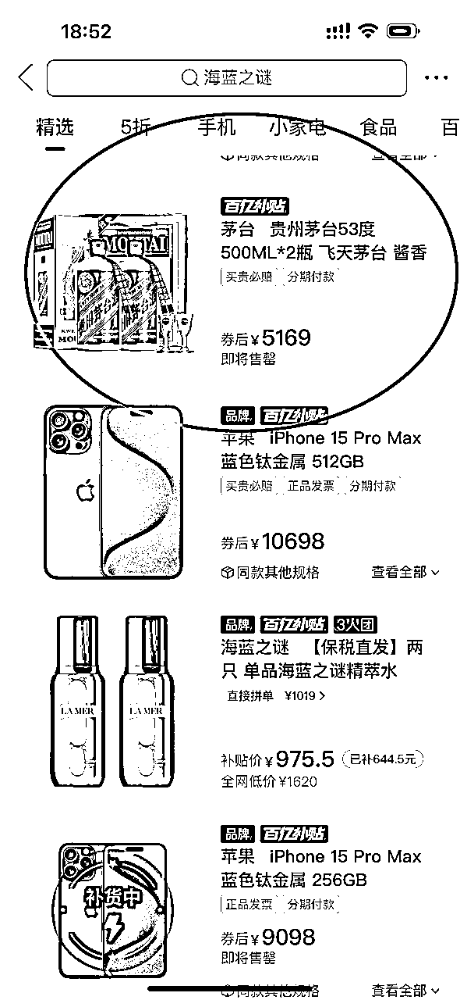
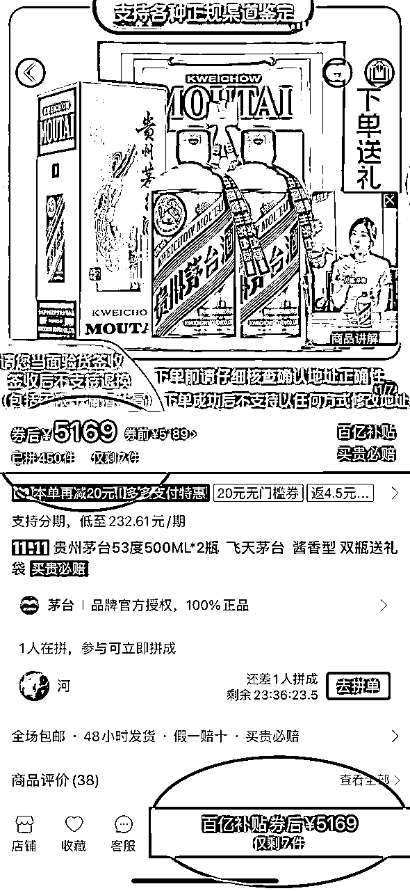

然后是Switch。搜索日版白色款，下单价格1725元，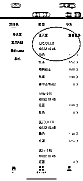实时回收行情是1760元。35元差价，虽然不多，但胜在流通快。

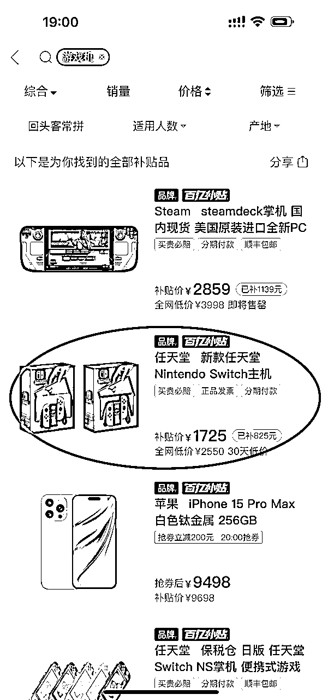
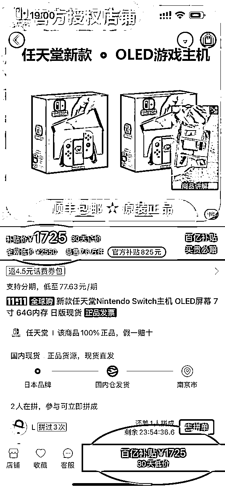

还有雅诗兰黛小棕瓶两瓶装，下单829元。单瓶实时回收440元，两瓶880元，利润51元。

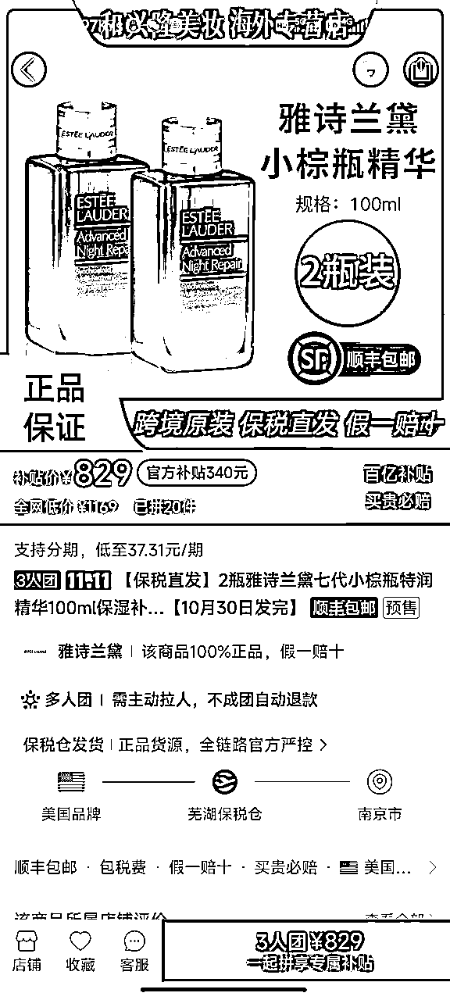
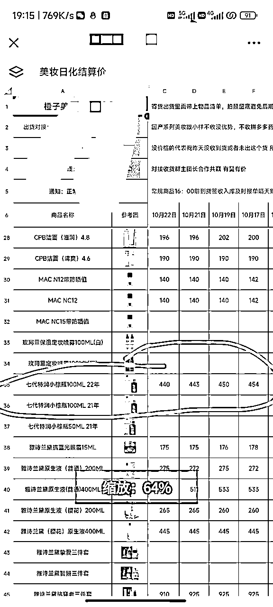

比较一下会发现，美妆和数码各有优势：美妆成本低、利润率反而高；数码单笔利润厚，但占用本金也多。实际上有利润的产品远不止这几个，抖音、快手、淘宝、京东也有类似的百亿补贴频道，逻辑完全一样。这类货都是硬通货，流动性很强，根本不愁没人收。

说到这里，就得讲一下百亿补贴背后的产业链。为什么这种玩法能一直转？因为每一环都有钱赚，形成了一个闭环：黄牛赚的是平台商家让出来的差价，货出手给档口；档口赚的是收货再供给电商商家的中间利差；电商商家把货重新上架到平台卖给黄牛，赚的是平台补贴政策带来的利润；平台呢，靠着补贴把流量和销量数据做上去了，股价跟着涨，最终赚的是股民的钱。

所以百亿补贴本质上就是这个行业里最基础、最无脑的玩法。它不复杂，核心就两个词：人头，资金。

把这两样用到极致，你就能赚到钱。

拼多多是有风控的，黄牛不可能无限下单，有时候付款后订单会被系统自动退款，圈里管这叫砍单。正常发货概率只有四成左右。怎么尽量减少砍单影响？秘诀就是：别把一个账号当命根子。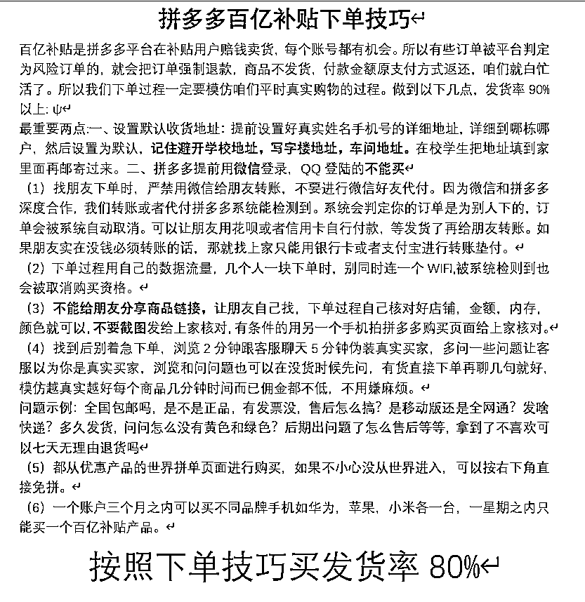

砍单了怎么办？退款秒到账，立刻找下一个人重新下单。只要你的“人头”源源不断，砍单就不是问题。比如你有团队，一天找100个人下单，40%发货率，一天也有40单。另外60%砍单？别纠结，继续换人下单就行了。

资金方面也得盘算清楚：平台发货要2-3天，到货2天，出手还要1-2天。换句话说，你下一单的钱大约一周才能回笼。想放大收益、同时多铺几单，必须解决资金占用问题。

很多人对这行有误解，以为撸货就是在拼多多买两单赚个差价，结果号黑了、砍单了，就骂行业不行。其实真不是行业不行，是思维方式没跟上。

举个例子。我常去的那家足疗店，怎么做到洗脚不花钱还能赚钱的？很简单，和店里98号技师聊聊天，让她在拼多多帮我下一单，寄到店里，过几天我去取。她可能跑路吗？不可能。她一个月工资比我这货贵多了，上班都要实名登记，工资还压在老板手里，根本跑不掉。我不仅赚了差价，还拉近了关系，她后来甚至被我转化成了买演唱会的客户。诀窍是什么？下次还点她。

同样的道理，你家楼下有沙县小吃、兰州拉面、黄焖鸡米饭吧？找老板帮你下单，资金你来出，东西寄到店里。记得吃饭多加点鸡腿。人家开了十几年的店，能为了你一单货跑路？

有人天天抱怨拼多多砍单，却不肯花心思去多找几个人下单。要知道，在工厂打螺丝一天12小时也挣不到300块。你现在只需要花三分钟说服一个人帮你下一单，就能赚300多。说不通？那就换下一个。别试图把一个弯的钢筋掰直，那只会浪费你的时间。

有志者千方百计，无志者千难万难。

说完百亿补贴，再看葫芦娃茅台抽签。

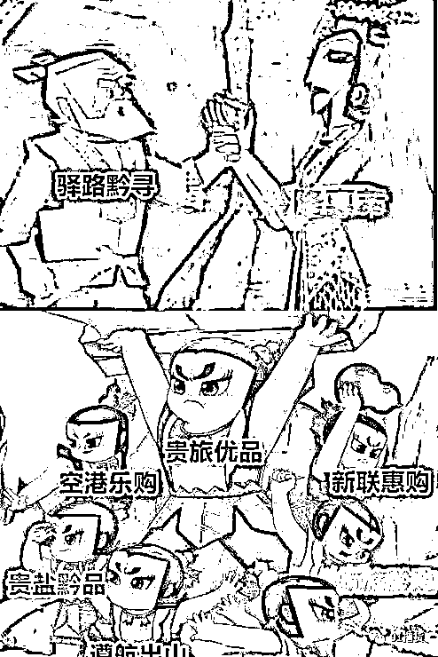

上面这些小程序，全是贵州的特产平台：贵旅优品、空港乐购、新联惠购、遵航出山、驿路黔寻、乐旅商城、贵盐黔品。这七个平台都是贵州省内国企主导的特产搭售茅台扶贫项目，界面长得差不多，圈里叫它们“葫芦娃”。

怎么玩？先注册。微信搜平台名称，找到小程序，填姓名、手机号、身份证号，就能预约。注意预约不是每天都有，要么看平台公告，要么等群里通知。第二天上午10点整，收到短信就是中签了，没收到就是没中。平台放量的时候，中签率也就千分之四左右。

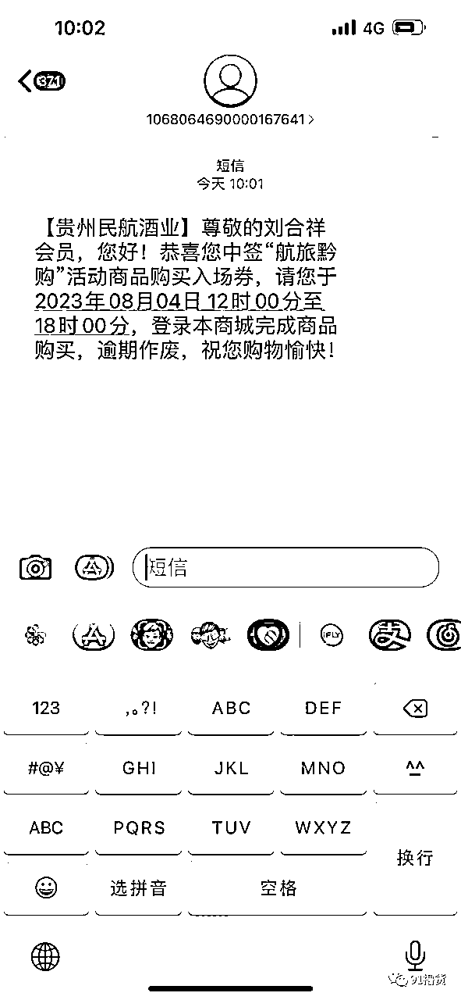

中签后，自己要垫钱买特产，找我这边报单买指定特产可以返现；茅台到货后也可以直接卖给我。

但这里说的“中签”，其实是中了特产购买资格。一签最多买1480元的特产，每消费一块钱积一分，攒够700分就能按1499元换购一瓶飞天茅台。也就是说，买1400元的特产，积1400分，最多平价换两瓶。

来算算中一签的利润。成本端：特产1400元，两瓶飞天2998元，快递费60元，合计4538元。收益端：按飞天每瓶2650元的行情，两瓶就是5300元。减去成本，净赚862元。但这还没完，中签后报单买特产，次日还能拿到几百元返现，目前特产返现大约500元左右（不同品类略微浮动）。这么一算，中一签的总利润能做到1300多块。

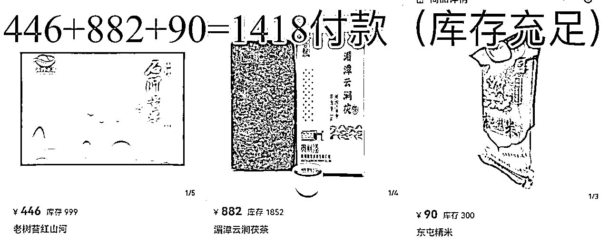
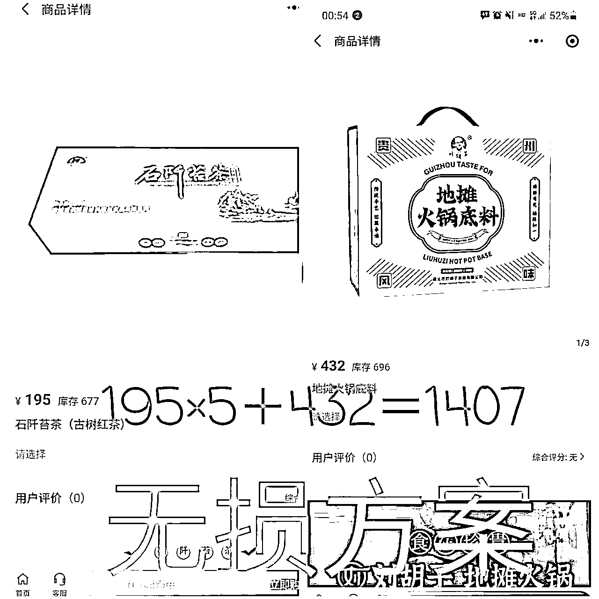

时间线也给你排一下：上午10点中签，当天12点到18点下单买特产；5天后特产到手，确认收货；再过8天，平台积分到账；之后用积分换购酒券、买茅台，大概再等5天到货。整个周期差不多18天左右，流转资金4538元，最终换回1300多利润。

为什么报单还能返现？因为商户在葫芦娃平台上卖特产要交一笔不低的上架费，类似房租。为了把上架费赚回来，商户就会拿出部分利润补贴给买家，帮自己冲量。

这里有几个坑必须提醒你：第一，三要素必须一致。注册的姓名、手机号、身份证号必须是同一个人，不一致的话中签了也没法付款。第二，付款时要刷脸。你要是拿父母信息注册的，付款的时候父母必须在你身边。第三，地址最好等中签之后再填，填了就没法改了。第四，茅台到货后别拆快递、别验货，直接卖盲盒，每瓶能多赚5块，瑕疵也有人兜着。

另外，平台到底有没有“黑号”？按照实际观测，新号中签率明显更高，而那些地址相同的老号，自从改成抽签制之后，往往一签都中不了。我个人判断，平台是有一面“盾”的，毕竟i茅台的技术已经非常成熟，程序员直接把代码搬过来就能用。所以要多留个心眼：开新号时，别再用老号以前用过的地址；几个号堆在一起预约的时候，也别连同一个WiFi。

葫芦娃的核心玩法总结起来就是：拼人头、拼号多。号少的人就只能拼运气。如果你长期做互联网，手里有流量、有私域，那这项目跟捡钱差不多——动动手指参加抽签，中一签就是1300+的利润。

再来说说i茅台抽签。

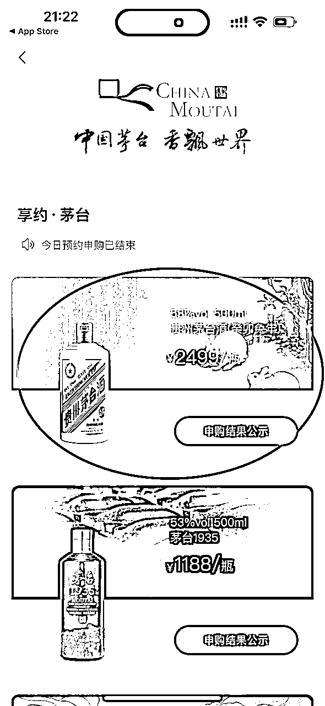
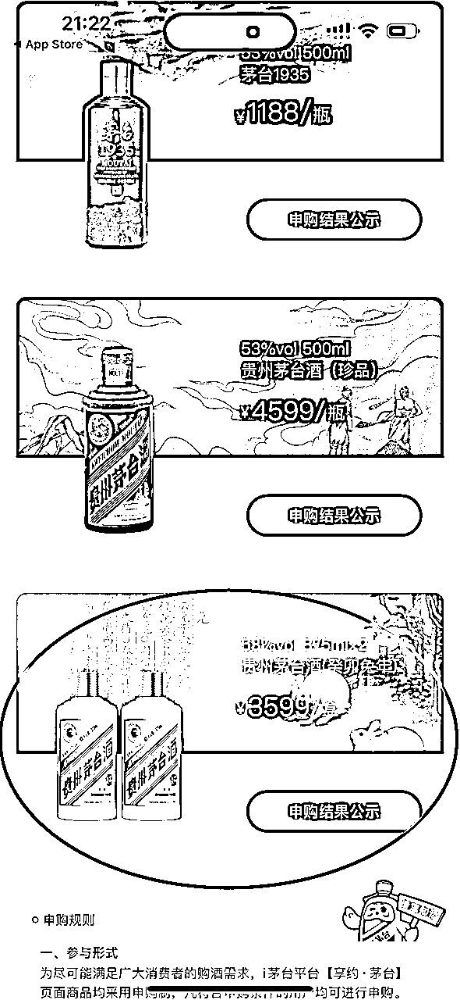
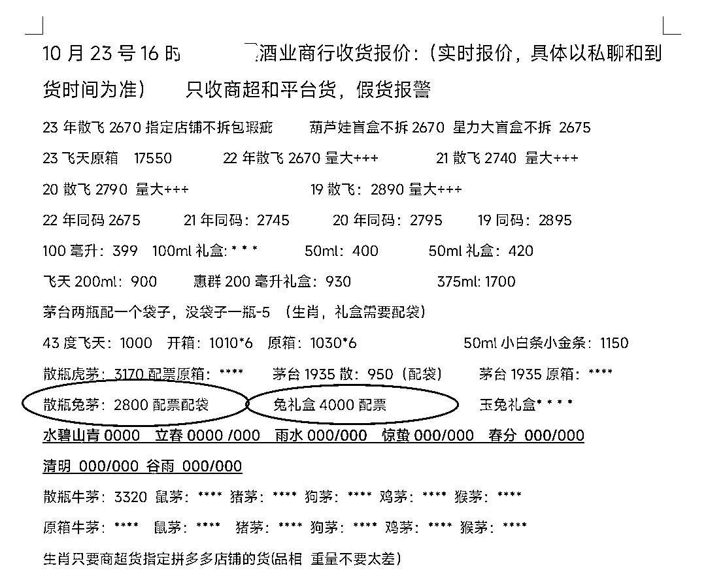

每天上午9点到10点预约，下午出结果。一签利润在300元和400元两个档位，没什么技巧，纯看运气。

说句实在话，这几个项目对“有人头”的人特别友好。那些做得好的在校大学生，往往就是看准了这一点：学生群体的人头取之不竭，大四的刚走，大一的又来了，永远不缺下单的人。

接下来说票务。

票务的玩法很多，每一场演出能用到的门道也不一样。小白先别贪多，把最基础的三件事弄懂：第一，会用常见的票务APP，比如大麦、猫眼、纷玩岛；第二，知道每场演出什么时候开抢，有哪些场次、什么价位、座位图长什么样，这些在大麦对应演出的官方公告里都能查到。

票分两种：强实名和非强实名。强实名就必须用客户的身份信息去代拍。非强实名里又分转增和改地址。转增对应的是电子票，操作很简单：官方一开转增，票夹里会出现转增按钮，输入客户手机号点转赠，对方接收才算成功。转赠方随后会收到大麦短信，截图发给客户，这笔交易就成了。

改地址对应的是纸质票。你和同行谈好交易后，把客户地址发给你的抢手，抢手把这个地址添加到大麦APP里，然后选“修改新地址”，改成客户地址再点保存。重点来了：整个过程必须录屏，保存后再截一张图，两个一起发给同行或客户。别嫌麻烦，这是票圈的铁规矩——只有录屏和截图才能证明你真的改过票或转赠过。改好地址之后，安心等官方出票，票会直接寄到客户地址。这段时间票夹上也会显示出座位号，同行要是问起，截图或录屏发给他就行。

至于猫眼和纷玩岛，几乎全是纸质票，流程稍微多一步：官方先寄给抢票人地址，再由抢票人转寄到客户手里。

等你把基础玩熟了，想从散户往上游走，会接触到更多平台：大麦、猫眼、纷玩岛、摩天轮、永乐、票星球。其中摩天轮本身就是黄牛平台，上面的票都是按市场行情溢价后挂出来的，商家全是圈里的同行。还有一个只在小程序端运行的票小二，外人搜不到，必须靠内部人员邀请码分享才能用。这个平台通常是同行之间用来参考行情的，价格一般比摩天轮低几十到上百不等。

票小二页面里有个叫“代拍大师”的功能，专门用来接强实名代拍单。入驻后客服会给你派单，你不需要自己去找一手客户信息。你可以留着自己抢，也可以放出去给抢手抢——通常放出去更稳妥，中单概率更高。拍不到也没损失，拍到了就有钱赚。

票小二和摩天轮背后共用一个商家后台：卖家宝APP。想入驻卖家宝，得有资质：三个经纪人许可证、一个演出许可证、三个月社保、一家挂靠公司，市面上全套办下来大概9000块上下。这个费用不是固定的，会跟着时间段和地区浮动。

票务的模式大致分五类：抢票、卖票、扒皮、做空做多、知识付费。其中抢票是入口，卖票是主要利润来源。

抢票的第一要义是“抢手基数要足够大”。如果一场演出不是强实名、又有利润空间，那不管在哪个平台抢，都得提前把观影人信息设好，最好设两个——有的演出允许一证两票，有的只允许一证一票，得看具体规定。信息必须与姓名一致，地址提前填好，日期和价位提前选好，点个“想看”再保存。预约时还有个“抢票攻略”选项，把这些信息填进去就完事。

非实名票抢到手，可以按行情加溢价转手。强实名票则必须用客户的身份信息去抢，客户信息是市场上流通出来的。拿到客户信息后，把日期、价位、张数看清楚，抢错了非常麻烦——客户要么压价，要么直接不要，退票退不了的话，只能自己吃进这个损失。

抢到正确的实名票，就去找当初放单的人报单，把订单截图和录屏发过去，对方统计完成后会统一结账。

自己单枪匹马抢票也不是不行，就是不稳定，手速、网速、付款速度缺一不可。更常见的是组织一批抢手分头行动，原理一样。非实名票抢到了，你可以拿出去卖，给抢手分一部分佣金。佣金给多少你说了算，因为市场行情是你把控的，而且抢手是跟着你才有钱赚的。但有两个风险点要格外注意：第一，不是什么演出都值得抢。演出火热度直接决定盈亏，只有市场供不应求，票才有溢价空间，这笔买卖才划算。第二，给抢手下指令一定要清楚准确，抢错了，要么你自己买单留住这个抢手，要么损失抢手对你的信任。

还有，必须确认你的抢手靠谱，不会跑路、鸽子。万一你这边已经把票卖出去了，他那边放你鸽子，你就得自己掏钱补这个大窟窿。千万别因小失大。

再往下说卖票。

卖票是票务玩家最主要的利润来源。卖的方法五花八门，归根结底就是两条路：卖给同行，或者卖给客户。

卖给同行，单笔利润会低一些，但胜在出手快，适合前期粉丝和客户还比较少的新手。同行之间的贸易，基本是在各种贸易群里完成的。要么看别人发的信息，要么自己把票放出去，收了下面抢手的票后，到群里挂信息；有客户需求也可以去群里找。票圈的交易习惯是：需要双方拥有八九个共同群聊，或者找一个担保人，两边都信得过的那种。配单信息一般有固定写法，比如“9.17武汉张学友1980连”，“连”就是连坐的意思，单张票后面就不标注。格式大致是“日期+站点+明星+价位+张数”，不过每家发单的语序都不一样，多看几页就能习惯。

看到中意的单子，先确认这个需求是真实的、存在的，再去问同行。千万别问完了又不要，甚至来一句“以打款为准”，这在票圈会被当成鸽子。鸽子行为和跑路行为是整个圈子里最避讳的事，真的一旦发生，最好主动转个小红包道歉，或者找其他同行帮你甄别一下。

如果演唱会快开演了，有客户来问票，可以趁机促成提前成交，也就是收一笔定金。相关海报也都能找到。

卖给客户，渠道主要是私域加公域：微信、🐧、闲鱼、抖音、🧣、📕，都有人在做。客户的问法和同行完全不同，他们一般会问“五月天有吗”“16号855有吗”，又简略又模糊。千万别嫌烦。交易本来就是一步步问出来的。你要做的是耐心引导，明确告诉客户：您需要什么明星、什么站点、什么日期、几张票？记住，两张默认要连坐，三张以上更要提前去找，因为价格更贵，你赚得也更多。

从人群分布看，中低端客户——也就是演唱会中低价位票的买家——占大多数。这类客户在聊天中给出的价位，往往隐藏着他们的心理预期。比如他问你855的票，他的预算一般就是855再往上浮一点，因为他默认会把溢价算进去。还有大量客户是比价党、酱油党，第一次聊几十个人只成一个，不要太正常。别因为有人咨询就激动得不行，也别因为别人不买单就烦躁。这行做久了自然就淡然了，说白了跟卖普通商品没什么两样，不是每个准客户都会成交。

要想提高成交率，价格要合理。这不是让你恶意低价，而是说在保证自己应得利润的前提下，别把价格报得虚高。另外，随着从业时间越来越长，你一定会遇到那种愿意花天价的顶级客户，前提是这场票在市场上极度火爆，比如TFboys、周杰伦、Blackpink这类顶流。还有，跟客户聊天的技巧特别重要，嘴甜是基本功；朋友圈或其他平台要有你过往成单的实拍图和商品展示，这是侧面印证你人靠谱的最佳证据。客户要看实拍票图或订单截图，就大大方方给。信任感一旦建立起来，离成交就不远了。

这些盘子里的玩法，其实没有一样是真正的高深技术。撸货赚的是信息差、平台补贴和周转效率的钱，票务赚的是信息差、时机和信任的钱。归根到底就三样东西：人头、资金、执行力。

希望这一篇能让你少走弯路，双11马上到了，祝大家都能抢到自己的那份利润。

在票务这行有个行话叫提篮子， 说白了就是扒皮，而且扒的是同行的皮。

这种玩法核心是泡在同行群里。群混得越久，沉淀越深，你脑子里对行情的敏感度才会上来，因为要收票，行情往下跌你就会被套住，行情回头涨上来才能解套赚钱。

第一个做法是开盘抄底收高位连坐。演唱会一开盘就立刻出手收中高价位的连票，宁多勿少。举个例子，周杰伦2000档开盘价基本在8500左右，顶流场地盘子必然往上走。养个三五天涨到10500时出手，卖给同行，一对赚2000。开盘时收10对，本金8.5万，10对赚2万，收得越多赚得越多。如果到11500再出，一对赚3000，以此类推。风险是实打实的，大量收货前一定要谨慎，多问多看。

第二个做法是不重仓但要盯盘。每天泡在同行贸易群里，看有没有同一场同一天同一档位的卖家和买家同时出现。随着做票时间变长，你的群会越来越多，自然混进去不少外围韭菜群，里面的人出的价格普遍偏低。发现同一场次同一档位有买卖双方，就算出价和收价的差额，这个差价就是你的。联系双方时，对卖家你是买家，对买家你是卖家。票收过来别急着改地址或转增，先跟买家把信息对齐确认好，直接让卖家售后发货就行。

第三个做法是接需求补位。有同行客户提了需求但找不到票，他可能明盘也可能不明盘。明盘的话直接看大盘行情，他要的票偏门，利润空间一般都大。先看大盘有没有利润空间，觉得利润够才去扒，否则纯浪费时间。不明盘就先看行情再试探他能给的价格，有利可图再出手，没利润或利润低就不碰。这种玩法需要你手头群够多才有量，前期群少能吃到的肉很少。

4. 做空做多

这套玩法要备资金，风险也不小，0到1的逻辑没吃透前别碰。

做空本质是赌跌。开盘后你把30对2000价位的连坐卖给别人，票你手上其实没有，钱先到账。等行情跌了再从同行那里凑够30对交付，卖出价减去低价补回的差价就是你的利润。

做多本质是赌涨。开盘后大量收货。还是以周杰伦2000连为例，开盘价8500，一对8500，50对要42.5万本金。过几天涨到1万，每对赚1500，50对就是7.5万利润。

5. 知识付费

圈子里一句话，先带货后付费。等你把票务玩法吃透了，也能收代理、收徒弟。代理488一个，帮你卖票；徒弟1888一个，把模式教给他。还有月费群，拉一批同行进来，你提供一手强实名代拍信息或者把看到的代拍信息汇总进去，单抽15块。模式很多，关键看你能给对方带来什么价值，利益一致才长久。

以上是玩法，下面说引流。

短视频篇

抖音和快手大家都很熟，一部分人刷，一部分人赚钱。我们要的是引流。

1. 坚持发作品。核心是吸粉吸客户。视频要清晰，时长别太长。可以去参考明星垂类的账号。内容基本都是演唱会切片、综艺片段，搬运要多号混剪，别照搬一个人的，片头片尾加字幕，把水印处理掉，小程序里工具很多。发布时可以直接上橱窗挂票，或者不挂橱窗带话题关键词，比如#薛之谦天外来物巡回演唱会#，#薛之谦演唱会门票#，官方流量就来了。评论区有人问就回私，直接私信对接。

2. 开直播

开播是引流抢手和韭菜的关键，一定要坚持。很多人做不下去是因为没人看，但你不试怎么知道。克服不好意思的心理。

前期没人看很正常，把主业号同步，提前发行业相关内容，去同行直播间连麦说话，输出点干货，稍微透露点收益装装样，每次互关。慢慢抢手就会关注你。开播后打开麦序，多鼓励连麦，有人提问就答，注意平台违规词，电商、微信、转账都别说。加微信后拉进抢手群，小白先科普能赚钱，前期多发抢票截图、发红包，定期清人。

流量平台篇

📕，发作品。找官方海报在上面叠字，有票转让、质量保证之类，配文写天津周杰伦门票有偿转让，城市+明星+意图，价位别写死。有人问再报价引到微信。📕容易被举报，作品发两天就违规，矩阵号操作更稳。成交不成交都留微信号，分开发。

钓鱼帖。去别人评论区装逼。别人发帖子问瞒着父母的高消费爱好，你就评论最近一年赚了一两百万买车买房给女朋友花多少钱之类，自编自导。再过两天发作品自证，晒豪车晒房，高清无水印。配文写有人质疑你们随意。再有人问你做什么的，你就谦虚说赚点小钱不值一提，一般不带人，想做可以带兼职，直接引流微信。亲测有效。

🧣。🧣流量大于📕，发图文视频都行，带#话题#关键词。🧣有实时功能，演唱会刚开盘抢完，去搜索关键词点实时，很多人吐槽没抢到，直接留言或私信说手里有票带溢价。🧣还有超话粉丝群，签到打卡升等级，进群后谁说没抢到票就私信，或者在群里说认识黄牛保真价格不贵，这个黄牛就是你。

咸鱼。咸鱼酱油党多，客户也多。发布信息用官方海报叠自己的文字或logo，突出一点。文案示例：出天津周杰伦演唱会门票，9.8-12全日期全价位单张连坐都有，拍下不退不换，个人原因强制退款扣20%手续费，不是钓鱼贴不卖低价票，诚信票务涨跌不鸽，鸽子勿扰同行勿扰酱油党勿扰。尽量别和其他人重复。咸鱼有违规提示，用矩阵号更稳。设置自动回复引流到微信。

咸鱼流量曝光，一是自然流，二是花咸鱼币推流。咸鱼币很便宜，发布后去签到处开10%抵扣。客户咨询成交都让加微信。咸鱼会压款，客户签收后才放款，15天自动确认收货。交谈时一定要强调转赠改地址，纸质票收齐让客户确认，不然客户反悔申请退款你会吃亏。小法庭基本55开，票务属于加价倒卖。建议微信或支付宝成交，省麻烦。

摩天轮篇

摩天轮不仅能卖票还能引流。出一场音乐节卖30单，平台会有客户联系方式，配票时打电话说你是商家，让客户加你微信收电子票，每次能加几十上百个。演出客户有复购，维护很重要。

破冰篇

第一层破冰是把玩法吃透，参考上面内容。
第二层破冰是公域私域基数不断放大，自己强大才有饭吃。
第三层破冰是人脉圈层，认识大牛，长期吃到独家消息，第一波红利先拿下。

本期分享就到这里，写得有点累，下一期看大家反馈再继续。双11快到了，线报也多，祝大家盆满钵满。

记住口号：合格的黄牛向来都是先冲！剩下的交给七天无理由！