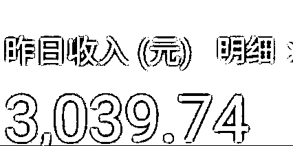
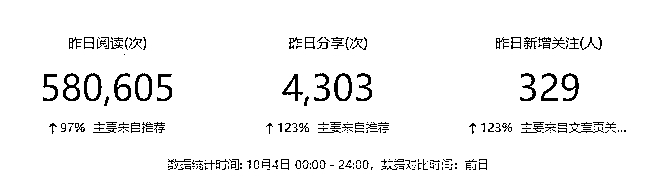
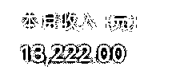

# ('10月19日《小白从0到单篇爆文115W+，不到一个月，变现过万元？》@圆迎', (2, 40))

最近刷到一位圈友的分享，真的被震撼到了：一个公众号写作新手，从零开始，不到一个月跑出单篇115W+阅读，变现1.3W+。今天把她的复盘精华整理出来，希望能给同样在摸索自媒体变现的你一些启发。

这位圈友叫圆迎，今年4月才加入生财。在此之前，她是自由职业者，做人类图天赋解读、金钱关系咨询之类的线上服务。2020到2023年，她花了大几十万在各种“知识付费+项目”上，最终发现还是要有扎实的内核能力。她也折腾过小红书、快手无人直播、快团团、境外问卷等多个项目，基本都以失败告终。5月第一次参加航海做小红书，一分钱没赚到，一度很焦虑。机缘巧合下，8月她翻出了2018年注册的公众号，9月报名第二期航海，全力投入公众号爆文写作。

她的做法很“笨”，但很有效：给自己定下一个月到两个月的沉淀期，每天只写一篇。因为怕写作、没天赋，就借助AI工具，同时付费跟了两个老师课程辅助。航海手册的基础知识反复啃，不断找对标账号，揣摩人家的写作技巧和思维方式。心态上，她几乎不怎么看阅读量——前期基本都是0，甚至有几篇只有自己看（因为买了粉，没去做问一问引流）。直到9月30号晚上，航海结束前一天，她才偶然发现阅读量过万了，进流量池了。坚持20天，终于看到效果。

爆发之后，她的公众号流量主收益从日入100元、1000元、3000元一路涨到5800元+，单篇阅读量从1W+冲到10W、30W、58W，最后跑出115W+的爆文。她说这个项目给了她巨大信心，原来自媒体真的能这样赚钱。

关于爆款文章的经验，她总结了6点：

1. 选赛道要以变现为导向。民生、军事、情感、热点、法律、历史、名人名言里，选自己真正喜欢、好下手的。她纠结了两天，最后选了“名人名言”，因为对小白友好。不同赛道单价不同，她有一天1万阅读量拿到了132元。

2. 找灵感靠刷：朋友圈、看一看、头条，多刷相关名言，找几个10W+以上的对标账号模仿。刚开始不会写，就模仿内容，测重复率低于30%再发。发了几天后，再用提示词整理优化。

3. 标题和开头很关键。她作为小白，没有用“开幕雷击”式标题，而是直接照搬名人名言的标题风格。开头用反问句，点出受众和价值观，用简短内容勾住读者。

4. 正文要有结构和逻辑，多用比喻、举例、金句等手法，让文章更有说服力。同时语言要简洁，别用太复杂专业的词。

5. 结尾要收好，回顾全文，提炼一个有力的观点或口号，呼应开头，再吸引一次读者。

6. 排版设计不能忽视：字体、字号、行距、配图、图表，整体协调，让文章读起来舒服、有吸引力。

她也踩过两个坑，大家一定要警惕：

第一个坑：赞赏功能。原创三篇后应该立刻开通，她拖到爆文后才开通，少赚了一波收益。更麻烦的是，主号开通赞赏后，绑定运营者和小号的赞赏用了同一部手机，小号又发了同一篇爆文的题目，导致主号当天阅读全是0。发现问题后赶紧解绑、删文章，但10月8号起阅读量明显下降，因为这个小失误，损失可能好几万。

第二个坑：用朋友的身份证注册了第二个号。10月4号发第一篇文章就进流量池，第二天阅读过千，连续发了6天，朋友担心人脸识别和信息泄露，要注销账号。她没绑定财务信息，只能第二天注销，收益4块多也不要了。所以切记：朋友的身份信息真的不能用，关系再好也别用。

最后她说，万分感恩生财，让她看到不一样的赚钱机会；也感恩圈友，让大家看到不一样的赚钱方法。希望她的复盘能给你带来一点勇气和方向——先赚到一元，再慢慢放大。

