# 没资源、没背景、学历普通的年轻妈妈，怎么靠育儿行业两年赚到七位数？

我是一名95后妈妈，经历过重度抑郁，也曾在绝望边缘挣扎。后来为了给女儿治病，我一头扎进育儿行业，两年时间挣到了七位数收入。

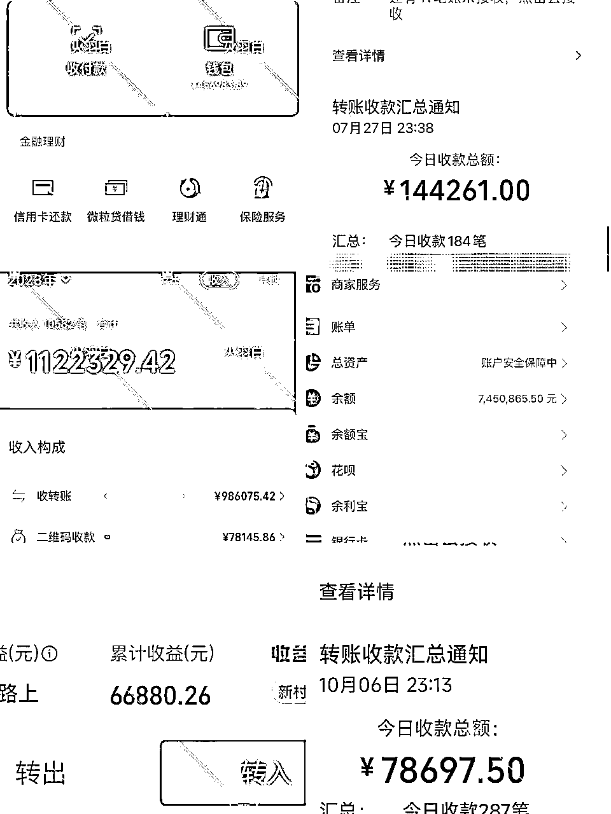

这篇文章会完整讲述：一个没有资金、没有人脉、学历也不亮眼的全职妈妈，怎样一步步成为单日进账14万的婴幼儿商品供货负责人。

如果你也学历平平、不甘心只靠老公养家、想在家带娃之余多一份收入，或是想给孩子做个榜样，我的经历或许能给你一条可以走的路。文末我还会整理一份可复制的带货实操经验。

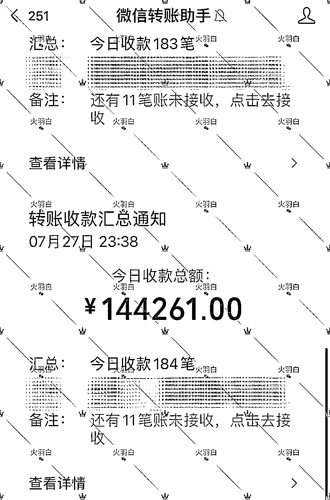

# 一、女儿生病，逼我月子里开始卖货

## 1、童年不被善待，女儿又早产确诊

我在农村长大，父母很早就离了婚。父亲一心想要儿子，后来干脆出轨、失联。母亲和奶奶把怨气都算在我头上，总是打压我，还常拿“不要你了”来威胁。

14岁那年，唯一护着我的祖父走了。我万念俱灰，从三楼跳下去，没想到只是骨折。

家里不愿再供我读书，把我送进收容机构。后来在民警的帮助下，我才联系上父亲。那个暑假，我每天早上6点干到晚上6点，连轴转了两个月，才攒够读大专的学费。

靠着一股不服输的劲，我自考了本科，学商科，毕业后做销售。我始终觉得，女人要有自己的价值，要一直学习，要能赚钱，才能不看别人脸色生活。

婚后，婆家条件不错，但依然看不上我。我心里憋着一口气：必须赚更多钱，才能挺直腰杆。所以孕期我也不敢停，结果把自己累到早产。

预产期原本是3月9日，结果2月8日就高位破水，紧急入院。催产三天后，转为剖腹产。

比早产更揪心的，是新生儿检查发现孩子有先天性甲减，医生说可能影响智力发育。我怀孕时自己就是甲减，一直按时吃药，没想到还是遗传给了女儿。那一刻，自责和心疼一起涌上来。

好在医生说，后期干预治疗有康复的希望。就是这句话，让我比任何时候都想赚钱。我告诉自己：必须拼，给女儿一个好身体。没有背景、没有人脉、学历一般的我，能依靠的只有自己。

## 2、生完第5天，我就在朋友圈卖货

坐月子时，我每3小时喂一次奶，还要定时喂药、换尿布。当妈妈的人都知道，新生儿阶段有多难熬。但赚钱的念头像钉子一样扎在脑子里：我不怕苦，就怕没钱。

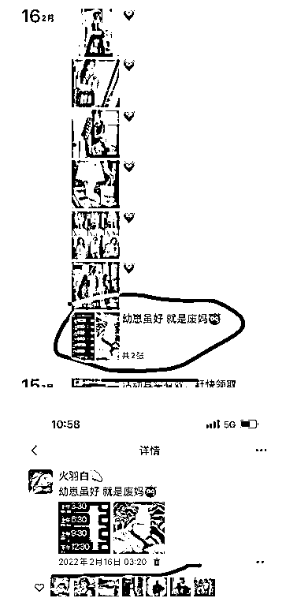

4月8日，命运开始转向。我带女儿去儿童保健院体检。因为孩子是在人民医院出生的，我没有同院妈妈群；排队时和旁边的妈妈聊天，对方拉我进了一个群。

我从小跑销售，性格外向。看到医院群大多是通知和科普，就想自己建一个私聊群，让妈妈们互相交流。就这样，我的卖货群诞生了。

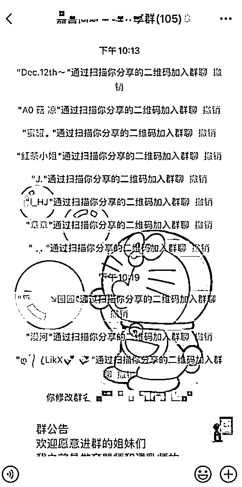

当时没有稳定货源，我就一家一家跑儿童服装批发市场，敲门问、亲手摸面料、测试质量。选定一家靠谱的，开始在群里卖童装。

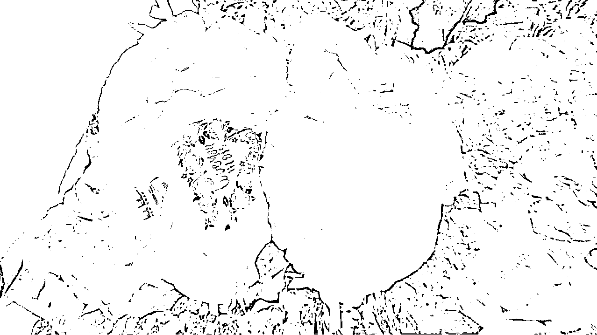

为了留住最初的下单客户，我连送礼物的钱都想省着花。自己在网上买了自制润唇膏的材料，做了一批小礼物，每个入手童装的妈妈都送一份。

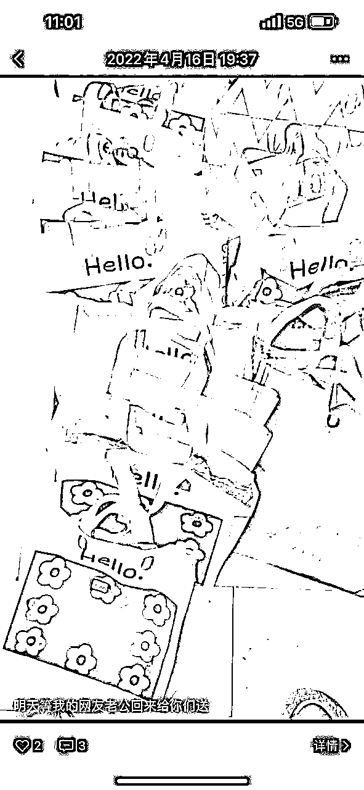

我自己也是当妈的人，太理解妈妈们给孩子挑东西时有多谨慎：可以贵一点，但一定要安全、要放心。口碑是我最看重的东西，所以质量这一关，我卡得很严。

最初的销售反馈很好，我心里更有底了，正式决定深耕婴幼儿用品。

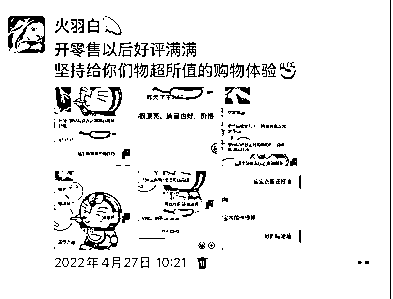

【复盘1：冷启动流量】第一批客户，从妈妈群来。孩子月龄差不多，需求也差不多，我女儿需要什么，她们的孩子多半也需要。刚开始没头绪的话，先泡妈妈群：人群准、需求明确，带货才容易开张。

## 3、一次纸巾试水，意外闯进社区拼团

为了测产品，我联系了本地一个知名纸巾品牌，想试试水。结果拿到一批没有外包装的“边角料”同款纸巾。老公担心客人不认，我说纸巾是消耗品，能帮大家省钱；同城配送，不满意可退，试一次不亏。

这一试，打开了社区拼团的路。2022年5月8日到5月20日，我们卖掉1400箱纸巾，净赚7000元。这是我在育儿行业赚到的首笔可观的收入。

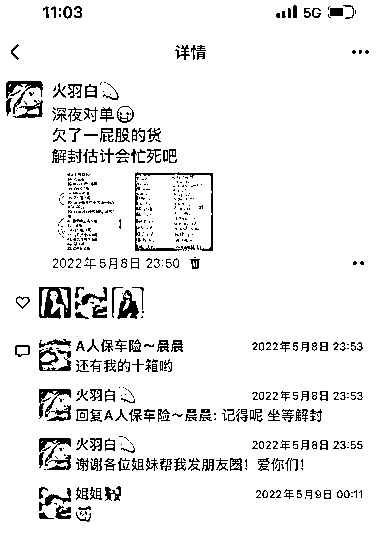

厂里一度缺货，还欠着单。我老公开着家里那辆小五菱，跑遍周边五个县区，挨家挨户送货。

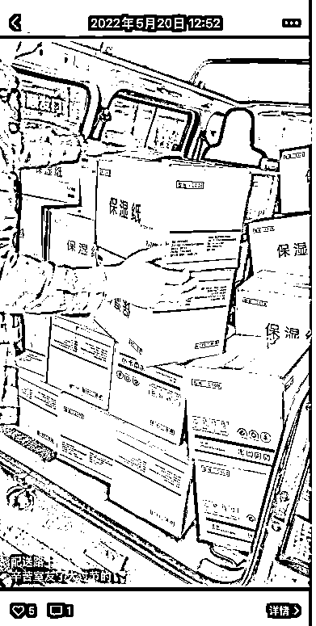

【复盘2：拼团选品】选品有几个心得：第一，选消耗品，复购高、出单稳；第二，条件允许时，价格就是最大的优势，尽量带物美价廉的消耗品；第三，可以跟卖同行已经卖爆的产品。判断方法：去大型电商平台搜同款看销量，再去二手平台搜同款看转手量。电商销量高、二手出货少，说明需求大、质量好；电商销量高、二手出货也多，说明可能不好用，不建议碰。

本来以为会一直做拼团，结果女儿4个多月时生了一场病，又把我逼急了。

那天她发烧4天，打完针回家洗澡，突然嘴唇发紫，身上出现鱼鳞一样的纹路。我吓得腿软，立刻打120。抱着她往小区门口走的时候，我整个人都是空的。看她那么小，躺在担架上吸氧，我恨不能替她受罪。

到了医院，医护人员态度很差，只允许一个人陪护，不让我进病房。我提出转院，护士还冷言冷语：市里医院一天要500，这里才50。我没再忍，直接办转院。到市里医院住了5天，花了约3500元，孩子痊愈。

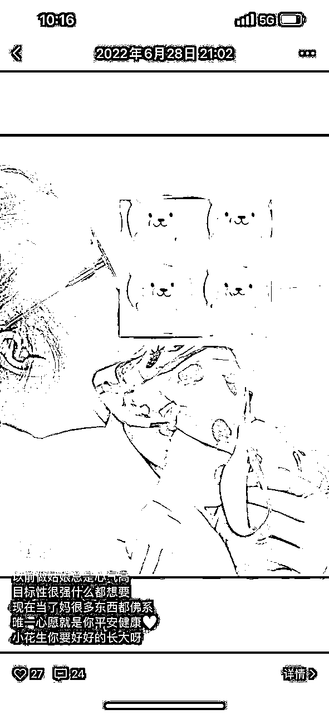

那一次我彻底明白：想给孩子更好的保障，必须更努力赚钱。之后带娃的碎片时间，我几乎都扑在产品上。为了测品，自己花钱买样品；为了拓客，自己买试用装，办活动送尿不湿，包邮送到家。

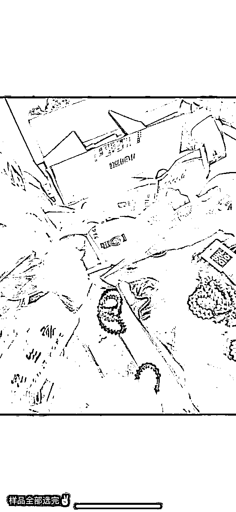

这些都是我自费买来的样品。

为了锁客，我推了储值活动：充5000送200，充10000送500，买什么都能抵扣；节假日还会给会员准备礼物。

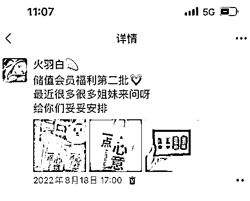

就这样，拼团慢慢走上正轨，卖货也越来越稳定，每天利润基本在2500元以上。

【复盘3：裂变和留客】拼团一定要做裂变，流量不能断。我试过最有效的方法，就是自费寄小样给用户体验：先让妈妈们觉得东西好，她们才愿意放心买单。老客户也要用心维护：节日送礼、做活动、充会员卡，既能培养消费习惯，也能积累信任。

## 4、疫情亏掉3万，被逼转型做品牌代理

后来疫情反复，物流随时停，退单、丢件一起涌来。我每天在接单和退款之间反复折腾，还要处理大量售后。为了稳住供货仓库的关系，也为了守住老客户的口碑，所有丢件损失我都自己扛，前前后后亏了近3万。做生意本来就有风险，这钱只能认。

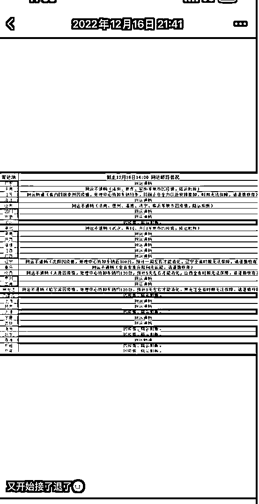

我忍不住想：反正都要囤货，物流又这么难，不如直接签一个品牌来做？想通后，我在原来的服装批发店铺之外，又租了一间约40平的小仓库，专门存货。

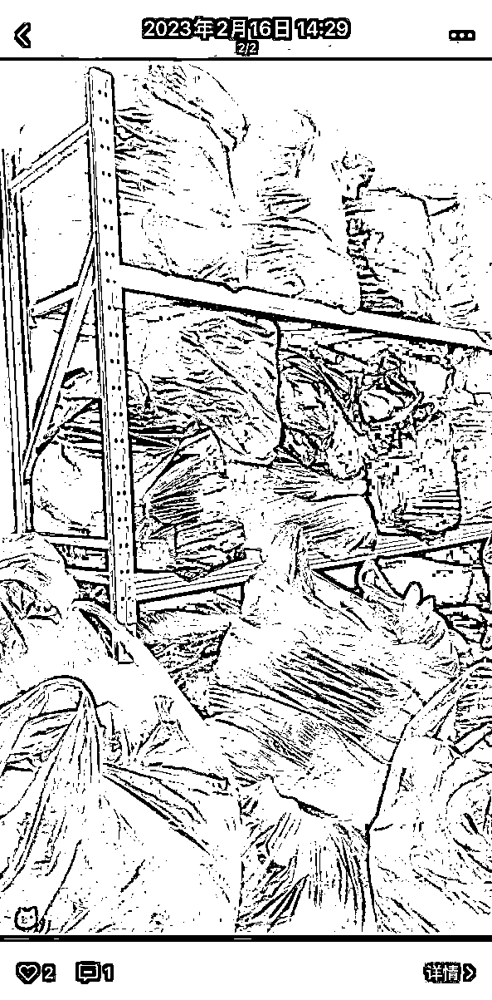

那时主要卖婴幼儿用品和各种童装。靠着之前的卖货和拼团经验，到5月，私域业绩已经有了一定名气。

【复盘4：囤货原则】第一，优先囤消耗品和爆品，参考前面的选品方法；第二，囤货要量力而行，别贪多。所谓量力，就是根据客户需求量决定进货量，最好提前问问大家需要多少，再下单，避免压货。

我觉得自己还需要成长，于是走出去学习。

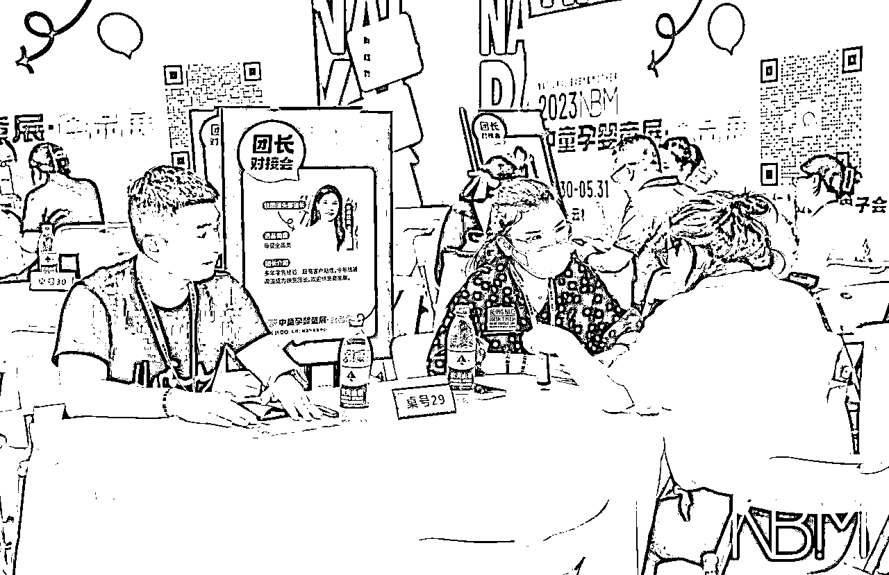

也正因为这次学习，我被人看见，拿到了一个行业奖项：被NBM评为年度优秀团长。

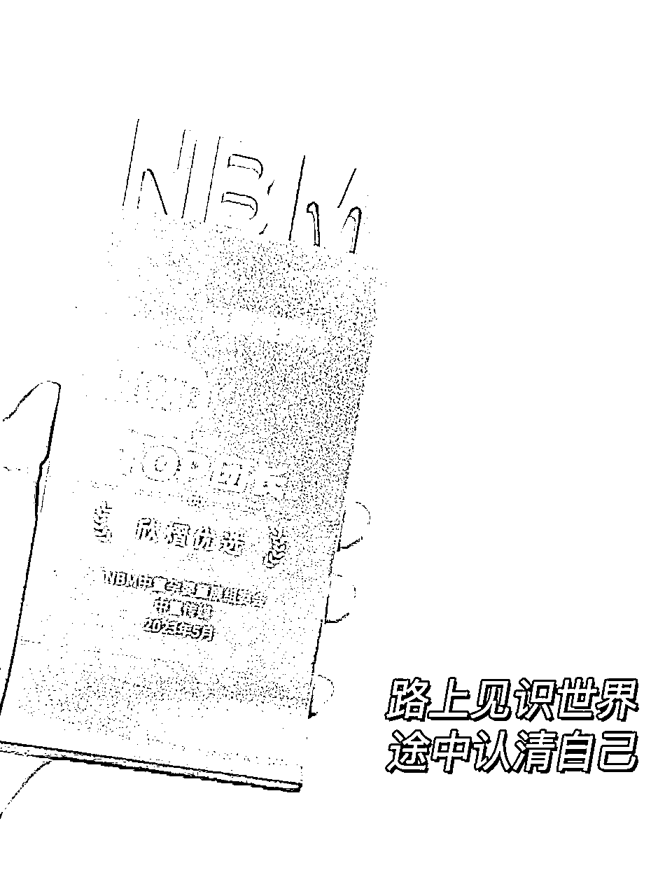

头一回站上展会领奖，那种成就感难以形容。更重要的是，我认识了很多同行，拿到了资源和新机会。

之后，我接下几个新品牌，换了一个更大的仓库，仓储产品种类扩展到300多个。

【复盘5：终身学习】小时候家里不供我读书，我就自己打工挣学费。长大后，我也一直保持学习，没有停下来。正是这个习惯，让我遇到不少贵人，拿到很多资源，一步步完成了逆袭。

## 5、从自己卖货，到带人卖货

生意越做越大后，我多了一个新身份：教别人卖货。

以前做服装时，我指导过一些想开童装店的妈妈，有些经验；做了一年多育儿产品，手里也有不少项目和渠道。于是我想：不如收一批共创伙伴，把团队裂变起来，帮更多和我一样身处困境的妈妈，在家也能赚钱。

说做就做，我把自己的方法整理成一套培训体系，目标是让没有经验的人也能直接复制、快速上手。

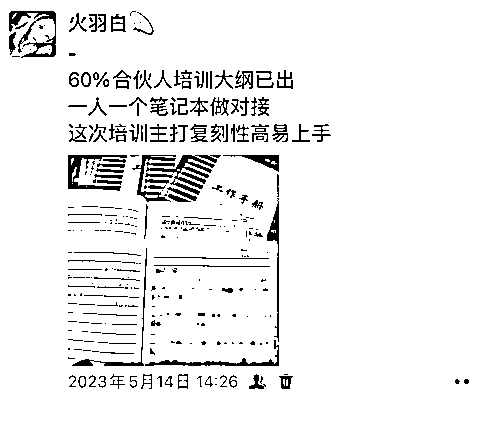

因为之前口碑积累得不错，团队招募只用了3天，就收到20多位共创伙伴，每人2588元，3天收入5万多。

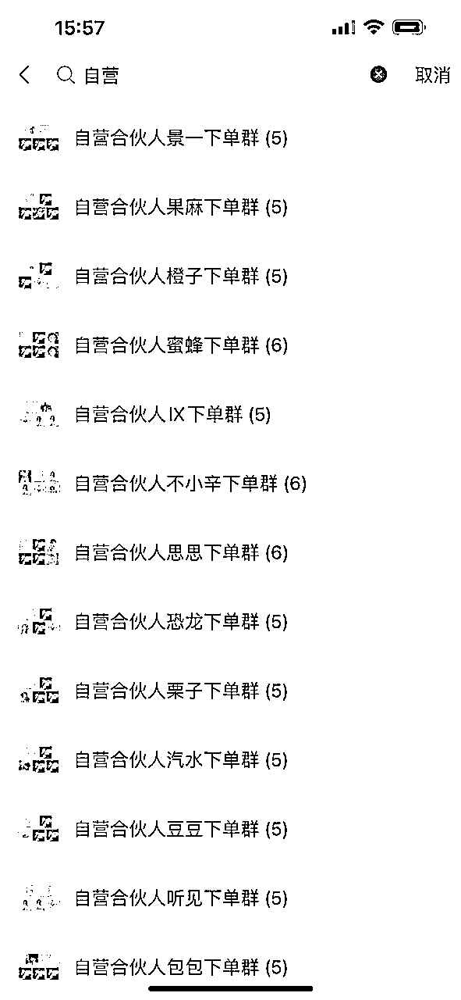

后来，我搭起供货群、培训群，靠转介绍和产品实力，慢慢有了影响力。

我学历不高，讲不出高深的理论，只能讲实实在在的干货。所以培训做得特别细，学员不会谈客户，我就逐句带着她练。

很快，最早加入的共创伙伴就做出了成绩。

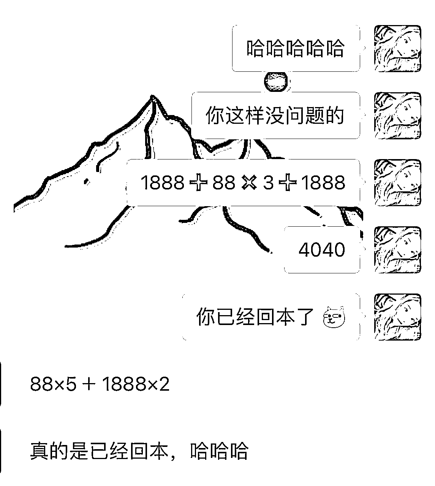

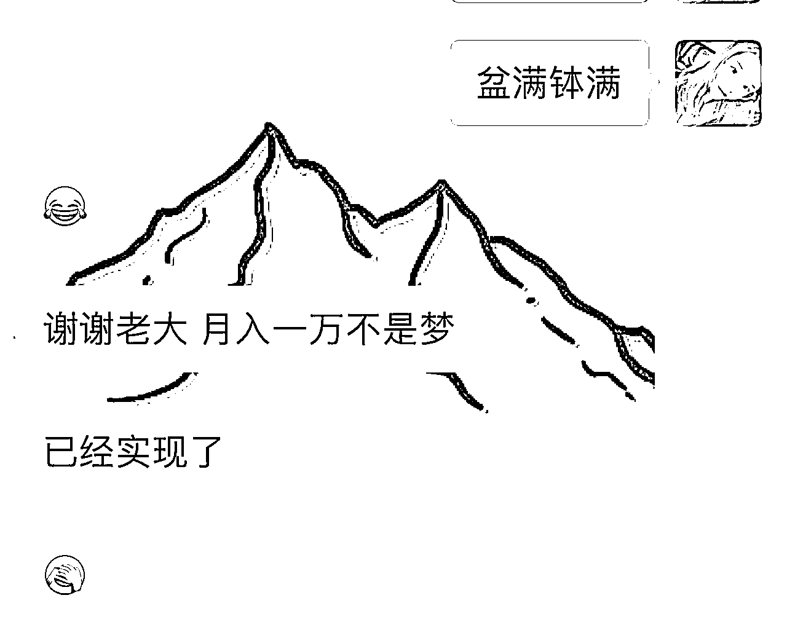

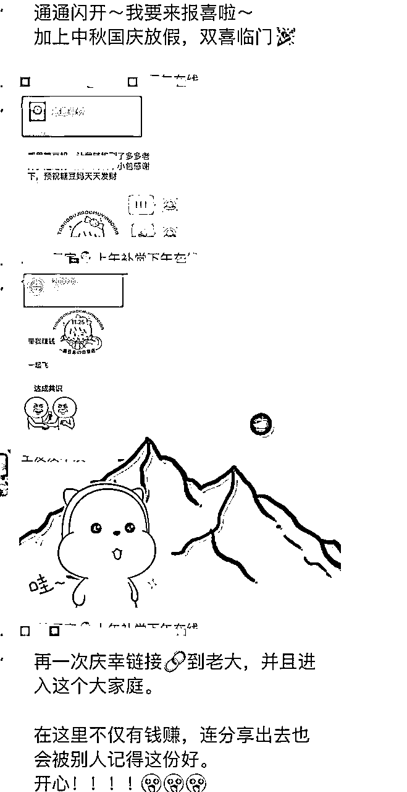

【复盘6：极致利他】手里有资源和经验以后，我没有停在原地，而是用它们去帮更多妈妈。无论自己做零售、做拼团，还是后来带团队，一颗真诚帮人的心，最后都会回到自己身上。

这就是我从一个什么都没有的普通妈妈，到两年赚到七位数的全过程。从零售代理，到社区拼团，再到婴幼儿商品供货负责人，每一步都是用教训换来的。

# 二、婴幼儿产品怎么卖爆？这四个关键值得收藏

## 1、启动期流量：三招搞定，并持续裂变

带货的核心永远是流量。我赚到七位数，流量主要靠这三招：

**1）线上泡妈妈群**

尽量多进妈妈群。我常去育儿社区App的群聊；带孩子去医院、游乐场时，也可以主动和旁边的妈妈聊天，互拉进群。

注意：别一进群就发广告，容易让人反感。可以先用这些话破冰：
- 有没有附近的姐妹加个好友，以后一起遛娃？
- 本地有什么靠谱的产后恢复推荐吗？
- 附近有几家婴幼儿商品店在搞活动，要不要一起拼单？

**2）线下小区遛娃搭讪**

带孩子去小区或周边小区的遛娃区，选人多的时间段：夏天傍晚，冬天中午。遇到同龄宝宝，可以从奶粉牌子、尿不湿牌子聊起，加上🛰️，再互相换妈妈群。

**3）线下婴幼儿商品店附近拉客**

有条件的话，可以去婴幼儿商品店停车场附近蹲守，这类客户更精准。我会以平台官方活动送小礼品为由，引导妈妈们加🛰️、进群。

常用话术：
- 您好，我是某平台的好物分享员，正在做线下推广，送您一份小礼品体验一下。
- 我是本地妈妈闲置群的招募员，邀请您参加闲置交换活动，家里的宝宝用品都可以来出售，还能换积分领绘本玩具。
- 我是某品牌的线下体验活动推广员，正在邀100位妈妈免费试用产品，想邀请您进客户群。

## 2、科学选品：踩准宝宝的成长节点

不管做零售、拼团还是供货，选品都是地基。除了要选消耗品，更重要的是盯住客户宝宝的月龄。孩子长得太快，很多用品一个月就要换代。

我最早一批客户的孩子，和我女儿差不多大，所以我最清楚这个阶段的妈妈需要什么。我的原则是：自己没试过、没给孩子用过的东西，绝不上架推荐。

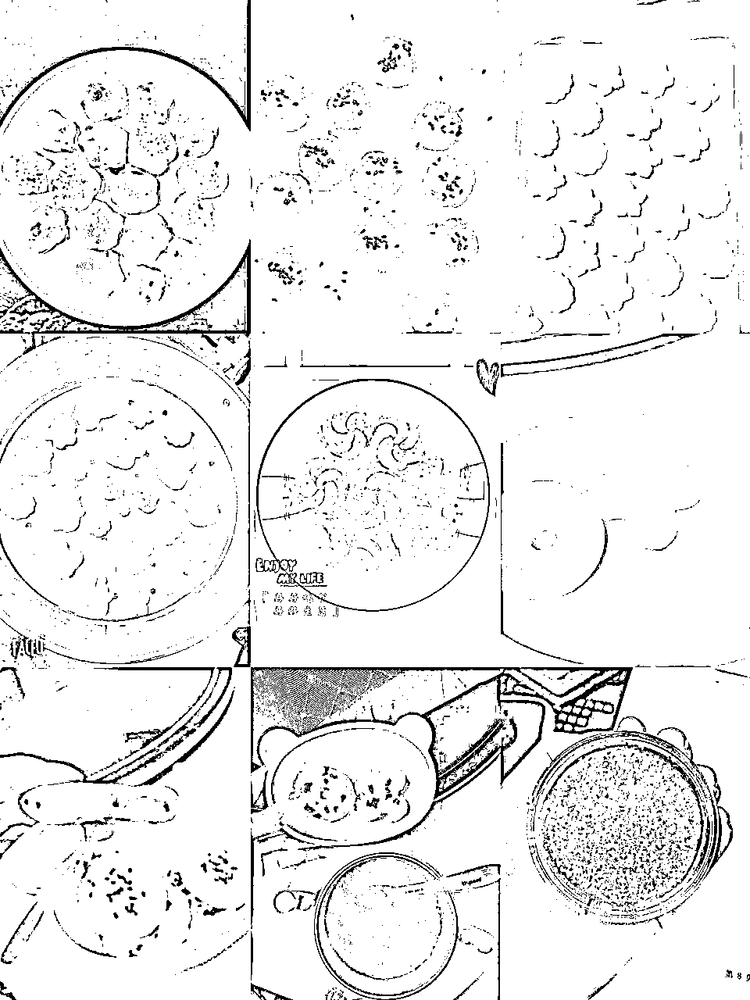

比如宝宝满6个月要加辅食，我仓库里就备足辅食类产品：做辅食的小工具、模具、杯子，一应俱全。我自己也学着做辅食，平时能和客户交流。

抓住客户宝宝的成长节点，按需供货，才能做到上一款爆一款。

## 3、矩阵上货：让客户有的选，你才能通吃

上货的时候，不要同类产品只推一款，要尽量铺全。

比如之前核污染风波，很多妈妈抢DHA。我没急着推某一款，而是把仓库里所有DHA现货都理出来：价格、功效、适合年龄、性价比、藻油含量，列成表格发到群里，让她们自己选。

现在的妈妈很有主见，会看专家科普、博主测评、社交平台种草，也会听身边姐妹的推荐。我们要做的，不是说服她买你选定的那一款，而是把市面上主流的同类产品都准备齐：不管她最后选哪个，你这都能满足。

这样一来，成交一定会落在你手里；你强大的货源能力，也会让客户越来越信任。

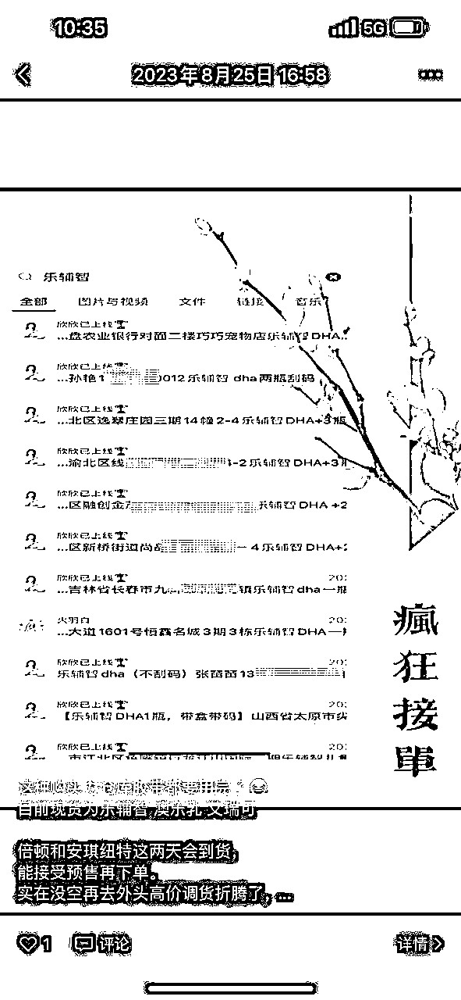

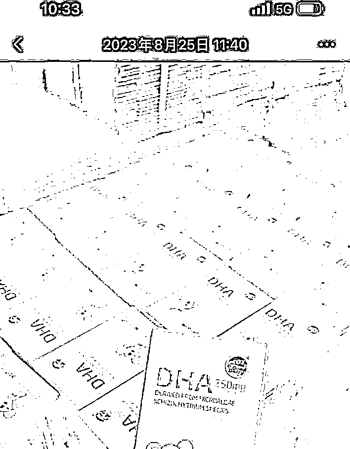

## 4、售前售后：把情绪价值给足

面对妈妈客户，售前售后都要把情绪价值给足。多理解、多回应、多帮忙解决具体问题，关系近了、信任深了，成交自然会更顺。

很多人只看到宝妈群体的消费力，却忽略了一个更关键的点——她们是最需要被理解、被安抚的人群。

我自己就是过来人，能深切感受到那种状态。带娃这件事，几乎把所有精力都榨干了，我家孩子小的时候，我几乎只有在她睡着的那几小时，脑子才敢稍微松口气。

更别提孩子生病那种时刻，整夜整夜的守着，焦虑、疲惫全都堆在身上。

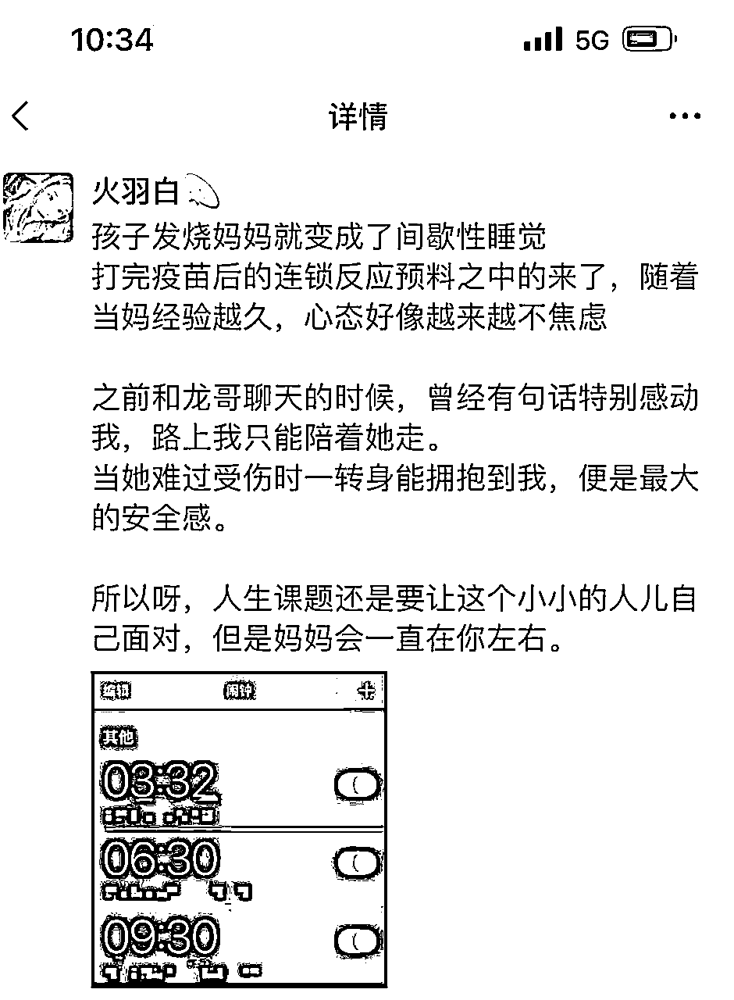

身心同时被透支，是她们真实的日常。所以当客户向你倾诉这些困难时，最需要的不是一堆产品参数，而是真诚的鼓励和情绪上的陪伴。用一点点希望、一点点被看见的感觉，就能帮她从崩溃的边缘缓过来。

除了育儿的压力，容貌变了、身材走样了、和家人相处摩擦、婆媳之间的隔阂……这些情绪像潮水一样接踵而来。

我的宝妈客户群，其实就是一个可以说话、发泄、取暖的地方。带货可以谈，但更重要的是先给她们满满的情绪价值，帮她们一起梳理、一起想办法。

所以服务宝妈群体，情绪按摩是基本功。她们心里舒坦了，下单的信任感和配合度自然就上来了。

## 5、品类别只盯母婴，延伸到日用也能多条腿走路

母婴品类之外，生活用品其实是更大的增量。买家常识，家里大部分开销的决策权都在妈妈手里，日常消耗品几乎都是她来操心。

适当地引入日用、快消品，甚至节日礼盒，都是很自然的延伸。像刚过去的中秋，我就上了三只松鼠的零食礼盒，团队一天就卖出近200单，当天营收直接破6万。

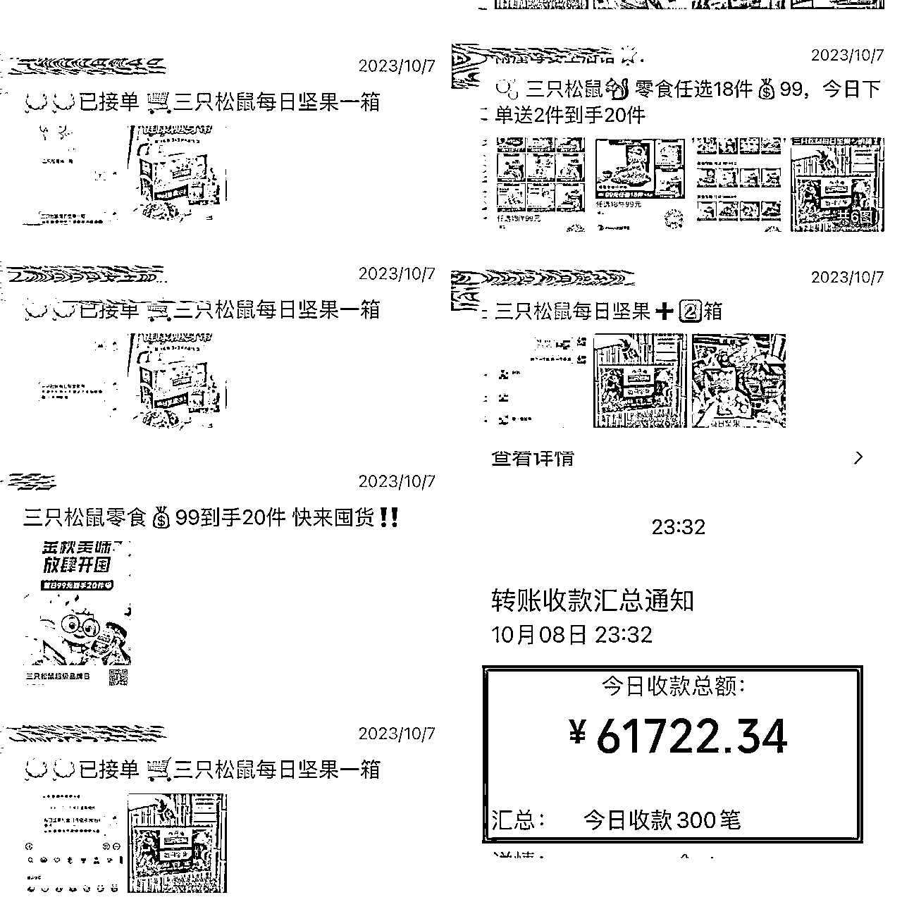

眼下年关将至，完全可以提前备好礼盒货源，提前一个月就开始预售，业绩自然会跟上来，也能顺势多赚一笔，把年过得更体面。

# 三、零资源、零背景、学历普通的宝妈，也一样能闯出自己的天地

女子本弱，为母则刚，这句话我真的是用血泪验证过。

起初我只是想为孩子治病赚点医药费，后来一次女儿高烧，把我所有的韧性都点燃了。从那以后，挡在前面的无论是谁，我都咬牙扛过去。支撑我一路向前最坚定的理由，就是每次回家看到女儿那张笑脸。

很庆幸我走过来了。想借自己的经历告诉每一个宝妈：

闯出一片天，并不需要多少钱，也不需要高学历、硬背景、丰厚资源，甚至不需要你天生能力超群。

只要你有不服输的劲儿，愿意学、愿意干。

把育儿的碎片时间利用起来，就能做一份属于自己的副业，赚到改善生活、给孩子更好未来的钱，也给自己一份底气。

回想起没起色时，家里人那副态度：让我取个快递都要等对方打完游戏才去，亲妈也常说我不务正业整天抱手机，明明我是在谈合作。赚钱了之后，房子是我买的，妈妈每年心心念念的貂再也不用犹豫，老公想要的手表可以直接送上。女儿的生活开销，我也能全权承担，给她想要的一切。

家人的眼光，也彻底变了。婆婆从以前嫌我脾气不好，到现在只会劝我老公：人谁还没个脾气呢！

我，一个没有任何资源、没有任何背景、学历也不高的普通宝妈，都能靠自己杀出一条路。你也可以。