# AI＋👸号故事爆文，一个小团队15天做到日入2.1W＋，入池率90%，我把全流程拆给你看

你好，我是龙哥，写故事这条路走了5年，手头矩阵号攒了80万粉丝。先感谢赚钱这个平台，让我有机会看到一批又一批新人在👸号爆文赛道上冒出头来，成绩相当亮眼。

我自己这几年操盘了十几个👸号，摸爬滚打也积累了4年多的实战经验。这段时间带着团队，用GPT＋故事爆文的组合拳，加上其他热门领域的尝试，半个月内就陆续冲进了流量池。日收入数据摆在这儿：21000＋、12000＋6500＋、4000＋、3000＋、800＋、900＋……

这篇复盘，是理白老师劝我动笔的。运营👸号快5年，变现做到300万之后，我又用GPT＋👸号爆文这条路，带着团队一天拿下230万阅读、150万阅读、100万阅读、94万阅读。

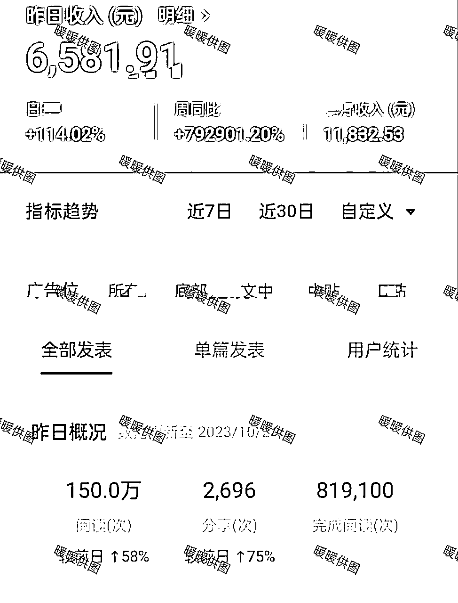

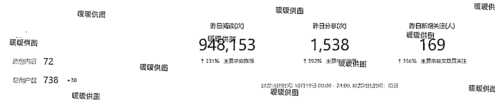

而这前后加起来，不到15天。我用8000字，把从零开始带小白学GPT、注册👸号、找灵感、拆解爆文6大类型，再到批量产出100w＋爆文的完整变现链路，全部写清楚。

考虑到有人可能连👸号注册都不太熟，这篇内容我尽量写得细一些。

## 一、👸号注册与排版：从零到一

### 1. 注册：身份证就能搞定

电脑上打开浏览器，搜索“🛰️公众平台”，点“立即注册”，会看到四个选项：订阅号、服务号、小程序、企业🛰️。

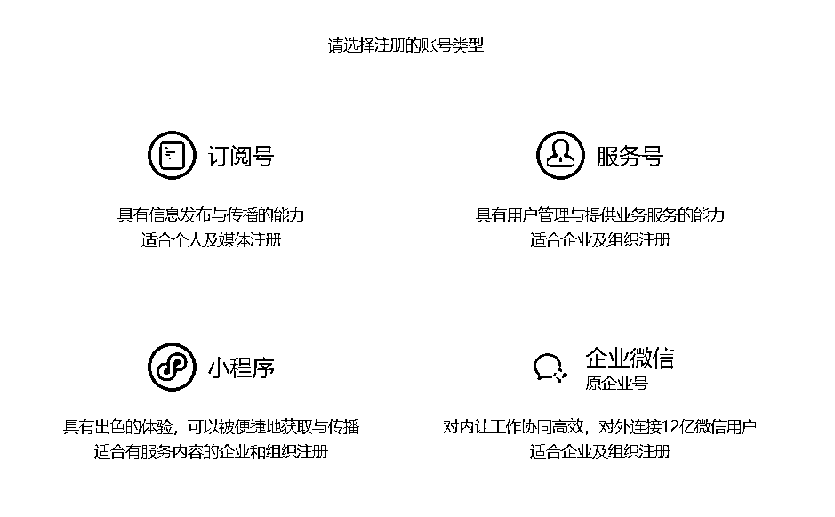

选订阅号，千万别手滑点了服务号。然后填邮箱、设密码，按提示走就行。

补充一句：新人起步，个人号是最优解。个人号可以直接绑你的银行卡，流量主收入到手无阻碍。一个人做2到5个个人号完全没问题，自己的身份证用完了，家里人的身份证也能顶上。

想批量放大操作的朋友，也可以走个体户路径。淘宝上买个个体户营业执照，一个执照能做两个👸号，第二个要交300块认证费给腾讯。另外个体户号还要刻公章，流量主审核过了，钱会打到法人银行卡上。

不过说句实在话，在你还没跑通流量池之前，1到2个账号足够练手了。

👸号是有权重一说的，原创度高的账号，进流量池的概率会大不少。

短故事这个方向，不管AI写还是自己写，1000字上下就够了。这个长度，文中能插两个广告，文末还能挂一个。那种动辄几千字的长故事，对标的是有大号粉丝基础的老账号——人家有粘性，打开率稳，比如我自己运营的号，阅读在7000到10000之间。但这类老号，根本不靠流量主吃饭。

所以，一定要找对低粉爆文号来对标，别筛错对象。

1000字的故事还有个大优势：完读率高。文章越长，读者越容易中途跑掉。

有人担心AI写出来的东西质量不行，其实真没那回事。只要调教几轮，GPT3.5写出来的文章，自己再润色一下，小白照样能做出100w＋阅读。

ps：有GPT4.0的话，效果更好。

### 2. 排版三原则：伺候好中老年读者的眼睛

👸号爆文，大部分定位都是中老年情感粉。那么排版的每个细节，都得围绕他们的阅读习惯来。

**第一，字体往大了调。** 14到15号字，年轻人看着还行，对老年人来说真费劲。你想想父母🛰️聊天时用的字体大小就明白了。我一般调到17号左右。

**第二，文章切成4到5段。** 这是心态问题。你一篇1000字的故事不分段，读者一眼扫完，会觉得你敷衍。中间切分开，悬念感也更强。AI写的故事，说实话大多不算惊艳，年轻人可能看不下去，但中老年读者不一样——他们的文化程度普遍不高，对阅读的需求跟咱们不同。

有人担心：万一中老年读者里也有文化水平高的呢？放心，你的标题已经帮你筛好人群了。那种博览群书的中老年读者，根本不会被标题党文章吸引。换句话说，他们本就不是你的目标受众。

**第三，每段别超过4行。** 拿不准就用手机预览看看效果。字太多堆在手机屏幕上，看着太累。还是那句话：排版是为了方便读者。

### 3. 排版实操：两种方式

**方式一：直接在👸号后台排**

登录🛰️公众平台。

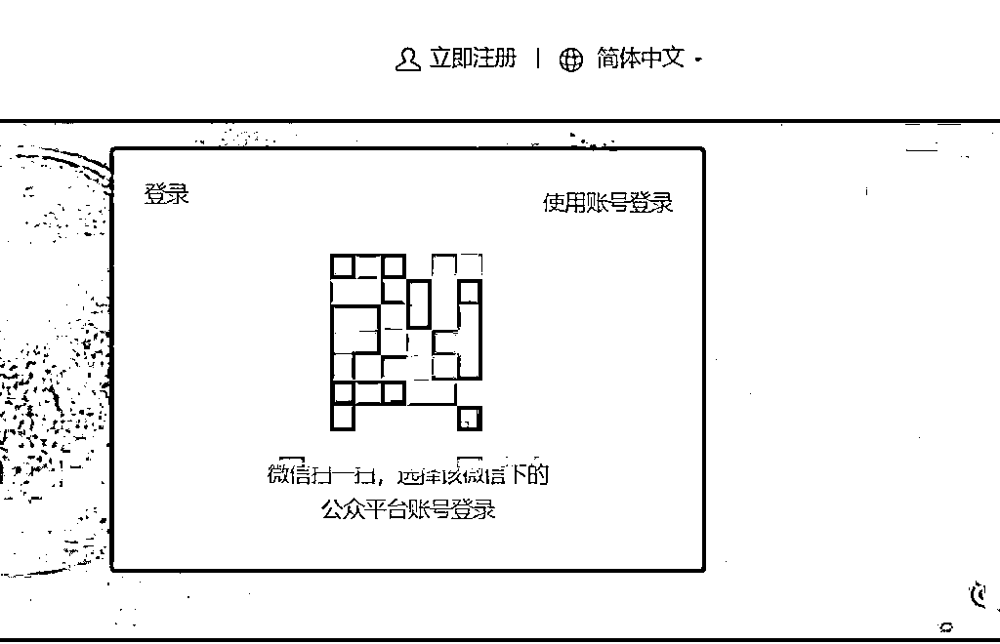

个人号或公司号，绑定🛰️后就能扫码登录了。点开“图文消息”。

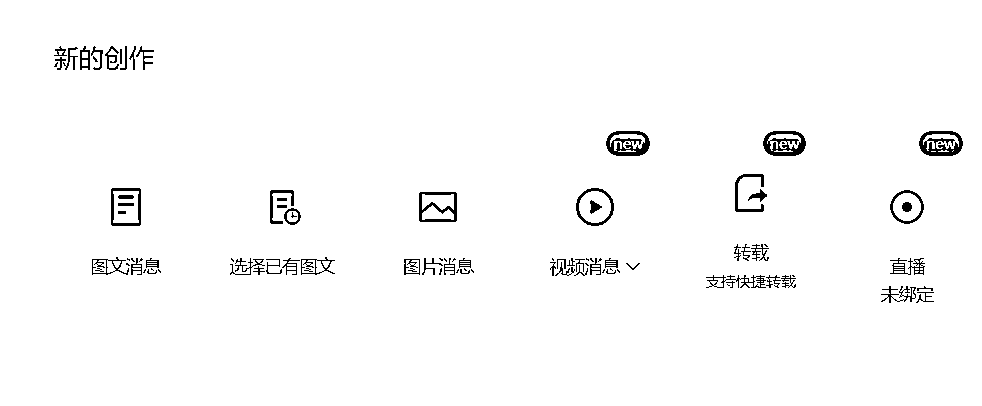

简单排版的话，👸号后台自带的功能完全够用。

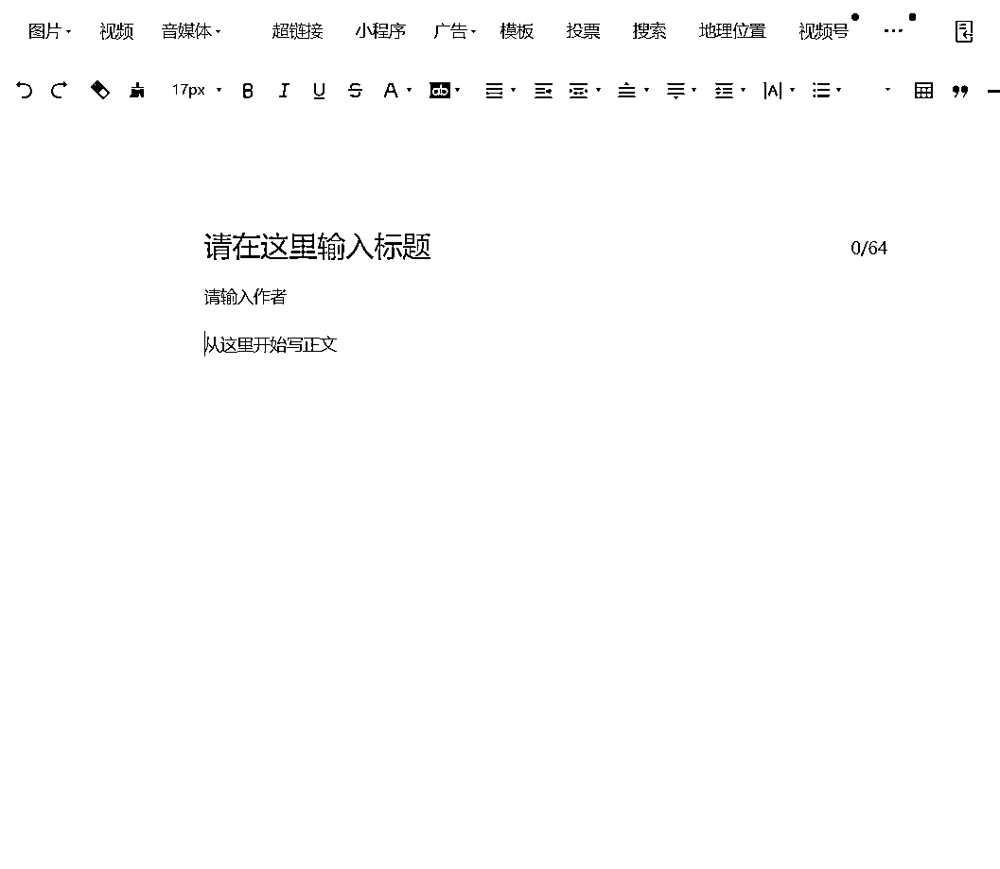

没进流量池之前，一天1到2篇就够了，保持日更。只要内容选题没问题，基本半个月内都能进池子。

操作顺序如下：把写好的文章（或者AI生成的文章）粘到正文区，然后——

1. 全选，调字体大小；
2. 调整两端对齐、段前距、段后距，按感觉来，选8或16都行，行间距字间距同理；
3. 加小标题。可以直接用纯序号，也可以去135编辑器或96编辑器找现成的序号标题。我一般是直接用01、02、03，调到24号字，加粗，居中。效果大概这样——

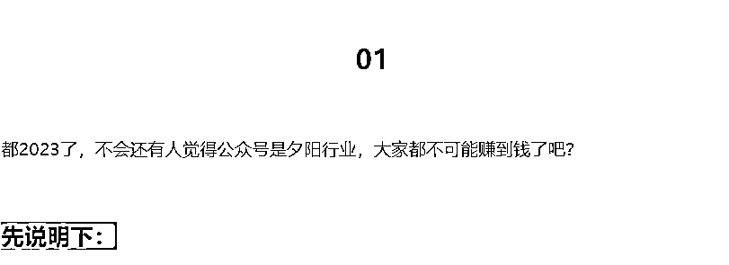

也可以把字体加粗，加上橙色背景色，20号字，看自己的审美来调。

想要更花哨的小标题，135编辑器里有大量样式可选。

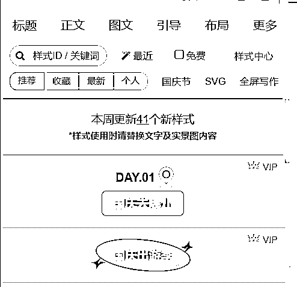

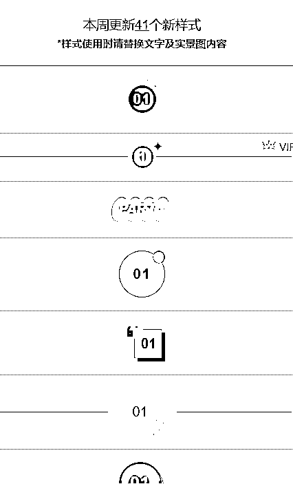

选免费的小标题就行，不用开会员。

**方式二：用第三方编辑器排版**

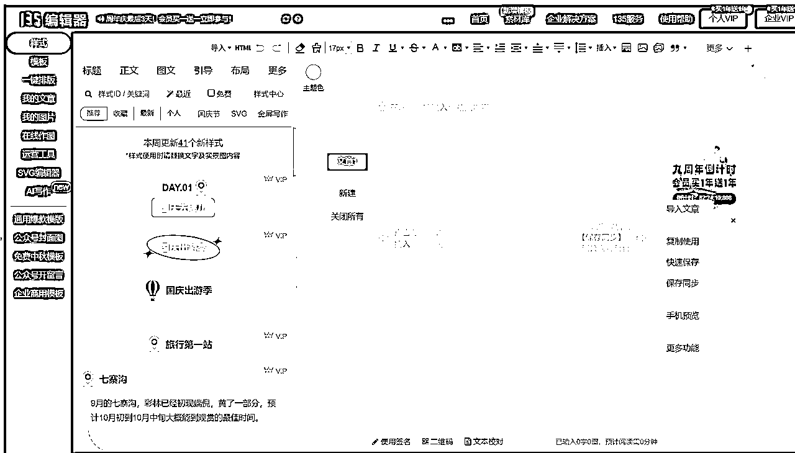

👸号最好有人设感。结尾附上自我介绍、往期推荐阅读，这样一篇文章爆了，能顺势把读者导流到其他文章，带动多篇一起进流量池。

在135编辑器排完，全文复制到👸号后台，保存草稿，然后预览到🛰️上——记得先关注自己的👸号，才能收到预览消息。检查排版没问题后，插入广告，智能选择、全部插入。

粉丝不够500的，先去买粉，市场上中介价格大概30到80不等。

开通流量主之后就能插入广告了，每篇文章只要有阅读就有收益，收益直接进银行卡。没绑银行卡的记得先绑上。

提醒一下：有小伙伴排版后发出去看不到广告，或者排版时提示插入不了广告名片——这种情况复制粘贴重新来一遍就行，一般是插图太多或小标题触发了bug。

发布的时候，记得勾选“群发通知”，这样大家才能收到消息。定时发布也很实用：情感类文章，选晚上七八点或十一点左右发；不确定的话，可以看后台内容分析，看看你的号一般在什么时间段阅读最高。故事类的话，基本是早上6到8点、中午12到2点、晚上7到8点和11点以后这几个时间段。

温馨提示：发文章时标了原创但不勾选群发通知，照样能进流量池。

精力够的话，用“发表”功能一天发十几篇，这样更容易测出多篇十万加，爆上加爆。设置好定时发表，可以提前排好一两天的内容，主业忙的话，一次性排好几天的文章也不是不行。

## 二、👸号爆文六大类型

### 1. 情感类（故事、鸡汤、观点）

我和团队成员主写的就是情感文。优势在于这类内容主观性强，AI写起来容错率高。中老年情感市场是常青树——每个人都有情感需求和好奇心，看故事就是好奇心的体现。很多爆文，靠的就是标题和封面抓人眼球。

案例：

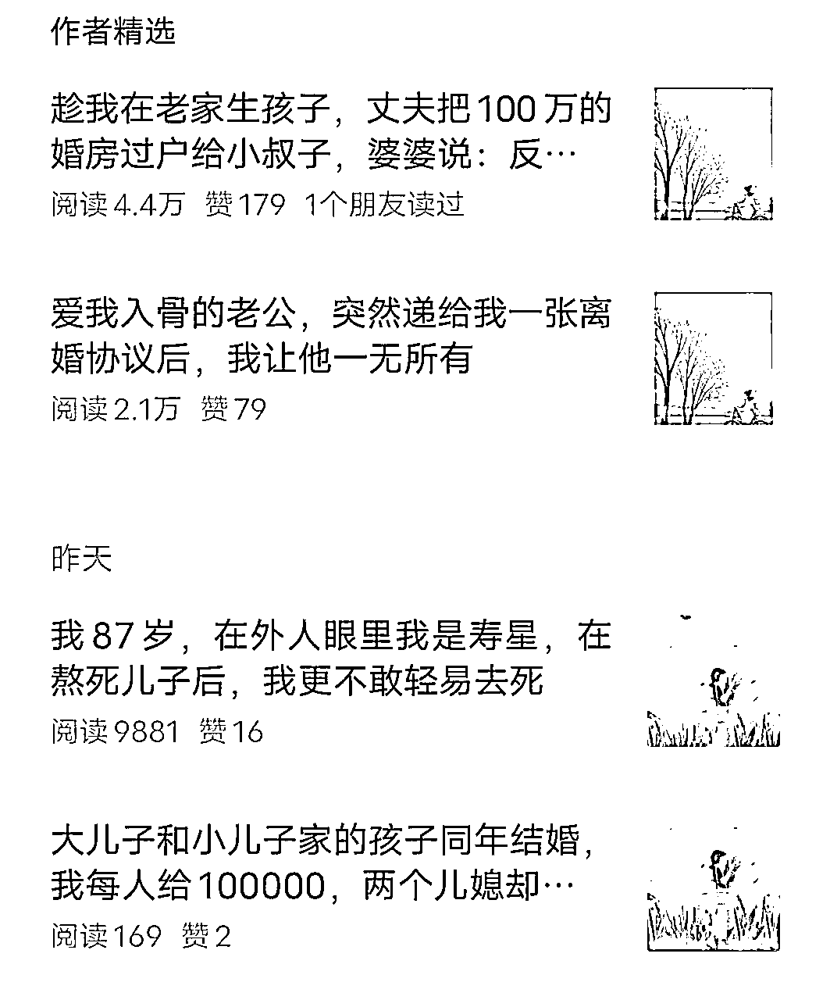

### 2. 历史类

历史人物、历史故事选题，打开率一直不错，上了年纪的人都爱看历史。但要注意：近代史涉及敏感人物，尽量别碰。流量池爆了容易触发人工审查。想写历史，可以尝试民间历史故事、名人故事、后宫情感故事等方向。

### 3. 民生类

和普通人息息相关的内容，看的人也多。比如农村、养生、健康、养老等话题，具体怎么写，看你们自己的方向选择。

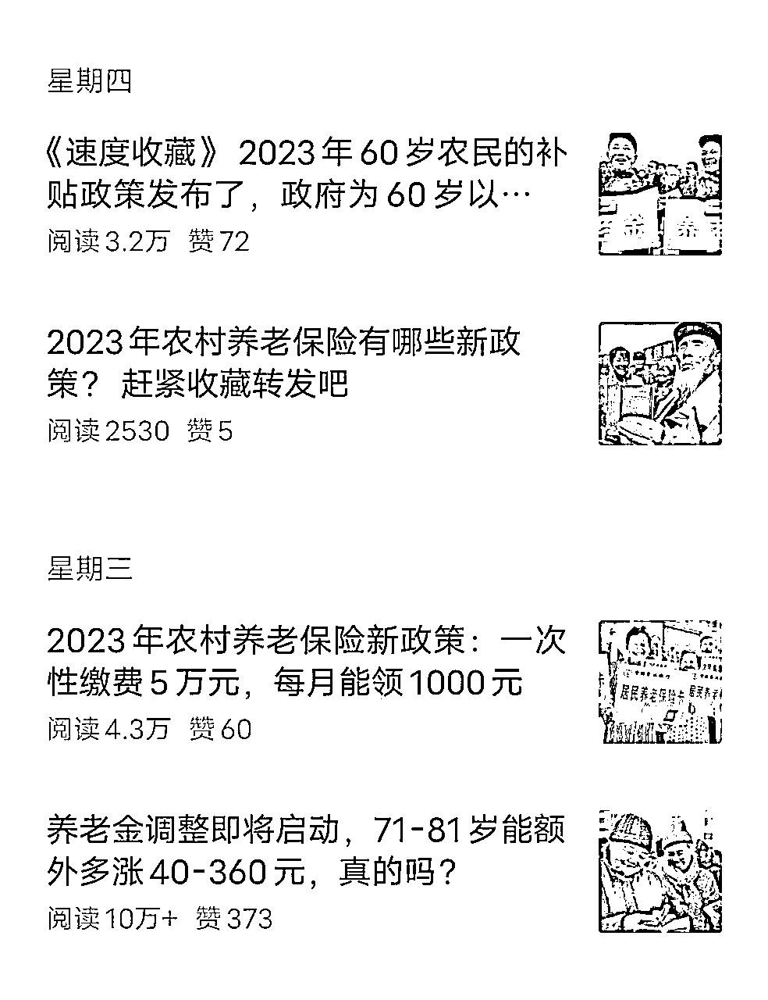

### 4. 明星类

也可以叫名人类。名人自带流量：宋祖儿、马云、各种杰出人物，他们的语录和故事，很多人会忍不住点进去。但注意别侵权。

### 5. 评论类

甄嬛传、陈情令、各种爆火的影视剧——孤注一掷这类话题，你写观点也很容易拿到流量。出了十万加的话，记得来找暖暖报喜。

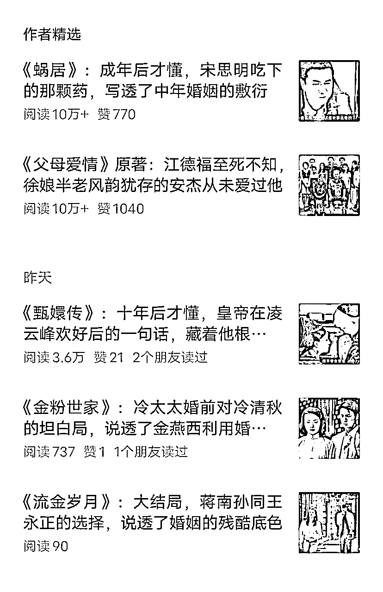

### 6. 专业类

法律、医生等方向，没有过硬专业能力不建议碰，容易出问题。另外👸号发布规则里，擦边内容和时政类型是绝对不能碰的。

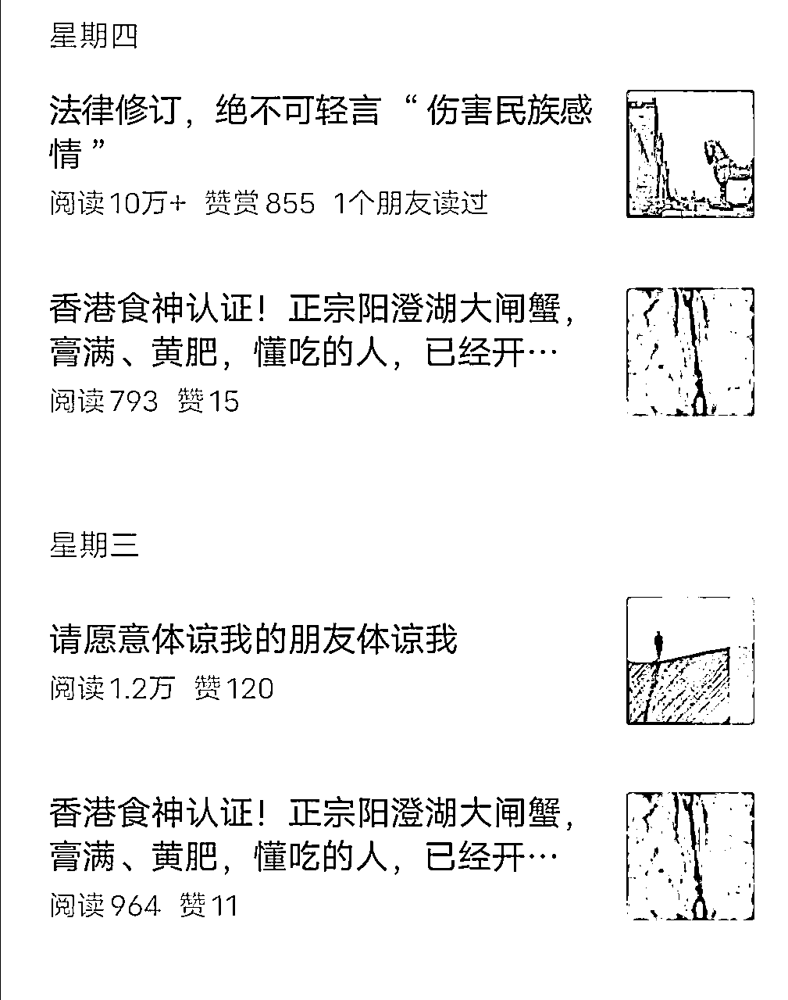

## 三、小白也能快速上手GPT

我是今年年初开始用GPT的。先是GPT3.5用了一阵子，后来换成GPT4.0。对比下来，4.0确实方便太多——但一个月费用要100以上。于是暖暖调整了好几轮指令，让3.5写出来的文章，也能贴合👸号的调性。

### AI出文章的三大好处

**第一：零基础友好，时间不够也能做。**

对于想入局自媒体但内容能力暂时欠缺的人来说，AI能帮你快速抓住选题、搭好框架，然后参考你投喂的范文，写出符合要求的文章。这些文章基本都能过原创，不放心的话可以二次修改。

很多人对AI的印象是死板、一板一眼、冰冷毫无温度，觉得这种工具写出来的东西没人看——说实话，我在接触AI之前也这么想。但AI真的在一次次刷新认知。目前团队使用的情况来看，AI写的故事，已经能达到1到3个月经验故事作者的水平了。

👸号读者的大盘画像是什么样的？文化水平普遍不高，认知程度也有限，接触互联网也没年轻人那么深。年轻人爱看的👸号，基本是学习、赚钱、成长、鸡汤热点观点。而中老年读者更倾向转发祝福类、养生类、名人故事类的文章到朋友圈，或者转发给亲友。

你翻过父母的票圈吗？收到过父母发来的👸号文章吗？什么健康食物、防癌习惯，农村读者可能还关注农村建设、三农、养老金……注意，这些正是👸号爆文的主力军。那些看似不起眼的领域，在👸号开通公域机制之后，反而一马当先成了很多读者的心头好。

用AI写这些内容，相当于把信息收集、重组、加工，直到完美契合你的要求。说实话，自己提取文章、编辑文字，还真没AI来得得心应手。大数据时代，工具确实帮我们省下了大量时间和精力。

**第二：批量生产，爆款概率指数级上升。**

有些团员一听“日更”两个字就慌了：要上班、没时间写，交一篇稿子都费劲。这背后最大的痛点是找选题——很多人刷几个小时视频，才能看到一个还不错的素材。对搜商不够的人来说，AI真是救星。

写文章这件事，尤其是好故事，极度考验文字掌控力。有些人写文就是鲜活生动，一字一句跃然纸上，让人看得入迷。但也有人文笔不够，写两句就劝退读者——这也是为什么很多人觉得写故事赚钱慢。

在你还没厚积薄发之前，一边练手写故事，一边用AI辅助出稿，然后再加工修改，写作能力也能得到很好的锻炼。

👸号去年开通的公域机制，相当于几年前的今日头条。做过自媒体的都懂头条养活了多少创作者。用AI批量出文章，完美解决了原创作者出稿慢的问题：同时运营几个号，一起朝一个方向发力，时间一长，出爆文的概率自然倍增。

试想：你一天写一篇，人家用AI一天出十篇，谁的概率更大？谁的收入更多？在大部分读者文化水平不高的前提下，想迅速吃到👸号流量风口的第一波红利，必然是“量大出奇迹”。

**第三：AI还在飞速进化，现在是黄金窗口期。**

我开始用AI那会儿，文章质量远不如现在。现在GPT4都出来了，公认比3.5强不少。等大家学会了用AI，不光能生产各种类型的文案、故事、文章，以后还能解锁更多功能，说不定就能跟你自己的工作或专业结合。在大家都在做斜杠青年的时代，多一门技能，就多一条路。

### 怎么拥有AI？

1. 国内软件：有免费也有付费；
2. 国外GPT：文章质量相对更优。

### 新手调教GPT写1000字故事：四步法

**第一步：找一篇爆过的文章，把情节（或链接）喂给ChatGPT。**

注意：很多人提取大纲后直接拿来用，这样做重复度太高。正确做法是等GPT给出不错的大纲后，手动修改，降低重复度，或在开头增加悬念成分。

1000字的短故事，和3000字👸号故事写法不同，建议分成4个部分：

1. 开篇悬念；
2. 事件起因（结合生活片段）；
3. 故事高潮（解开悬念，引发共鸣）；
4. 升华主旨，传递正能量。

拿我这边一篇10w＋阅读的GPT文章举例：

标题：泪目！河南一个10岁的小女孩已经是4个孩子的“母亲”

1. 让GPT提取故事大纲：

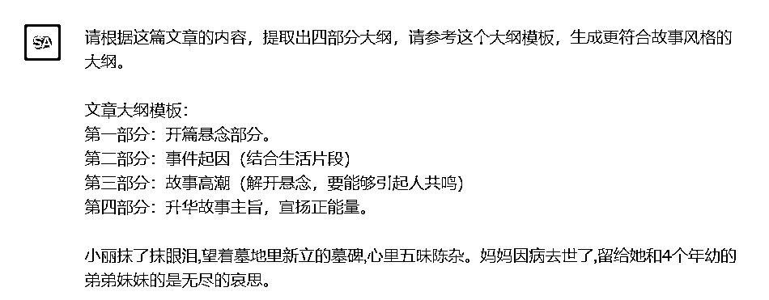

调教指令可以参考这个，可以自己优化：

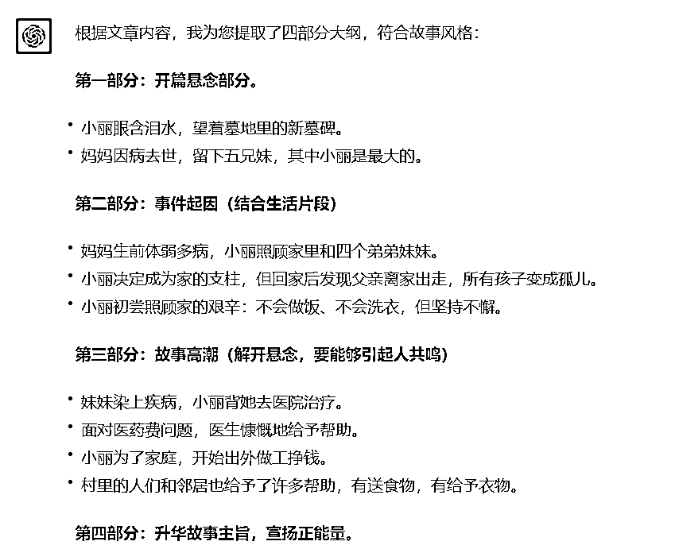

2. 大纲和原文太像的话，不能直接用。手动改一改，让情节更曲折、悬念更强。

3. 用优化后的大纲让GPT扩写成1000字故事，或者每一部分单独扩写。

这里我直接用原大纲做示范，扩写出了一篇1000字的短故事——

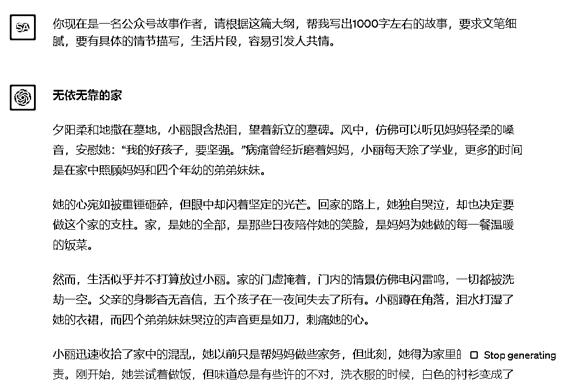

注意：大纲没修改之前，GPT写出来的故事和原文会有些像。所以尽量改大纲，或者分部分让GPT写。

👸号爆文故事的打开率，基本由标题和封面决定。像这个标题就自带悬念和反差：河南10岁小女孩，成为四个孩子的“母亲”——这本身就是故事。

找爆文选题时，多积累一些低粉爆文号，研究对方的标题是怎么结合情节制造悬念、反差、情绪、冲突的。金钱、拆迁、赌博……凡是能引起共鸣和情绪波动的元素——悲伤、愤怒、好奇、同情——都可以用。标题和封面足够吸引人，这篇文章就成功一半了。

## 四、爆文灵感从哪里来？

很多姐妹刷到一些故事，觉得都差不多。暖暖为什么要专门把故事类型细分出来？因为故事对应的人群，比你想象中精准得多。

打个比方：这几年很多广告商找我投广告，都非常认可我的故事号，说转化不错——女性用品、小说充值，转化率都很高。但我几个朋友的账号就不行，每次投放转化效果都特别差。不瞒你们说，她们经常想花钱买我的粉丝。因为我的粉丝群体购买力强，广告商每次都会复投——这也是我这几年收入能达到几百万的原因。

我仔细分析过这里面的门道，对比了同行的大部分故事👸号：有古风的、灵异的、现代情感的、职场故事的、婆媳的。虽然都叫“故事”，用户群体其实天差地别。

拿转化最差的婆媳文章来说——为什么差？因为看婆媳故事的粉丝，大概率是正困在婆媳矛盾里的人。什么样的人更容易陷入婆媳矛盾？要么是婆婆本人，要么是留守在家带娃、和婆婆同住的儿媳妇。当然也有少部分女性一边和婆婆住一边工作，但非常少——你想想，每天上班都忙不过来，有孩子还要带，哪来的时间看👸号？

婆媳号受众大多是宝妈，手里可能没什么钱；还有婆婆型读者，消费谨慎，六七十年代的人苦过来的，不习惯网购，也不舍得花钱。这类人群，看故事花时间没问题，但让她们为产品或广告付费，很难。

所以，👸号爆文故事的核心逻辑是什么？要的是阅读量。专为中老年群体写的文章，更容易被喜欢，也更容易爆。这也就是为什么那么多人用AI写出爆文——用户水平普遍不高的情况下，你写1000字，她们能津津有味地看几分钟。

而且文章短，完读率高；老人看得慢，文章停留时间自然拉长。所以这类中老年情感故事的单价其实还不错——比上不足比下有余。真正高质量、领域专业的账号，单价会更高。

接下来具体聊爆文故事的细分类型。

### 1. 中老年情感故事

很多人不知道情感故事具体指什么，我直接截图一篇给你们看——

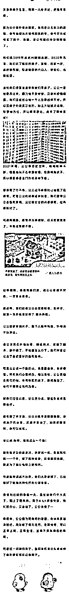

做婆媳类内容的人，很容易陷入题材泛化的坑，比如生娃、钱、亲戚走动这些老生常谈。写之前先把人群锁死，是25岁还是35岁以上的女性，年龄跨度别拉得太开。

更致命的是选题跳来跳去，今天写夫妻婚外，明天写婆媳，后天切到大学生恋爱。这种打法会让数据极度不稳，可能婚外那篇冲到几万阅读，婆媳篇却只有个位数。长期下来既浪费账号权重，也练不出写作手感。

很多人觉得一千多字的短故事练不出功。其实即使借助AI写作，在润色和修改的过程中，文字敏感度也会跟着提升。

### 2：人物故事
这类内容范围很广，就是围绕一个人物展开。可以选名人、历史人物、明星，自带知名度和搜索量，注意避开负面话题，避免纠纷风险。

### 3：娱乐故事
电影、电视剧、网红、圈内瓜类的故事都可以做。注意版权和侵权边界。

### 4：民生/历史故事
民间轶事、历史趣闻，比如各种寡妇故事、小人物传奇都可以。素材可以在抖音快手找，也可以去电台节目搜，历史书籍里也有不少。

不喜欢纯故事的，也可以直接对标观点类爆文。

怎么找对标？在🛰️搜关键词，找到10w+的文章，订阅号消息往下拉，看一看里会有很多低粉爆款号。点进文章底部，系统会推荐同类型爆文。

前期先攒一批对标账号，挑近期数据好的选题持续日更，流量池就好进了。

# 第五部分：新人一天突破两百万阅读的技巧

团队里有几个人一天阅读稳定在百万左右，其中一位直接破了200w+。今天结合几年运营爆文号的观察，给大家拆解一下。

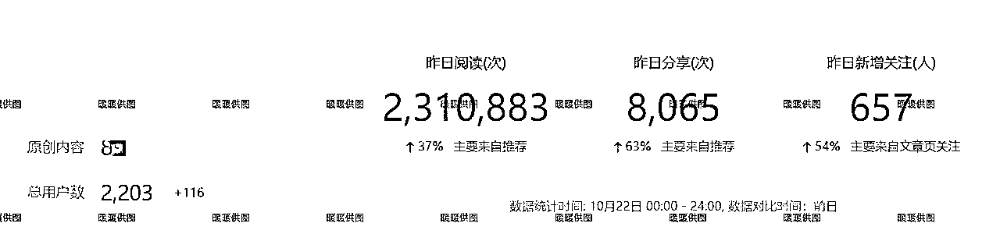

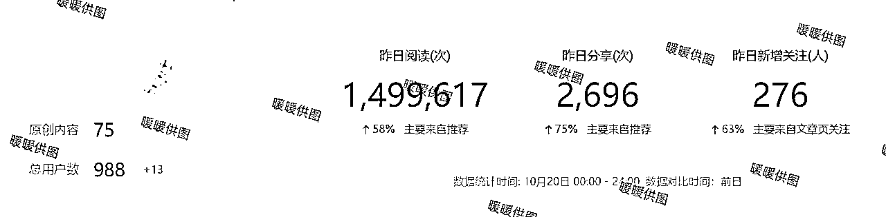

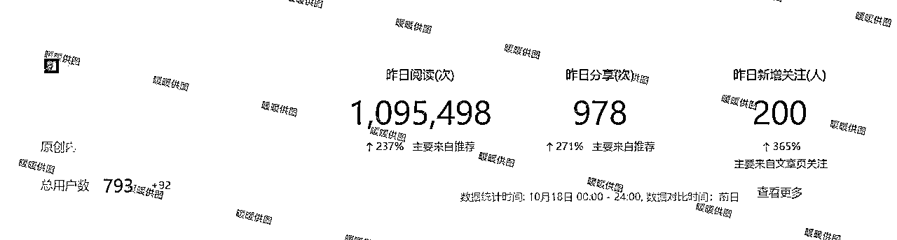

## 爆文大致可分为三个阶段

### 第一个阶段：打破流量池的入门期
入门期记住三件事：

1：坚持日更，条件允许就一天1-2更。
2：选自己拿手的赛道，标题可以参考对标号。
3：一旦有一篇入池，立刻进入飞速提升期。

提醒：入池超过两个月还没动静，要自查：是不是文章质量下滑，标题封面没吸引力，是否频繁断更。

如果以上都没问题，那这个号大概率很难起量。选项有二：注销重开，或换赛道再试一次。

敲重点：团队执行力强的同学，只要认真执行基本都能入池。正常情况下账号入池概率并不高，这也是很多人做爆文赚不到钱的原因。

很多人会问，为什么同样的10w+选题，我的号只有一两个阅读。先对照前面的问题排查。

我观察到很多同行的低粉号阅读不理想，本质是思维固化了。

敲重点：用GPT写观点文，很容易出现重复度高、原创度不足的问题。

易撰可以查原创相似度，但抓不到👸号文章，只能做参考。这也是为什么一堆人抄同一个标题，阅读只有个位数的根本原因，账号权重低也更难爆。

暖暖给学员的实操建议：

1：让GPT出大纲后，必须手工改大纲，提升原创度。
2：文章内容要手动改，尤其是开头要用自己的话抛信息增量，拉近读者距离。GPT只能帮小白起步，现在低粉号都在用，想要一篇赚几千块，还是得手工润色。👸号始终是内容为王。
3：控制账号的重复度。

比如大家都在写甄嬛传、名人名言，关键词、情节高度重合，前面可能还能爆，后面就没了。这就是信息增量不足，标题封面只能帮你进池。

如果系统判定你在重复写同一件事，即使垂直度没问题，内容也会被判定为低质，流量就会被限。

解决办法就是提高原创度。尤其是被判定滥用原创的作者，记得手写1000字。写不出来就在结尾加一段自我介绍，或者编一个亲身经历的小故事，比如我有个朋友、我亲戚经历过，增加原创标识。

千万别直接照搬GPT原文，反复取消原创标记会严重影响账号。

### 第二个阶段：进入流量池的飞速提升期
这个阶段最容易翻车，一旦违规封号，就直接掉池。

1：多发原创，原创度拉满。
2：选题要持续优化，不能原地踏步。
3：垂直度在这个阶段会被打标签，必须稳定。
4：出爆文后立刻连肝3-8篇，看个人精力。

群里会不定时投喂选题，执行力强的学员基本都入池了，其中有两个人连发八篇，爆了五六篇。

错过飞速期就浪费了，这也是我们团队一天破200w+的核心原因。

多篇爆文会带动账号整体阅读，可以在文末插往期推荐引导阅读。很多低粉号也会留下🛰️引流到私域变现。

### 第三个阶段：稳定流量池的内容期
这是我认为最关键的阶段。

长时间靠GPT或短文，很多人会审美疲劳。没关系，爆文的终点一定是持续的内容竞争。

深耕一个赛道，稳定输出，吸引精准用户。流量主只是变现方式之一，👸号还有广告接单、付费阅读、带货等多种变现，后续会慢慢展开。

运营爆文号要足够理性，会选对标、攒网感、优化指令、定期复盘，才能在数据波动中抓住爆文逻辑，一篇赚几百上千，月入过万。

对于已经跑通1-2个号的小伙伴，建议做矩阵，不同赛道需要不断测选题，才能找到最适合自己的方向。

复盘到这里就结束，感谢芷蓝姐和理白老师提供的项目和资源，让我受益很多。

最后祝各位都能通过👸号爆文实现变现。