# 100天从0到月入6.3万：一个支付新手的完整复盘

大家好，我是晋四喜。做线上引流和视频号电商起家，骨子里信奉“先干起来再说”。目前主要业务是视频号后端店铺和短视频投放，另外刚跑通一个叫“无卡支付”的新项目，已经带着一位圈友一起跑了三个月，效果还不错。今天特意来分享这段真实历程，希望能帮到有缘人。

先亮成绩：启动100天，收益从0做到63426元。

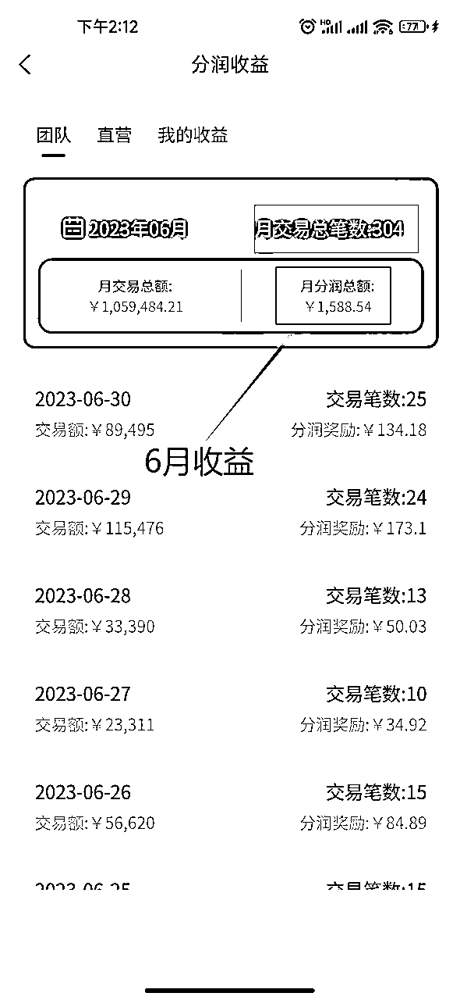     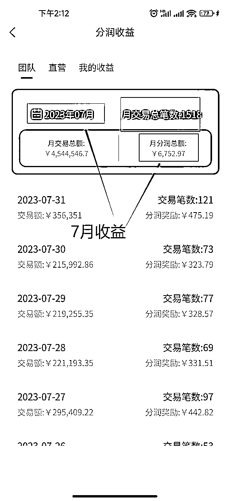 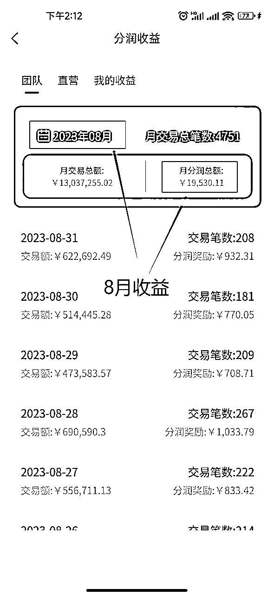 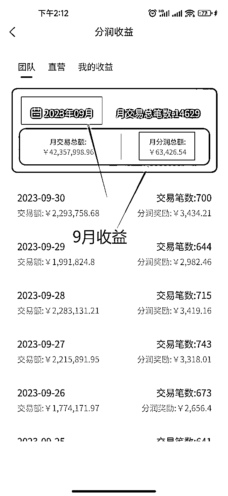

数字好看，但过程相当磨人。6月中旬开始，我们在头条、小红书、百家号、抖音四个平台反复试错，前前后后封了36个号，才摸出第一个能跑的模型。

## 为什么放着电商不做，跑去碰支付？

进赚钱这三年，我也算折腾了不少方向，基本都围绕引流和电商。这些项目帮我练出了高效产出内容、梳理SOP、私域转化的能力，也确实带来了收入。直到今年五一，我和朋友喝茶聊起赚钱这件事，才意识到原来的路子风险越来越大。

一是电商收入会被“叫停”：人一停，钱就断，视频号平台还时不时抽风，懂的都懂。
二是管理太重：既要花大量精力盯日常，又要承担高额人力成本——一个成熟的短视频制作或直播人员，月薪就要7K左右。
三是毛利太薄：账面GMV每月几十万，净利润率却只有10%出头。

无货源电商适合赚快钱，只要肯干，短期一定有回报；但放到长线看，它的可持续性和被动收益都很弱。

为了破局，我花半个月拜访了不少朋友，最后被涛哥点醒（身边叫涛哥的好像都挺猛）。他再次提起无卡支付。其实2019年他就说过，那时我在做贷款，一个客户能赚上万块，真心看不上这种一单几十块的小生意。所以他重提时我依然无感，一方面嫌收益低，另一方面团队也不是做电销和地推的料。直到看见他团队月交易额300亿、被动月入七位数的成绩，我才知道自己原来是个井底之蛙。

愿意试水，是因为这几点：

1. 支付是典型的管道收入：用户在，分润就在；每个月还能叠加前期的存量，自带复利。口罩三年都扛过来了，韧性可见一斑。
2. 我选了有人行背书的头部支付公司，基本不用担心APP关停。为此还专门飞了一次深圳，实地考察。
3. 无卡支付方便线上推广。它没有传统POS机的区域限制，全国客户都能做，等于把市场边界打开了。老支付人普遍不会线上获客，而我多年的引流经验可以直接迁移，试错成本很低。
4. 转化更容易、粘性更强。用户下载一个APP就能用，初期零费用；从传统POS切到无卡，不需要额外投入。而且谁会愿意整天背个POS机？所以客户不容易被切走。
5. 最关键的是259号文的落地：传统POS机变成一机一商户，而无卡APP有丰富的线上商户池。行业格局一变，利润自然重新洗牌，新人终于有机会挤进来。

以前我根本不敢想“月入七位数”，觉得那是不切实际的目标。但看看身边活生生的例子，再想想苏世民《我的经验与教训》里的那句话——做大事和做小事的难度是一样的，所以要选一个值得追求的宏伟目标，让回报与努力匹配——我瞬间释然了。

## 从0到1的实操路径

确定方向后，我立刻把引流团队里的一个伙伴调过来测试，说干就干。

第一步：研究同行。我的老习惯是“先抄后超”，找几个对标账号，把他们的引流路径完整走一遍。复盘下来发现，百家号和小红书主要吃搜索流量，头条和抖音靠推荐流量；最终都是通过私信和关键词自动回复，引导到微信成交。

 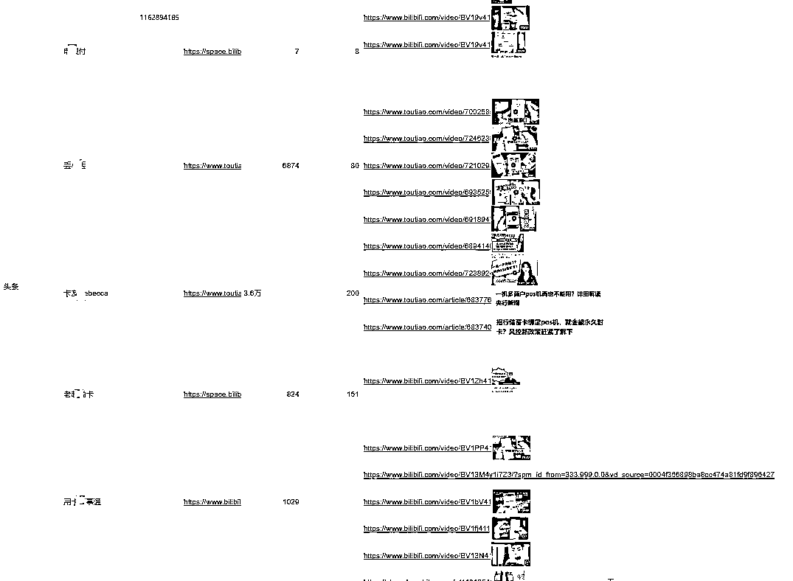 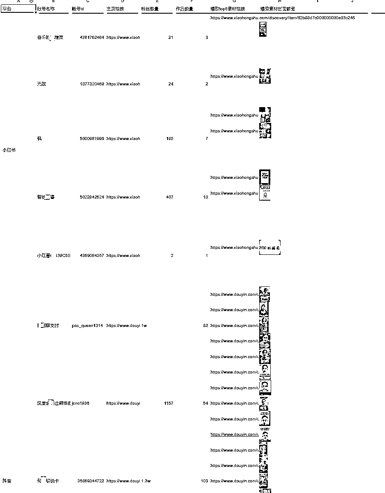 

第二步：搭内容库。我用5118和全网下拉词把用户关心的问题挖了一遍，列成选题库。再把文章生成器接上，从各平台抓基础素材，内容生产的基本盘就有了。

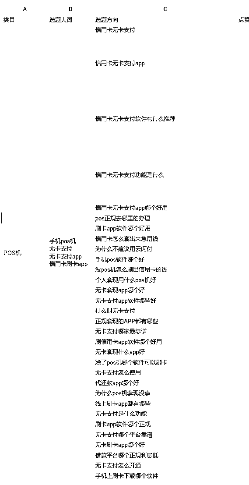   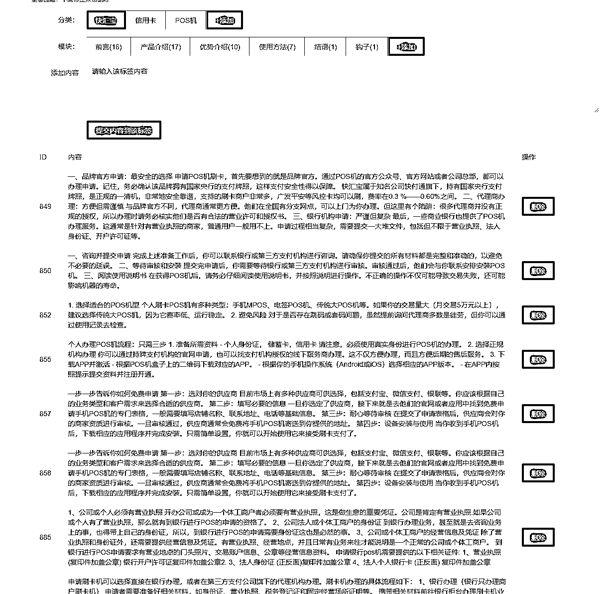 

第三步：补专业度。光会引流不够，还要能聊成交。我又找两位线下同行，一起整理出《POS专业问答》和《POS线上销售流程》。

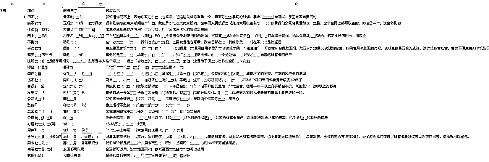

第四步：起号养号。一开始头条、小红书、百家号、抖音各起5个号。很多人觉得账号难搞，其实渠道能解决一部分，剩下就用4家运营商的20张卡补齐。注册时别连WiFi，也不要在同一地址扎堆；我还专门买了部联想拯救者Y70五开手机，一个手机登录所有账号，高效省事。

然后是平台容忍度测试。因为这行涉及金融，每个平台的管控尺度天差地别，还得防同行恶意举报。20多天测下来，结论是：小红书生态最差，几乎天天被投诉；百家号管控最严，蓝V账号说没就没；抖音和头条相对宽松。

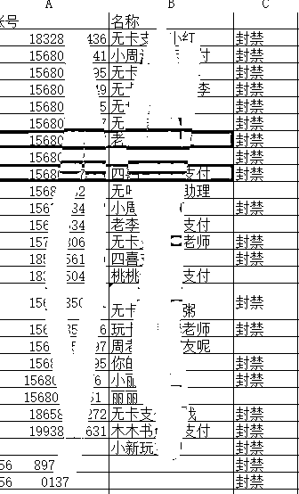 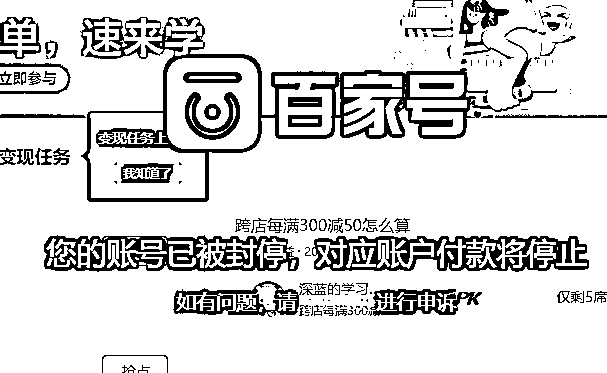

代价是小红书封4个、百家号全灭、头条封1个、抖音封2个。这批“炮灰”引流了80多人到微信，成交40多个，分润却只有1000多，我一度有点小落差。但心里清楚，一个项目没跑满三个月，不急着下结论，于是继续死磕。

进入第二阶段，我开始加人加号。两个人、每个平台3个号，一天大约能引流12个人，激活六七户。跑了半个月，增长速度还是上不去；再看同行，一天能激活50户。问题出在哪？找涛哥复盘后，发现两个卡点：一是只有直接客户，没有代理裂变，增量入口太窄；二是很多用户激活了却不用，缺少后续维护。

对症下药：优化销售流程，每个客户聊完都加一层“代理”沟通；每周检查数据，对交易异常的客户二次跟进，把台均交易额提上去。

 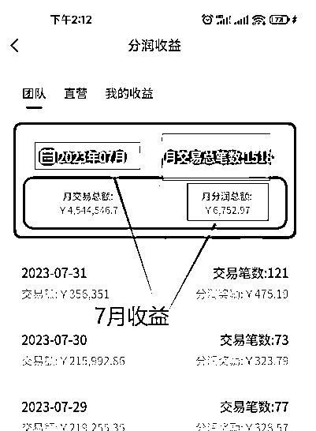

调整后，除了新增流量，老用户也开始产生主动转化，收益曲线终于抬头。这段经历让我更坚定一句话：做正确的事，永远比把事情做对重要。自己不确定时，就去请教可能知道答案的人。苏世民也说过，主动给你敬佩的人写信或打电话，请他们给建议，你永远不知道谁愿意跟你见面；这些关系可能会陪你走很久。

到8月中旬，每天稳定新增激活15户左右。按这个节奏，两个人三个月后月佣金到4万以上没问题。但我想要的远不止于此。当时小代理慢慢多起来，可大多数人只是为了把费率做低才拉3户人头，真正想靠这个翻身的人只有1个。要干大事，身边必须有一群能打的人。

以前不找人，是因为我自己还没跑通；现在有了结果，可以理直气壮地筛选了。我按“窄门进、宽门出”的原则，只挑了身边5个可能成事的人深入沟通，最终打动了一位原本就干支付的同行。他愿意加入，说到底三点：259号文之后，商户问题急需解决；万十五的分润够高，干一年抵三年；再加上大家目标一致，他也愿意跟着冲一把。9月收益快速增长，也印证了这条路走得通。

做到现在，我越发觉得支付这行有价值：一能解决普通人刷卡支付这个社会问题；二能帮普通人有尊严地低成本创业。假如有一天目标达成，回头一看身后还成全了一群人，那种成就感一定比赚钱本身更爽。

## 新手想入局，先对号入座

入行之前，判断自己适不适合很重要，不然第一步就走错了。可以参考这几个指标：
- 手里有没有能整合的人脉资源？
- 每天能不能拿出3小时以上的空闲？
- 沟通能力怎么样？放不下面子做销售的，劝退。
- 可不可以接受延迟满足？个人月入2000，大概率要等到次月才可能实现。

我是做线上引流出身的，只能聊聊线上玩法。创业这件事，前期不妨记住邓公那句话：白猫黑猫，抓到老鼠就是好猫。

线上精力有限，优先做头条和抖音，反馈周期最短。头条的操作细节，我那篇精华帖第03部分写得很明白；抖音图文就更简单了，核心是“一个创客贴、一个半蓝V、一个小回复、一人五号。”

 

创客贴是在线作图工具，智能设计和批量设计很省事——输入内容就能自动出图，一个号一天3条，熟练后15分钟交差，5个号最多两小时。

半蓝V主要是为了增加信任，淘宝花100元办个个体执照即可。

小回复是抖音自动回复插件，用户在私信里能直接跳转加微信，不用担心回复不及时。妥妥的神器。

微信承接方面，朋友圈是第一个门面，用优质案例、生活分享、专业知识三类内容搭建，每天3-5条。用户加过来之后，话术直接套用我整理的两份资料就行；涉及支付问题，能发语音尽量发语音，信任感会明显不一样。

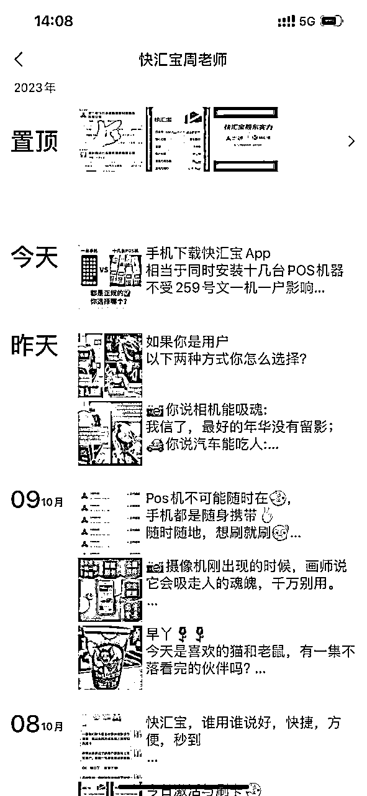  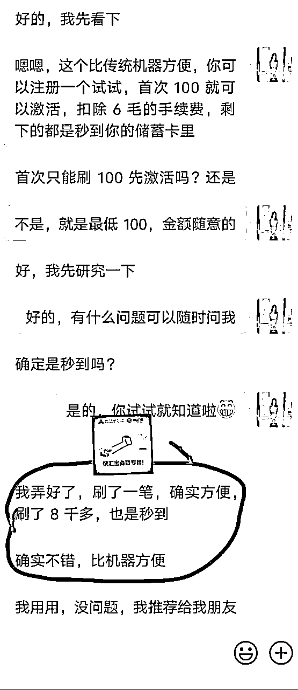   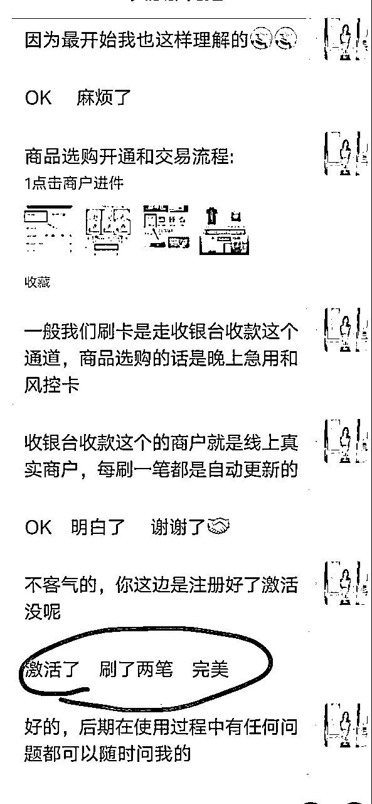

## 最后说几句心里话

我已经快一年没在赚钱发帖了，这次愿意把项目讲透，是想找志同道合的伙伴。我的初衷很朴素：成人达己，合作共赢。说白了，就是想把“五虎将”凑齐。论做事，赚钱里的朋友天然比大多数人靠谱。

要是你已经入局支付，有两句话请收好：

1. 选品定生死。产品合不合时代、合不合用户需求，就像电商选品一样关键。选对了，爆单像呼吸一样简单；无卡支付就是当下生逢其时的机会。
2. 选好领头羊。好大哥要有高维认知，能带你做正确的事；还要靠谱、愿意分钱，这样你的努力才不会打水漂。

感兴趣的圈友，欢迎来链接。我的微信是xsd9092，加的时候备注“赚钱圈友”，一起迎接支付新时代。

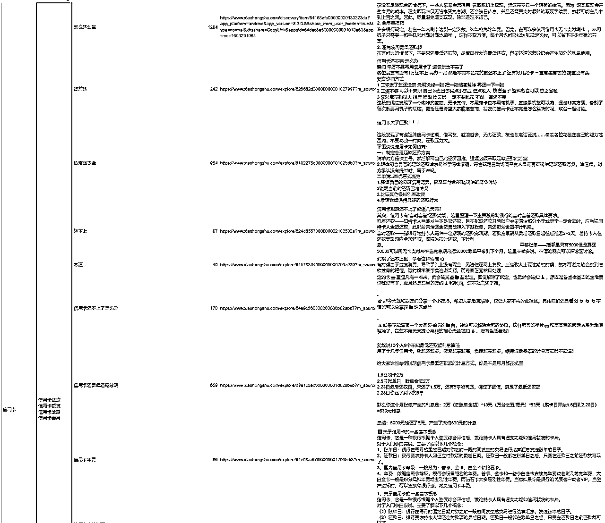

我把给文章生成器做的各平台基础素材截图放在下面了，内容生产的底层问题基本就这么被补上了

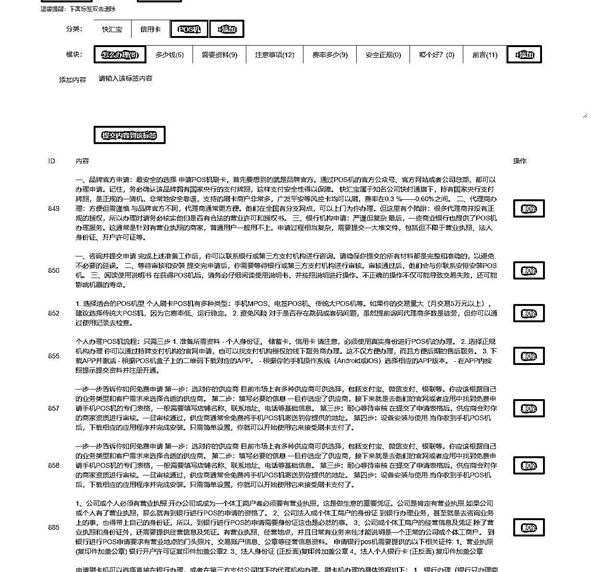

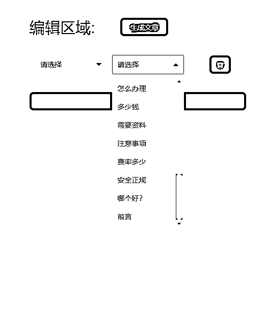

a3，行业新人入场，想吃到流量变现，专业度必须先提上来。

先把上面那些选题和内容模块拆解梳理一遍，对行业有个入门认知。随后拉上两名线下同行一起，把《POS专业问答》和《POS线上销售流程》整理出来。

a4，养号开号。

第一轮我各开了5个头条、5个小红书、5个百家号、5个抖音。先去试探各个渠道的反应，同时也在测

很多人卡就卡在这一步，其实思路很直接：渠道能解决的就用渠道，解决不了的4家运营商20张卡还不够吗？

做免费流量的第一步，先把账号池做出来。

注意注册时尽量别连WiFi，也别在同一地点批量注册，手机直接去搞一套五开的设备——联想拯救者Y70。一部手机管理全部账号。

## 2、平台容忍度测试

由于内容踩在金融边上，各家的审核尺度差异很大，也要看当下生态的竞争环境，有没有同行恶意举报。最开始就开始投放。

目前测下来小红书环境最差，每天都在被投诉；百家号管控最狠，哪怕是蓝V也照样封；抖音和头条的容忍空间相对宽松一些。

测试前后花了二十多天，这期间小红书挂了4个，百家号全部阵亡，头条封了1个，抖音封了2个——这些牺牲号总共拉了80多人到微信，完成了40多单激活，但分润加起来才1000多，落差感挺明显。不过我一直遵循一个项目没跑满3个月不给自己下结论的原则，就继续往前走。

## 3、做对的事比把事做对更重要。

经历完第一阶段的试错，第二阶段开始扩号扩人，慢慢放量。

两个人每平台各管3个号，一天能带来大概12个进粉，日均激活六七个。持续半个月我觉得增速不对劲，看到同行日均能做到50户，就意识到方法有偏差。

和涛哥对齐后发现两大问题：一是引来的全是终端客户，没有做代理裂变，增量口子太窄；二是部分客户激活后没流水，后续跟进缺失。

问题找到，解法就清晰了：调整销售话术，在每一次客户沟通收尾时加一段招募代理的引导；每周复盘数据，对交易异常的客户主动二次激活，提升单户流水。

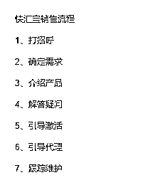

调整完之后，除了日常的引流转化，还出现了自发的转介绍，收入曲线开始往上走。充分证明做正确的事远比把事情做到位重要，方向不确定时就去问已经走通的人。

“给值得敬佩的人写信或打电话，请求建议或争取见面的机会。你永远不知道谁会答应见你。从中你会学到很多关键的东西，也会建立起受用一生的关系。早年结识的人，往往会形成非比寻常的连接。”——《我的经验与教训》，这段话放在这里一样成立，主动出击才会产生故事。

## 4、利他才能长久。

到8月中旬，日均稳定新增激活能做到15户。按这个速度推算，两个人月佣金3个月内破4万问题不大，但目标显然不止于此，需要更大的突破。

我注意到小代理数量在增加，但大部分人只是为了降自己费率而冲3户任务，只有1个人是真心想靠这件事赚钱，真正出力也只有他。要做大一件事，单打独斗不可能，必须带起一支能干的队伍。

之前一直没招人，是因为自己没验证清楚模式，现在自己跑通有了结果，才敢开口。于是我开始在微信里筛选身边靠谱的人，按窄门进宽门出的思路，第一批只聊了5个。

（窄门进宽门出是什么意思：提高门槛精挑细选，不广撒网。5个精准人选往往比100个泛流量效果更好）

通过反复沟通，其中一个原本就在做支付的同行被我影响了。他愿意加入主要基于三点：259号文后商户痛点真实存在；万15的分润，一年抵别人干三年；认同我的目标，愿意一起冲。之后就有了9月的爆发式增长。

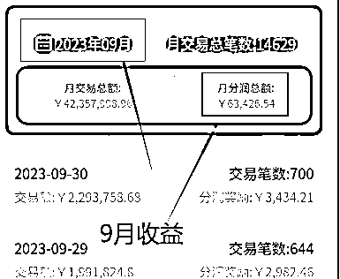

这几个月下来，我觉得支付这件事很有价值。一方面能帮普通人解决刷卡问题，这本质上是社会刚需；另一方面能给普通人提供低成本创业的机会，让有能力的人被看见。

如果有一天目标实现了，回头一看身后带起了一批人，那种满足感会远超赚钱本身。

# 四、新手小白怎么起步？

先判断自己适不适合做，否则一开始就错了。可以对照这几个标准：

1、自身资源如何，有没有可整合的人脉。

2、每天能否稳定抽出3小时以上。

3、有没有基本的沟通表达能力，放不下身段做销售的别碰。

4、能不能接受延迟回报，个人月入2K，一般要到次月才兑现。

我本身是线上引流出身，只能分享线上的打法。创业嘛，用邓公的话说，“不管黑猫白猫，抓到老鼠就是好猫”。

线上精力有限的话，优先做头条和抖音，这两个渠道反馈快。

## 1、微头条怎么玩

头条的具体操作，这篇精华帖里已经讲得很细了——直接看03、头条运营细节干货总结

## 2、抖音图文怎么玩。

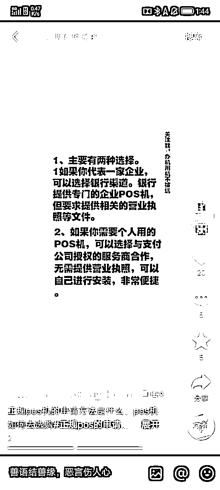

概括起来就一句话：创客贴 + 半蓝V + 小回复 + 一人五号

a、创客贴是个在线设计工具，有智能设计和批量设计功能，输入文本就能自动出图；一个号每天3条，15分钟搞定。5个号最多2小时。

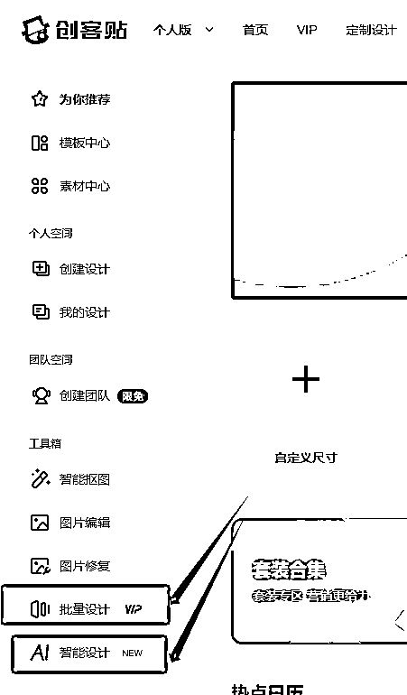

b、半蓝V是为了提升信任。某宝花100块搞个个体执照就行。

c、小回复是抖音自动私信跳转插件，能把抖音私信自动转到添加微信，避免错过消息。非常好用。

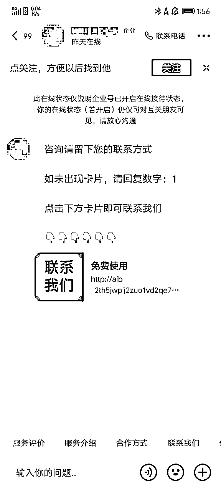

## 3、微信转化的细节。

微信朋友圈要经营好，用来承接信任和转化。

朋友圈内容由优质案例、生活日常、专业干货三部分组成，每天发3-5条即可；

用户添加后的话术，直接套用我整理的《POS专业问答》和《POS线上销售流程》。

因为涉及支付，尽量用语音回复，转化率和信任感会明显提升。

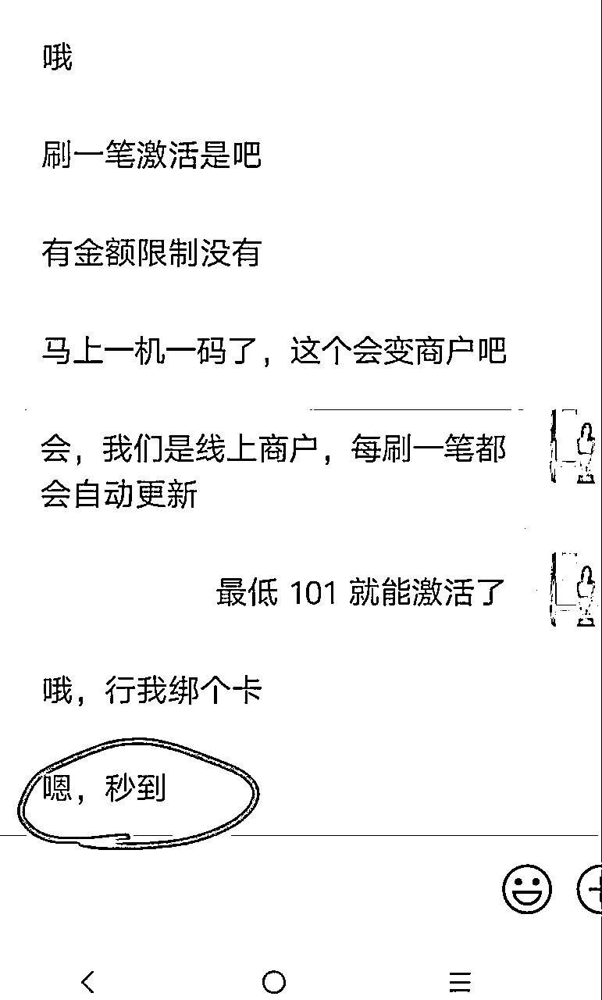

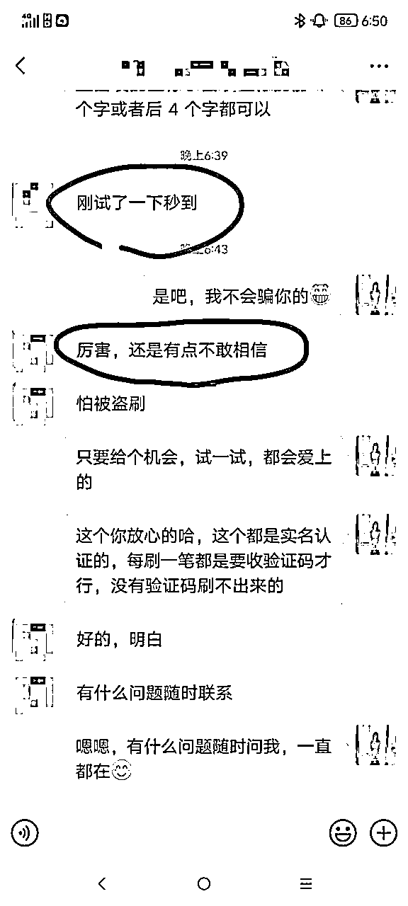

# 五、最后的话

说实话，我快一年没在赚钱发帖了，这次愿意把机会摊开来，主要是想找志同道合的战友，成人达己，合作共赢，我的目标是凑齐五虎将。要说做事能力，赚钱的伙伴本身就比外面大部分人强。

如果你已经在做支付，希望你记住两点。

1、选品决定生死：产品是否契合当下时代和用户需求，就像电商选品一样，选对了自然爆单。无卡支付在当下阶段确实踩中了风口。

2、选对领头人：一个靠谱的大哥要有高维的认知，能带你做正确的事，事半功倍；要有人品和分成机制，让你的付出不会白费。

有兴趣的圈友可以来链接，一起迎接支付新时代。V：xsd9092，备注，赚钱圈友

另外说一句，这个项目不需要任何启动资金，需要的是时间和结合自身资源去推广。

APP名字叫：快汇宝。支付公司全称：深圳市快付通金融网络科技有限服务公司

下面是爱企查的股权穿透图和资质截图：

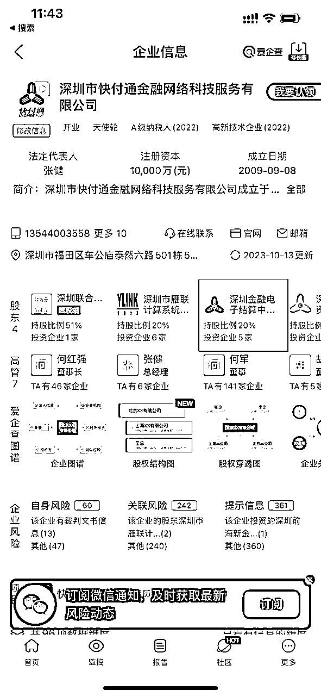

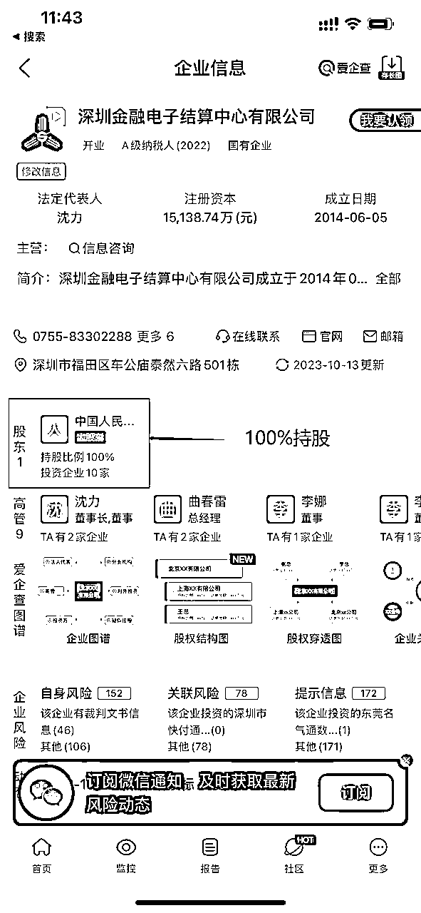

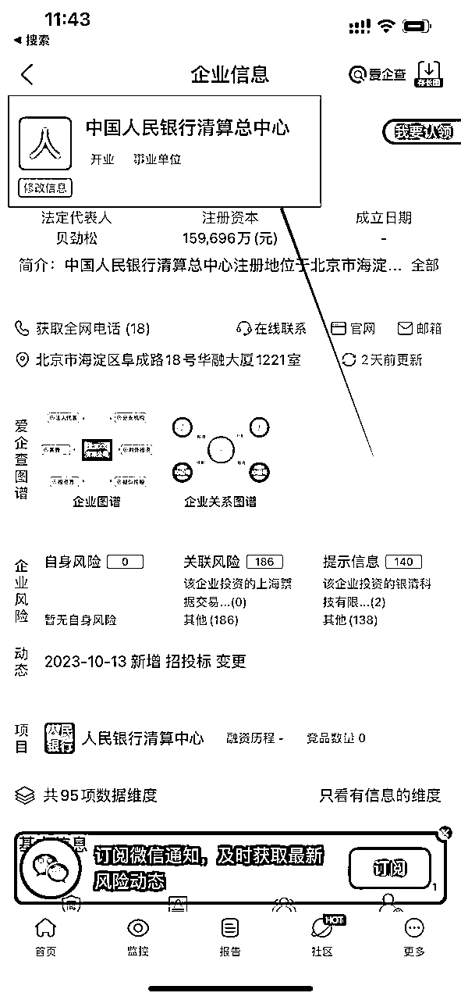

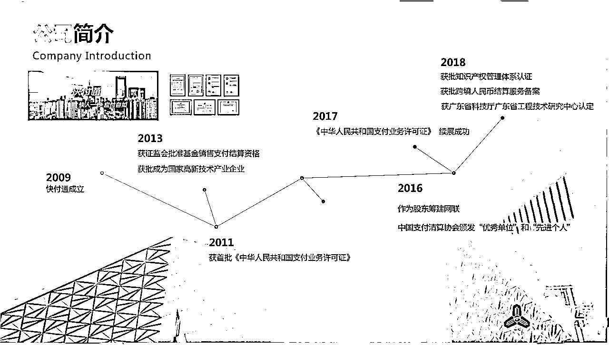

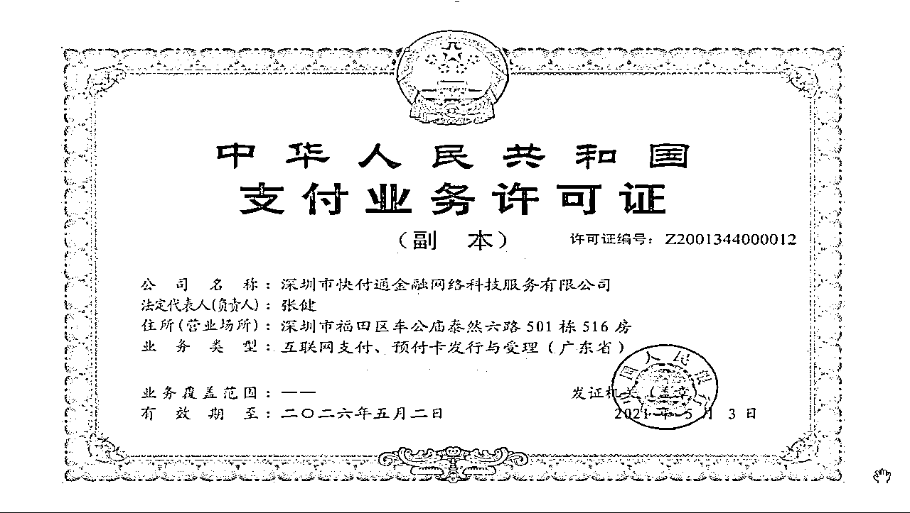

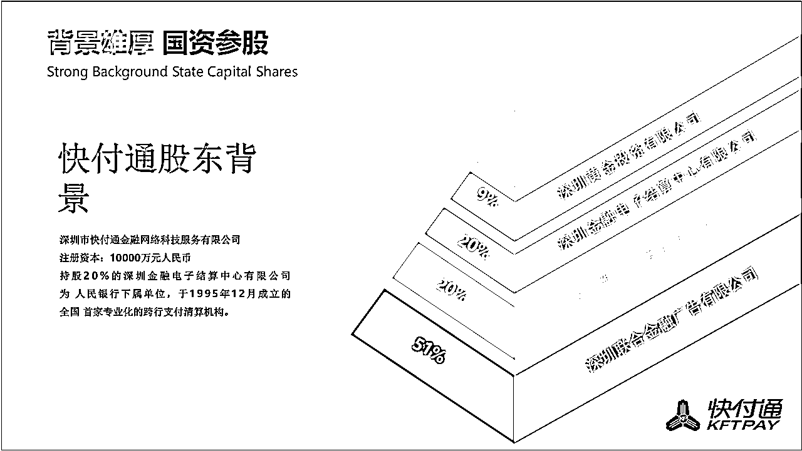