# 从0到变现！得物好物分享实战笔记1.0

大家好，我是龙哥，运营👸号：叁斤

从2020年入局📕开始，我一直深耕好物分享矩阵，后来也聊过📕接广趋严后的转型路子。蒲公英审核变严后，我就开始做个人IP和📕电商，这条赛道一直没离开过。

老婆却始终惦记着纯粹的好物分享号，毕竟能白嫖大牌产品，她乐此不疲。一次被商家推荐，我把账号申请到了得物上试水。

同步一批📕的短视频上来测试，没想到反馈出奇地好，一条才53个赞的笔记就带来了72元收益！

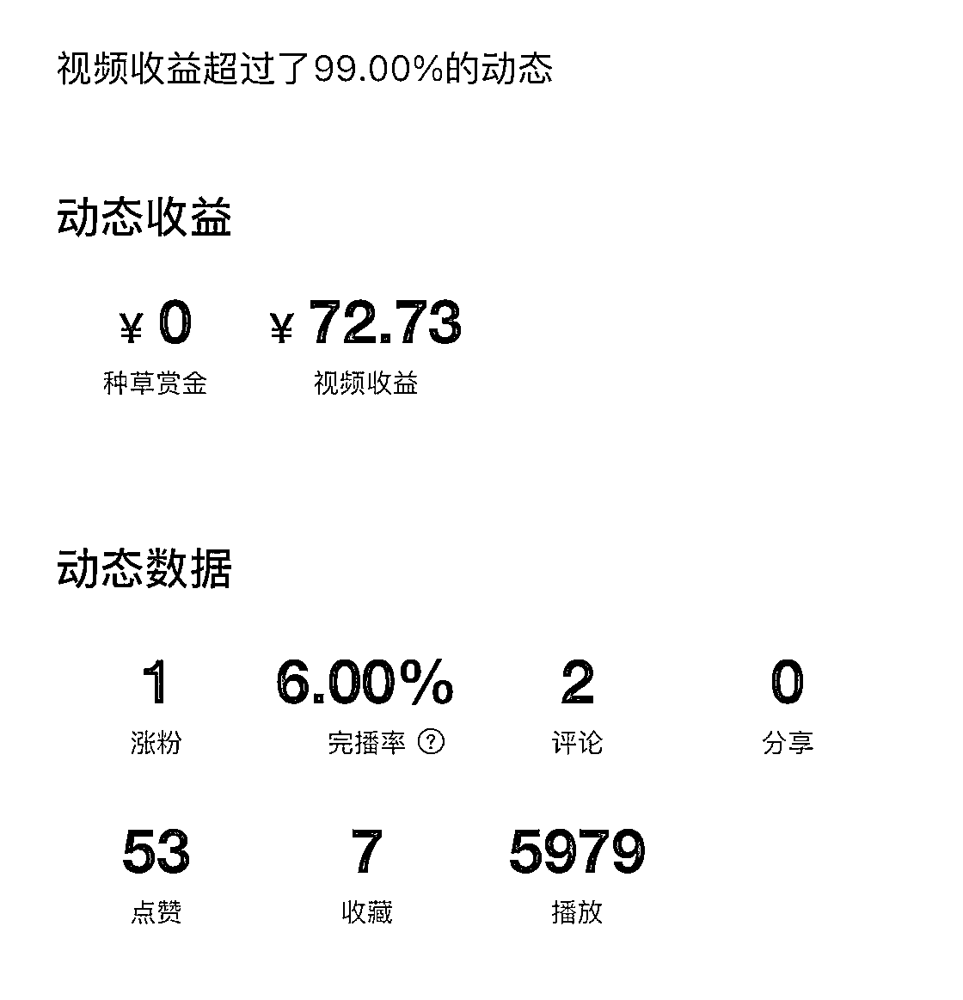

尝到甜头后我立刻开了几个新号，凭借之前的📕运营经验，很快就把玩法跑通。大概两个多月，单个账号的月收入就稳定在3千到5千之间。

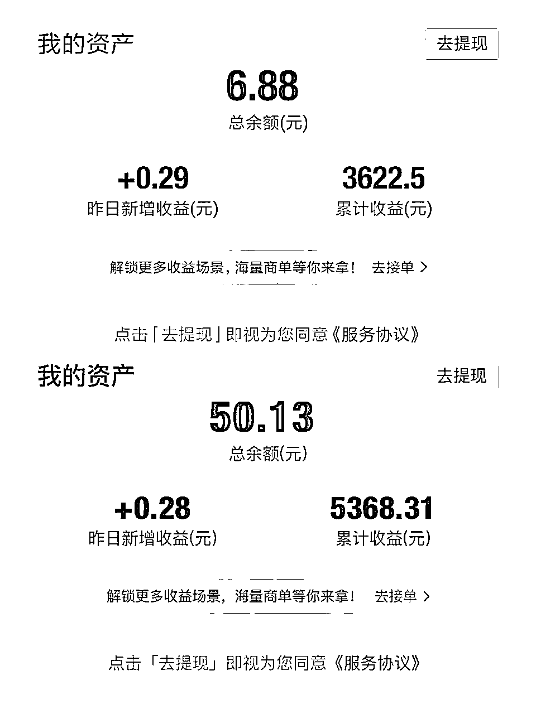

品牌邀约更是源源不断，收到的测评品堆满角落。合作结束后没用的产品我会挂闲鱼出掉，这块每月还能额外净赚1千到2千。

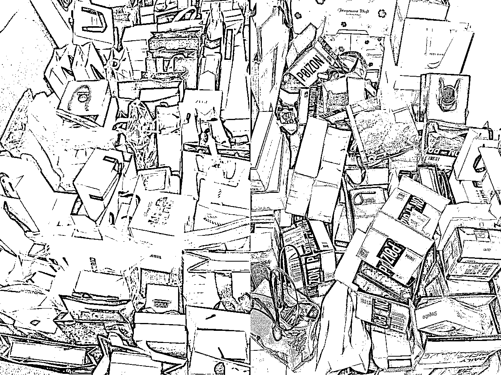

目前我手上共养了5个号，仅靠同步📕内容和品牌商单，一个月就能多拿1万到2万元。奇怪的是，我在网上找了很久关于得物的干货，相关讨论少得可怜，更别提系统性的好物分享教程了。今天就把从0到1的经验补上。

正文开始

# 目录：

1. 得物能怎么赚钱
2. 视频激励怎么赚
3. 100粉门槛如何快速达成
4. 品牌合作怎么拿下

# 一、得物能怎么赚钱

得物的变现路径比📕还要多元。

## 1、品牌带货合作：

账号达到100粉即可开启品牌合作，得物自带品牌招募池，合作需求非常多，覆盖服饰穿搭、节日礼物、美妆护肤、潮牌球鞋等几乎所有品类。

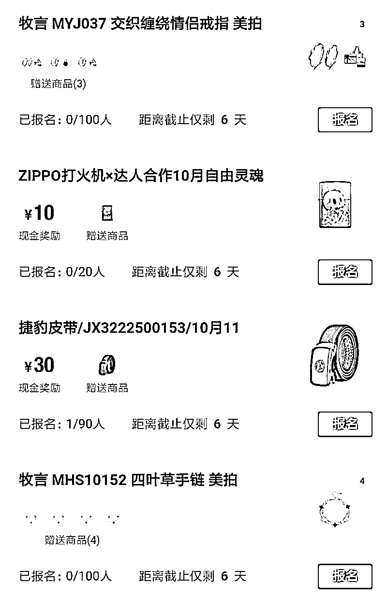

在得物上做内容几乎没有📕那种卷度，只要账号没被限流，拍摄质量略好于普通买家秀，就能拿到商单。给你们对比一下得物穿搭和普通📕穿搭的质感差距。

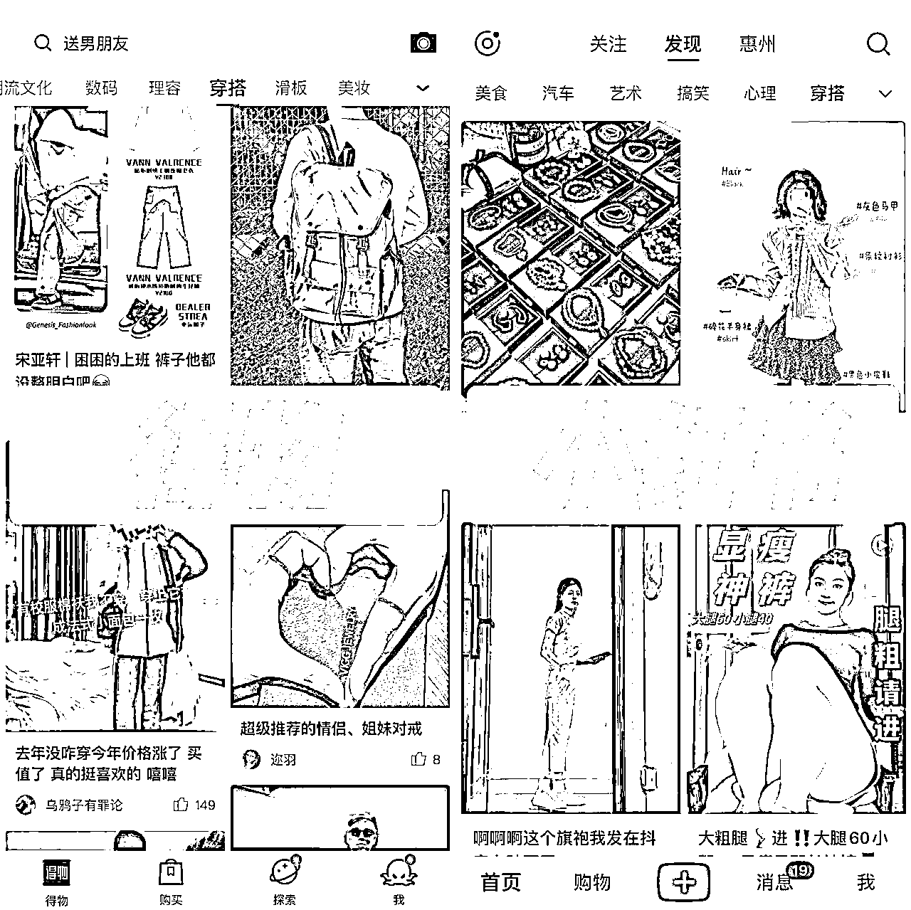

商家合作基本都是寄样，拿到的产品如果自己用不上，合作完还能在闲鱼转手，单月额外收入又能到1千到2千，都是全新正品，流动性很好。

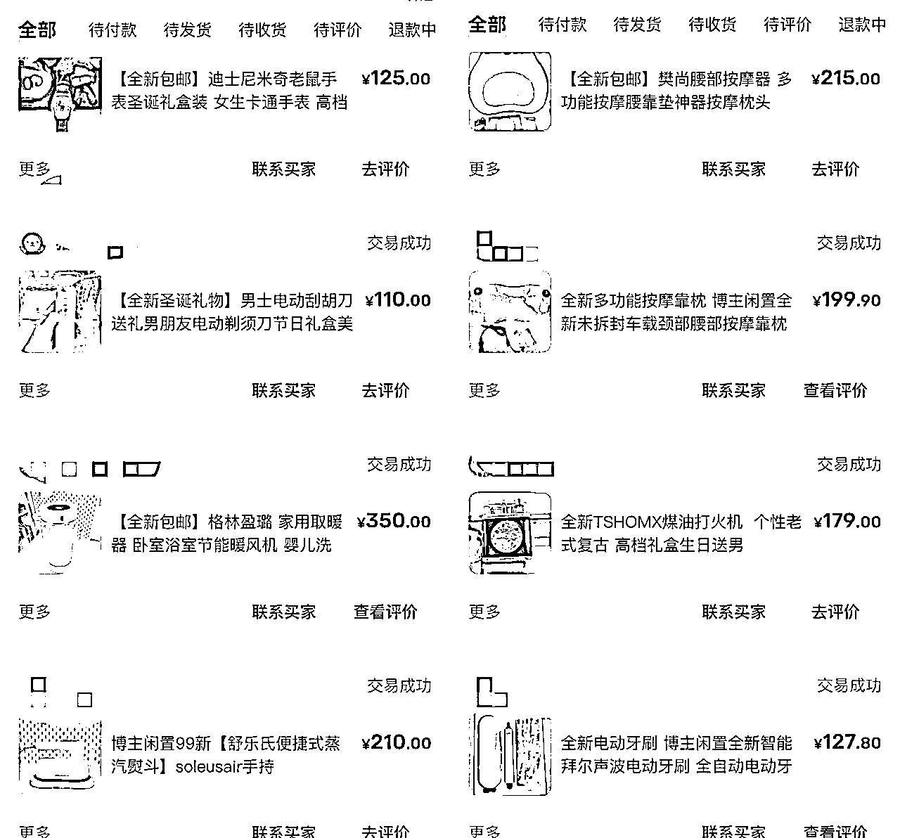

## 2、种草佣金：

得物笔记支持挂商品链接，除了商单还能拿种草赏金。有人通过你的链接下单，你就能分到佣金，和抖音精选联盟的逻辑类似。

新号也能挂链接，所以即便没到100粉，也能靠笔记佣金先行变现。

## 3、视频激励：

发视频就会有平台激励，和抖音中视频计划差不多。开通门槛是先发满5条视频。

激励收益相当可观，做混剪二创就能吃到，单号每月轻松多几千块。

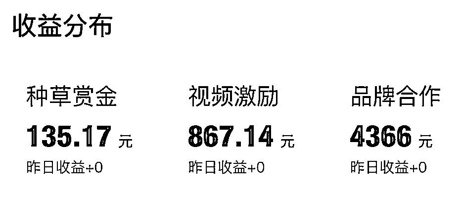

## 4、站外引流

因为本身在做📕IP，我顺手测试了得物导流效果，发现互动率甚至比📕更好。

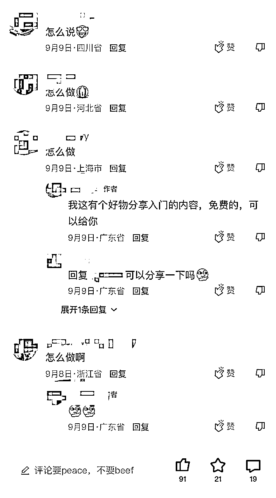

综合来看，最稳的变现组合是品牌合作+视频激励，种草赏金虽然能跑，但金额相对有限。

# 二、视频收益怎么做？

## 1、账号基础功能

运营前先摸清三个核心入口：成长任务、视频号、Poizon+

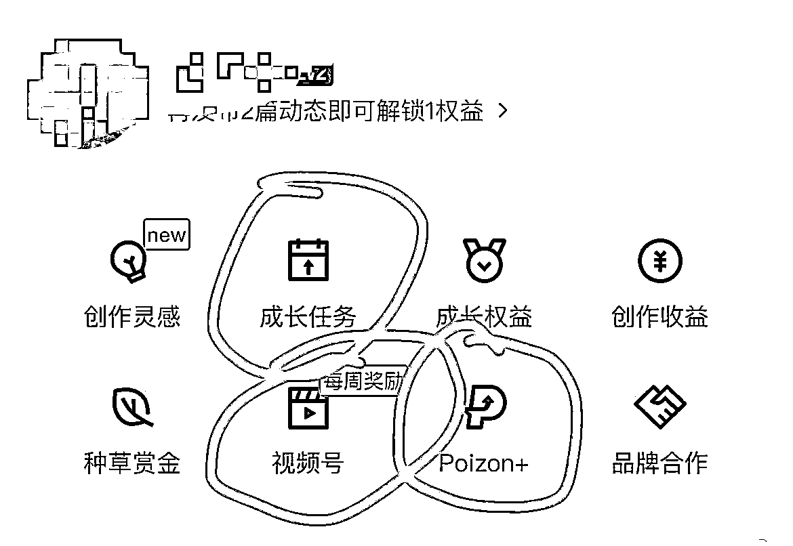

成长任务：平台会定期放任务，完成能拿到流量券、购物津贴和优惠券。

流量券可以直接给笔记加热，购物津贴下单抵现，优惠券就不用说了。

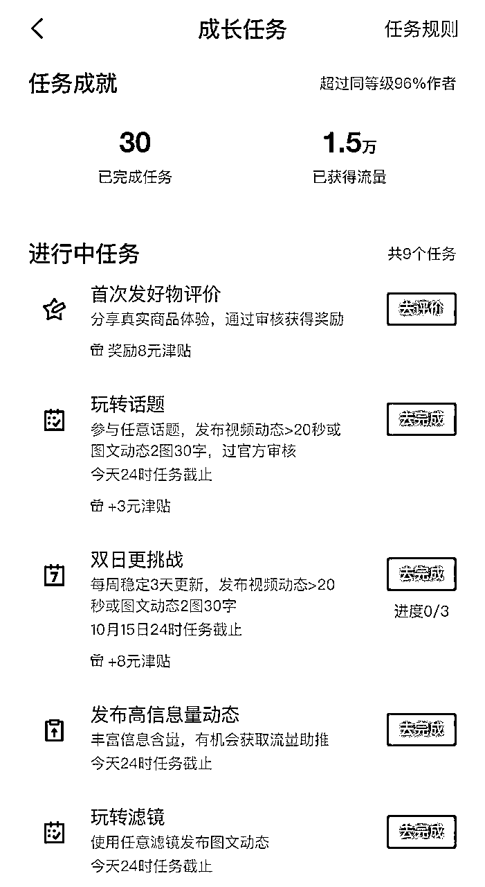

视频号：开通认证后每周可领5000流量券用于推流，视频收益明细也在视频号里查看。

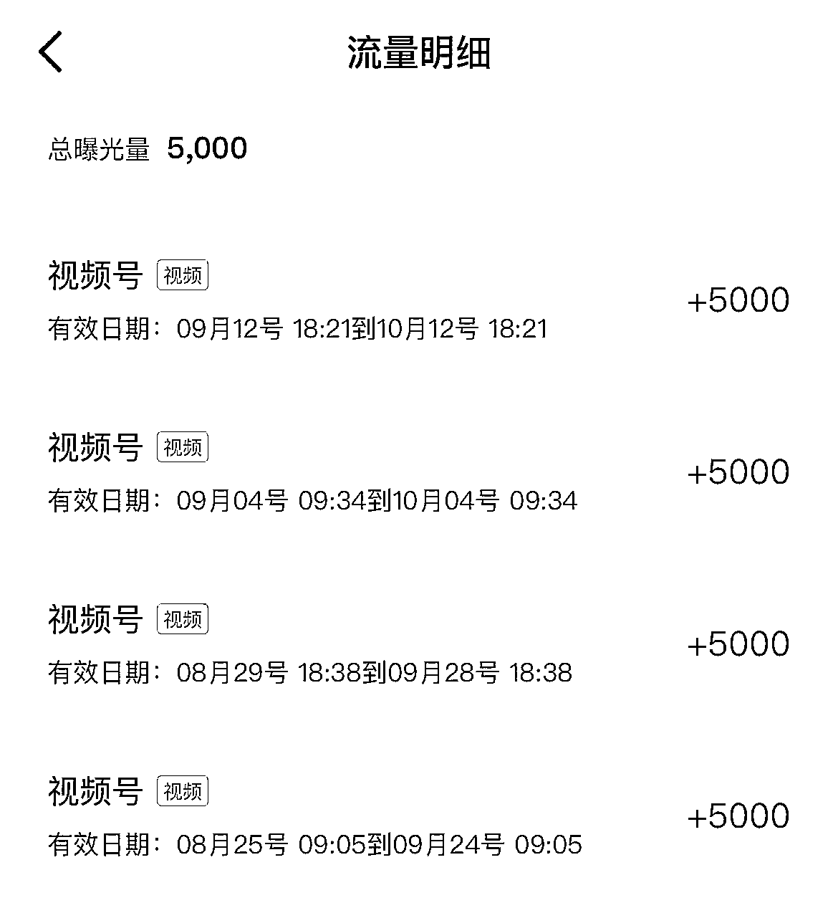

Poizon+：就是流量券的投放后台，能看到券余额和可推广的笔记。

## 2、视频制作思路

制作逻辑和抖音、视频号一致，二创为主，具体方法网上教程很多。

重点聊搬运：

得物目前还是小众平台，知道的人不多，搬运的生存空间很大，直接搬📕、抖音的素材就行。

但要注意两点：

1. 搬运前先搜索该博主是否已在得物有号，或同标题是否已被搬运。得物对重复内容管控较严，先搬会被下架。
2. 避开露脸视频，真人出镜的一律不搬。

## 3、适合的选题方向

得物用户和抖音、📕有重叠，但平台偏好不同，更吃以下主题：

1. 潮流文化
2. 数码产品
3. 穿搭
4. 美妆
5. 运动健身
6. 家居
7. 娱乐
8. 影视

...

我自己测家居好物赛道，视频激励效果不错，想做激励可以围绕这些方向切。

## 4、投放小技巧

没认证视频号前先别急着用流量券，等认证通过后再用。

也不要每条都投，优先投收益高、互动好的笔记。

# 三、如何快速涨100粉？

得物100粉可开通好物分享官，500粉可升级专业达人。

好物分享官：能进入品牌合作广场报名招募。

专业达人：在此基础上可开启定向合作，自行定价，等品牌来投递，类似📕蒲公英。

100粉是关键门槛，下面几个方法能快速冲到：

## 1、互粉

新手增粉常用手段，在互粉评论区留言或看到互粉帖就去关注。

不过官方现在查得严，不建议明示互粉，100粉其实很容易，不必冒风险。

## 2、做娱乐营销号

抖音里大量的综艺娱乐号，内容搬到得物涨粉很快，用户偏爱看。

这类博主基本不会关注得物，所以搬运风险低。

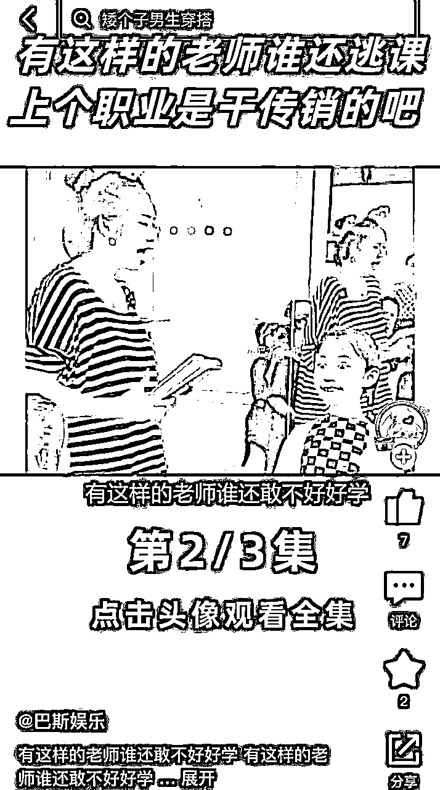

## 3、影视号

在得物发影视剧解析也很吸粉，图文也行，比如《女生必看的10部剧》这类清单。

素材可以从📕搬运，制作门槛低。

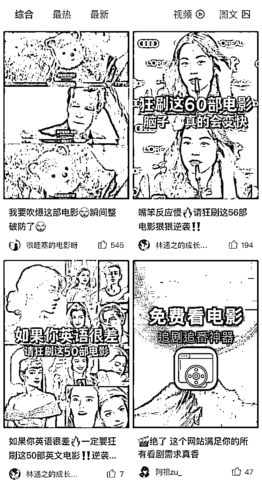

不会写文案又不想剪辑的，直接找📕爆款影视封面，把拼图拆开重排，文案用ChatGPT润色即可。

## 4、搬运起号

不只是影视和娱乐，还可以搬好物账号。

想做哪个赛道就搬对应内容，例如穿搭就去📕找无露脸的爆款笔记搬运。

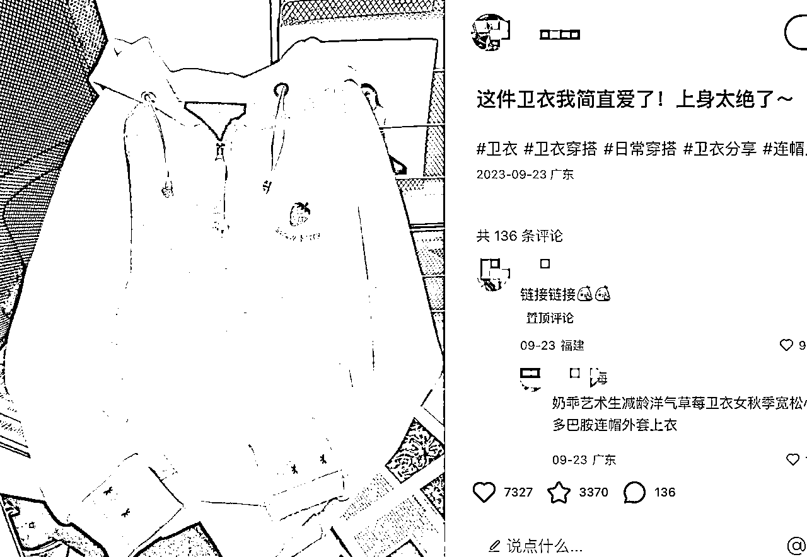

搬运前确认博主在得物没号，也没人提前搬。优先搬小博主，粉丝少的博主爆文基本没上得物。

用这招起号成功率很高，100粉后广告也不会少。

# 四、怎么接品牌合作？

得物合作分两种：投稿任务和定向合作

投稿任务：100粉后在品牌广场报名，部分带费用部分只送产品，价格由品牌方定。

定向合作：自己定价，账号数据好会吸引品牌主动来聊，和蒲公英类似。

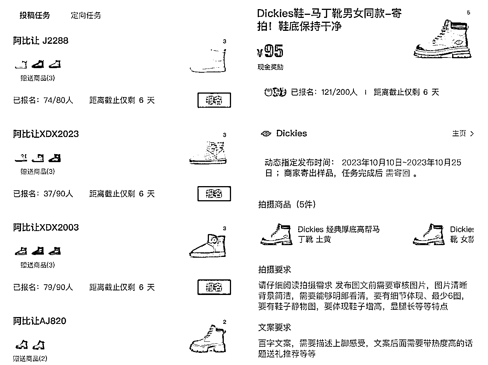

几个提高接单效率的技巧：

## 1、提升合作通过率

如果你之前用影视娱乐涨粉，主页没相关好物内容，直接报名通过率会低，需要先补几篇种草类笔记，实拍即可。

原创方案：

按想接的品类，把手头的衣服、鞋子、包、手机壳、耳机、音箱、护肤品全拍一遍，不用精修，只要比买家秀好看就能过。

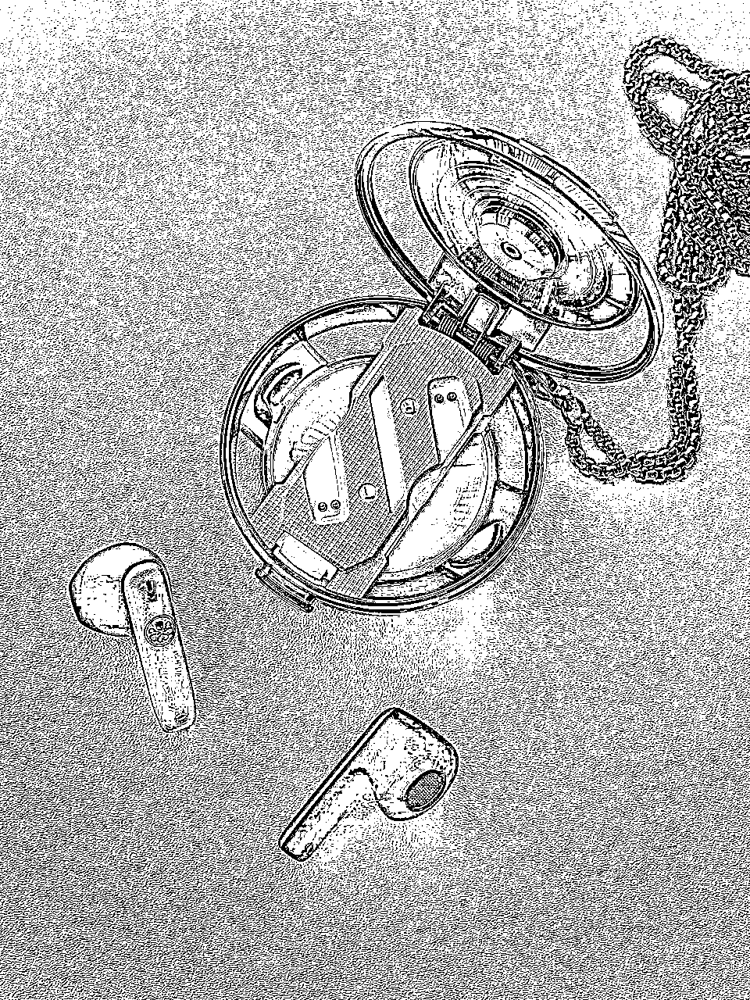

不会拍就去📕找同款博主，对照构图模仿拍摄。

得物对内容质量要求不算高，随手拍也能通过，模仿多了手感自然提升。

再看一些实际通过合作的内容案例。

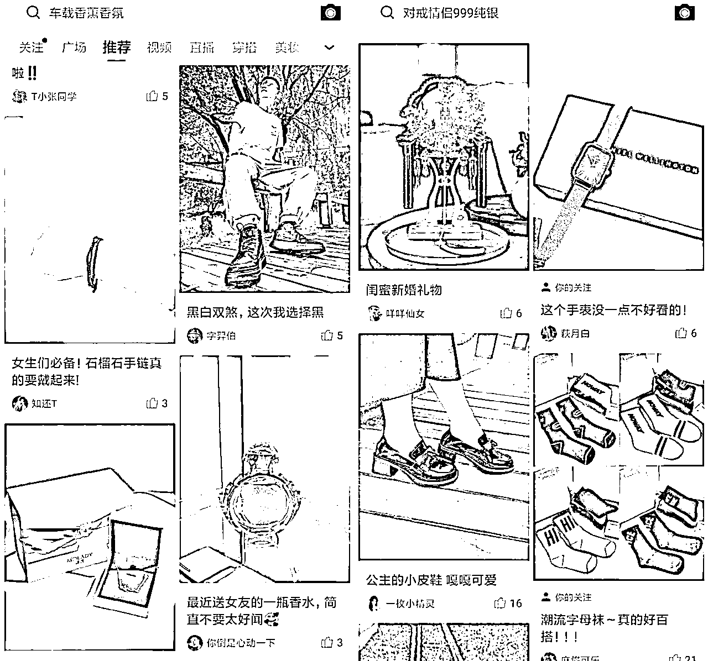

质量真的不高也能过，难度极低。

搬运方案：没货期不想拍，就去📕找对应品类的笔记搬运，和起号逻辑一样。

原创+搬运各5到10篇，报名通过率会大幅提升。

## 2、提高报名通过率

定向合作靠数据，投稿任务靠品牌方筛选，可以这样做：

加PR🛰️：报名后立刻加上品牌PR，把链接发过去说明已报名。

先报好过的：初期别冲热门大牌，先从产品价值低、无费用、门槛低的品牌开始练手，通过率更高。

## 3、注意事项

账号等级和报名次数挂钩，正常账号每月可投200次投稿任务，若广告太多且质量差、数据差、被判定刷粉，会降级为普通账号，投递次数降到20次。

看清合作要求再报名，例如部分单要求必须露脸，不想露脸就别报。

如果手上项目不多，得物好物分享是个值得尝试的方向。天花板不算顶，但矩阵化后非常好跑通，且目前竞争还不激烈。

祝大家顺利变现～