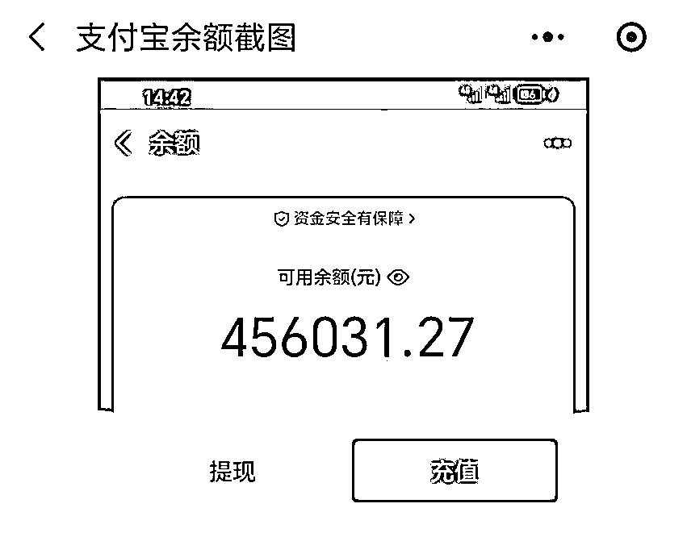
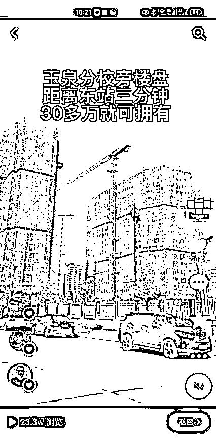
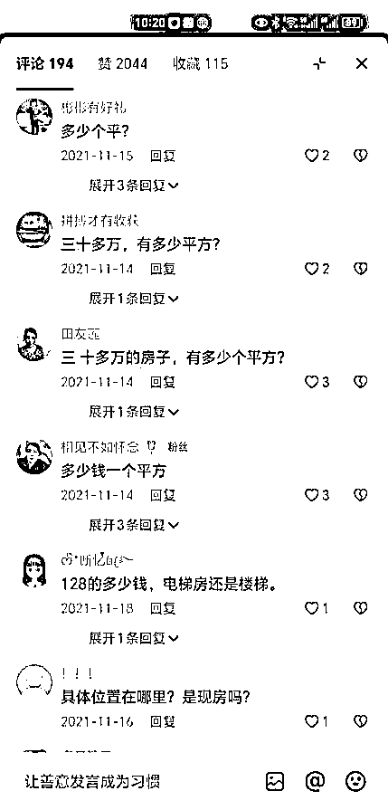
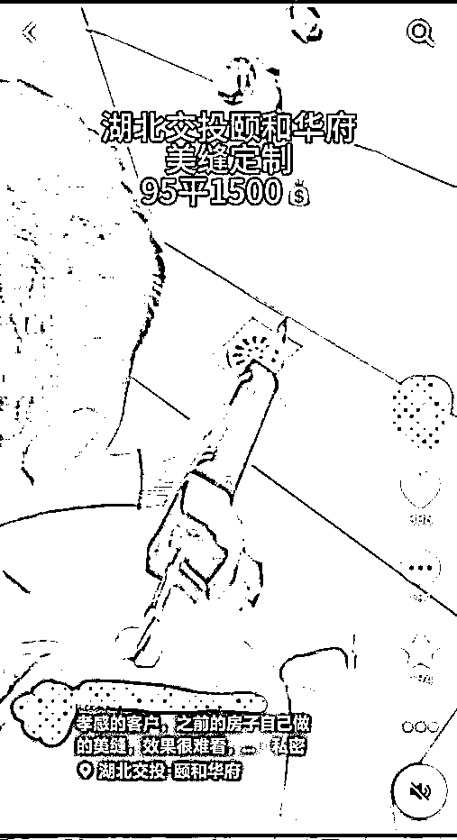
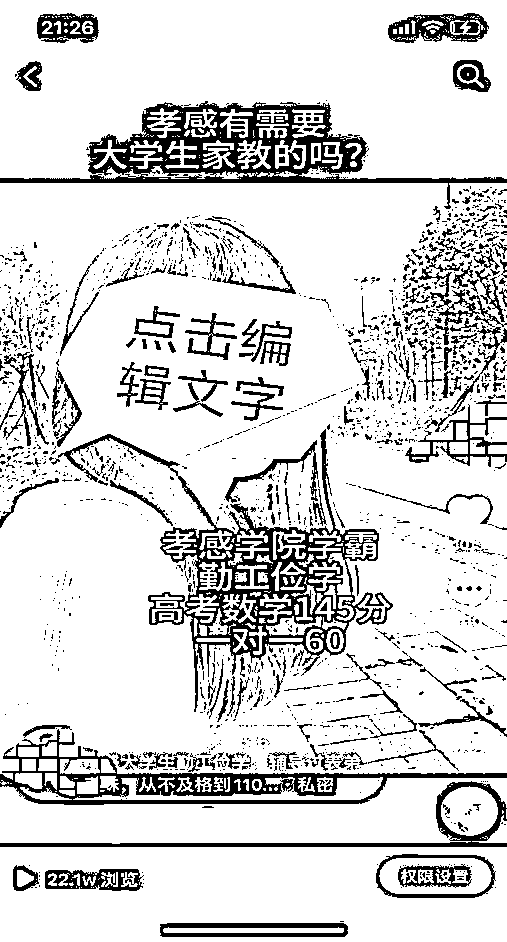

# 从零到单号月入30万：我在抖音同城带货房产的完整复盘

当整个楼市进入低谷期，我用一个同城房产号完成了从月度零成交到整年1500万成交额的逆转。最高单月佣金12万，单个账号累计收益超过30万，这就是我这三年深耕短视频同城变现的实战记录。

赚钱圈的各位朋友大家好，我是鑫哥。过去三年我一直聚焦在短视频同城引流变现上，积累了一些可复制的打法。今年6月在群友孙悦伟的引荐下加入赚钱，也在风向标上分享过相关案例。今日第一次以文字形式系统梳理同城项目的经验，希望能给同样在摸索的伙伴一点参考。

2021年3月，我正式开启房产同城号的操作。后来该账号每月能稳定带来500多组精准看房客户，个人单月佣金峰值12万，单号变现超30万。身边跟我一起做的几位伙伴合计佣金也突破了100万。这个方法论到现在依然适用，并且可以平移到同城的其他垂类，变现效率很高。

下面就详细聊聊我如何用抖音撬动本地客户，最终把一套玩法跑通到多个账号的经历。有本地资源、懂本地业务的人可以重点看一下。完整复盘我已整理在飞书文档里。

一、机会的发现

2020年下半年我转入本地房产中介做新房销售。房子不好卖是事实，但佣金比例极具吸引力。我们这里一套新房佣金在2万到4万之间，优质盘甚至能拿到8万、20万。

起步阶段我用的是地推发传单和熟人介绍，刚从广东回本地，人脉几乎空白。整整一个月下来一个带看都没有，焦虑感非常强。每一次团队会议都显得格外难受，迫切需要一条新的获客路径。

那段时间我刷到本地一家男士理发店的抖音账号，播放量动不动就是几百上千赞。好奇心驱使我去店里体验了一次，下午时段店里只有一个理发师，等候的顾客却有5个。我和老板聊了聊才知道，他的客源几乎全靠抖音。甚至有客户开车从几十公里外的县城赶来消费，价格还是同行的两倍以上。那一刻我意识到，抖音的本地生意机会正在形成。如果把房产这种高客单业务搬到抖音，想象空间会更大。

1. 项目启动

起步阶段非常艰难。

注册账号后我完全没有方向，只能模仿网上的房产大V出镜讲专业知识。特意穿上西装戴工牌，本以为看起来专业，结果台词经常忘，一条视频拍剪都要耗半天。内容太硬核，播放量低，来的私信也多是已经买房的业主来问售后问题。后来我跑到本地知名小学门口和新开商场前取景，播放有所提升，但依然没有精准客户。这样摸索了三个月，零成交，不得不停更了一个月来调整思路。

1. 拐点到来

停更期间我一直在观察本地同行。市场不好，有个人却月销三套，全部来自抖音。我去扒了他的账号，发现剪辑很粗糙，但评论区全是“在哪买？什么价？多大面积？”之类的硬需求。

我拆解了他的视频要素，在此基础上做了优化。改版后的第一条视频当天播放22万，点赞2000多，评论190多条。晚上十点多开始电话就没停过，私信也完全回不过来，一直到凌晨十二点才忙完，全是精准咨询。

当时视频的画面和标题如下：

后来核算，那一条视频直接带来5套新房成交。复盘后发现，爆发的核心在于标题和画面高度统一。标题里带上了本地知名学校、高铁站，并且点出了一个极低的价格，画面则同步展示了学校、高铁、楼盘实景和样板间，精准击中了购房者最关心的点。

为了延续效果，我把这一套取景逻辑放大到全城，围绕大家熟知的商圈、学校做楼盘全景拍摄。很快从一天零客户变成一天六组客户，带看排期都饱和。

转化上我也非常拼，晚上11点还在回客户，有些客户挂我电话我也继续跟进。那段时间的工资比客户资产还低，但为了成交只能死缠。五一、国庆、初二朋友结婚都没去，全在带看。累到开车时都能出现幻觉。

1. 方法成型

为了提高效率，我把视频做成了标准化生产：统一的标题模板、统一的话术框架、统一的结构、统一的出镜方式，去掉冗余表达，压缩时长提升完播。同时在评论区快速回复，用固定话术私信索要联系方式做深度跟进。视频覆盖半径达到周边几十公里的县市。为了避免客户跳单，我不会提前透露具体售楼部名称和地址，先约到公司面谈分析需求后再带看。

1. 规模化复制

前期我客户带不过来时，同事还不以为然。后来成交量上来后，很多人来请教。我给的方案很简单，按我的模板拍就行。几位最早跟进的徒弟很快成交，每人房产抖音累计变现超百万元，其中一位拿到公司年度销售冠军。

随后我联合公司里几位强销售合作，我负责拍号获客，他们负责跟进成交。这一年我拿到月度销售冠军、最佳贡献奖、年度优秀员工。

1. 类目迁移

2022年单账号产值做到1500万以上，个人收益30多万。随着同城房产竞争加剧、房企结佣难度增加，我逐步淡出房产圈，但打法本身依然有效，加入真人出镜后效果更好。

我把这套房产打法迁移到其他同城垂类，依然很快跑出结果，做到本地头部。最快的一周变现3000+，其中一个账号两天内收集260个付费意愿客户，均为自然流量，涉及门面、教育、装修、娱乐等，甚至被本地官方机构关注。

我亲手操盘的案例如下：

我也用同样的方法辅导商家做抖音。有人拍了两年200多条视频，最高播放500，零成交。在我的方法下起步即破万播放，日均客户对接不断，单月抖音获客收益稳定过万。

1. 总结与建议

1. 商业机会就在身边。同城短视频正处红利期，只要你掌握一门手艺或拥有独特本地资源，就能通过短视频快速变现。维修、装修、家政、美妆、摄影、绘画、民宿、法律服务、种植等各类技能，市场需求很大，但很多人不懂怎么用短视频表达，反而去追逐不熟悉的项目浪费成本。
2. 要做客户要的东西，不要做自我表达。同城播放的核心是转化，看房用户关心地段、配套、价格，就要直接输出这些点，而不是用与业务无关的热梗博播放。
3. 同城变现不要讲课式输出。越像广告越简单越有效。不要找专业的摄影工作室或传媒公司，他们做得出片，但不一定懂本地转化。

感谢赚钱平台给予我的成长，也感谢孙悦伟的推荐、梁靠谱和芷蓝的指导。有兴趣做同城变现的伙伴欢迎交流合作。