# 铭文赛道：Web3里的一片蓝海，普通人该怎么上车？
作者：龙哥

各位朋友好，我是龙哥，目前全职深耕 Web3，是星星之火社群的主理人，研究方向聚焦在铭文生态，核心玩法以一级市场打新为主。带着 210 多位社群成员一起进入这个新领域，团队拿到的成绩包括 eths 最高回报 700 倍、OSH 最高 115 倍、TAB 最高 115 倍等等。

接下来我会从八个维度，把我在铭文里的实战经验拆开讲清楚：

一、我是怎么接触到 BRC-20 铭文的
二、我主要从哪几个渠道获取项目信息
三、操作层面我的策略框架
四、走过的弯路和踩过的坑
五、复盘后的核心心得
六、当下环境与未来机会点
七、新人为什么适合入局铭文叙事
八、如何快速进入 BTC 铭文和以太坊铭文生态

一、初识 BRC-20 的经历

我 2022 年 5 月入圈，机缘巧合在龙哥盟结识了可乐哥，在此特别感谢他的引领。今年 3 月底，可乐哥跟我说 Ordinals 有可能是七年一遇的机会。4 月中旬我们用 2U 的成本参与了 BRC-20 的 meme 和 pepe 预售，后来 meme 最高冲到 1000U，pepe 最高到 3000U。当时场外 75U 一张收的 Ordi，最高涨到 28000U 一张。也就是从那之后，我开始把重心完全放在铭文生态上长期深耕。

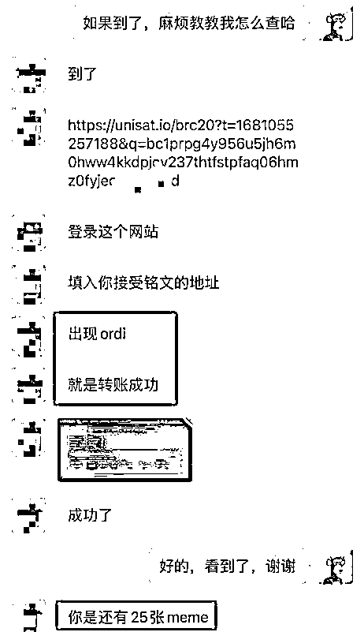

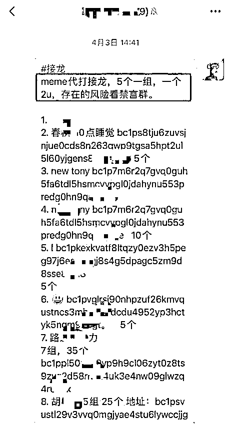

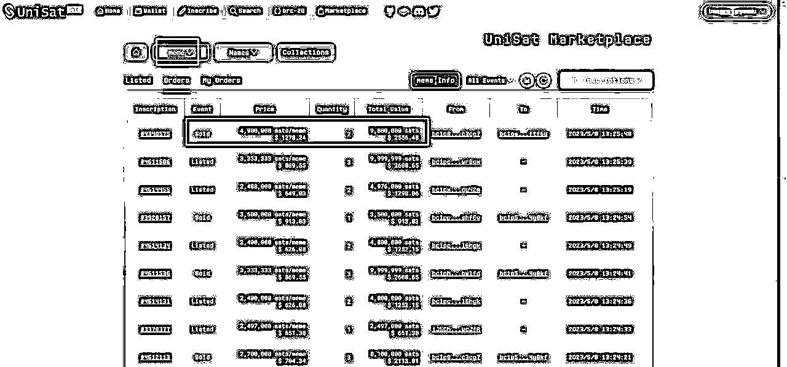

二、项目情报主要来自哪里

新赛道意味着新机会，关键是怎么提高胜率，说白了就是信息源够不够快、够不够准。目前我主要依赖这五类渠道：

A：BTC 生态的推特 KOL，比如我自己的推特 @chenshuiqng1 关注列表里的一批核心博主；
C：各种铭文共识群，信息量大但需要自行二次甄别；
D：铭文 OG 私密群，多为持有特定域名或受邀进入，比如水浒.x 108人群；
E：项目监控工具：https://ordichef.xyz/cooking

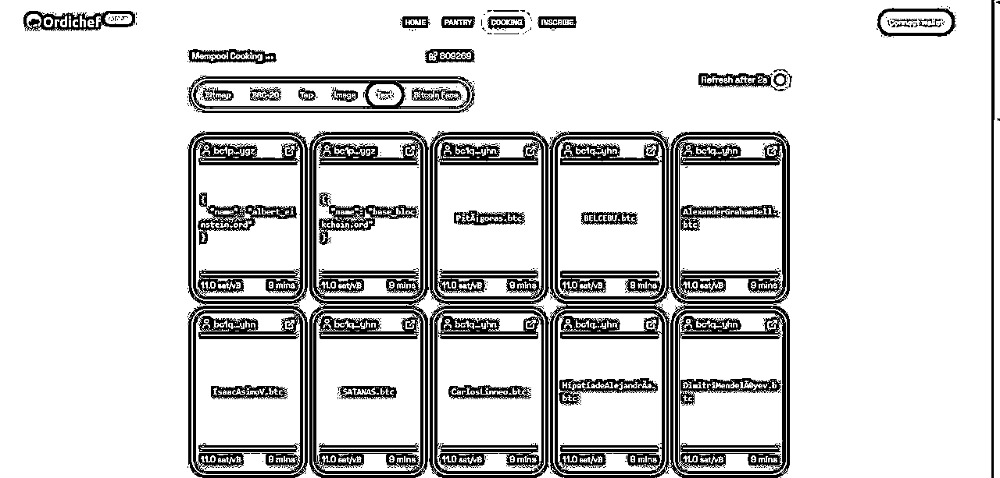

三、实战操作思路

面对不断涌现的铭文项目，我的操作大致遵循这三条主线：

A：重点捕捉新协议的首发币。像 7 月推出的 ORC-CASH 协议的 OSH，最高 115 倍；8 月初 TAP 协议的 TAP，最高 100 倍；3 月初打新的 Ordi 就是 BRC-20 协议的第一枚代币。这些被称为头矿，头矿一定要打。

B：及时把握热点概念币。比如 9 月 15 号 BRC-20r 的 odos，就是借 Ordinals 分析平台 ODOS 的热度，成本 0.85U，最高到 6.8U，接近 8 倍。这种币一级打完后迅速刻录并转移到钱包，有浮盈就分批退出，直到清仓。

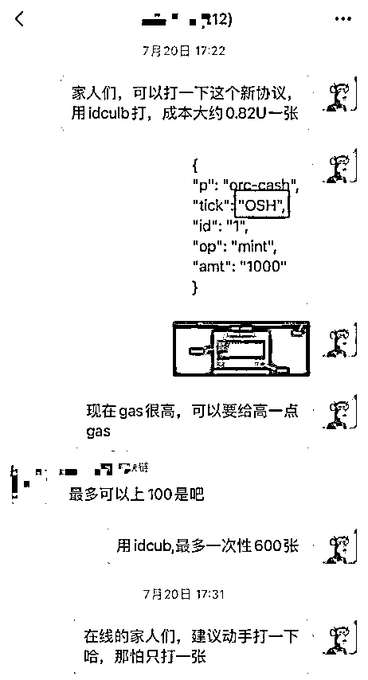

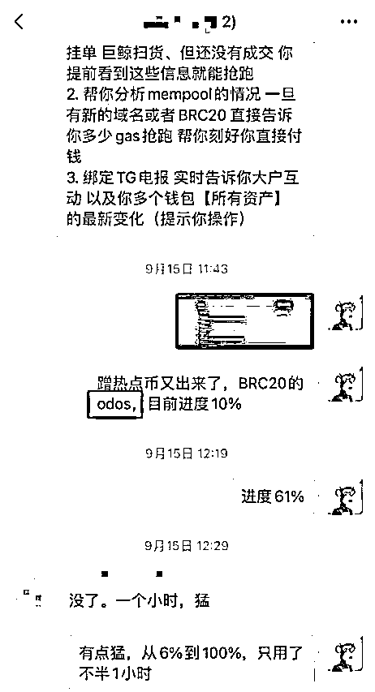

C：域名类资产优先选择数字域名，流动性更好，位数越少价值越高。比如 2 位数远好于 3 位数，3 位数优于 4 位数，越短越稀缺。

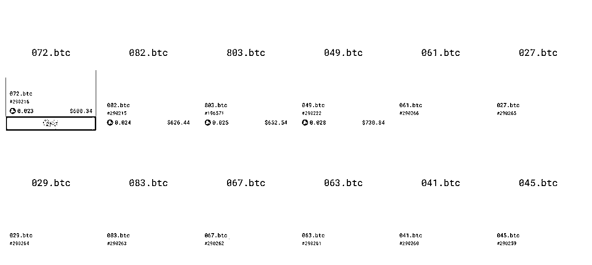

四、踩过的坑分享

新赛道坑也不少，我在这里复盘几个典型的：

A：被卡单。就是 Gas 费给得太低，市场 FOMO 时出块拥堵，虽然钱花了但铭文没抢到，进度条 100% 也白打。应对方法有两个：头矿一定要把 Gas 提高，宁可成本高也不错过；非头矿类的热点币，可以先小额试探，进度加速后再追加 Gas 提高抢单概率。

B：代码复制失误。早期 BRC-20 的 shib 代码里 amt 后面应该是 1000000000，少一个 0 就会导致铸造失败或额度错误。这个错误很致命，身边有朋友因此损失不小。正确做法是直接照抄项目方白皮书上的原始代码，一字不改。

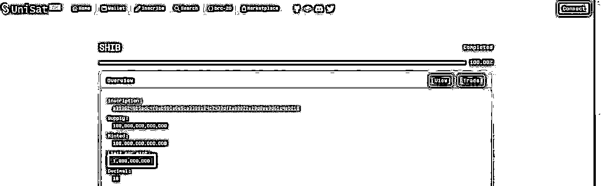

五、经验总结

A：确定性机会要敢于重仓。这次盈利受限很大原因是仓位太保守。我见过几个赚到 A7 的大佬，都是在新协议首发头矿上重仓吃到利润，因为首个代币胜率通常最高。

B：果断止盈。会卖才是真的会玩。理想价位就及时落袋为安，这次就是因 FOMO 不舍得卖，导致利润大幅回撤。

C：放下偏见。Web3 里偏见会吃大亏。成本可控的前提下先参与再说，往往有意外回报。

D：基建要提前准备。多备几个 Unisat 钱包，里面充少量资金，随时待命。执行力在铭文赛道很重要，项目来得快去得也快，投研来不及时小资金先上车更重要。

E：操作难度越大，潜在利润越可观。比如 TAP 协议的 TAP，当时是新协议且需要用 Looks 代打平台，门槛高很多人被卡在操作环节，竞争反而小。

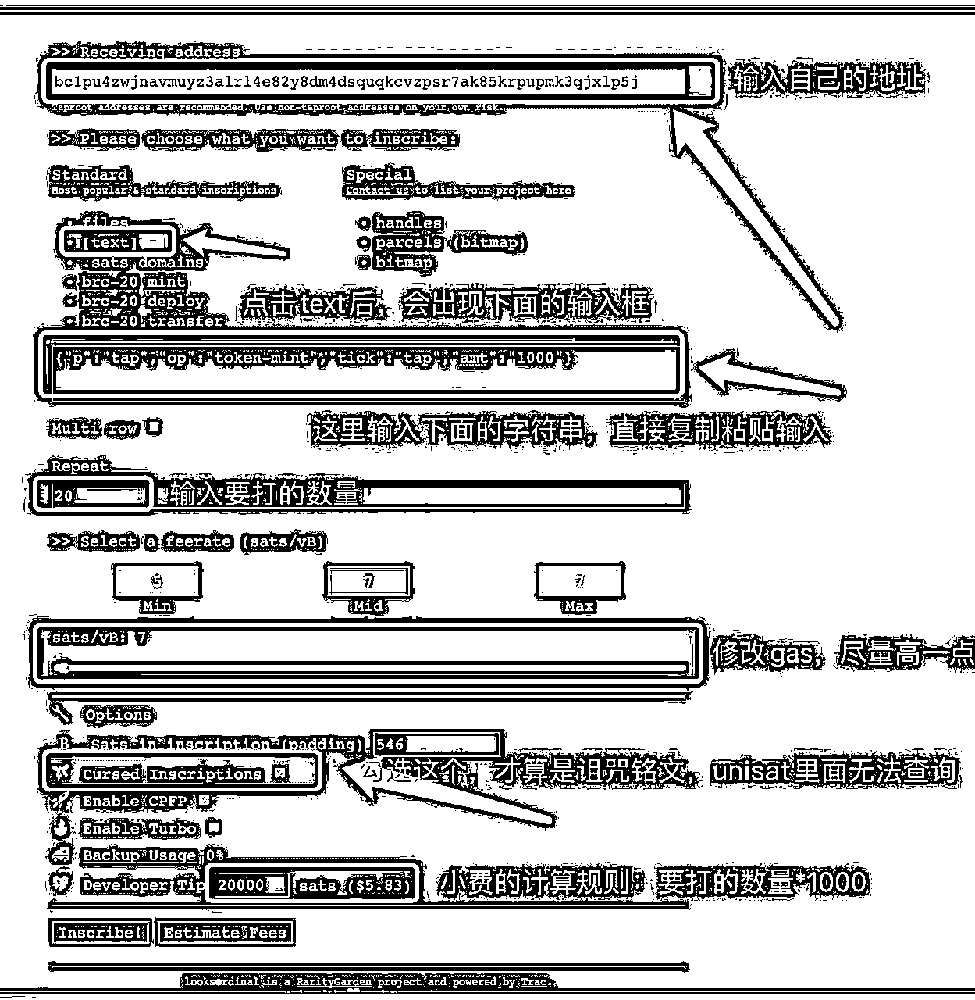

F：原则上只做一级打新，尽量不碰二级。一级低价入，二级高价出。二级盘面波动大，容易影响心态。

六、现状与机会

当前整个链圈仍处熊市，多品种回调严重，BRC-20 也不例外，但并不代表没机会。7 月的 OSH 还是跑出了 115 倍，9 月的 ARC20 也有 20 多倍。

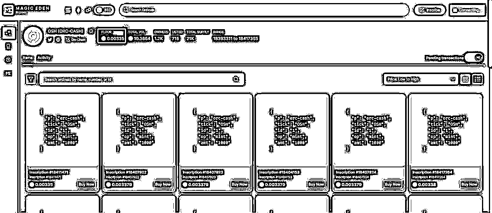

很多没接触 BTC 生态的人看到 BRC-20 回调就觉得没戏了，实则不然。像 9 月 15 号的 odos 就有 8 倍回报。而且铭文不止 BRC-20，未来会有更多新协议诞生，我们的核心机会就是抓住新协议的首个龙头币，去打头矿。

七、新人为什么适合

传统赛道拼资金、拼团队，普通人很难拿到第一桶金。但铭文这类新叙事相对没那么内卷，圈内大佬也不一定看得上，对新人很友好。操作门槛低，适合小资金高回报打法，比如 8 月份我们参与的 TAP，成本约 1U，现在到 115U，撬动率高。风险可控，本金小，赔率比传统赛道高得多。现在行情整体低迷，正是学习积累的好时机。

八、如何入场

第一步就是把各种代打平台的流程提前熟悉，等项目上线时不手忙脚乱。下面是星星之火社群整理的教程：

图文版教程：https://www.yuque.com/dianshangqingshuige/aagovv
视频版教程：https://www.youtube.com/@ordi8899

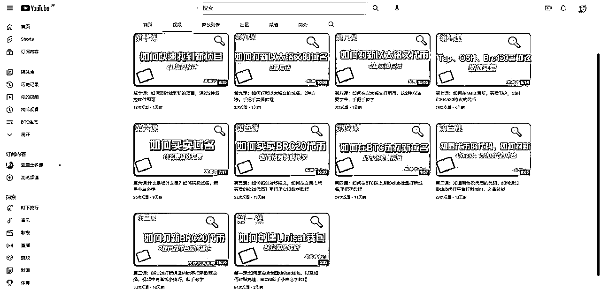

铭文生态是一个值得长期研究的蓝海赛道，小资金也能玩出高赔率。欢迎交流，联系方式：ordi8899，龙珠圈友可加🛰️。

以上内容仅为个人分享，不构成投资建议，市场有风险，操作需谨慎！