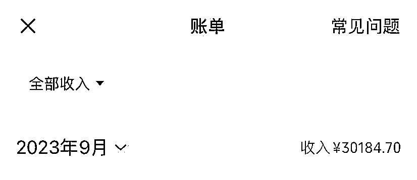
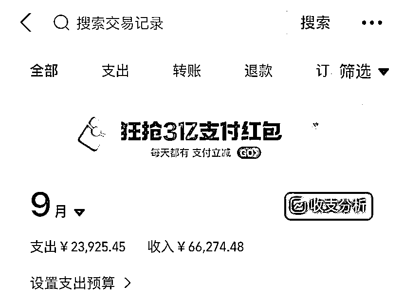
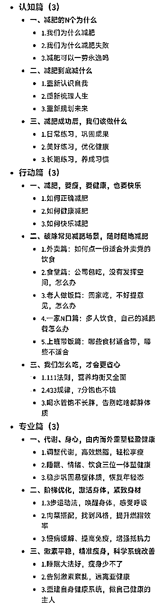
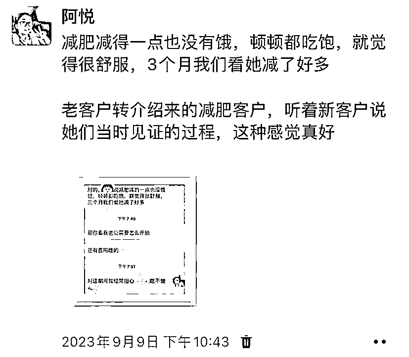
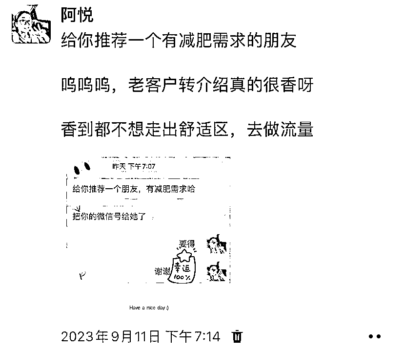
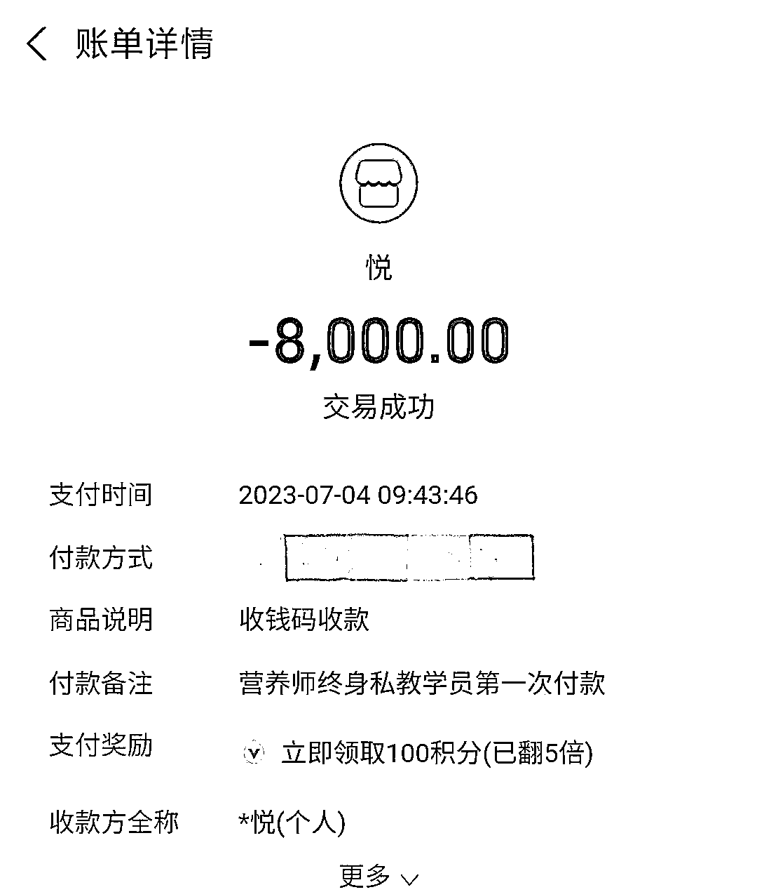
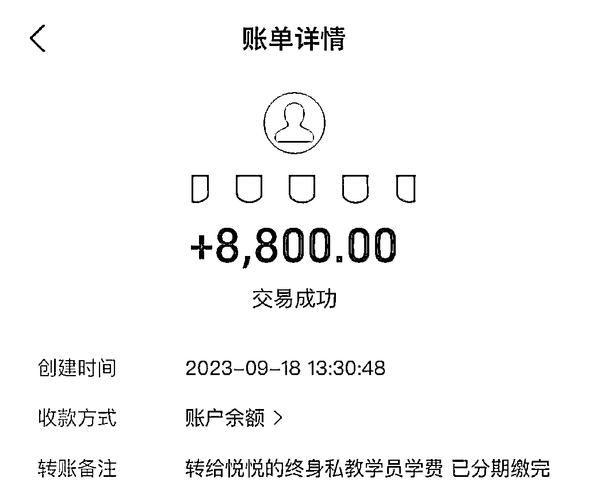
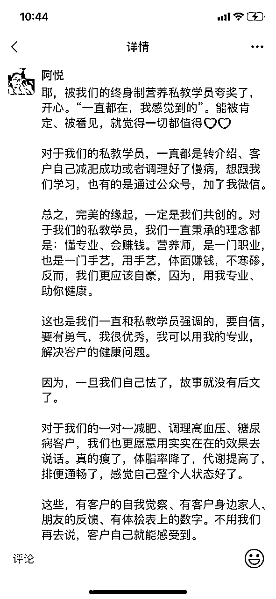
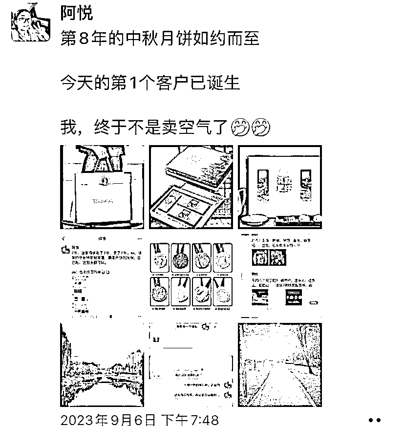
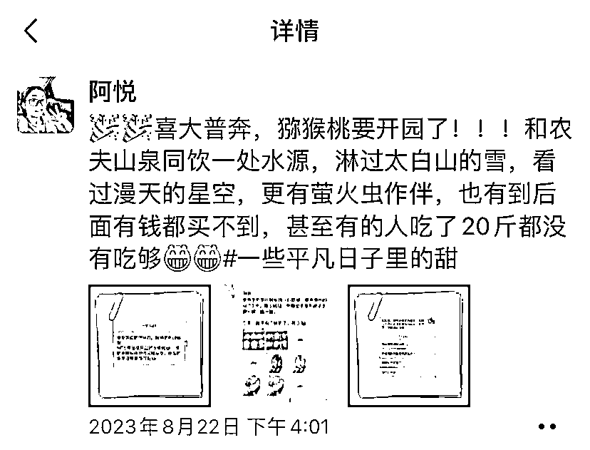

# 营养师也能闷声赚钱？低粉、高客单、靠转介绍，9月收入创新高，我把关键复盘写出来了

都说金九银十是收获季，这话真不假。今年9月，我的收入冲到了历史最高点。

先感谢梁靠谱推荐我加入赚钱，也顺便“逼”我写下了这篇9月复盘。

我是阿悦，本职是营养师。目前我的业务主要分三大块：

1. 帮想减重的人健康瘦下来且不反弹，同时辅助调理高血压、糖尿病这类慢性问题；
2. 带终身制营养私教学员，教她们既懂专业又会做个人品牌、会赚钱；
3. 卖一些应季的健康好物。比如9月帮朋友卖了他家山头的猕猴桃，还有朋友工厂做的月饼；刚好赶上中秋国庆送礼季，又加上了海参和燕窝。

我的主战场在🛰️。这个号里除了家人亲戚、朋友，剩下基本都是付费客户、学员，以及和我一样有付费意识的同学。换句话说，🛰️里的好友，至少跟我有过共同付费经历——同在一个群、同为一个老师或课程花过钱。

加入赚钱还不到一年。今天这篇帖子，就想聊聊营养师这个赛道，怎么靠“卖自己的产品”做出还不错的收入。

内容分三块：

一、帮客户快速见效，是口碑推荐的关键
二、高客单产品，怎么灵活收款
三、选对适合自己身份的产品，卖起来事半功倍

“生老病死”大家多少都有点避讳，所以反过来——健康长寿、体态轻盈、变瘦变美，成了很多人愿意砸钱追求的事。

营养师这个职业，这两年也被越来越多人认可，甚至有人主动付费来做咨询、做健康管理，这是大趋势。

我们能在自己的能力范围内，让自己和家人远离高血压、糖尿病，变得更瘦、更美、更健康，就很有价值。

我的客户来源里，🛰️好友占了85%，剩下的来自👸号和📕。客户年龄大多在35~40岁，女性为主，有的是给自己做营养咨询，有的是帮另一半或父母调理，也有小部分是给孩子做减重。

一、让客户早点看到变化，转介绍就成功了大半

我的第一个高客单产品，是4980元的季度健康管理。如果你想减重，这个季度就围绕减重来做；如果你想调理高血压、糖尿病，那主题就是慢病调理。

一个季度里，我会给客户建专属陪伴群，再配一对一健康管理方案。前期做2~3次营养咨询，每次解决一个具体的健康问题，同时陪客户建立1~2个新的生活习惯。

中期再有2~3次进度回访，发现客户行动有偏差或卡住了，就及时了解原因，一起调整出更适合当下的新方案。如果实在忙不过来，还可以申请暂停7~14天，后面找时间补上。

后期会安排1年后的健康回访。如果客户反弹了，排除不可抗的客观原因，我们免费再带一个季度，对客户的健康负责到底。

减重的客户，想要的无非是：瘦、瘦得轻松、能吃饱、不用累死累活运动，最好还不反弹。

高血压、糖尿病的客户，最直观的改善就是体检报告数据越来越好，能享受正常生活。

所以，在设计方案初期，就要把动作定得轻松、简单、可执行；同时结合客户是否常出差、经常外卖还是在家做饭，额外准备1~2套应急备选方案。

再搭配一些健康课程，让客户能自学，成为自己健康的第一责任人。

（这是优化后的健康管理方案，新增板块还在录制中）

客户愿意动起来，愿意迈出第一步，就已经是改善健康的一大步，后面出效果也更有保障。

怎么让客户在短期内看到变化？第一给信心，第二给陪伴，第三引导客户关注自己的微小进步。只有当客户感觉自己真的在变好，后续配合度才会更高，效果也更明显。

另外，客户在行动中，以及拿到理想结果后，这两个节点最容易带来转介绍。

一方面，有需求的人看到现有客户的行动和改变，可能也会成为你的客户；另一方面，围观效果的人亲眼见证变化，也会主动找来。

这里特别重要的一点：帮客户成功，就是帮自己成功。另外，当客户减重结束做回访时，记得补一句：“如果你身边有人也需要减重，记得推荐给我。”

有时候你不说，客户自己也会推荐；但有时候你不说，客户会忘；还有的情况是，你说了，客户推荐得更积极。所以多做一步，总没错。

我有一个客户，已经给我转了10个新客户，是目前转介绍第一名。

对于转介绍多的客户，一定要重点维护。比如给一部分佣金——没有客户转介绍，你可能一分钱都赚不到；再比如中秋、国庆这种特殊节日，记得送礼物表达心意。

转介绍能成功，本质是让客户实现了预期，甚至超出预期。这样她推荐起来更有动力；同时，也要认真对待她转来的客户，哪怕最终没成交，也要给转介绍人一些相关的健康知识，至少让人家觉得没白加你。大家都有面子，未来才有更多可能。

二、高客单产品，怎么灵活收款

我的一对一终身制营养私教学员，价格是16800元，一次付费，终身不用再交钱。教专业的营养知识，也教商业能力，让每个私教学员都能变成懂专业、会赚钱的营养师。

但16800对不少人来说不是小数目。如果学员确实有付费意愿，也有付费能力，就可以商量分期付款。比如第一个月打多少、第二个月打多少，或者第一次付多少、第二次付多少，三个月内付完就行。

只要一开始付费，我们就开始交付。说不定有的学员很快就能用学到的专业赚回学费。

同理，帮学员成功，也是帮自己成功。

交付终身制私教学员时，前1~3个月会留给学员自由安排学习时间，同时每周做一次学习复盘。

每个学员都有专属交付小群，专业营养课、商业课、📕和朋友圈等营销课程都配齐了，还有专门的老师答疑陪跑。简单说就是：双导师制+专属陪伴群+每周一次复盘/答疑+无限次提问。

这是针对更高客单价的配置，交付内容更多、团队也更齐全，而且是终身制，不用二次付费。

三、找到和自己身份匹配的产品，卖起来事半功倍

月饼是朋友家工厂的，我在朋友圈卖了8年。今年刚好碰上国庆，物流也给力，很多人自己吃或者送亲友，销量很不错。猕猴桃也是朋友家的，今年第二年在朋友圈卖。

这两个应季产品，帮我激活了一部分朋友圈好友。大家冲着我的推荐下单，还有人聊着聊着就延伸到了健康管理和营养私教。

后来，有客户直接问有没有别的礼盒，或者稍微高端一点的，于是我又对接了海参和燕窝。

这些产品，因为我的营养师身份+“吃货”背书，大家的认可度还挺高的。

后面可能会再上架朋友家的梨和梨膏，也都是我自己吃过、能追溯产地和源头的日常好物。

以上就是我目前分享的三个板块。在朋友圈卖货、卖自己，要勇敢一点，也要做好被拒绝的准备。但只要你持续深耕，客户有需求时，一定会第一个想到你。

最后，一定要学会切换自己的多重身份：你既是营养师，也是销售员，甚至可以是销冠。做营养咨询、写健康管理方案时，你就是专业营养师；遇到客户和学员咨询时，你就是销售员。

千万别有那种“知识分子的清高”：做方案时觉得钱少活多；卖自己时又觉得营养师谈钱不好意思，遇到客户砍价还有情绪。

营养师的角色，是帮客户拿到健康结果；销售员的角色，是为客户做选择，告诉客户“选我没错”，愉快地把自己的服务卖出去，也让客户快乐地买进来。

不确定性有很多，但只要你一直在，一直在某个领域深耕，你在，就是最大的确定性。

再次感谢龙哥盟平台，也感谢靠谱的“小皮鞭”催促。