# 六个月 All in 📕，从持续烧钱到月入几十万
作者：龙哥

大家好，我是龙哥。

今年三月，我果断撤出视频号赛道。当时平台规则反复摇摆，对矩阵店极不友好，继续待下去很容易被当成牺牲品。横向比较过一圈后，我把所有筹码押在了📕上。

# 01 前期失血，团队瓦解边缘

刚入局📕，前期学费交了不少。报课、囤方法、做准备，看起来万事俱备，结果一头撞墙。

三四月份基本处于持续亏损状态。刚组建的📕小组也迅速掉队，对选赛道、测产品都变得敷衍。那段时间几乎失眠，脑子里全被📕占据，连做梦都在想内容。

心里只有一口气：我不可能一直输。学够多、试够多、挖够深、坚持够久，翻盘是迟早的事。

就在这种状态下硬撑，团队却在不断换血。这是我最头疼的点，老人留下的烂摊子，新人需要手把手带，这些杂事严重挤占了我的思考时间。为了不让琐事拖慢节奏，我把所有人叫到一起，现场给选择题：要么先拿一个月的工资走人，要么放弃原来谈好的底薪+提成，我直接给固定工资，加一千块封顶。

后面招人我就按这个逻辑来，只谈工资不谈分成，亏了我扛，赚了和员工无关，他们只管把手上的活干好。团队问题暂时被按下，虽然我知道这不是长久之计，但项目没起飞前，必须先保证运转。

# 02 把运气做成方法

转机来得有点偶然，却也合情合理。

某天深夜我随手下个应用，忽然意识到，应用商店里成千上万的 App，背后都有调研、有设计、有专业的运营团队。那这些现成的内容，我直接拿来用，不是更省事吗？

一念及此就停不下来，当晚就开始拆解测试。

## 启动1.0测试

一秒化身海外买手

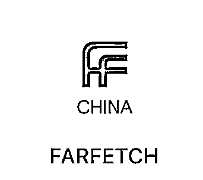

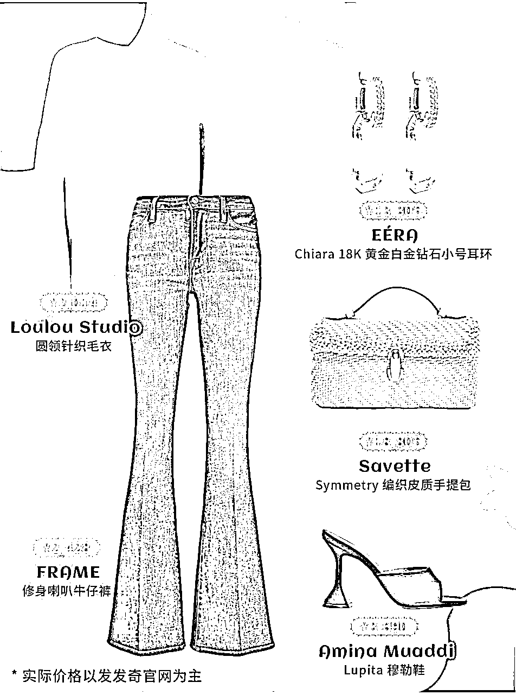

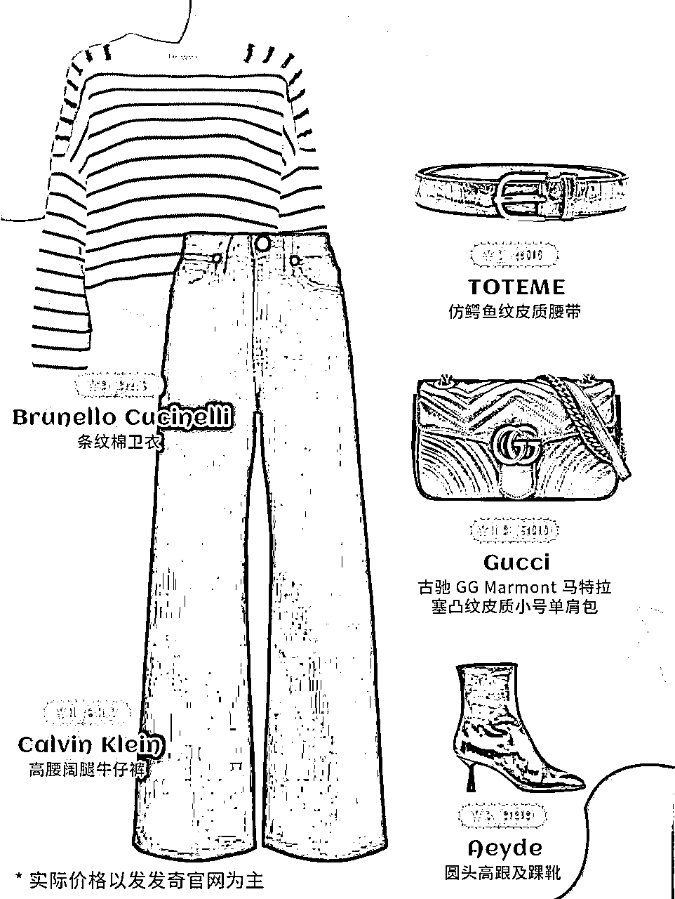

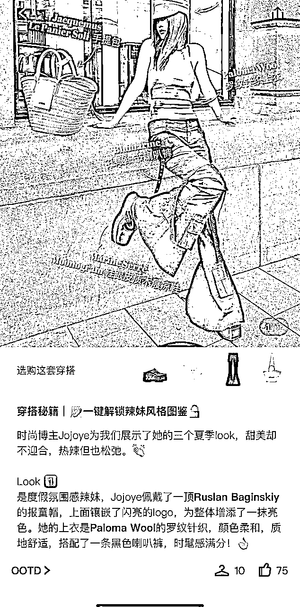

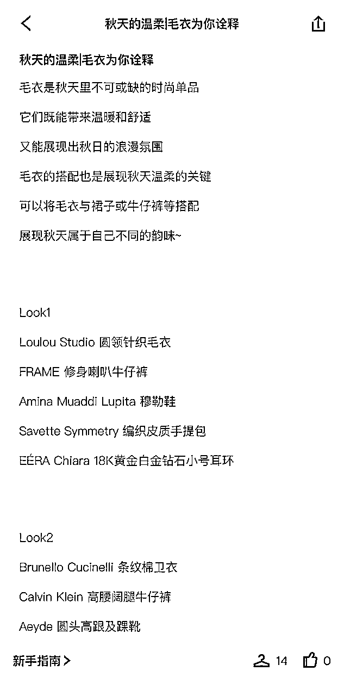

举个例子，某个垂直 App 的客户定位就是高端。款式、品质、溢价、搭配方案，乃至文案，都已经被做得成熟。我搬过来后，等于直接披上海外大牌买手的身份。

更重要的是，盯上这条路的人很少，合规风险自然就低。而且这批素材不只适配📕，抖音、视频号、快手都能同步复用。

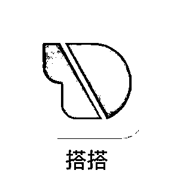

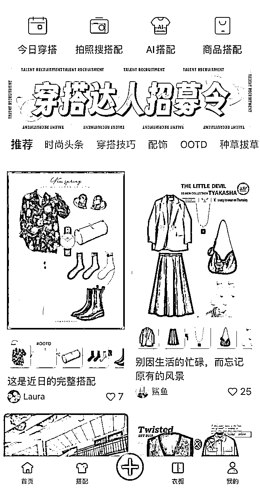

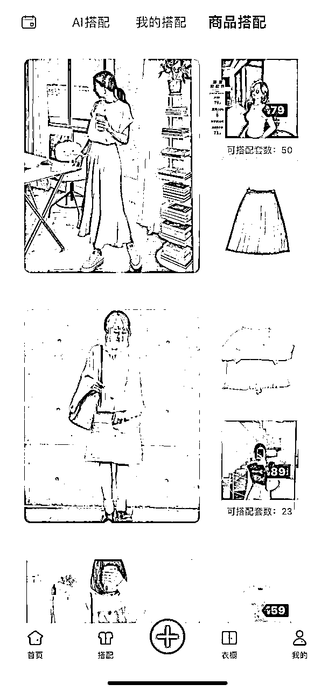

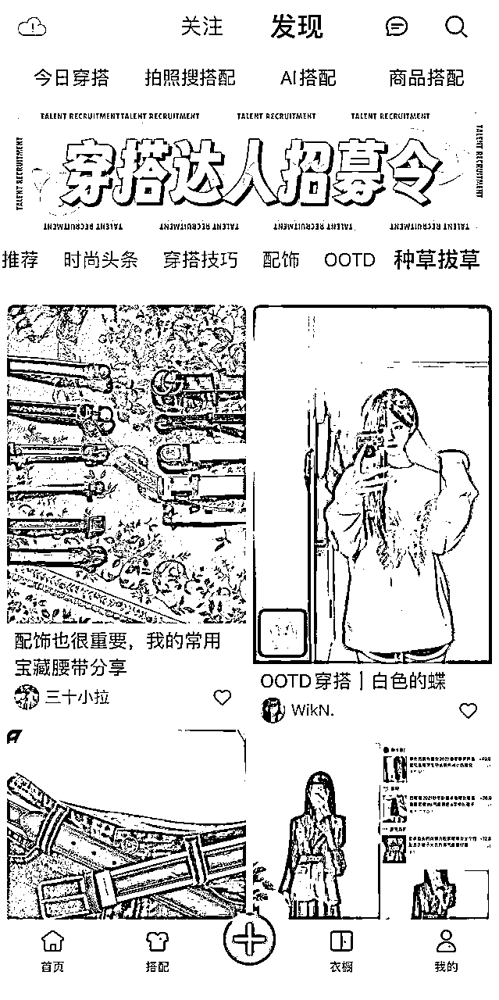

选品、素材、文案，还需要愁吗？随便一个 App 里都是能一直薅的资源，品已经帮你测过一轮了。

思路一旦打开，才发现处处是矿。几乎所有垂类都能套用同一套打法。

秒变星座塔罗博主【~天秤座好像只有事业没有爱情~】

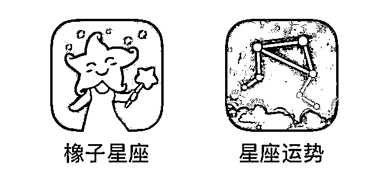

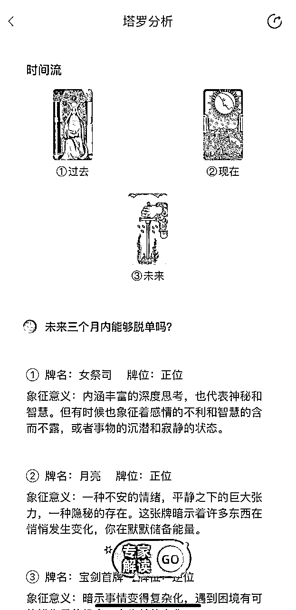

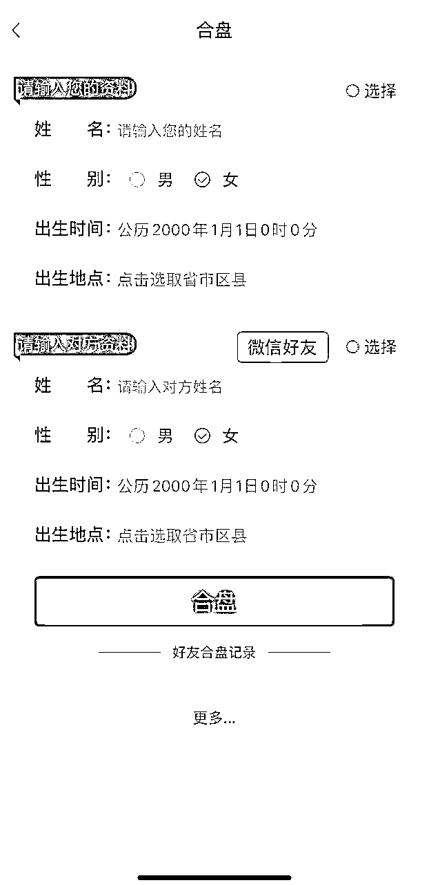

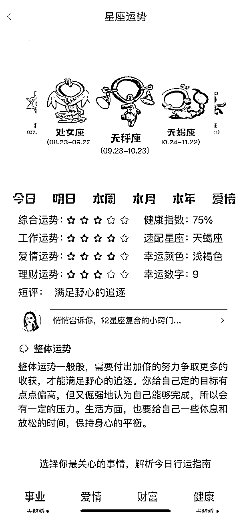

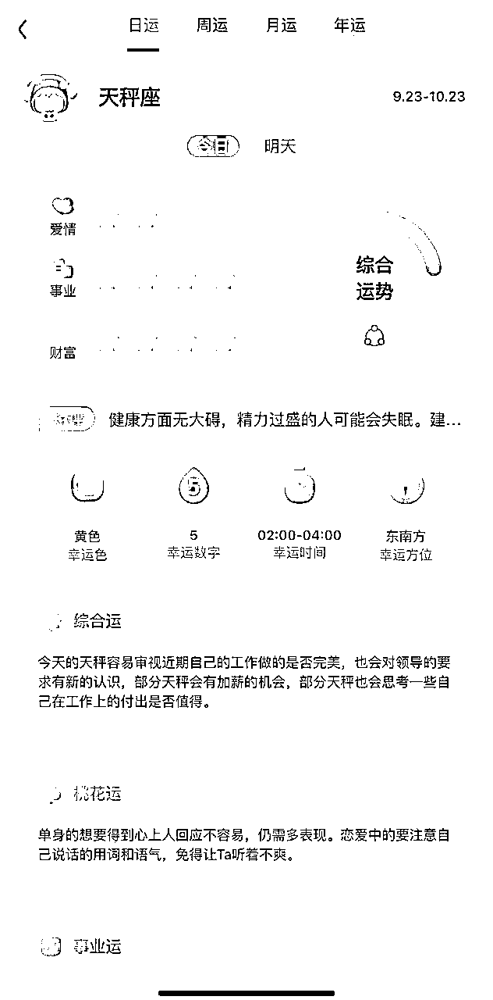

秒变消费测评达人

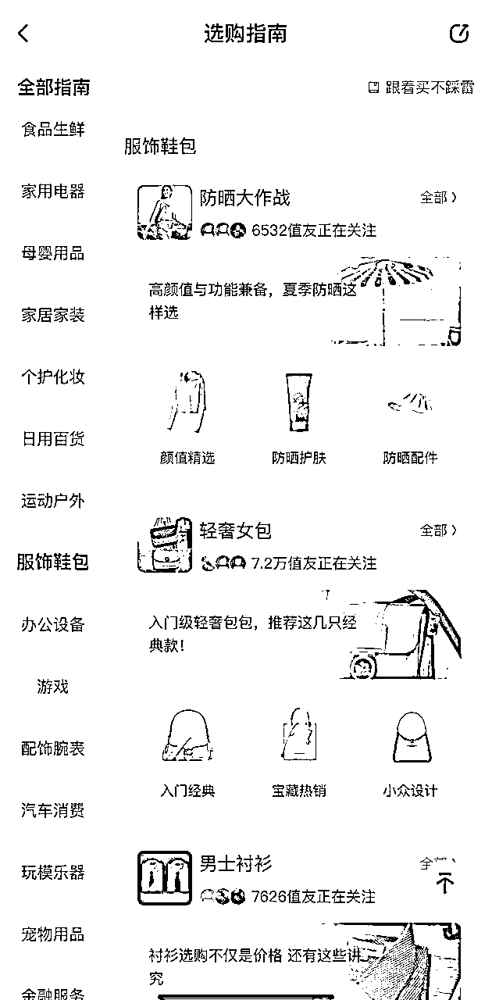

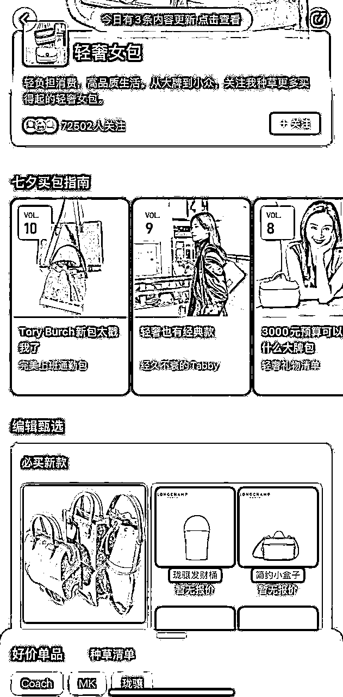

秒变书单搬运机【只要截图，笔记就成型了】

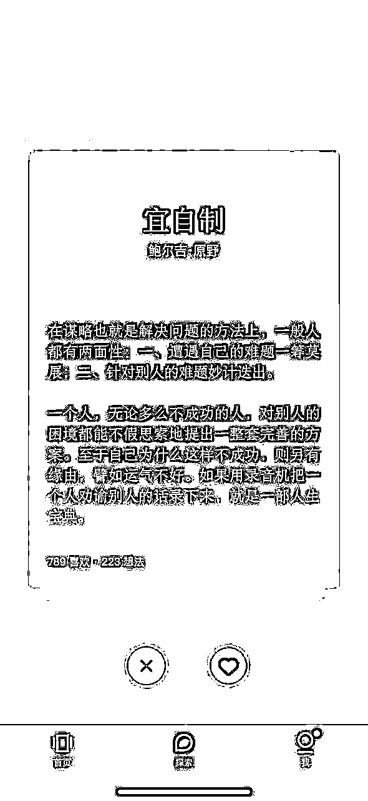

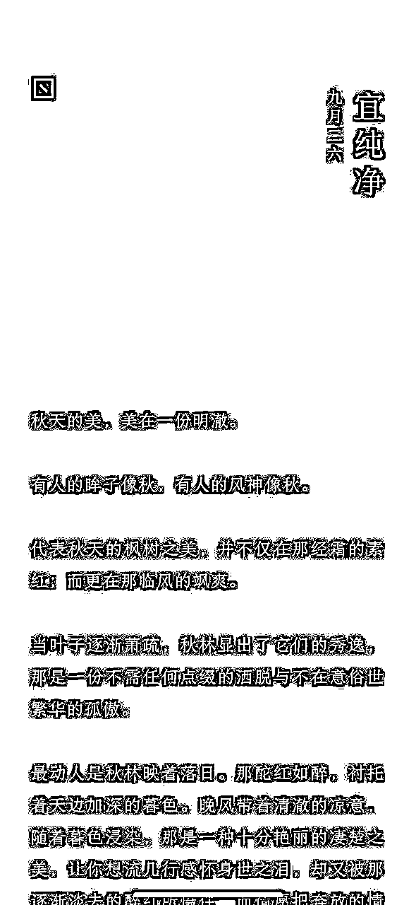

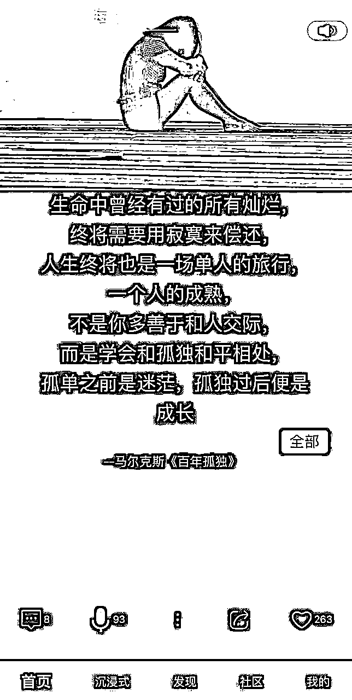

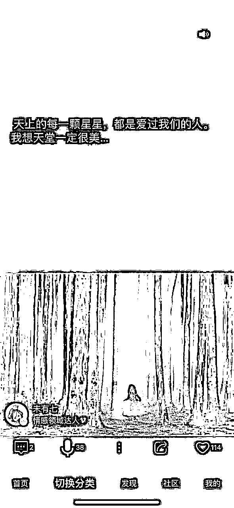

上面只是冰山一角。宠物、医美、养身、个护、兴趣爱好……几乎每个赛道都能用这套搬运+改造的方式快速起号。

## 启动2.0测试

从 App 到网站，沉淀私域精准变现

光靠 App 就已经做到起号几乎全中，利润回血也快，团队很快进入正向循环。

但我习惯继续往深里挖。App 是知识的载体，那浩如烟海的网站里，又藏了多少可变现的知识点？

我平时会抽空看一些跨行业的案例和分享，不想被单一赛道限制思维。很多当时觉得无用的细节，往往会在某个时间点变成赚钱的灵感。

之前在星球里看到圈友分享的一篇关于电脑搜索和文件管理系统的文章，我把它作为 2.0 测试的核心方向，目前已经带来一笔稳定收入。

很多女生遇到电脑问题会直接懵。我把网上关于电脑常见故障的内容系统梳理后做成笔记，至今已经积累了 3w+ 的私域流量。

当下直接变现的项目就是：系统重装、故障远程指导、新机初始化、搜索和文件管理系统搭建。单独配了一个四人小组来做，日均利润稳定在 500+。

这 3w 私域后续还能跨品类持续变现。

2.0 期间还发现一个新方向：海外站点。国外网站的内容自带“好奇心流量”，目前正在加深挖掘。这个模式复制性极强，几乎任何行业都能跑通。

# 03 分享也是放大器

方向选对后，最忌三心二意。

咬牙走下去，熬过最难的阶段，回报会很夸张。现在我们手上还有 29 家店铺在跑，之前 37 家，一波封号后有 8 家没解封。目前全部进入标准化流水线运营，7 月净利润 17w+，8 月净利润 44w+。

当长线布局全部开花，收益就是叠加放大的。

这套“走小路”的起号变现打法，目前还没人系统讲过。我们本可以闷声做个一两年。但市场足够大，我更希望把方法抛出来。大家一起卷，3.0、4.0 的打法也会更快被催出来，生态会更健康。

我的分享只是个起点。真正发力的人，都会在此基础上长出自己的路。比如下面这两位赚钱圈友。我不清楚他们具体怎么玩的，但肯定不是照搬，他们必然在此基础上做了自己的创新。市场永远奖励第一个吃螃蟹的人。

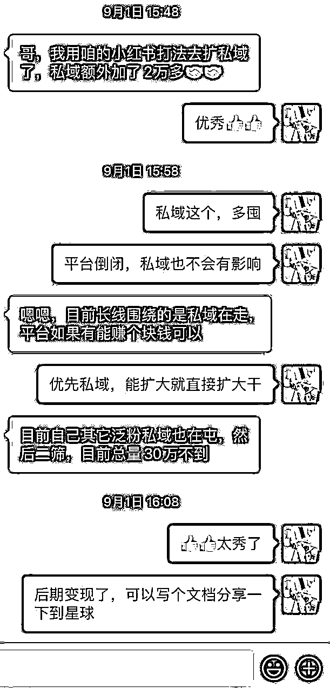

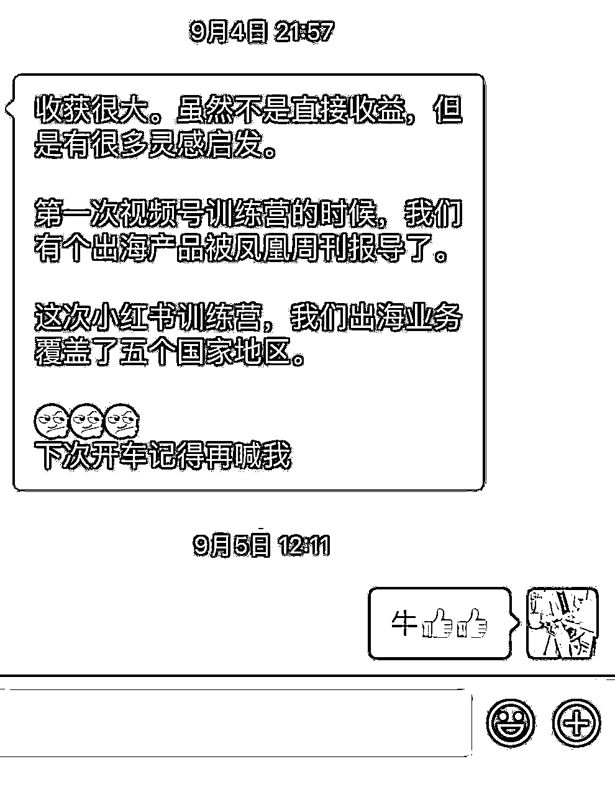