# 两个月净赚50万，9店总GMV超200万：我的月饼短视频带货实战复盘

你可能觉得月饼只是应季小生意，但我在今年7到9月，靠它在抖音、快手、视频号、小红书同时开出9家店铺，跑出200多万的成交额，利润接近50万。

成绩不是一上来就有的。7月基本在试错，我们一口气铺了近30个账号；8月临近中秋节点，不断做加法和减法；到了9月，只留下12个跑得动的账号。真正的利润集中在8月和9月。

先看几组后台数据：聚水潭总GMV、部分店铺成交额、部分账号浏览量。
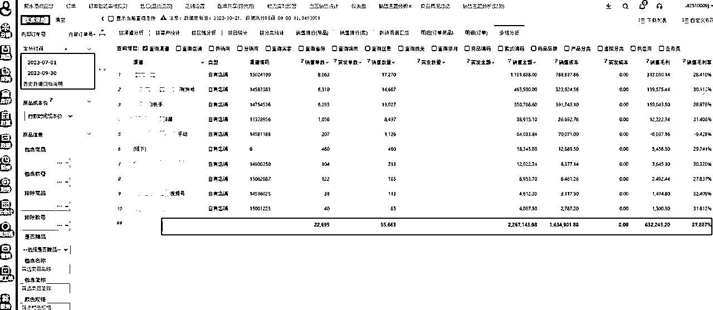
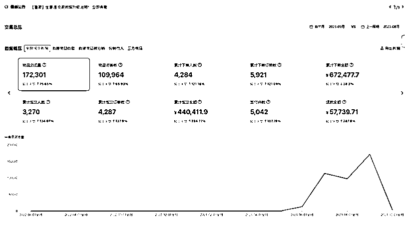
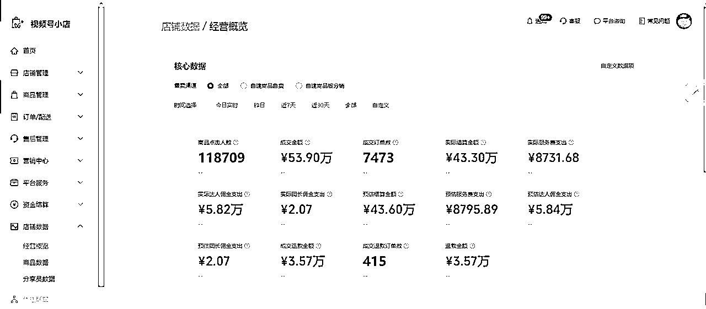
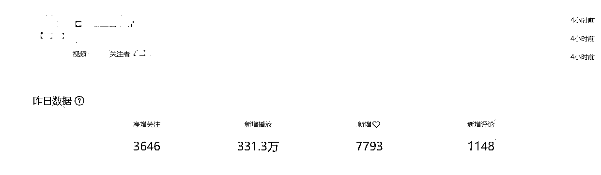

## 曾以为自己做不了短视频

回顾入局前，我21到22年在知乎写内容、做知乎好物，但知乎的红利肉眼可见地消退。22到23年，我开始去短视频平台做带货，试过中医、切片之类的混剪内容，前前后后运营了十几个账号，全都没有起色。那段时间真的被挫败感压得喘不过气，甚至怀疑自己只适合写写文字、做做图，根本玩不来短视频。
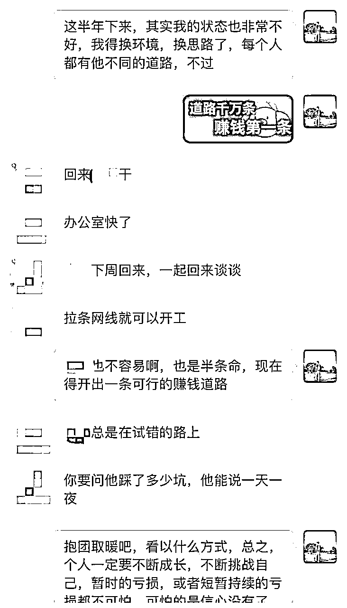

转折点是之前一起做传统货架电商的朋友叫我回老家搞个项目。我盘了一下身边资源，选了月饼这个品类，开始组团队。

刚入局时，我连月饼怎么生产都不清楚，更别说市场需求。但我知道一条原则：物质决定意识，凭空想不出好项目。任何项目都该先看别人的成功案例，跟着实操再优化，而不是闭着眼睛“干就完了”。

以前我做项目，习惯照搬别人的方法论，结果总被现实打脸。后来我学会了先分析外部环境，搞清楚竞争对手是谁、他们的价值在哪，再结合自己的情况做定位。

## 拆解案例是第一课

项目第一周，团队啥也不干，只做一件事：搭飞书案例库，把市面上所有月饼账号的视频拆了个遍。拆完之后发现，运营的核心其实是做减法。经过筛选，我们锚定了目标账号。

不过，拆解过程中小伙伴们常常一脸茫然，不知道怎么判断哪些案例值得学。我意识到团队缺的不是努力，是“网感”。于是我去付费学习、刷知识星球、啃主题书，最后提炼出一套“案例思维篇1.0”。哪怕你再小白，用这个框架也能快速上手拆解。

这套东西配合飞书案例库使用，我们就像有了自己的情报系统。市场会变，对手也在变，案例库必须持续更新。

## 从“看果”到“溯因”

后来上了兰陵王的知识体系课，我彻底明白了一个道理：任何结果都有原因。以前我们只盯着对标的流量、出单这些“果”，却从没想过背后的“因”，所以连抄作业都抄不好。

我带着团队开始做推理式拆解。拿视频来说，我们用“人货场”模型拆解对标账号，把视频切成400多个片段，再定义、分类、归纳。
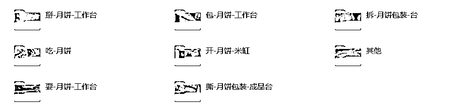

结论很清晰：爆款视频的构成基本就两块——做月饼的过程和月饼成品的展示。出镜人物是制饼师傅、掰饼的人、老人和孩子；产品是复古油纸月饼；场景离不开工厂生产线和老物件。

直播间也没放过。我开了个小号，从对面上播一直蹲到下播，用飞书妙记全程记录。直播间通常分两层：底层是工厂流水线包月饼的录播，上层是绿幕前主播伸手讲话术。蹲久了，连主播话术也搞到了。

当时课程里的“三归模型”让我很受触动：归纳、归因、归道。归纳是把内容元素分类；归因是找齐变量、验证因果；归道是总结规律、复制放大。

大量拆解后，我提炼出一个公式：经典粤语歌+制作画面+老物件里的掰饼特写=高数据。再往里挖，“果”是播放量高，“因”是“怀旧场景+具体动作”凑齐了；更深层的“道”则是：念旧情绪加源头工厂信任。前者给情绪价值，后者给产品背书。

人员操作上，对标账号基本保持日更视频、日播直播，这个节奏后来也被我们继承下来。

光看视频片段不够，我还专门开车40多公里去月饼厂，在流水线泡了几天。我这才知道，月饼出炉后要放3到5天，到了“回油期”口感才最好；也知道了一个月饼要经历做馅、备皮、包馅、印模、烘烤、冷却、包装这么多步骤。站在消费者角度看，这些制作过程天然带有“信任带货”的效果，所以每一道工序都被我拍了下来。

老物件场景反而是最难找的。米缸、电视柜、旧橱柜，这些是60后到80后的集体回忆，丢了太可惜。我先回老家找，没找到；后来在小伙伴的老家发现一栋保留完好的老房子，赶紧带着相机、手机、补光灯跑了100多公里去拍。
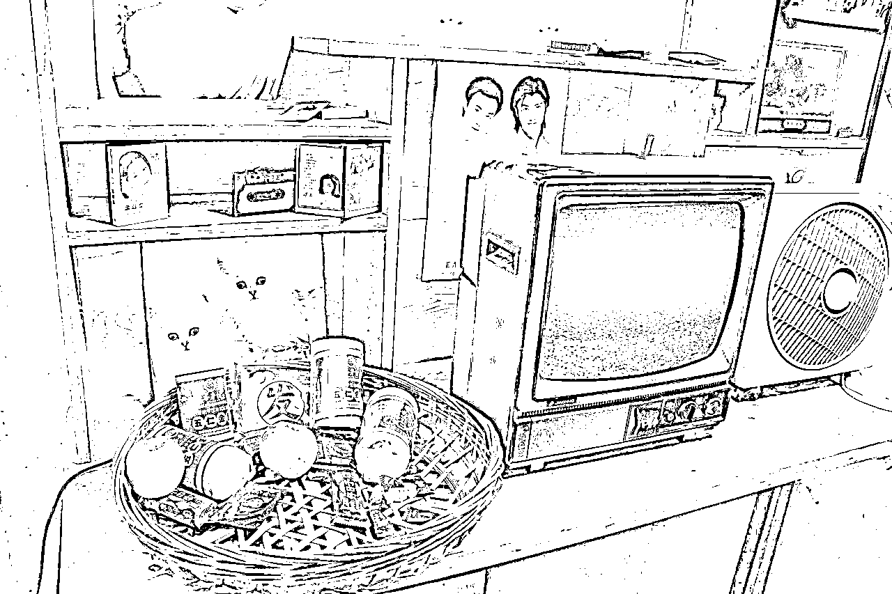

之后又补拍了很多撕月饼、掰月饼的特写，再加上老房子里的厨房、卧室、客厅、工厂等场景，我一共攒下1000多条视频素材，全部打标、归档。
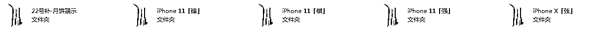

后来，爆款的形式也有了新变化。一条流水线搞笑视频，通过印模成型时的滑稽动作配轻快BGM《小神仙》，直接成了抖音月饼类目今年首个破亿播放的视频。但内核依然没变，我们很快跟上了节奏。
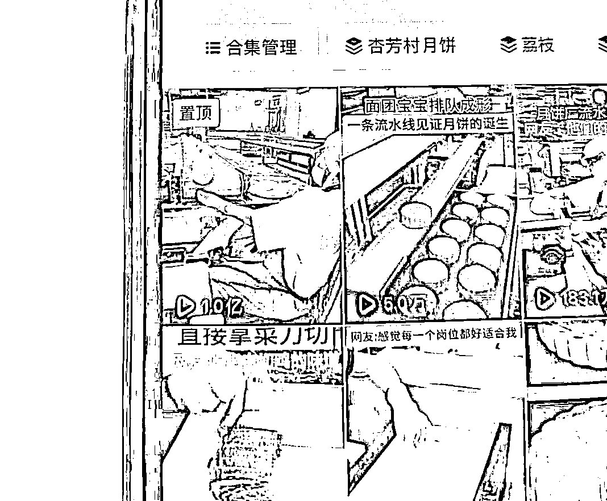

## 日产100多条视频的秘密

一开始我们四个人四台电脑，一天也剪不出20条。没有量，矩阵就是空谈。后来在生财有术看到@奇杰分享的“批量思维”，我一下开窍了：平台内容再多，拆到底都是少数基础元素的排列组合。放到月饼视频里，核心就是制作和展示两个模块，照着1:1替换就行。

先把对标爆款拉进剪映电脑版，拆它的画面结构。比如一条视频只有“制作”和“展示”两组画面，那我要做的就是把每组画面换成自己的素材。

什么叫“1拖x”？简单说，一个草稿里同时排4条片子，对应4个账号。
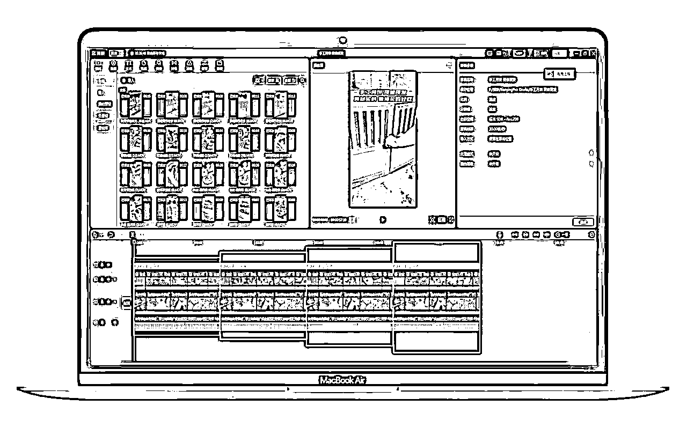
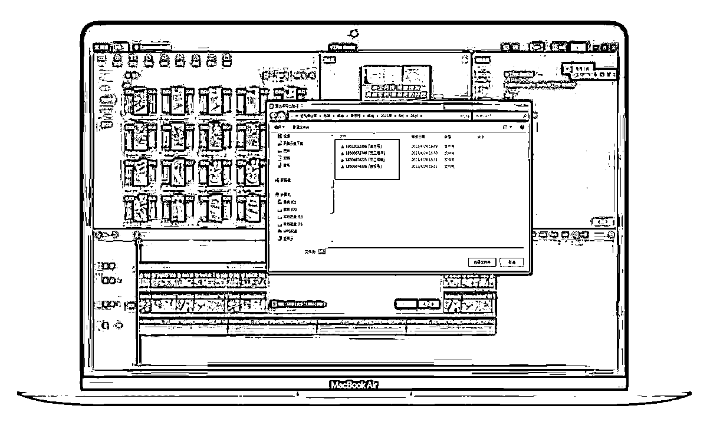

操作路径是这样的：对标模板导入后，分离音频，再复制粘贴3份，一共4份；接着把每一份的画面逐一替换成我们的素材。
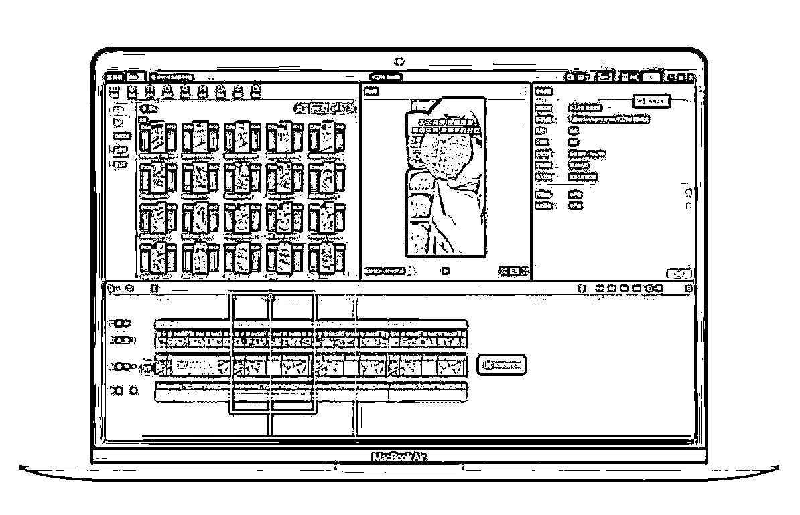

导出时用剪映的“选定区域”功能（快捷键Shift+X），分别输出到指定文件夹。

重点来了：草稿必须保留。如果某个模板发出去爆了，立刻找回这个草稿，复制、换画面、接着发。爆款大概率还会再爆。
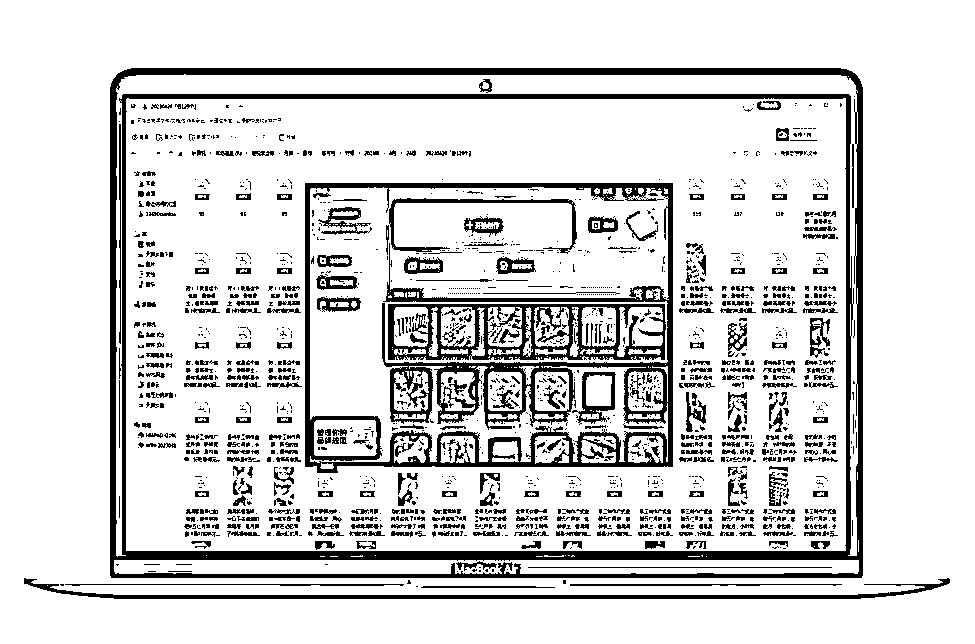

这套批量剪辑法非常省人力。后来剪辑基本由我一个人承包，其他小伙伴去忙运营和发布。到8月2日，我的剪辑量已经达到5417条，每天至少投入8小时以上。
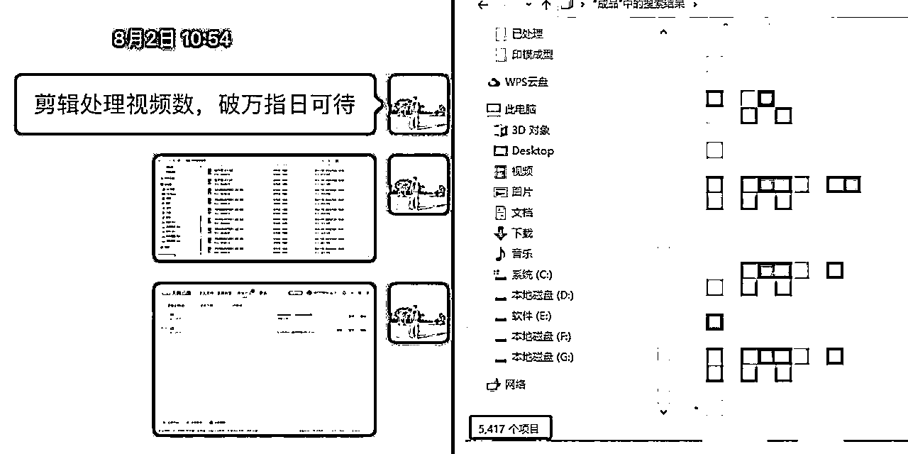

到了8月23日，草稿箱容量接近1T。
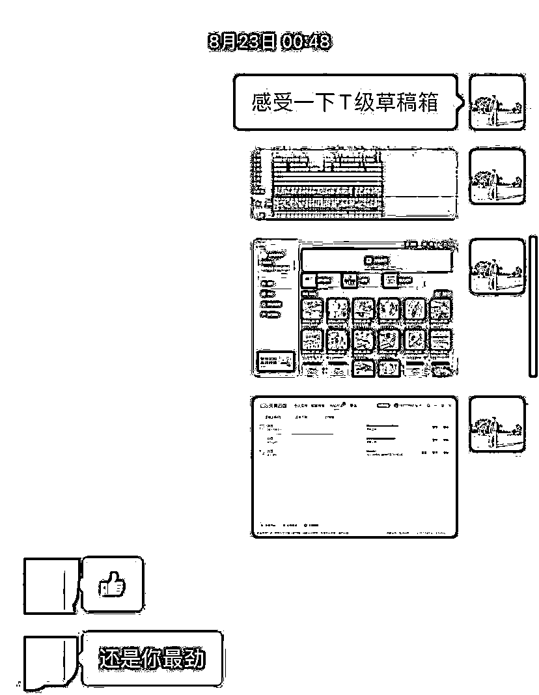

我越剪越熟，干脆几十条视频塞进一个草稿里批量处理，赶工期时一天100到200条不嫌多。
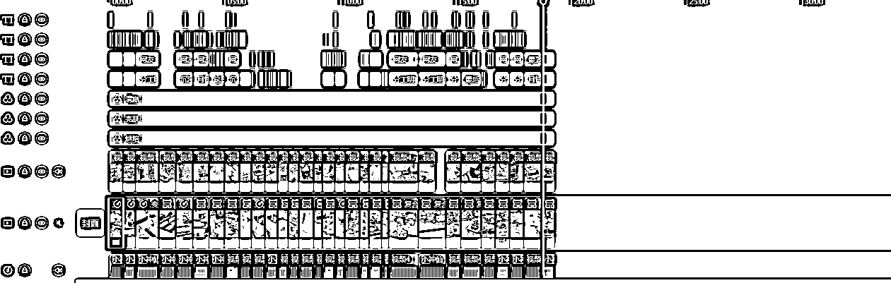

## 协作发布：云盘中转是关键

账号一多，内容怎么分给团队就成了麻烦事。数据线、QQ、微信、百度云、夸克我都试过，始终不够“丝滑”。后来找到天翼云盘，问题迎刃而解：一个账号不限制设备和系统登录，N台手机可以同时登录同一个账号，素材同步非常方便。

我们在现场拍完直接传“素材库”，剪辑这边立刻下载、打标、归类；剪好的片子再上传到“成品库”，发布端随取随用。
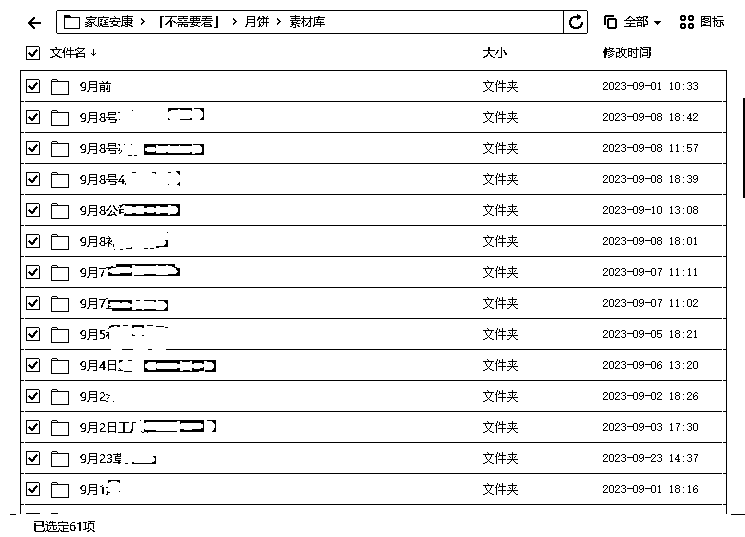

刚开始我把所有成品放在一个总文件夹里，结果小伙伴经常下错，还有人把别人的号发串了，导致多个账号同质化严重，被判违规。后来我改成按人名/账号建独立文件夹，谁负责哪些内容一目了然。
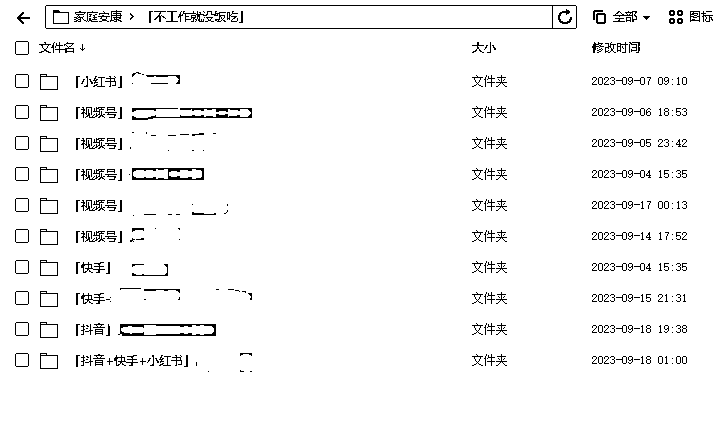

标题和话题怎么取？一开始我几乎照抄案例库里的爆款，毕竟爆款往往是二八定律里的“二”。同类同品，直接拿来用问题不大。话题也照搬，加载自己品牌名也行。抖音通常带5个话题，快手3个，视频号和小红书不限制。

内容尽量一鱼多吃。抖音/快手发布时，选一帧做封面，填好标题话题，然后复制发布框里的所有内容。发布时打开高清、关闭“保存本地”和“允许下载”。发完自己完整看一遍，再点赞、收藏、评论，先把第一个互动做出来。

视频号可以直接粘贴抖音的标题话题，但“短标题”那栏有搜索权重，记得在20字内补关键词。发完看一遍，评论一句，甚至可以复制抖音上自己的评论。小红书比较特殊，封面和标题文案都要重新定制，这里按下不表。

这套发布流程我也做成了飞书SOP，图文+视频手册都有，新人照做就行。

## 合作达人，扩大利润来源

8月之后，同行和大品牌开始大量入场，流量还在，转化率却明显下滑。我在想，怎么才能保住利润，甚至放大？

光靠自己的店和账号肯定不够。我们还有一套体系：店铺能装货，账号能装内容，主播能承接转化。如果再引入达人，给足佣金，他们就能帮忙带货。

运营这件事，0到1要亲力亲为，1到10到N要学会授权和合作。也可以看作是兴趣电商里的“淘宝客”或“京挑客”，本质都是找达人分销。我专门分了一个人去对接达人，慢慢做出了成绩。
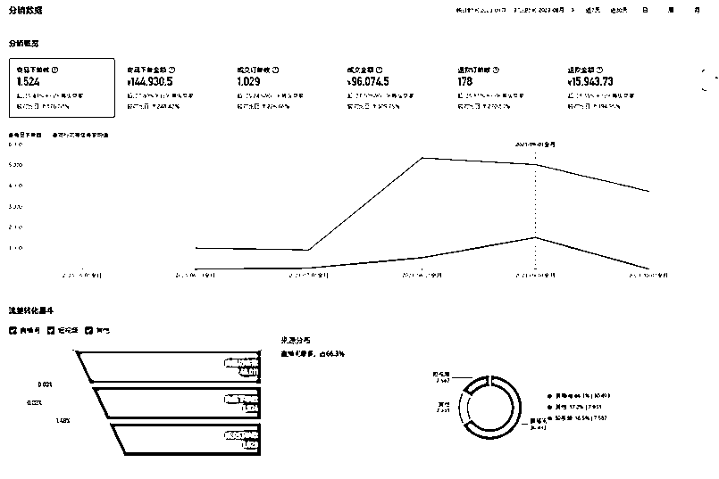
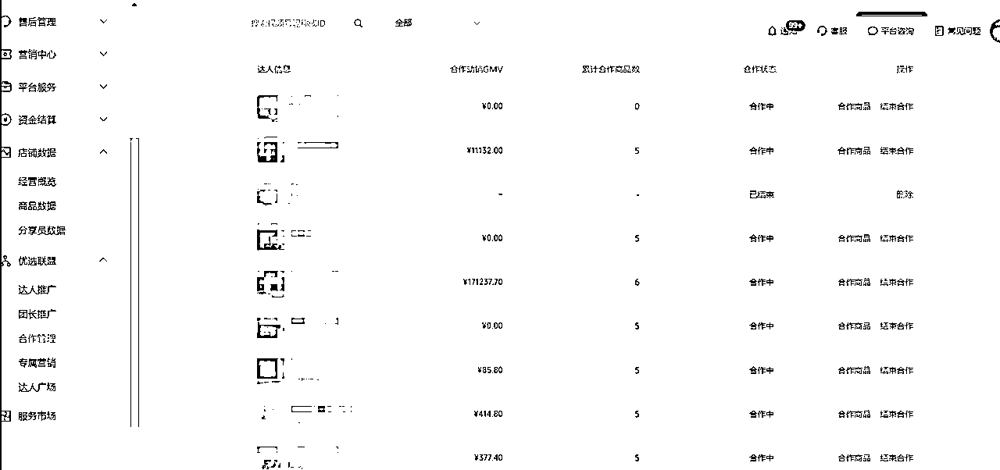

有一句话我特别认同：助人获得势能。把利分出去，自己的盘子才能做大。

## 最后：果断做减法

这种季节性项目，爆发窗口很短，前期铺大量账号，本质上是用数量对抗不确定性。
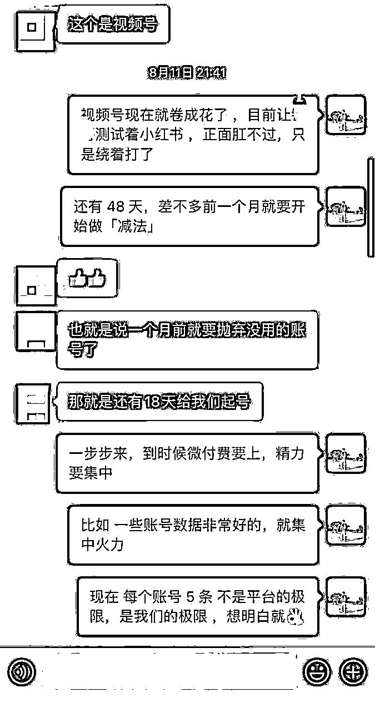

7月份我们做了近30个账号；8月节点临近，一边加一边减；9月只留下12个账号。资源有限，与其分散用力，不如把火力集中到真正能赚钱的号上。

这就是我的月饼项目全过程。拆案例、溯源因果、批量化生产、云盘协同、达人分销，最后再做减法。希望这段实盘经历，能给你一点可复制的灵感。

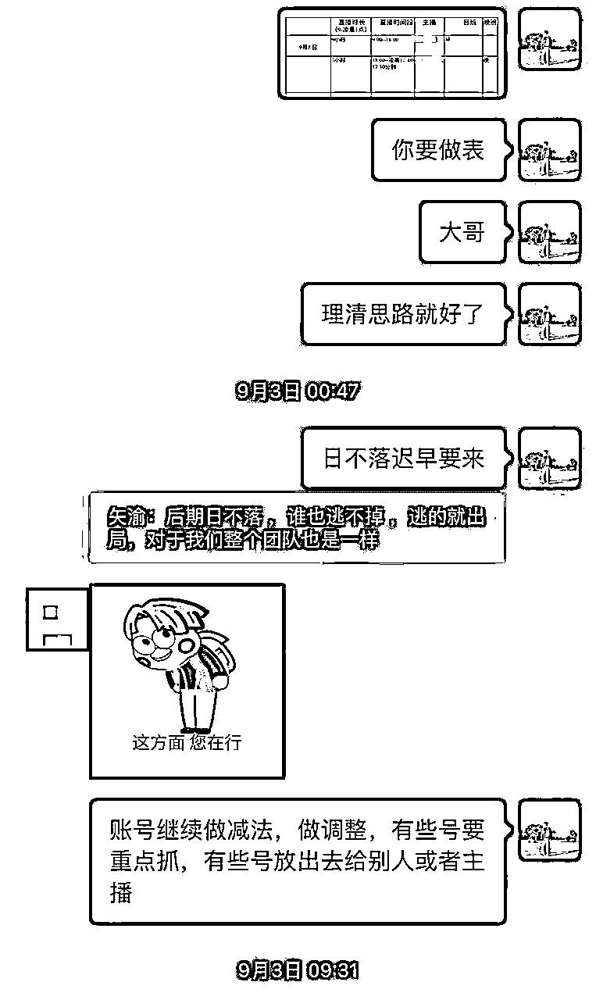

当一个账号或平台跑通模型后，最忌讳的就是继续把力气撒向四面八方。真正该做的，是集中火力主攻一个平台或一个账号——要么让内容量持续堆积，触达系统的推荐上限；要么把直播时长拉到最满，做到“日不落”。我最大的心得就是：加法要谨慎，减法要果断。

# 八、关于放大，一个交过学费的教训

“投流只能帮你放大，不能帮你救命。”

我做过信息流、做过电商、做过内容营销，一直信奉流量=钱，总觉得舍得花钱就能把盘子滚大。平台确实会乖乖给你量，但坑踩得多了才清醒：

- 品定生死——产品能不能爆，70%在选品那一刻就定了，正反馈不是靠投流砸出来的。
- 内容为王——品选对之后，内容才是你的灵魂，视频也好，直播也好，都是在做内容。

这个项目最让我欣慰的，是终于靠内容撬动了自然流量，没让年初立的flag倒下。

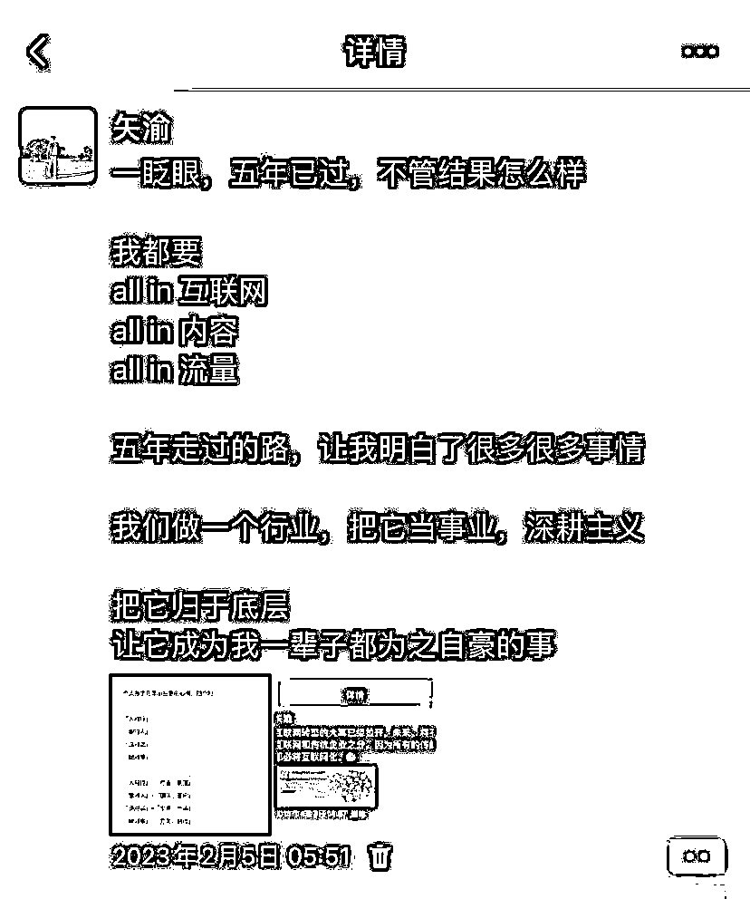

我的职业生涯，绕了一个大弯：

先做投流——17到18年刚毕业，用甲方的预算练手；再做产品——19到21年扎进工厂，守车间守仓库；后做内容——21年开始转型做内容，一路做到现在。

从一贫如洗到负债累累，我越来越确信：普通人想在社会竞争里突围，真正的护城河是“知识体系”，也就是认知思维。内容产出的底层，正是这套体系。大家总说学经验、买教训、补认知，可多数人得到的只是七零八碎的碎片信息，根本撑不起持续前行的动力，自然也就得不到持续正反馈。

话说回来，没有结果的自媒体人，往往把一切归罪于流量问题——觉得有流量就能卖空气。但本质是能力问题，是你没能力获取流量；再往深了挖，是认知问题。先知后行，才是一条正道。多想、多思考，用思考做决策，选对方向，努力才值钱。

节点产品适合放大，投流的最佳窗口是前15天，具体怎么安排，还得结合你的目标和预算来定。

# 九、项目心得

查理·芒格说过：一个人掌握80到90个思维模型，就能解决90%的问题，而真正重要的只有几个。

做店铺、做账号，我用了矩阵思维；做拆解，用了因果思维、用户思维、三归模型；做剪辑，用批量思维；协作发布，用系统思维。这些模型帮我在遇到状况时，能快速做出调整和决策。

再聊聊做项目的几个关键点：

1. 禁止内耗
2. 降低预期
3. 做好筛选
4. 做好阶段性计划
5. 减宽度，加深度

展开细说：

- 内耗是无能的表现。团队和个人的精力、决策，都必须以拿结果为唯一导向。
- 降低预期，处处是惊喜。从小结果入手，一步步往前推进。
- 数据端要算清投产比，有舍才有得。管理端做筛选，不做教育。
- 这个时代一切都在快速变化，不同阶段有不同考验。要明确每个阶段该做什么、该拿到什么结果——结果不一定是钱。
- 前期靠数量对抗不确定性，拼宽度谁不会？无非砸钱、搞矩阵、批量复制。但后期必须砍宽度、加深度，最终活下来的，一定是把项目做深的人——比如对供应链和产品的把控、对平台机制的理解、对流量和客户动向的感知，这些才是真正的壁垒。

团队刚起步时，我问过伙伴们一个问题：为什么赚不到钱？

答案归结起来无非是：“人有我没”，所以赚不到。

别人日更3到10条，你没做到，赚不到；
别人日播2到8小时，你没做到，赚不到；
别人开了联盟高佣金，你没开，赚不到；
别人找达人带货，你没找，赚不到；
别人付费推流，你没推，赚不到。

那怎么才能赚到钱？反推就行了。至于“人无我有，人有我优，人优我廉，人廉我转”，那是后话。

我们活在一个供给过剩、消费不足的时代。市场由供需关系决定：产品的供需、内容的供需、平台的供需，全都挤破头。看看平台搞的“赛马机制”就知道了。

互联网业态正在回归丛林法则：弱肉强食。

做兴趣电商其实不难，为什么赚不到钱？原因很简单——别人有的，你没有。想要那个“果”，反推“因”即可。

最后提醒一句：任何方法论都有适用边界，别照搬，因地制宜。

生财真的是一块宝地，能走到今天，离不开这个圈子。感激不尽，分享自己的一段经历，愿大家都能一起生财有术。

最后的最后，如果你有货源、有资源，或者正在做电商、做内容，欢迎联系我，一起交流，一起成长。