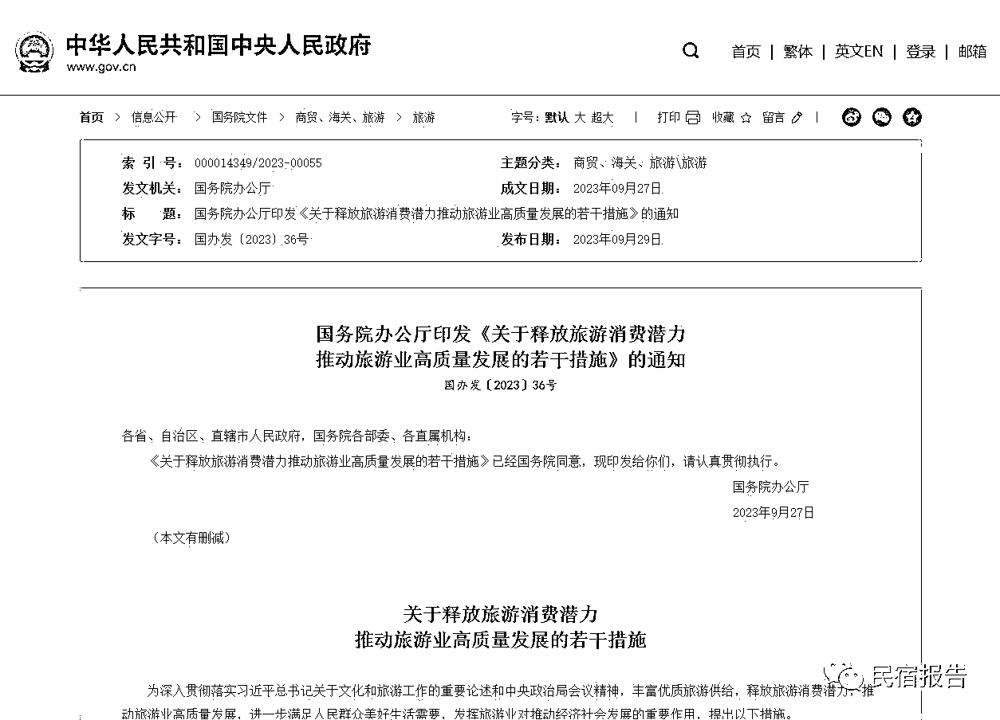
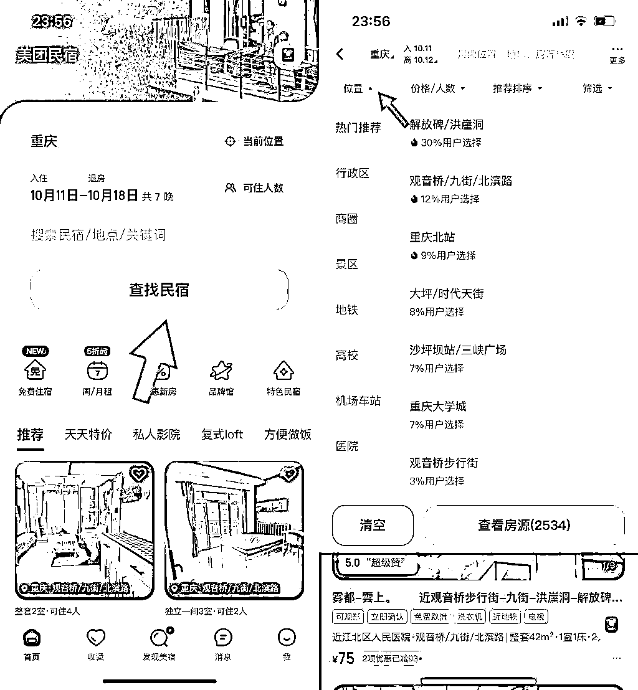
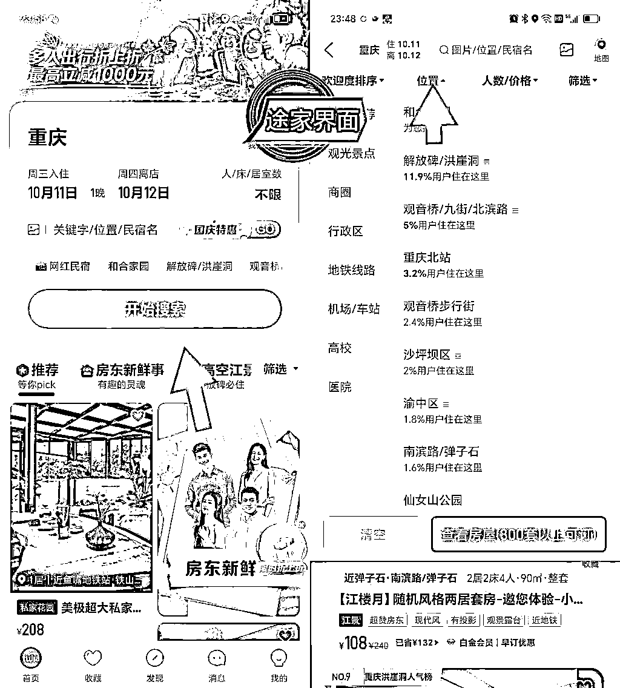
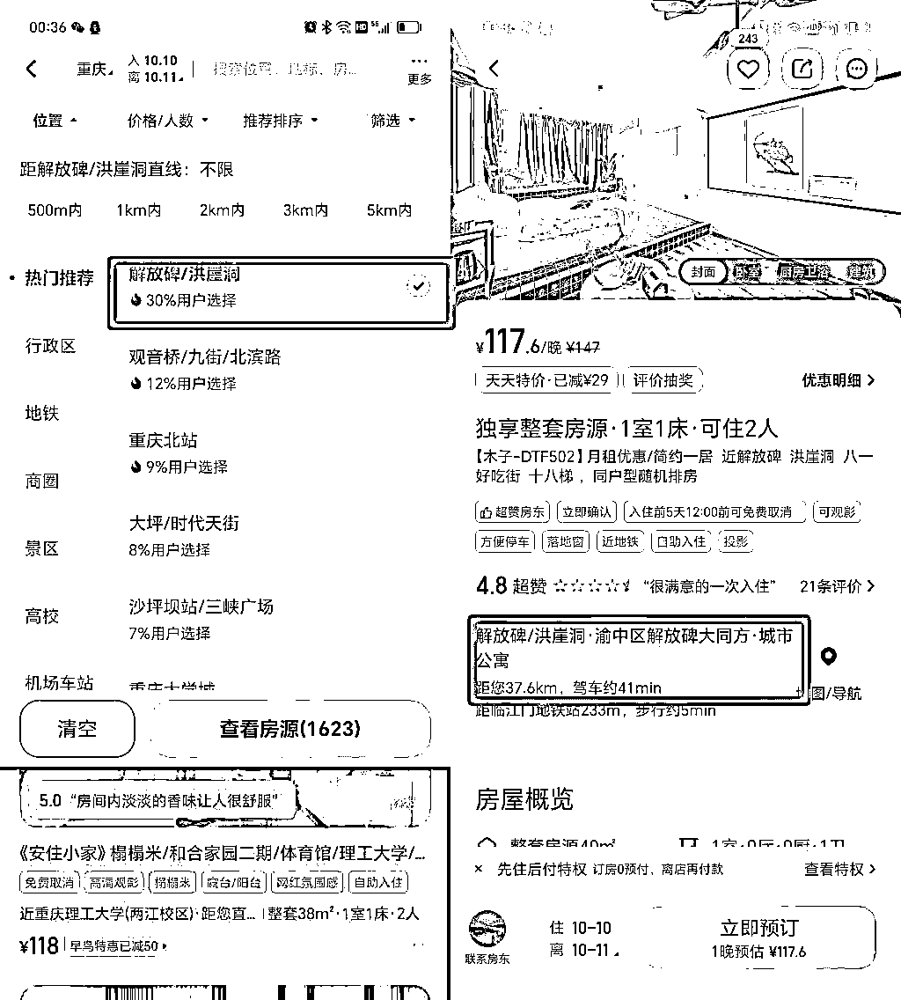
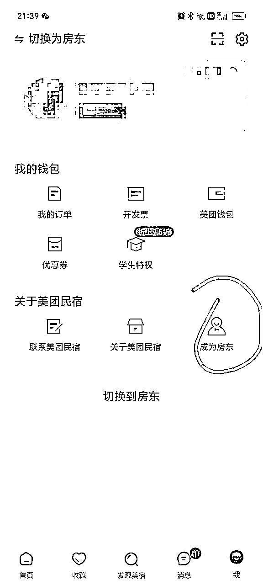
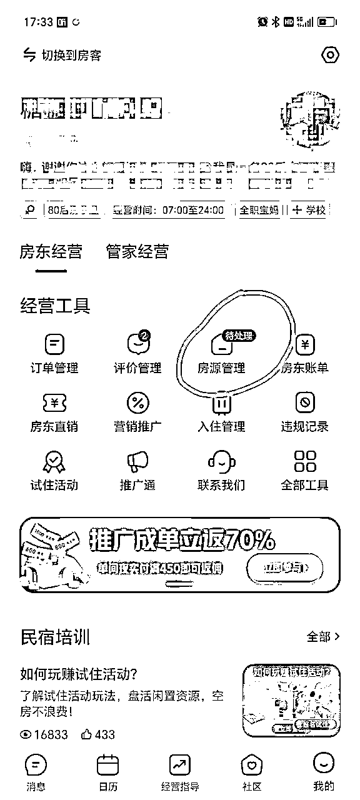
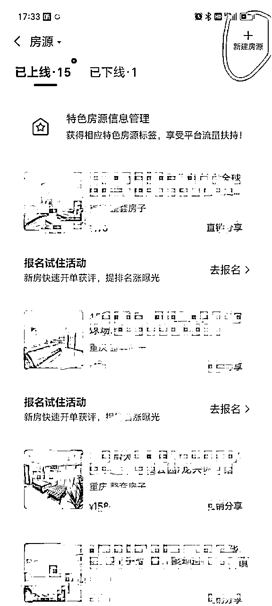
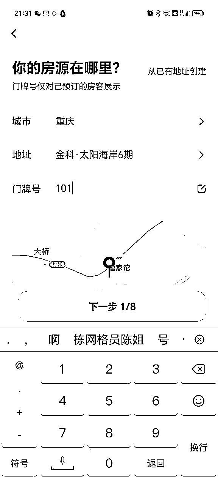
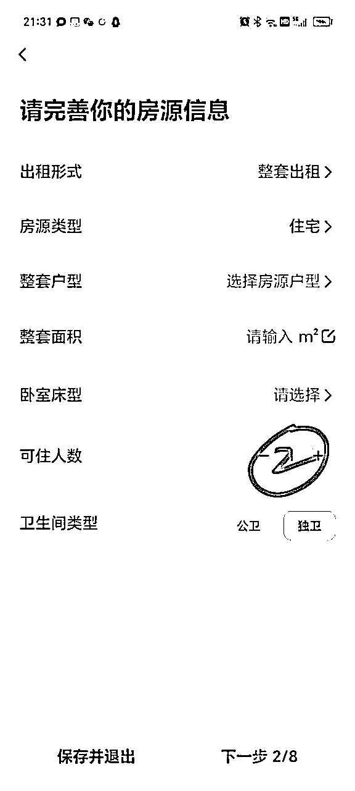
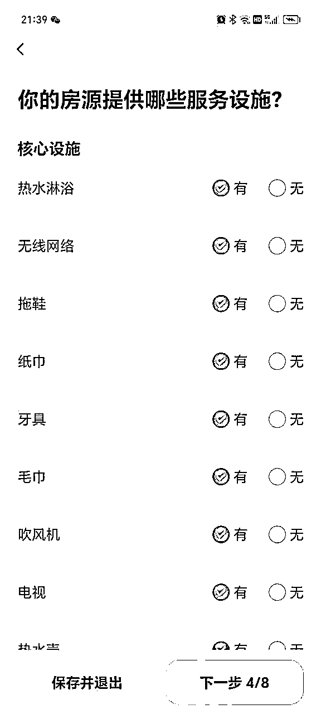

# 小白如何快速低成本上手城市民宿

最近总有人问我：看了你的民宿经验，我还是不知道怎么开始。今天这篇，就把一个带娃宝妈如何用不到两万块，把城市民宿从零做到月入2W+的全过程，重新给你盘一遍。想上车的纯小白，看完应该心里有数了。

先看一张官方政策图，给自己打打气。各地细则差别很大，最好亲自去当地部门问清楚。

# 一、算清这笔账：投入和回本

我在重庆郊区，一套一居室月租500，押金1000，季度付1500，拿房成本2500。房源本身是家具家电齐的，我补了些软装和厨具（电饭煲、炒锅、碗筷之类），花了约2000。单间月营业额能做到2500以上，4500除以2500，不到两个月就回本了。如果合同里争取到1-2个月免租期，回本更快。像解放碑、观音桥那种热门地段，一居租金要2000左右，但房价也高，高进高出，看自己资金情况。

# 二、营业执照怎么看？

多数城市20套以内不用办证，具体查当地“网约房管理办法”。我认识个杭州圈友说，当地因为亚运会，低于20间暂时办不了证，公安局答复亚运结束后会放开。

# 三、选址到底看什么？

先说我的做法：就在自己小区和隔壁小区拿房（5公里内），步行可至，方便打扫和管理。我主业带娃，副业民宿。如果你是全职干，建议10套左右先别请保洁，自己动手才能摸清卫生标准，以后请人也不容易被忽悠。0到1跑通了，再扩张，风险最小。有本书《攻守》里有句话我很喜欢：活着才有将来，不亏才有复利。

怎么判断一个区域能不能做？看周边有没有商圈、工厂、写字楼、大学城、网红景点、大医院、火车站、机场。命中1个就能试，3个以上基本稳。另外有四个快速调研法：多加区域中介🛰️（20-50个）直接问；找物业客服聊，他们门儿清；上58同城、安居客看数据；看同区域有多少酒店和民宿。一圈下来，心里就有数了。

房型怎么选？我手里基本都是单身公寓，只有一套两室，因为周边小情侣和出差多。旅游打卡地则要以套房为主，按客群定。

如果是资金充裕、懂商圈客群的老手，可以直奔热门商圈。商圈不缺客人，缺好产品。租金高，启动资金少的朋友要谨慎，但产品好就不愁卖。筛选热门商圈步骤：

打开途家/美团，选城市，点民宿，再点位置，会弹出热门推荐，排名就是热度排序。竞争越激烈说明需求越大。

然后抄同行：点进排名第一的解放碑/洪崖洞，点开销量靠前的房源，看地图上的楼盘名称，这些就是目标。锁定目标楼盘后，找几十个中介，看上100套房，从中挑最好的。

# 四、拿房谈判与签约

小白最稳妥的拿房渠道是中介。找到目标楼盘，多找几个中介，直说你是做民宿二房东的，需要大批量房源，可以长期合作。第一次给佣金，第二次给你介绍客人你给返点，中介会很有动力。

房东不愿租给民宿怎么办？常见担忧是人员复杂不安全。你就告诉他：我们在派出所备案，每个客人入住前都做实名登记。我8月底签了一套新装修精装房，房东姐姐一开始摇手拒绝，说好几个做民宿的找过她都没同意。我拿这套说辞诚恳沟通，最后签下来了。

房东的核心诉求无非四点：稳定收租、避免空置、省去麻烦、房子被爱惜。围绕这几点谈：
- 租金每季度准时打，合同写死日期，5-10年稳定收钱。
- 合同期长，不会中途空置。
- 普通租客租一年可能就搬，你还要反复带看、付多次中介费；委托我，这些麻烦全免。
- 我们会重新装修升级，把房子弄得漂漂亮亮，以后你卖房也能卖个好价。

签合同要注意：签的是房屋托管合同，不是普通租赁。要明确房东委托你管理、改造、再出租，还要补一份委托协议。违约条款一定要写清楚，房东违约要赔偿我方损失，金额往高了写，不然有些房东随时反悔。合同里最好加上：“甲方将该房屋及附属公共设施委托给乙方，用于经营酒店式公寓等相关事宜，完全同意乙方自主推广、经营、管理、装修、转租等行为。”

合同期限越长越好，至少5年。如果房东只愿意签1-2年，说明信任不够；房源好但已经是民宿状态、不需要再投入软装的话，1年也能签。我8月底那套精装房只签了3年，密码锁、四件套、仿真绿植加起来不到1000，一个月就回本了。

租金和押金能谈到押一付一最好，不行就押一付三，前期投入越少，滚雪球越快。

# 五、软装升级：颜值即正义

新手别碰毛坯房！别碰毛坯房！别碰毛坯房！除非房源是你自己的且位置极佳，否则又花钱又操心，不如长租。精装、简装房只需要做软装升级。卖民宿本质是卖图片，就像相亲，好看的人机会多。这一步最值得花心思。

想省钱又好看，去当地二手市场、二手群淘，线上用拼多多、1688。不用请设计师，去📕、抖音、淘宝搜家装图，定好风格照葫芦画瓢。年轻人喜欢的风格就那几种：北欧、轻奢、原木、奶油。装的时候别太女性化——我以前踩过坑，按女生审美选床品，结果男客很不喜欢。尽量中性风，男女通吃。

氛围灯一定要有，一两百块就能买到很好的，拍照特别出片，氛围感直接拉满。

装饰画别买花草系，容易土，选抽象款，看不懂才显高级。波西米亚挂毯、编织装饰物便宜又有格调。

窗帘必须全遮光！年轻人都是“月亮不睡我不睡”，我曾经买了透光窗帘，客人非让我换，我只能拿沙发盖巾临时遮，紧急下单才解决。这是真实踩坑。

四件套尽量用白色宾馆款，可以用84漂白和消毒。面料选涤纶比纯棉更好洗，污渍一搓就掉，干得快。南方秋冬烘干机费电，这点很重要。

民宿必备清单，直接抄：通通锁密码锁（小程序好使，限时密码短，别买那种12位密码的）；宾馆专用纯白四件套；装饰摆件（物美价廉）；浴巾毛巾；一次性牙刷拖鞋、凉拖；消毒品；吹风机、烧水壶、共享充电线、计生用品；洗发水沐浴露纸巾；瓶装水按人数放，美团优选、多多买菜买冰露或冰点，便宜。

# 六、照片和视频

有条件请专业摄影师，一套300左右。自己拍也行：全景、中景、近景、特写多角度，修图调色。我所有房源都是手机拍的。视频也要传，更直观，平台给流量扶持，还能提高下单率。

# 七、上平台与引流

主流平台是美团、携程、途家，还有飞猪、小猪、木鸟。我主要用前三个。可以用宝寓一键管理多平台，多一个平台多一分机会。

各平台特点：美团客户年轻化，价格敏感型，大学生和小情侣多；携程、途家以出差商务客为主，消费能力强但要求高，年纪大的客人需要耐心教。美团和途家对房源数量没限制，一两间都能上，有房产证或租房合同就行，位置灵活。携程要求高，要租房合同或营业执照，且同地点5间以上，所有房源只能一个地址，因为它主打酒店。携程有个毛病：很多客人按酒店标准预期，下单后发现是小区民宿就取消。美团和途家的客人预期低，很少这事。

我一开始70%订单来自美团，现在携程30-40%，回头客40%，其余美团和途家。

美团民宿上架的步骤：下载APP，选“成为房东”；；我的-房源管理；；新建房源；；按步骤填地址等信息；；传多角度图片（卧室、厨房、卫生间）；发布；等审核后设置新房特惠。

新房怎么拿流量？多参加平台活动：新房特惠、今夜特价、早鸟优惠。每个活动就是一个流量入口，新店没有订单数据时，靠活动换取推荐，数据起来排名靠前，曝光和流量自然来。

定价参考周边同行。节假日比如五一、十一，发现同行们都订完了，马上涨价，不愁卖。

接待流程：订单来了立刻主动联系客人，加🛰️，要身份证正面照和联系方式，说派出所要求实名登记，一般都会配合。不配合就用平台入住管理或亲自上门登记。这是保护自己，出问题派出所查有记录。加🛰️还能给私域导流，以后做多元化变现。然后发定位、密码、入住注意事项（退房时间、关空调关灯）。

多平台可用宝寓这类小程序，绑定所有平台，一个平台有单，自动关掉其他平台，避免超售罚款。同比还有百居易，顺手就好。定价参考同行，但别打价格战，拼服务。我刚开始只有3间大床房，后来有出差客要标间，就上了双床。两室平时候生意一般，寒暑假好，景点附近建议多拿两室三室，因为假期多人出行。我从月入1000到月入2W+，花了一年半。踏实用心，会越来越好。

# 八、运营细节

线下客人也引导到平台下单。好处：提高销量数据，有纠纷平台可解决。我朋友线下接单，客人住了两天不给尾款，还搞坏东西，赔不了只能报警。如果走平台，有保险直接赔偿。平台成交收10%服务费，值得。不要为省1%-3%的平台费线下交易，和平台是互利的。线下客人可以用房东直销，美团现在只扣1%，途家扣3%。

新店多参加活动。没单时可以找亲友刷单，再五星好评。客人退房时记得说：如果住得满意，请给我一个五星好评，对您表示感谢。

# 九、复购率怎么提

核心是加🛰️。之前提过，下单就加，发指引、密码、处理问题，并提供身份证照片实名登记。最好线下收押金，因为一旦纠纷，平台可能偏向客人，比如美团。重庆群里就有房东吃过亏。我基本不扣客人押金，碗碎了、杯子碎了、床单弄脏了都不扣。比如女生例假弄脏床单，洗洗就好了，没必要为了三十块清洁费扣人押金，流失一个回头客。我做的是回头客生意，不是一锤子买卖，真诚服务才换得来转介绍和复购。

服务要有温度。入住时间我设下午15:00，有的设14:00，看清洁速度。退房12点。客人要提前到，有空房就安排，没空房如实告知，让他选择等或换。延后退房一两个小时，如果当天没订单就不收费；有订单就提前说最迟几点，客人都能理解。民宿群里有些房东坚持收费，上次有个房东为十块提前入住费跟客人闹得很不愉快。成本控制重要，但做个人情味有温度的老板更重要。

# 十、劝退名单

民宿日常很琐碎，没耐心、脾气爆、心理脆弱的人别碰。你会遇到各种奇葩：
- 住半天理直气壮要求退全款，想白嫖；
- 威胁给好评要求返现50%-60%，180的房费要返100；
- 故意损坏东西拒不赔偿；
- 凌晨让我代买避孕套……

但也会遇到很多温暖的客人。掌握节奏，控制成本，先跑通一套房，再慢慢滚大。希望这篇能帮到想上车的你。

做民宿房东，真的得有一颗随时“救火”的心。小毛病层出不穷，今天水管漏了，明天灯不亮了，后天门锁又出问题——反正哪里有事就得往哪里跑，日常状态堪比抢险队员。所以想入这行的新手朋友，一定先给自己打好预防针。虽说城市民宿算得上低成本试水的好选择，特别适合没什么经验的人起步，但要是你缺乏耐心、遇事容易烦躁，那我劝你趁早打消这个念头。

好了，经验就聊到这儿。如果你觉得这篇内容对你有启发，不妨点个赞、收个藏，也算给我一点小小鼓励啦～上次发完帖子之后，就有不少圈友私信我，还约了课。最近我也在整理自己的方法，正忙着准备推出一对一陪跑计划，从民宿的日租，到长租、短租公寓，从零开始一步步带大家落地。除了美团这类OTA平台的运营技巧，我也会一并陪大家玩转抖音、📕、视频号这些社交媒体，帮大家吸引到更精准的客源。感兴趣的朋友，欢迎随时来交流！