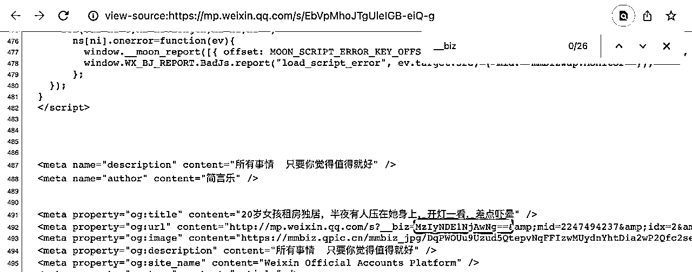
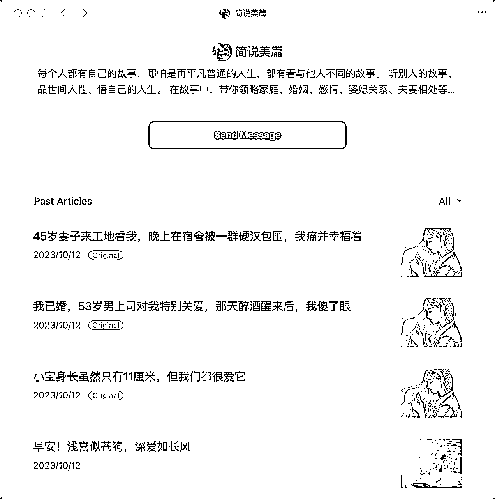
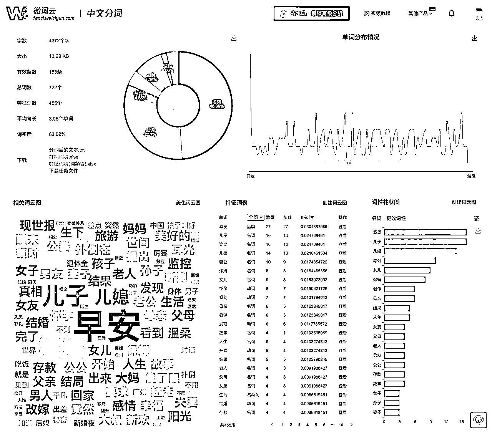
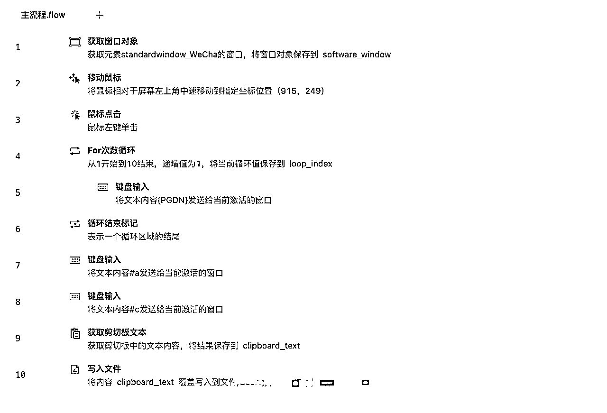
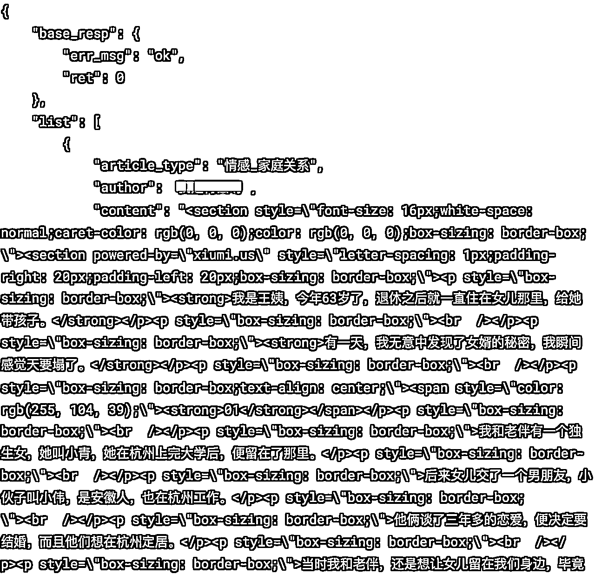
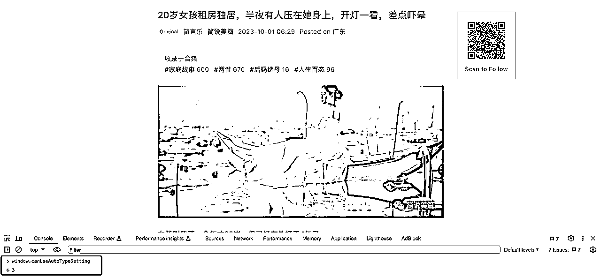
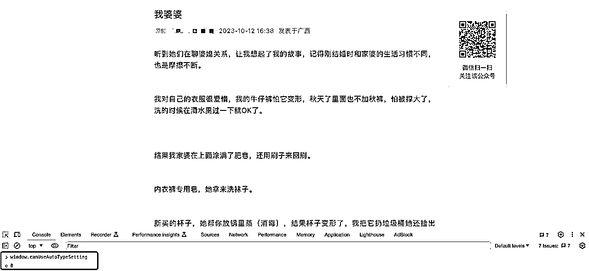

做公众号的人，尤其是参加过航海项目的朋友，应该都有这种体验：想参考别人的文章标题找灵感，比如妞妞教练，但自己既不会敲代码，又不想花大量时间学RPA。其实有个笨办法，完全不需要技术，一分钟就能把某个公众号的历史文章标题全部扒下来。

第一步，先拿到公众号的身份标识。随便打开这个公众号的一篇文章，用电脑浏览器打开，右键选择“查看源代码”，然后搜索 `__biz` 这个关键词，屏幕上就会出现类似这样的内容： 从 `__biz=` 开始，一直到 `&` 符号结束，中间那串字符就是该公众号的唯一ID。比如示例里就是 `MzIyNDE1NjAwNg==`。

第二步，用这个ID拼出一个链接。注意，链接里 `biz` 前面是两条下划线，格式照着来就行：```
https://mp.weixin.qq.com/mp/profile_ext?action=home&__biz=MzIyNDE1NjAwNg==
``` 这个链接就是公众号的历史消息页，不过它只能在微信内置浏览器里打开。

接下来，在电脑版微信里打开这个链接，页面大概是这样的： 然后你会看到历史文章列表。关键时刻到了：你只需要按住键盘的下翻页键，或者不停地滚动鼠标滚轮，一直滚，滚到你不想滚为止。最后 `Ctrl+A` 全选页面内容，`Ctrl+C` 复制，再粘贴到记事本或任何文本文件里。瞬间，所有滚动区域内的文章标题就都到手了。就这样，获取标题这件事就算完成了。

如果你还想分析这些标题里的高频词，继续零代码路线。找个在线词云工具，比如“微词云”，把刚才复制到的全部标题粘进去，点生成，就能得到类似这样的图表： 是不是已经有内味儿了？全程没写一行代码。

如果觉得手动滚屏麻烦，也可以考虑用RPA工具把整个流程自动化。关于RPA的具体玩法，圈里已经有不少人分享过，这里不啰嗦。大致的流程就是按刚才的操作顺序编排一遍： 完成之后，你基本就解放双手了。

再往深走，想用Python直接刷接口拿数据？我得提醒你，这种方式风险偏高，接口里带着你的用户信息，操作不当容易被封号。想尝试的话，得先抓包拿到接口地址。抓包工具方面，iOS可以用Stream，Mac可以用Charles。打开历史文章列表往下滑动时，就能看到类似的接口地址：```
https://mp.weixin.qq.com/mp/profile_ext?action=getmsg&__biz=MzIyNDE1NjAwNg==&f=json&offset=10&count=10&is_ok=1&scene=&uin=777&key=777&pass_ticket=nW6YdJ9Ajz8WOD5QWR6otnasml3bFeu9ls7CFcVLpe9bpwNUUAO8uQ2xgA1wouAY&wxtoken=&appmsg_token=1239_ITZ0NysE7K5IHytH3LJrMhO0KVxv_kofwv72GA~~&x5=0&f=json
``` 参数看着多，重点几个别忽略：`__biz` 是公众号唯一标识，跟上面说的一样；`pass_ticket` 和 `appmsg_token` 是验证凭证，有效期很短，也需要通过抓包获取。拿到接口地址后，就能用Python去请求了，记得把headers加上。技术细节就不展开说了。 数据爬下来后，还可以用jieba之类的库做分词分析。

最后加个餐：学会了抓包，你会发现能干的远不止此。比如在公众号管理后台，查询可转载文章的接口长这样：```
https://mp.weixin.qq.com/cgi-bin/operate_appmsg?sub=check_appmsg_copyright_stat
``` 分析一下返回字段就能发现，接口里不但标明了是否可转载，甚至包含了文章完整的HTML结构！这比在页面上复制文本强多了，你完全可以把内容直接生成网页。至于后续怎么玩，你懂的。

另外还有个查验“快捷转载”的简单办法，非常省事。用Chrome浏览器随便打开一篇文章，按F12打开开发者工具，在控制台里输入一行代码：```
window.canUseAutoTypeSetting
``` 回车执行， 如果返回结果是0，表示该文章是“分享”状态；如果结果是3，那就支持“快捷转载”。 这玩意儿有啥用？当然是方便你更快地转载好内容了呀。

最后多说一句：爬虫的形态有很多种，手机端的RPA也能搞，比如Auto.js这类的工具，可以爬取App里的内容。有兴趣的话可以自行探索。就先写到这吧，估计离精华还差得远呢（笑）。