# 用结构化思路重塑资料管理，让信息想用就用

嗨，我是菲比。工科双一流本硕，加中美双学位，现供职于世界五百强央企技术岗，INFJ人格，习惯用结构化视角拆解问题。

上轮航海刚收官，作为首次上船的新人，状态超出预期。缺席两天仍完成思维导图九张、精华帖十一篇，资料整理分队总积分排到第一。

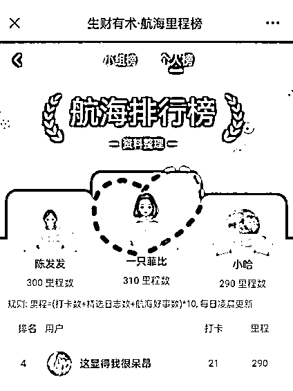

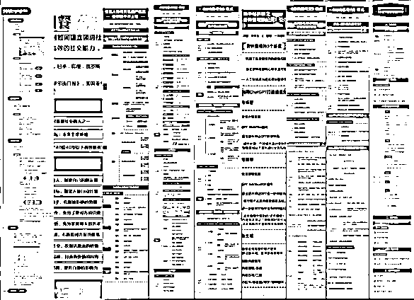

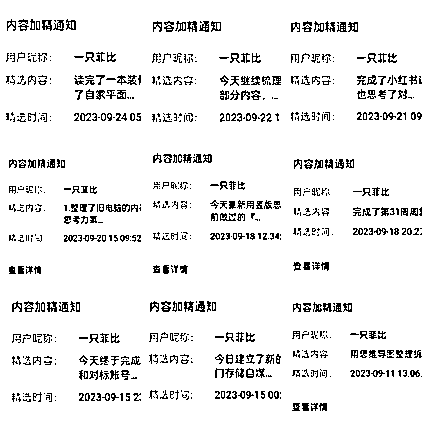

航海群里已做过一次分享，这里稍作润色同步到星球。想把过去十五年里在资料整理上沉淀的心法、迭代的方法论，以及一些真切体悟，跟大家聊聊。

全文三段落：

*   用到时才觉得缺，怎样存得准、找得快
*   靠结构化思维把信息调用效率拉满
*   把结构化带入计划与复盘，远离形式主义

# 一、用到时才觉得缺，怎样存得准、找得快

最近在装修，被一个博主“大怨种的收纳大法”吸引。她的原则很硬：

收进柜子的东西不能被遮挡，一眼可辨，且能单手在三步内取到。

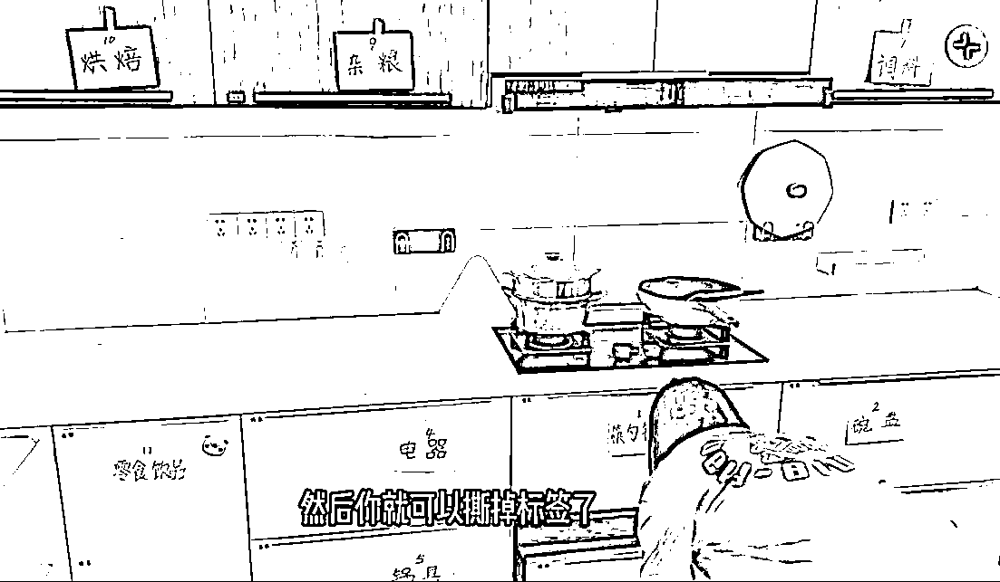

这套收纳逻辑迁移到知识管理极有参考价值。

一目了然、无遮挡，对应到资料库就是不重复也不遗漏；单手三步可取，对应到检索就是点开不超过三次即可定位。

能做到这两点的关键，是分类设计。

设计出适配自己的分类，需要先厘清两件事：自己平时的检索习惯，以及这份资料的实际用途。

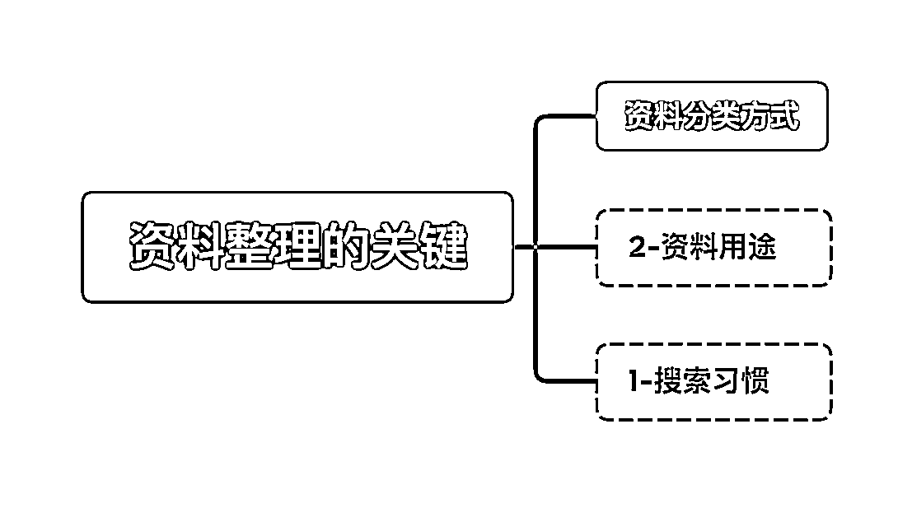

举例：刷微博看到一张TED演讲拼图，觉得有价值想留存。该归到哪里？

先想用途。若打算以后放进公众号配图，那就走“公众号-配图-励志”这样的路径；若暂时无明确用途，先丢进“灵感-励志”暂存即可。切忌随手扔进“微博截图”这类模糊文件夹。

再看检索关键词。以后想找这张TED金句图，你第一反应会用什么词？TED、微博、图片，还是励志、金句、语录？联想路径因人而异，标签也要随之定制。

资料整理不是把文件塞进文件夹让界面看起来整齐就完事。若没想清楚用途与个人思维习惯，资料很容易沉入手机图库或一个叫“截图”的黑洞，需要时再怎么翻都找不到。

# 二、靠结构化思维把信息调用效率拉满

要让信息真正可用，就要用结构化思维来做接收与输出。近阶段梳理《结构思考力》，收获很深。

## 结构化接收

整理的第一步是接收。接收时抓要点，再内化成自有知识体系，才是资料的理想归宿。

书中给了三步做法：

### 区分事实、论据、结论与观点

事实累积让论据成立，论据成立支撑结论，结论成立才能支撑观点。

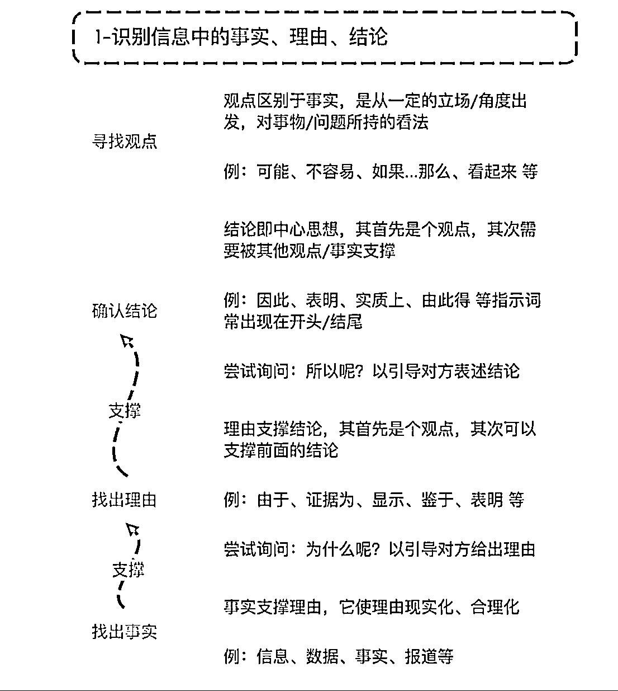

### 画出结构图，理清对应关系

通过梳理观点-结论-论据-事实的链路，能判断信息可信度与准确性，也能分辨哪些是核心信息与客观事实，哪些只是例证或主观判断。

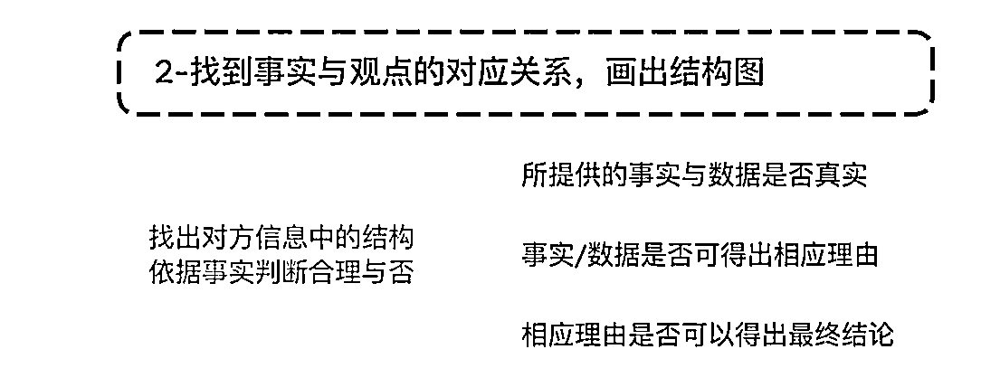

### 一句话提炼

若提炼不出来，说明还没吃透，需要回头再拆。

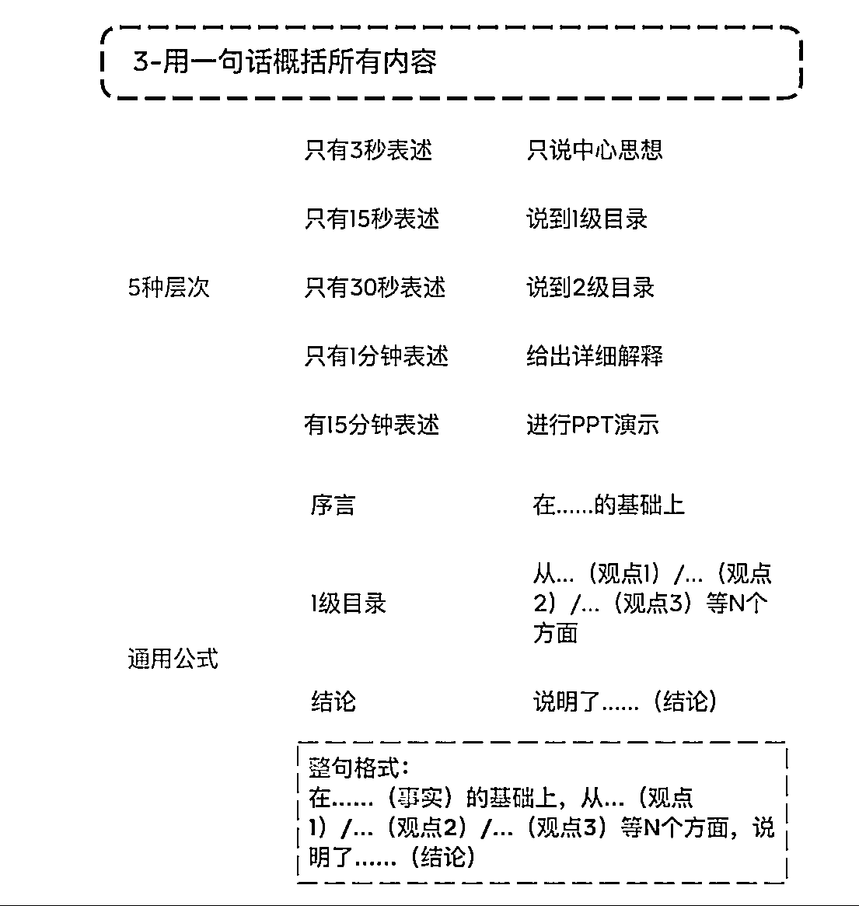

## 结构化呈现

内化后输出，想让人听懂，需要纵向与横向的立体结构。

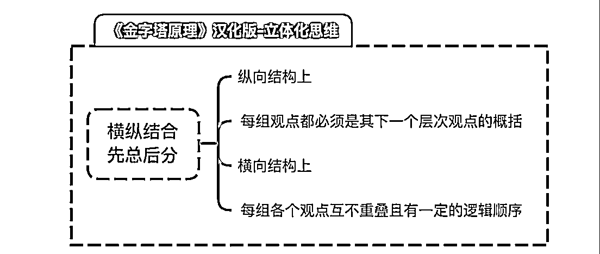

### 纵向

每一层比上一层更细、更深，下级支撑上级，形成稳固的金字塔。

### 横向

平行的模块要有清晰逻辑，不管是并列还是递进，同类内容做到不重复不遗漏，这样上级命题才无懈可击。

## 场景化落地

整理完还得用。同一素材在不同场景下，主题与表达要切换。

例如推广《结构思考力》这本书：

*   面对企业高层，话术是“帮助你更高效管控公司，提升团队执行力”；
*   面对内容创作者，话术则要换成“帮你搭起清晰的课程架构，写作更快质量更高，变现引流提速”。

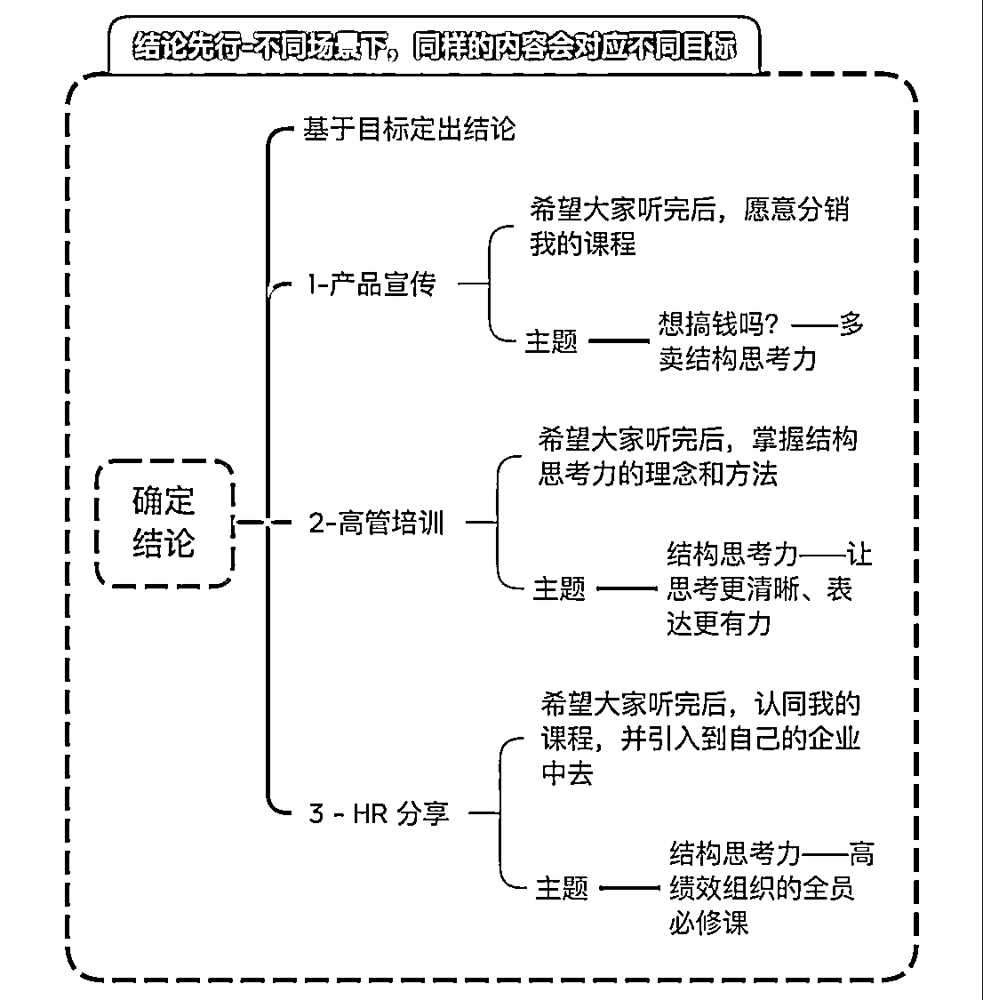

能想到的应用场景越具体、越丰富，后续调用时的速度与方案数量就越可观。

# 三、把结构化带入计划与复盘，远离形式主义

把结构思维带到日常，效果很强。我的计划与复盘方法就是这么迭代出来的。

过去也做过很多无效计划：定死改不动；复盘写成鸡汤散文，对成长帮助有限。

数月实践后，现在这套模板觉得仍有价值，拿出来分享：

## 做计划像玩滑动拼图

操作步骤：

*   先把当天所有想做的事列出来，不排先后；
*   把今天不做也无妨的剔除或暂缓；
*   对“今天不做也行但有积累价值”的标2；
*   对“今天必须推进否则会出事”的标1；
*   对“马上就要完成不能商量”的标0；
*   对“很急但可外包”的标#。

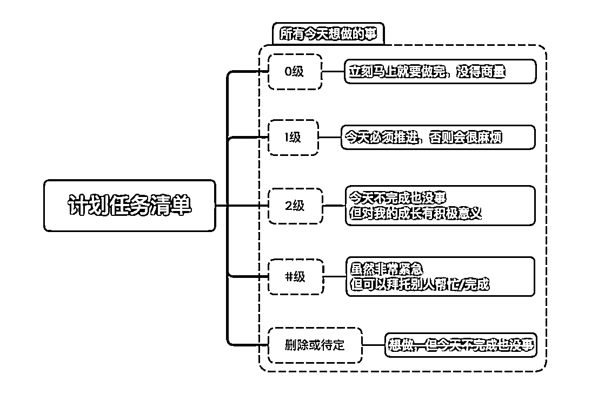

滑动拼图里所有块被困在一个框，只能推着移动，最终拼合。

做计划同理。先把无效滑块推出框，锁定必选项，再按重要度分配剩余时间，像推动滑块归位。

#类事项尽量分出去，节省注意力；0-2类事项按警报由紧到松依次完成。

排好级后，粗略估算每个事项时长，在保证娱乐与休息前提下确保可完成。若时间超支，就重新审视重要度排序，或拆分、外包、舍弃。

刚开始预估常失准，高估低估都很正常。坚持一段时间后，对自己完成各类任务所需时长与专注度会越来越准，计划会越来越顺。

我的日常习惯：上班第一件事看邮箱，明确当日工作项，再想娱乐与训练安排，随后快速列出待办并分类排序，直接开工。

这么做后时间利用率高，内耗少，精神状态稳定，也不会因忙碌忽略亲友沟通。

## 用表格做复盘，日积月累

最初的复盘是情绪化碎碎念，只是自我感动。

后来做公众号写周记，文字易滑向随笔，成了情绪按摩，实用性弱。

后来改用表格复盘。

周初建计划，每天睡前更新进度，按任务动作拆写成功记录与反思记录。周末表格填满，复盘自然成形。最后用语言衔接润色即可发布，效率很高。

我现在用的周复盘框架：

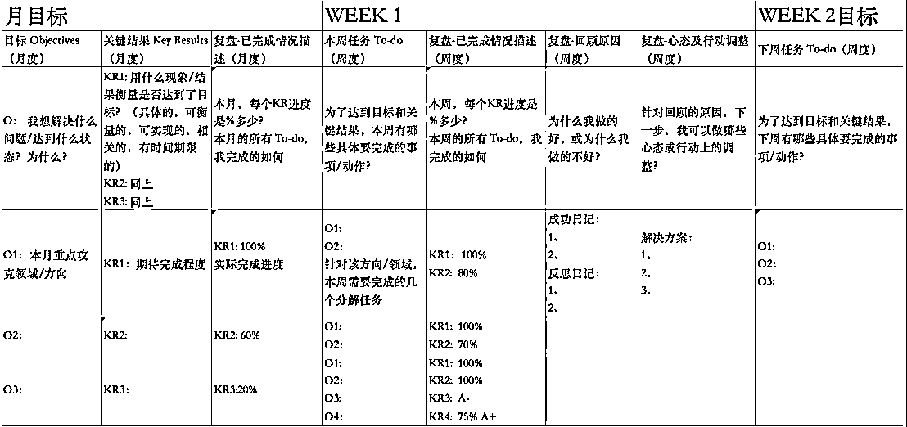

字段如下：

一、月度目标

1. 月度待办To-do，用O标记
2. 月度关键结果，用KR标记
3. 月度进度，用百分比

二、本周回顾

1. 本周待办To-do，用O标记
2. 周度关键结果，用KR标记
   （1）柔性目标打分，如B-/A+
   （2）可量化指标用百分比
3. 周度回顾-原因解析
   （1）成功记录：猛夸并提炼关键因素，促进经验迁移迭代
   （2）反思记录：只盯行为本身，找可改进点
4. 周度回顾-心态与行为调整
   聚焦反思记录的解决对策

三、下周待办

下周待办To-do，用O标记

这套复盘能把“思考”放大，让自己既看见亮点也看见短板，并针对性改善。

文章到此结束。感谢龙哥盟航海提供这次梳理与沉淀的机会，也感谢领队亮亮、组长喜得，以及自媒体启蒙导师理白老师。

愿大家能真正把结构化思维用起来，整理资料，也整理大脑，持续为人生赋能。

祝中秋国庆双节愉快！