# 12天、1300块左右，普通人也能搞定一家美国公司

想在美国挂个公司名，听起来很高门槛，其实走对路子，半个月内就能把主体跑通，下面是我实操下来的一套低成本路线。

## 启动前先备齐两样东西

1.  护照必须在手，驾照最好也备好。驾照的英文翻译件可以在支付宝里的租车类App免费申请，付个18元的快递费就能寄到。
2.  能稳定上网的网络环境，这个自己解决。

## 整体要做的事情

1.  先把美国公司注册下来
2.  再去申请EIN税号
3.  接着开银行账户
4.  最后搭上Wise个人账户和Stripe企业账户

### 想省心就交给Firstbase托管

如果你不想自己啃表格，Firstbase是一站式托管方案，涵盖注册、注册代理、会计审计工具、地址租赁。操作很傻瓜，节奏也快，唯一的代价就是贵。

Firstbase 公司注册费 $399
地址邮箱年费 $350
公司代理含年报税务工具年费 $299

一般只用这三项就够了，对应的优惠码如下：

Firstbase Start 注册公司用 优惠码：STARTFUSHENCHEN0XUR72B71A

Firstbase Mailroom 地址邮箱用 优惠码：MAILROOMFUSHENCHEN0XUR72B71A

Firstbase Agent 公司代理用 优惠码：AGENTLTFUSHENCHEN0XUR72B71A

我一开始选的就是Firstbase，先付了399，后来觉得成本太高就申请退费。他们支持资料未提交情况下7天内退款。

### 想省钱就自己DIY

#### 公司主体怎么起
不少州要求本地代理或本地公司来配合，比如怀俄明州的规定是：

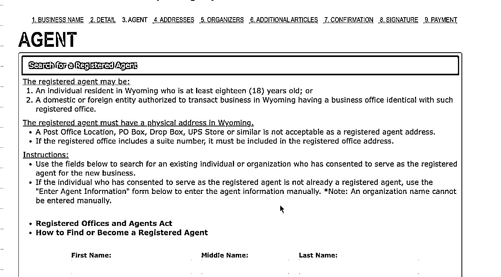

所以纯DIY难度偏大，我最后选了 Northwest Registered Agent 来跑注册，价格只要39

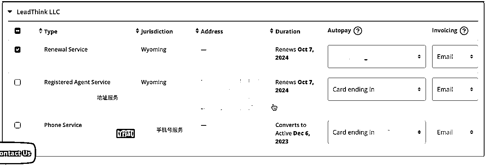

#### 具体操作步骤

##### 选州和选公司类型
这次我用怀俄明州。现阶段非美国人注册美国公司最集中的就是特拉华、怀俄明、内华达，这三个州因为运营成本低、税收友好，被大家称为公司友好州。

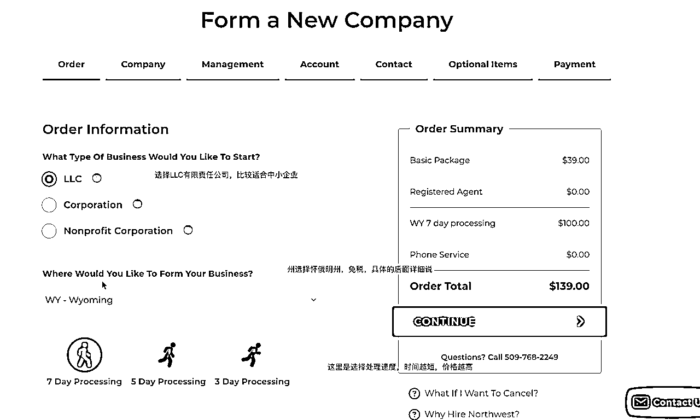

##### 公司名称和地址
取名基本自由，有限责任公司后缀必须带 LLC，比如“xxx LLC”。

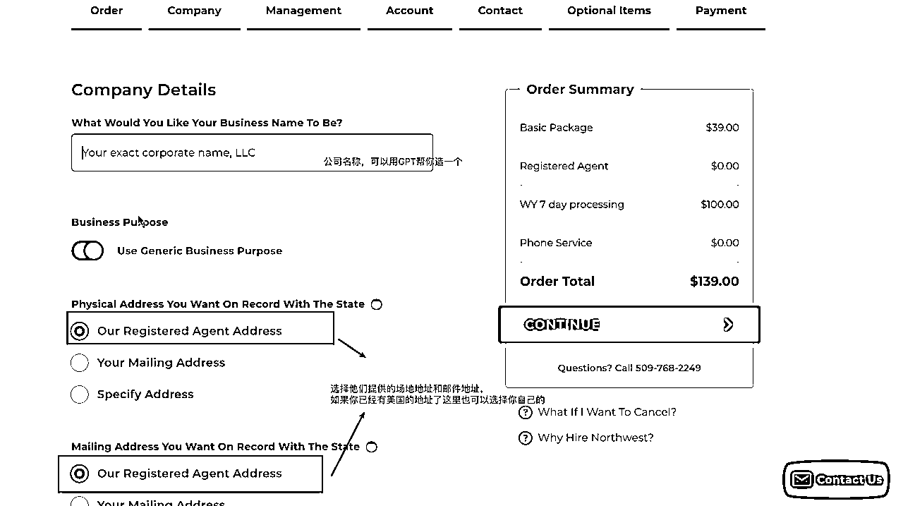

##### 指定管理人和管理人数
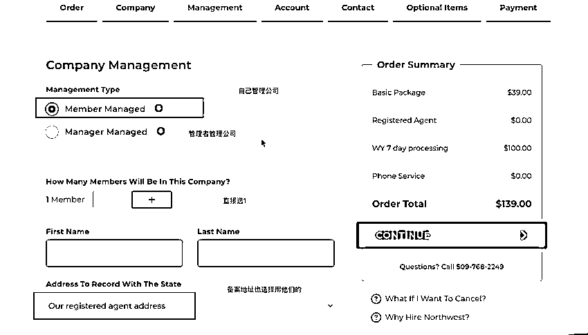

##### 设定账号邮箱和密码
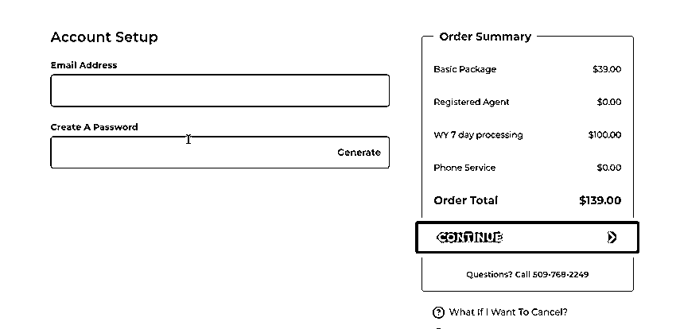

##### 填写联系方式
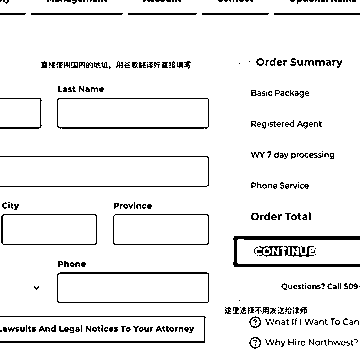

##### 选配附加服务
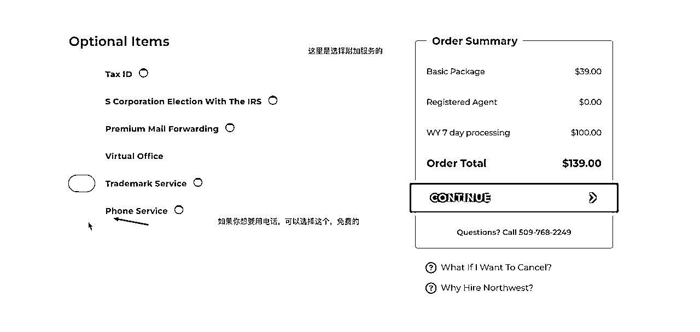

##### 付款
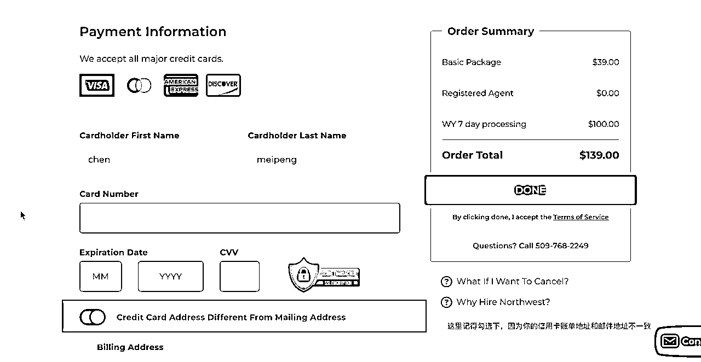

##### 用时
从提交到拿到文件大概三天，效率很高。我总共花了十多天，主要是前期换到Firstbase又退费耽误了时间。

### EIN税号免费自助申请

公司有了还不够，开银行账户必须先有EIN。这一步是省钱方案里最费手脚的部分。

#### 需要准备的材料
1.  上一步Northwest开出来的公司文件，平台上能直接下载三份，全部保存好。

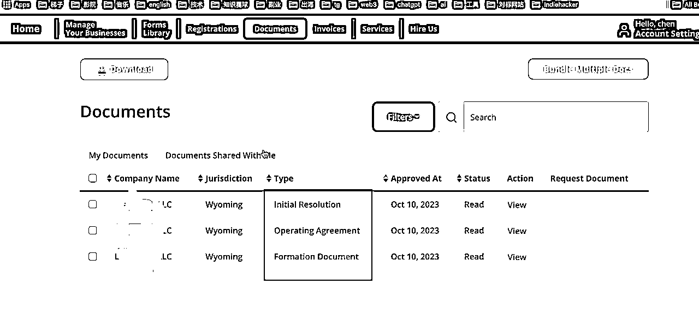

1.  下载SS-4申请表。拥有SSN或ITIN的人可以直接网上申请，大多数人没有，只能走传真渠道，周期约一周。着急的话Fiverr上20-30美金能加急2-3天出来。我选了自己弄，免费。

#### 表格怎么填
填写参考模板如下：

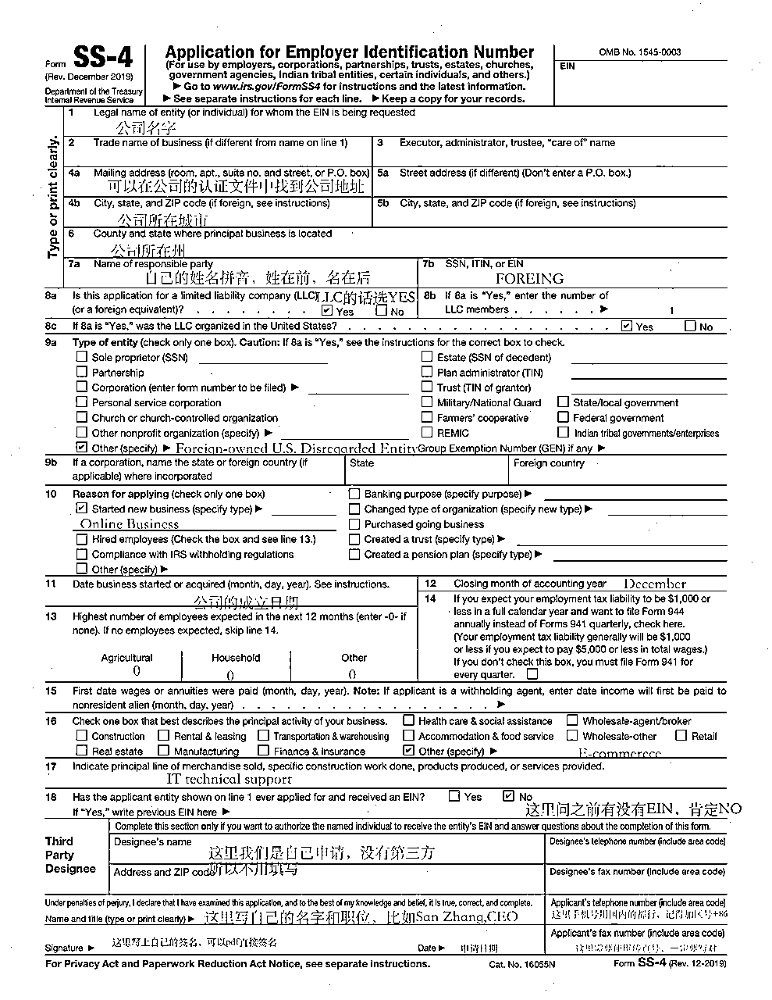

#### 传真方式提交
可以用 fax.plus 来发。注意注册时要用美国IP和美国手机号，否则拿不到美国传真号，费用8.9美元/月。我可以帮忙代发，如果你不需要自己注册。

寄送SS-4时，记得把Articles of Organization的第一页合并进去，一起传真。

Articles of Organization在后台就能找到

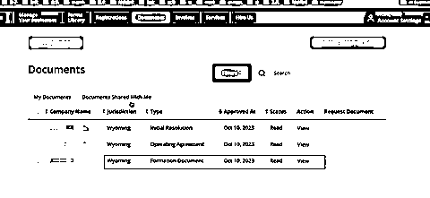

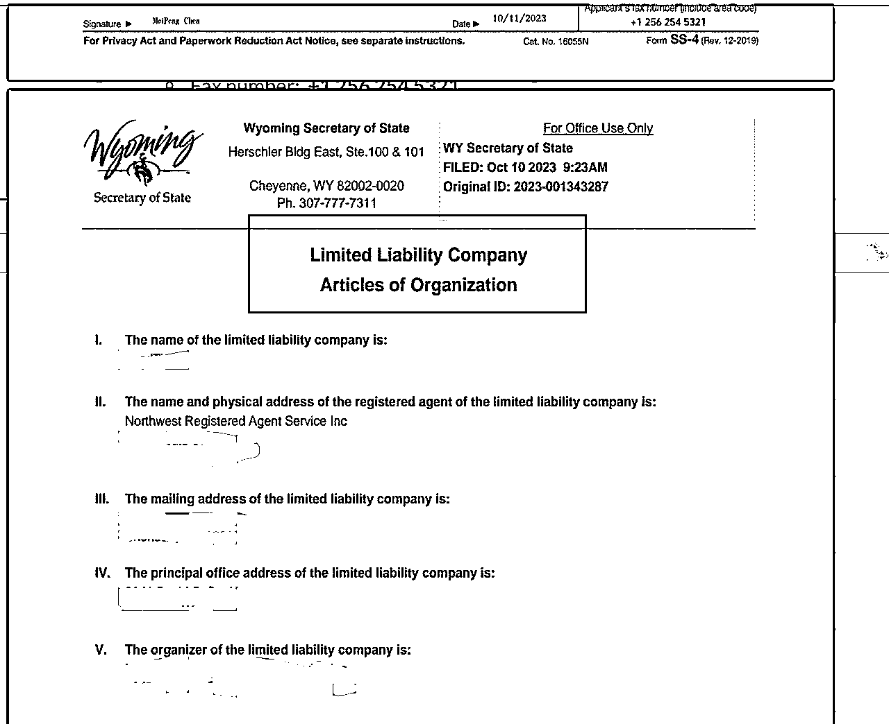

把首页拼进去，通过率会更高。

#### 回复时间
大概一周左右，fax.plus会收到IRS的邮件通知。

### Mercury银行开户
我这边还在等审批，通常2-3天出结果。用Firstbase的话他们会代办，一天就能下来，后续有进展再补充。

### Wise账户开通
Wise的好处是能直接把美元转回国内，汇率也有优势。开通美区账号需要美国地址公证和美区电话，如果开国区账号则用护照加国内地址即可，但国区有额度限制，年累计不超过50000USD，日不超过10000USD。

#### Wise怎么入金
可以用Duppy，欧易买USDT转入Duppy。我的USDT被风控了一天，第二天才放行，后续会继续更新。最省事的办法是淘宝找人代充值。

注：Duppy App目前仅港台Apple ID可下，我有账号可借用，也可自行注册。

### Stripe企业账号
Stripe还没开，等跑通了再更新。

## 花费与耗时总结

地址公证部分我还没写，官网自己提交要70美元，Fiverr找人做约20美元左右。

最终成本明细：
公司注册：139
国际驾照翻译：18¥
传真费用：8.99
美区SIM卡：Dashi SIM 卡费15欧+运费18欧 =255¥

合计：约1356¥
总耗时：约12天