# 从0到日销200万+，抖音抖店月销千万的经验复盘：终局是货架电商

大家好，我是王舒林，一个在成都打拼的重庆90后，目前All in抖音。今年五月份才开始起盘抖店，到现在单店单日最高做到了200多万，月销售额也稳定破千万。先给大家看看数据：

单店单日最高战绩（伊利锦歌专营店）：

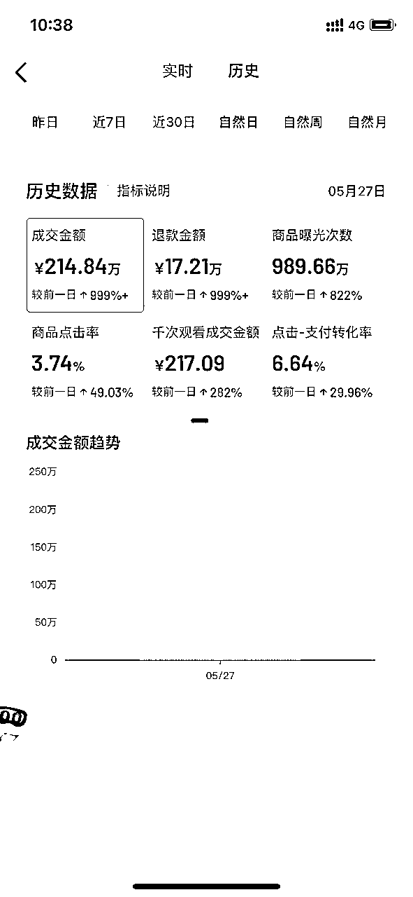

这是抖音、拼多多、京东、天猫的同期数据：

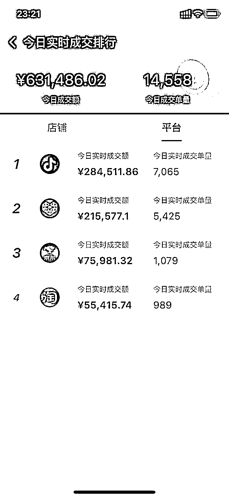

接下来，我把自己的实操心得拆成三块来聊：抖店运营干货、图文SEO/切片/自播的探索，以及我对抖音终局的理解。

## 一、抖店实战：选品是命脉，供应链和售后是底线

说实话，抖店现在不是谁都能玩的，供应链和售后这两关就能卡掉很多人。单日冲到200万的时候，意味着当天这个品类里能打的主播基本都在帮你卖，佣金和定价都要压到极低。这种操作通常是为了清库存或者冲榜，不是常态。真正决定生死的是选品。

### 1. 选品，别跟风，要匹配自己的资源

我的核心逻辑是：结合自己手头能拿到的资源和短板，挑一个真正适合你的品，而不是看什么火就冲什么。前提是你能拿到有价格优势的货，而且这个品在市场上已经被验证过了。

怎么算验证过？至少月销破万单，因为达人也会看平台最近在推什么，他们更愿意带已经卖爆的品。举个例子，我代运营的圣牧有机牛奶就做得很艰难，打开选品广场，旗舰店月销最高才3896，截图是这样的：

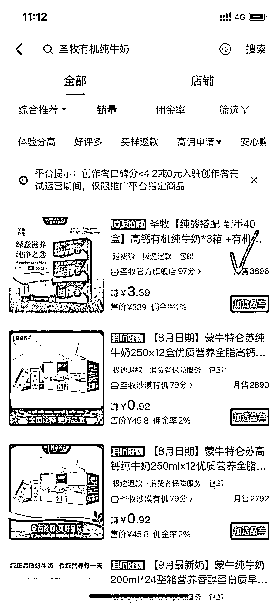

整类目月销不到1万，这种品基本就是亏钱，说明市场还没接受。抖音是单品逻辑，一条链接月销如果连2万都到不了，很难起量。

反观东方树叶，我做到月销仅次于官方旗舰店。虽然旗舰店总自己破价不让我们跟，但依然能打。

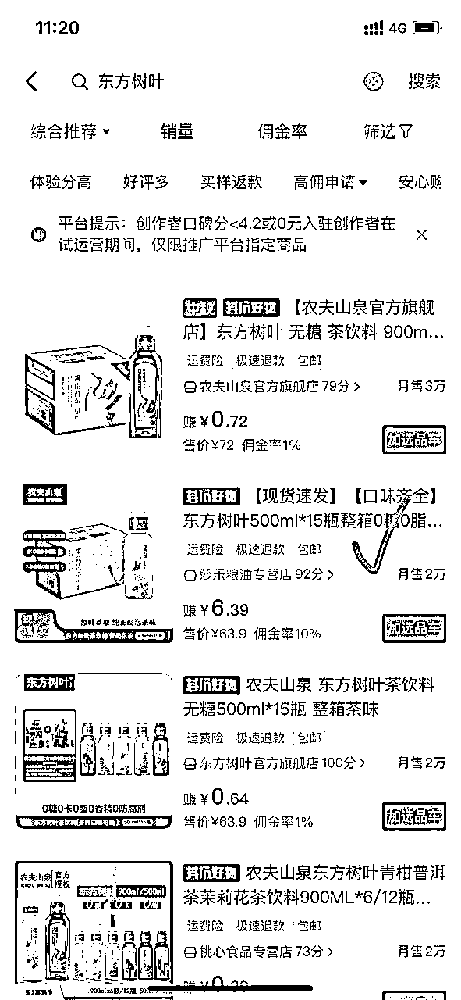

这是我操作的一些店铺：

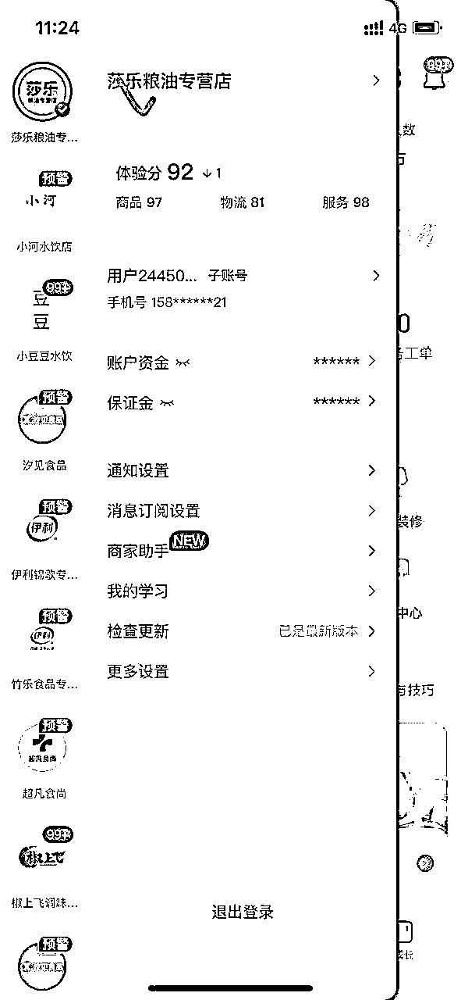

选品总结两点：
- 先看自身资源，再参考抖店后台的电商罗盘看畅销品，关键是你拿货价格有优势，那才是好品。
- 在抖音上别人没跑出来的品，千万别碰。像圣牧牛奶，小杨哥、东方甄选、广东夫妇都带过，依然没用。

### 2. 同行是最好的老师：去“抢”他们的达人资源

现在各个行业都卷到飞起，别指望“蓝海”，真有蓝海也轮不到我们。最现实的做法是去撬同行的达人资源，同时在选品广场上占住搜索位置。同行开多少佣金，你就跟多少佣金，把自己的商品挂到佣金最高的位置，搜索权重才会更高。

具体怎么操作？拿伊利牛奶举例：

第一步，去选品广场搜竞品，找到对标的同行店铺。比如搜“伊利”看销量，现在白奶缺货所以数据一般，因为年底大家都在做高端奶，预估国庆后市场会正常。这是当时的数据：

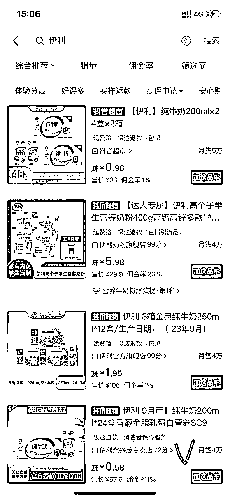

第二步，去精选联盟的达人广场，看同行合作参考，搜“伊利”，把所有能带货的达人都想办法加上。有人说“大V怎么会理我”，别担心，你对接的是他们的商务，跟商务搞好关系就行了——称兄道弟、逢年过节送礼，甚至可以许愿“你来成都我安排到位”。抖音会抽达人佣金10%，可以和达人协商线下结算，这里面的玩法自己细品。

这些是达人广场的截图：

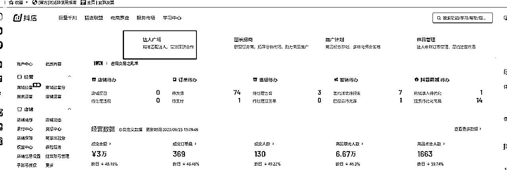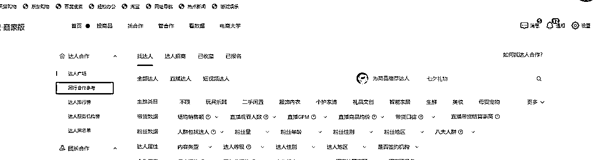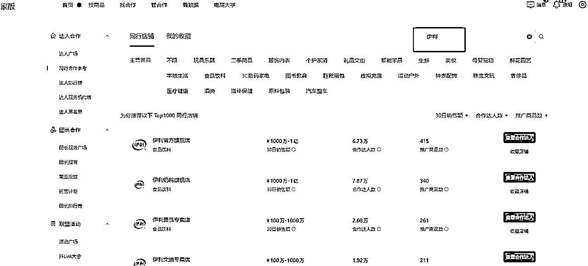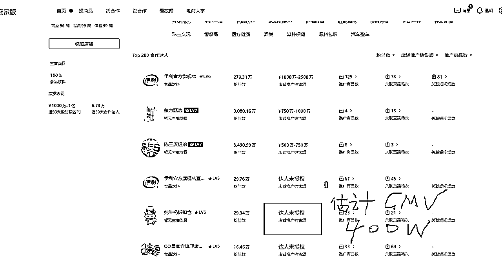

第三步，薅完同行的达人，不一定要马上带你的货，先把关系建起来。我有个朋友做达人矩阵，要求每个商务每天给达人寄10个样品，现在手里有一万多达人。对我来说，重点维护中腰部就够了，省时省力。建立联系方式的方法很多——加🛰️、找达人介绍、关注他抖音在直播间刷礼物互动，但最关键还是给达人提供好的货盘。我有时也帮同行操作他们的品，用这个方式和达人建立更紧密的连接。只要能稳定合作三五个出单达人，基本盘就稳了。

还有个找达人的窍门：当你某条链接爆了，赶紧去联系那些带过你货的达人。比如我的东方树叶，现在有25万个达人在带，可以导表把带过货且出单的记录下来，然后挨个联系，话术很简单——“你带过我家莎乐粮油专营店的东方树叶，我能给你降价提升佣金，做专属链接”，通过率几乎100%。

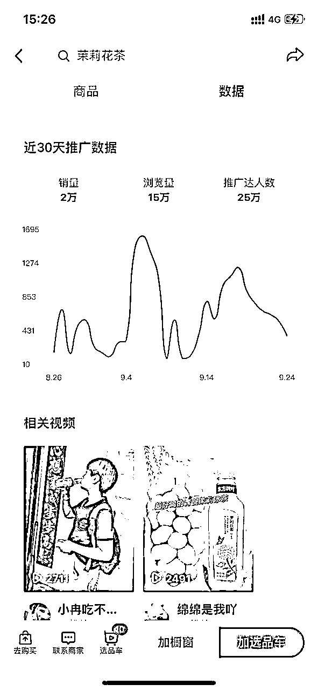

达人资源就是靠日日不断积累的，每天加几个，一个月、三个月、一年下来，你手上就有成百上千的达人。我还没有深耕短视频达人，因为他们出货太不稳定，但逻辑是一样的：提供样品、素材，甚至帮他们剪好视频分发，出单好的还可以投流支持。

第四步，积累头部达人。这个不用多说，花钱也得上。除了出货本身，在给中腰部达人的手卡上，可以标注“与超播同机制甚至更好”，刺激他们的积极性。他们甚至会直接在直播间挂这个机制来测评转化，效果很香。

这些是头部达人的截图：

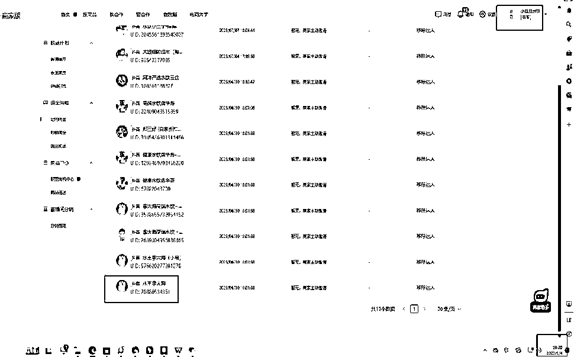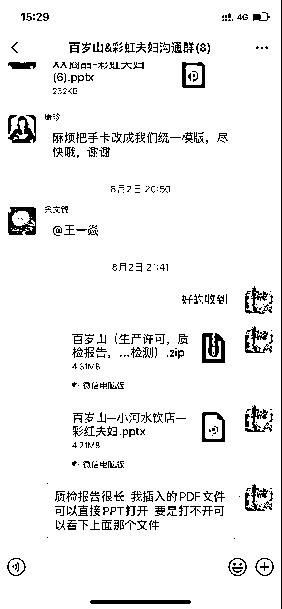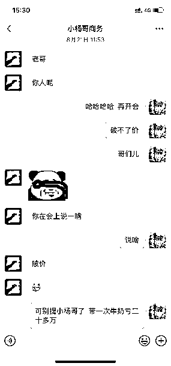

说实话，找大部分头部达人带货基本都是亏的，但只要链接爆了，自然成交带来的利润就能把亏损赚回来，还能吸引更多达人上门。

### 3. 抖店真正赚钱靠自然成交

达人直播带货的利润其实很薄。链接一旦爆掉，自然成交会源源不断，而且抖音现在主推货架电商，平台扣点2%直接免佣。所以我不建议乱投千川，目前ROI很难打平，估计还要一两年时间教育消费者。现在教投流的基本都是骗子。我朋友测试过高山脆萝卜干，月销800万左右，自然成交占了30%，是抖音萝卜干类目第一，投流基本没啥产出。

这里有个小妙招，也是我上周从同行那学的：同一个链接换不同主图和标题，抖音识别不出来，能增加自然成交。我的东方树叶就做了15个链接，现在精选联盟基本被我霸屏了，上周试了下，多了1000单左右，这周继续加。

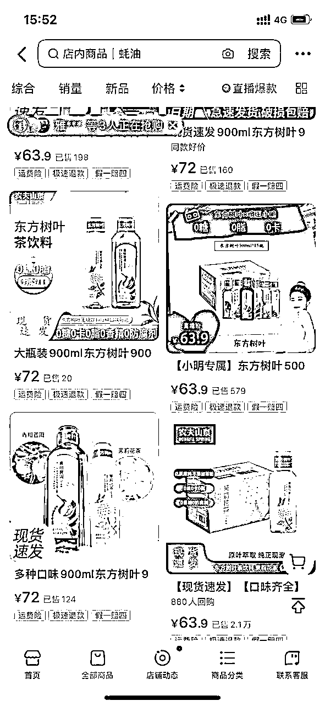

补充一下：每天加达人是必修课。另外一定要抢占那些每天播10小时以上的主播，哪怕只是挂车你的品，你的自然流量也会增加。当然，有自播更好，因为抖音推荐机制会优先推正在直播的品。货架电商那套就跟天猫京东拼多多一样，不断优化搜索关键词，报名平台活动就行。

我也兼职了彩虹夫妇的商务，如果圈友里有达人需要谈机制，可以找我帮忙。

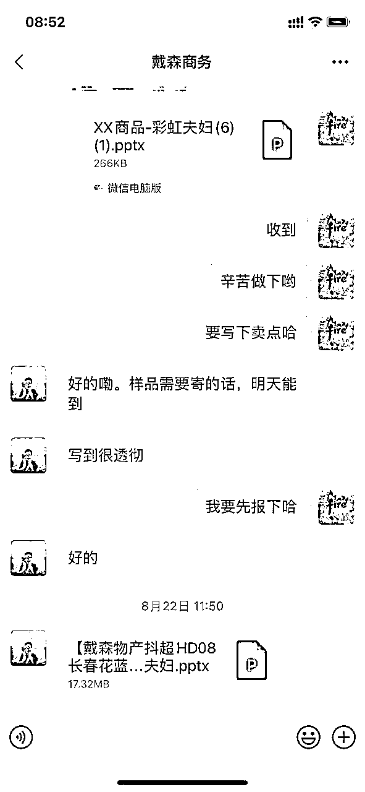

## 二、图文+SEO、超级切片、自播，这些路子怎么选？

先说图文和SEO，我自己做得比较失败，但还是想啰嗦两句：图文可以结合抖音SEO一起吃搜索流量，在红海里撕出蓝海。

超级主播切片是个好方向。比如辛吉飞切片，粉丝才6.1万，三个月卖了一千万到两千五百万。有条件的朋友可以搞小杨哥等人的切片，结合SEO来做，找大学生外包剪辑，便宜又量大，批量操作肯定能挣钱。

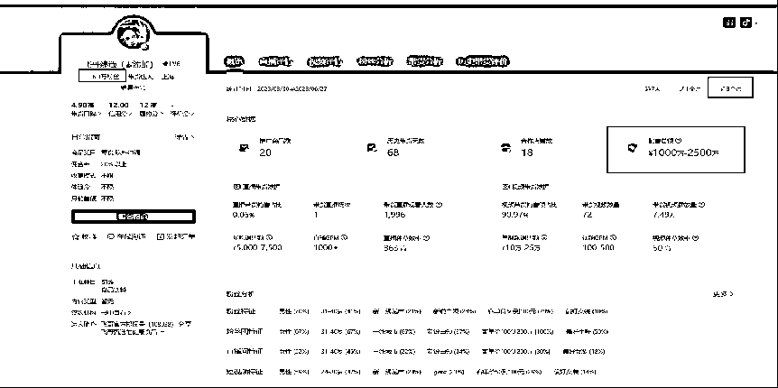

自播一定要慎重。我合伙人做自播，可以说是如履薄冰，烧钱如流水，随时可能被千川投死。主要几个坑：
- 投入大，设备和人员一个直播间起步五万，还不算投流，猛的时候一天投几万。
- 不是高毛利产品撑不过前期。
- 主播火了容易闹矛盾。
- 主播成才率低，被封概率大。
- 很费嗓子，主播周期短。

稳妥的做法是“固播”：可持续性强，人人可播、可标准化，目的就是为店铺增加曝光和产出。如果跑出了好主播，才用前面的利润去加注。我合作过一对达人，他们的自播方式最科学：两个人怼着产品播，一场能卖20万，同时兼任中控、运营、主播和助播，投入极低产出很高。自播一定得是低成本、不断迭代的；高举高打99%都会摔得很惨，比如我合伙人，我一直提他是因为这个项目我投得很少，算是小投入避坑了。

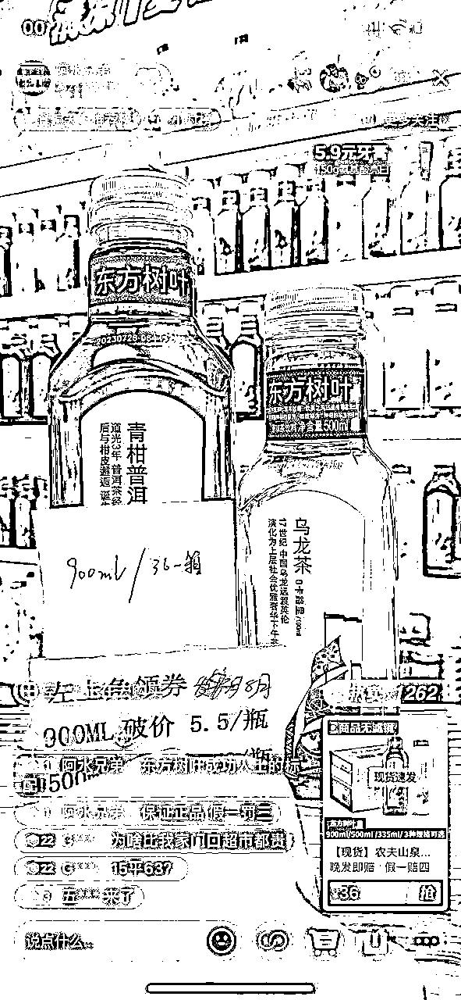

## 三、抖音的终局：所有流量最终都为货架电商服务

从李佳琦79元眉笔事件之后，很多品牌开始限制佣金。比如农夫系列产品，佣金不得高于10%，否则就算变相低价，直接罚款。

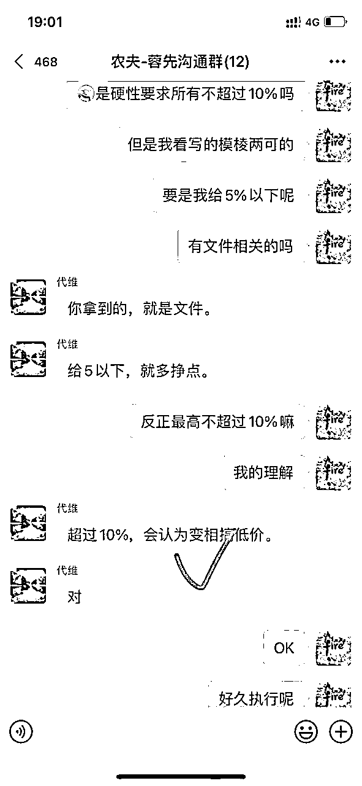

超级主播的佣金高得离谱，化妆品能给到50%以上还不含坑位费，再配合提价控价，等于割商家也割消费者，国家肯定不允许。我推测抖音也会对头部主播进行遏制、控制佣金。当然这只是我的判断。

但能确认的是：抖音的终局就是货架电商——抖店。形式变了，用传统电商思维绝对做不好抖店，必须把下面这些环节打通：

### 1. 无限达人就是无限资源，就是钱
当你的达人池足够大，出货根本不愁。运营达人是长期可持续的，我这边经常有达人突然场均在线3万+，一场带货一百多万，只要你在达人第一顺位，就能跟着赚钱。前段时间同行有六万箱百岁山要清库存，我找达人加1%佣金帮忙清掉，这就是额外收入。

### 2. 稳定的供应链
想在抖店起规模，没有好供应链不行。我要感谢得到高研院让我认识了现在的合伙人，他有一年五六个亿规模的供应链，才能撑起现在的抖店。也谢谢张潇雨老师，他的课把我带进这个领域；后来在赚钱还发现了小马宋老师，真的少踩了很多坑。

### 3. 好又多货盘，越轻越好
货不一定是自己的，没有达人需要的品，可以把达人介绍给同行，这样达人和同行都会和你建联。当你手上掌握足够多的供应链和货品，你和达人的链接就会更深。

### 4. 顶级售后
做抖店，客服主管是我沟通最多的人。发货前后都得规避问题，抖音服务分一下掉四五十分太正常了，一不小心店就没了。

所以你看，多元的货品、沉淀的达人、稳定的供应链，三者形成正向飞轮，最终由抖店来承接。这很像亚马逊的飞轮效应，当年听张潇雨老师讲这个概念，现在亲自用上了。每个环节的提升都会带动其他两个环节增长，抖店的营业额也会水涨船高。

最后，感谢圈子里的同学监督、鼓励和修正，感谢赚钱提供了这么多干货帖，让我在抖店上拿到了结果。希望这篇内容也能帮到你！