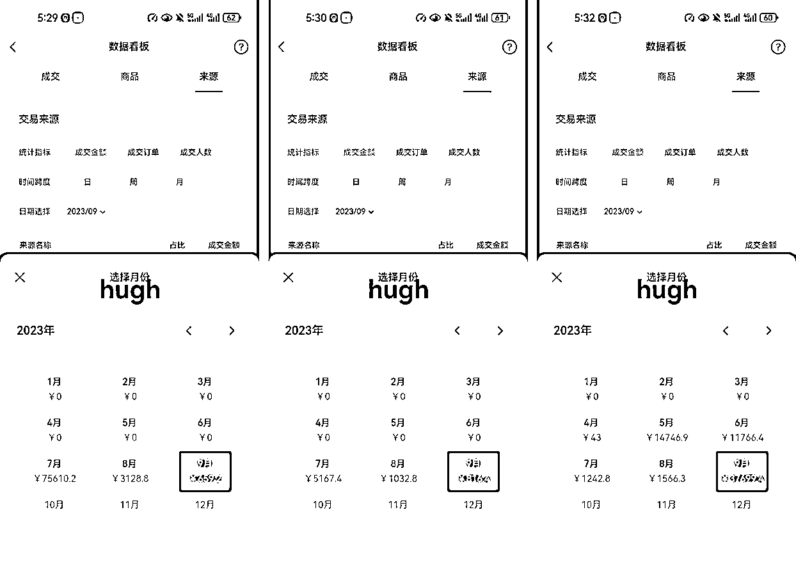
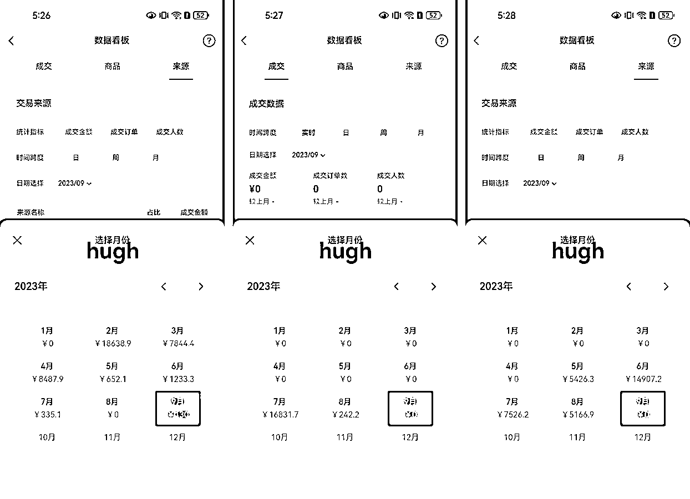

# 半年死磕一个小类目，视频号单品做到25万GMV、15万利润

大家好，我是Hugh，在赚钱混了一年多。今年2月起全职all in视频号带货，到现在单品类GMV已突破25w，净利润15w+。下面这几个核心账号的成交表现，大家可以参考。

跟市面上常见的快速上新打法不同，我走的是一条很笨的路线：半年多时间，几乎只盯一个细分赛道。下面就结合我的经历，从五个维度拆解下这套玩法是怎么跑起来的：

*   为什么细分赛道可以一直做半年以上
*   我是如何从零做到月净利5万+
*   从个位数账号扩张到几十个账号，需要哪些基础能力
*   矩阵化+自建后端路上踩过的坑
*   给还在摸索期的伙伴的一些建议

# 一、细分品类为什么能坚持久达半年

目前我仍旧是纯靠自然流在经营这个品类，内容是精剪混剪，起量后再切直播承接转化。

自然流最大的痛点就是波动大。门槛低，一旦有爆品有爆款，竞争很快挤进来，单条视频的生命周期往往就两三天，之后流量断崖，成交也随之稀少。想要持续赚钱，通常只能不断换品跟爆。

但我现在做的这个品类，从2月做到9月已经超过半年。利润区间在8k到5w+之间浮动，9月也有2w+。主账号即便都是同一种剪辑逻辑，也稳定使用了半年以上，整体上是可复制的。

以室内挂画举例，从流量和需求两个层面来解释这份稳定性。

室内挂画属于耐消品，一个款式基本不会复购，也很难围绕同一款图做太多差异化内容，同一款图的可玩性很快耗尽。所以要让生意延续下去，唯一的办法就是持续上新花色。

只要花色不断，就能不断产出新视频，就能在平台上持续拿新流量，也能持续满足不同软装需求的用户，从而不断产生成交。

同时，因为内容始终围绕挂画，号的标签会非常垂直。一旦找到一套可复用的爆款结构，流量和转化的稳定性会明显提升。当然稳定不代表每条都爆。

拉长时间看，2到9月利润大致为：1w、1w、8k、2w、2w、5w、1w、2w。细化到单月，约80%的利润集中在其中一周，剩下三周都是小额出单的维持期。

持续推新图是单品类长青的关键之一；另一方面，深耕单一赛道比跨品打品更聚焦，更容易在同类目里快速捕捉到下一个爆款，从而更快吃到红利。

当在同一个赛道多次验证成功后，心态也会更稳。即便连续三周甚至更久没有爆发，也会选择坚持。因为过往经验告诉我，这个类目有明显的周期波动，只要熬到那几天，就能用几天的收入覆盖整月。

# 二、从零到月利润5万+的路径

发现这个品其实很偶然。刷带货短视频时看到，第一个念头是“原来还有这种东西，有人买？”。

点进主页一看，该博主用同一套模板做这个品已经三个多月，每天稳定发三五条，点赞最低也有几十。于是我立刻开号模仿，开始混剪。

首日批量做了十几条，定时每天三条。第二天数据反馈不错，每条都有推荐，播放最低4k+。于是又备了一周的素材。第三天开了橱窗，但直到第六天都零成交，第七天时心里其实有点打鼓。

就在第七天下午，前面三天发布的两条视频突然起飞，立刻开播。最终两条累计播放破百万，连续播两天，净赚1w左右。

随后两个月，依旧靠这一号在支撑，每月都能有一两条破百万。尝试过原创，转化不如混剪且成本更高，最终放弃。到了4月底，账号抗压能力下降，违规增多被限流。

于是开始做矩阵，一个号扩展到三个号。很幸运，5月两个新号都起量破百万，月利润直接翻倍到2w+。

尝到甜头后，账号规模从个位数快速扩到三十多个，7月达到峰值，月净利5w+。

# 三、账号规模从几个到几十个需要的基础能力

矩阵带来的利润提升不是躺着来的，背后有一堆执行问题要解决。

## 如何在保证质量的前提下放大视频产量

矩阵的核心前提是产量能跟上。

我只做混剪，不做原创拍摄，所以关键在于：

1、拓宽原创素材的来源；  
2、在保持质感的前提下提高剪辑效率。

5月起，我通过抖音识物、同质化搜索、巨量百应等渠道，把素材源从1个扩到十个左右，基本保证供应。

视频量上，可以靠批量软件，也能靠人手提效。因为品类对前后逻辑有要求，最终选择人工精剪。6月底招了个全职助理兼剪辑、直播、客服，产量直接翻倍。

助理月薪4-5k，不可能指望她有太多创意，只能把SOP梳理清楚，让她照做。剪辑效率的瓶颈首先是素材查找。

即便有十几个原创号在手，每次从主页翻找还是太慢。于是建了一个素材表格库来统一管理。

前期录入会慢一些，后期找图和复用效率大幅提升，也能降低多号内容撞车的风险。

## 账号体量大了，怎么解决🛰️号问题

号池主要靠实名卡解决。用小运营商的卡，一人可实名七十多张，单张成本十几块含年费。初期辅助注册可以找亲友帮忙，半年后自己的号池就能自给自足。

实名使用上，我目前运营三十多个号，同时活跃十个左右，共用了4个实名：我、我老婆、一个朋友、大嫂。一个人最多可开通5个🛰️支付，处于冻结状态的号理论上可无限叠加，用到时人脸解冻即可，不占用当年实名次数。

## 设备与网络怎么配

设备要结合业务选。起步时买了红米11T做参考，结果直播效果不理想就放弃了。苹果直播没问题，但不支持原生多开。最终选择7台二手nova7，单台千元内，原生多开+直播表现都够用。

网络方面，有人建议发视频前切飞行模式换IP，操作繁琐。我现在的方案是：同实名🛰️只在一台手机登录，每台手机配独立流量卡，日常不连WiFi。尽量模拟真实个人使用，减少IP降权等内耗。

现在用的卡是广电和联通的月租9-19元，30G流量。

# 四、做矩阵和自建后端过程中踩过的坑

8月起我花了一个月时间注册公司、接入优选联盟、谈厂家，后端基本跑通。在不大幅增加时间成本的前提下，毛利从50%提升到70%。如果打算长期深耕一个品类，自建后端是必选项。下面是几个教训：

#### 没吃透小店入池规则，打乱节奏

当前入池标准大致是：店铺评分>4.3，且结算订单>100单。

我7月底就开了店，以为8月初就能全量切换。实际出单到结算要20天，导致8月上半月很多计划被打乱。

#### 没早点接入打单系统，错失新品红利

9月中旬前单日订单都在百单内，人工复制到1688下单也能扛住。9月中旬突然来个新品爆款，优选联盟的链接少且转化差。我用自营店迅速上架优化款，2k+单成交。

第二天订单量暴增，手工处理已来不及，被迫停播停推，只能先把订单消化完。

后来与厂家对接了店管家，视频号小店月费20元，可把订单自动同步到厂家后台，实现自动打单、发货、回传运单号，基本零人工。

做后端一定要提前确认供应商的系统对接能力，别等爆了再去谈。

#### 别在关键设备上省钱

4月底准备矩阵时，手头没多少钱，用父母淘汰的千元机注册号。刚开始还能用，发视频时就卡顿，严重影响效率和心情。

咬牙换了高配机后，发现大部分号已因风控无法迁移，又耽误了一波启动时间。

手机属于固定资产，做短视频带货必备，早买晚买都要买，别因小失大耽误节奏。

# 五、给还在跑通期的朋友一句忠告

别想太多，坚持对标抄袭不动摇。

我22年8月在视频号赚到第一笔钱，2小时6k+。之后几个月却一直在试错。因为我对普通人创业的认知不够，总想按自己的想法瞎搞，结果一直没起色。

盗坤说过，他赚钱的时候都是在照抄成熟模式，瞎搞的时候就亏。连大佬都这样，我们新手更不该自嗨。

等你在某个赛道浸泡足够久、拿到验证结果后，再做微创新才有爆发可能。

我7月的成绩，本质上就是在基本功稳住的基础上，做了个口播微创新，一条视频播放到500w，之前最高100w+，两天赚3w+。现在很多做混剪的同行还在用我那条口播。

我的深耕模式未必适合所有人，但它确实最适合当下的我。在一个品类活下来，把矩阵、直播、后端等基本功打扎实后，未来复制到其他品类会容易很多。