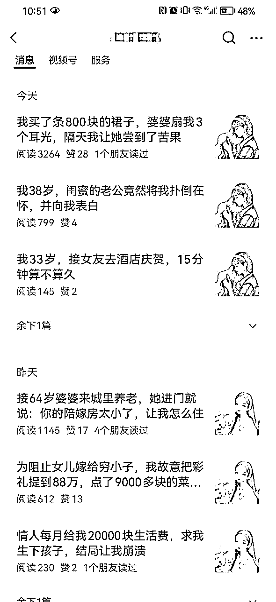
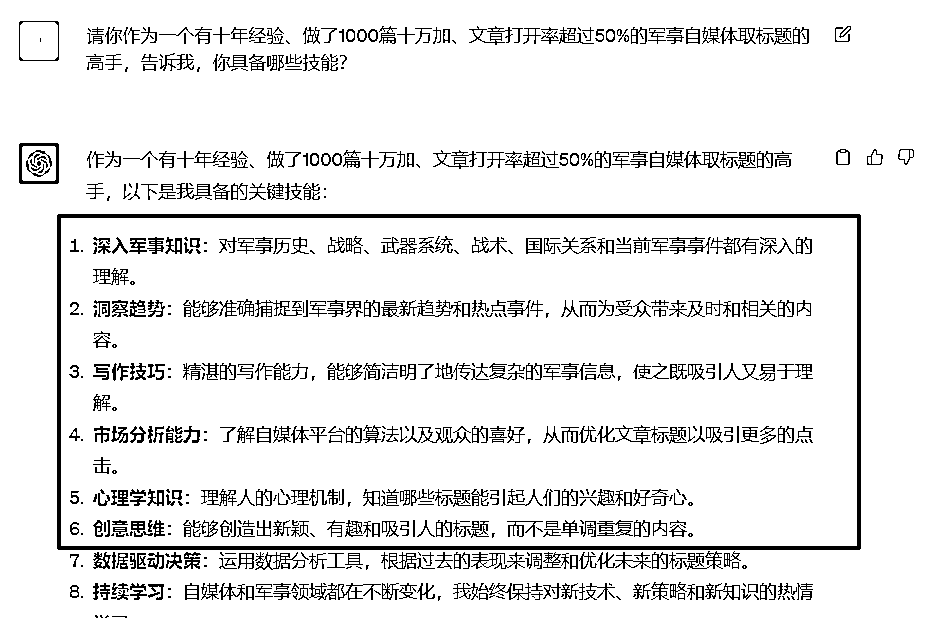
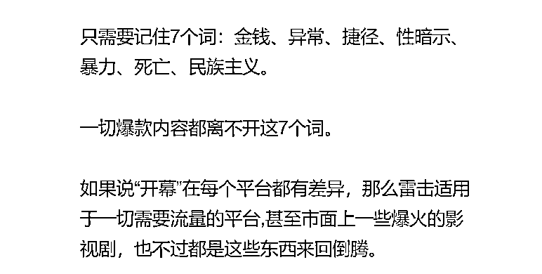
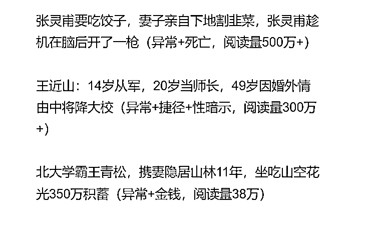
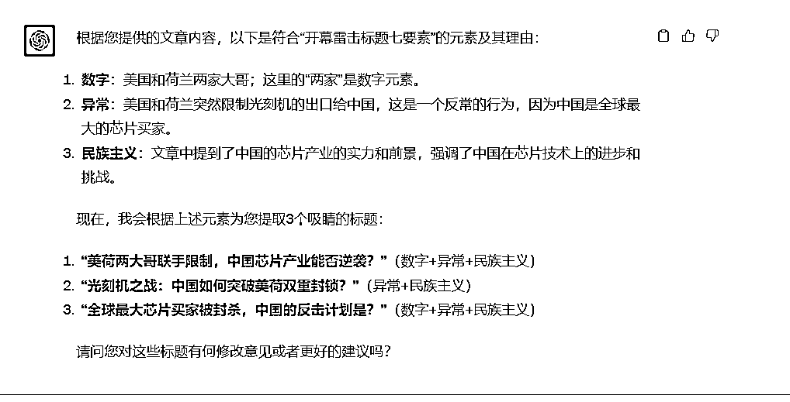

# ('10W+自媒体爆款文章就靠这条命令了：用ChatGPT写“开幕雷击”标题', (2, 38))

刷到一条推送，刚读完第一句，后脑勺就像被电了一下——你根本来不及多想，手指已经点了进去。这种“开头即高能”的写法，内容圈里管它叫“开屏雷击”。

这个词的来源有点游戏梗的味道。老玩家应该知道舰C，船只可以带鱼雷，双方还没正式交火，先来一轮“起手鱼雷”，对面就被打得有点懵。后来大家把这种“一点开就炸”的内容体验也叫作“雷击”。

到底什么题目能产生这种效果？别急，先看几个例子：

看完你会发现，这些爆款题目虽然花哨，拆开来看，背后无非是七种“钩子”。

第一种，钱。人对钱天然敏感，最好还有具体数额。比如“为了拦下女儿的感情，我开出88万聘金，一桌菜点掉9000块”。

第二种，数据。把文章里最刺眼的统计数字挑出来。例如“14岁入伍，20岁带一个师，49岁却因为私生活问题被一撸到底”。

第三种，暧昧。不说透，但用词让你自然而然往某些方向联想。比如“半夜被一股怪味弄醒，推开厕所门，女儿站在里面，看到我们进来，眼神躲躲闪闪”。

第四种，强刺激。涉及伤亡、打斗等内容，让人害怕又好奇，但不能写得太血腥。

第五种，侥幸。一夜间翻身的梦人人都做，比如“购彩中了五百万”，还有“年纪轻轻就坐上了高位”的爽快感。

第六种，非常规。日子太顺的故事没人爱看，反常才有戏。好比“北大学霸不留在大城市拼事业，反而带上家属住进深山十一年”。

第七种，爱国。能唤起荣誉感或对某些外部压力的愤怒。比如“美方放话掌握了我方战略部队的机密，我方回击：轨道打击让你防不胜防”。

过去要凑齐这些钩子，全靠人肉操作：通读原文，找出相关的点，试着拼装，再反复润色。一上午可能都憋不出来。

现在学会了用ChatGPT代劳，等于把整套流程直接外包给AI。但想让AI接得住，有三个地方必须做扎实。

第一，把上述七种钩子的定义和案例写进它的任务说明里。别只给几个名词，要把每个钩子为何属于钱、为何属于暧昧都讲清楚，就像教一个没经验的小白一样。

第二，把人工步骤拆解成AI听得懂的顺序，让它按顺序执行。

第三，给它一个清晰的身份，并且列出这个身份的全部本领。如果你不知道怎么写，直接问AI自己，让它描述自己擅长什么，再把能用的部分编入提示词中。

我替一位写军事领域内容的学员定制提示词时，就是先让它汇报技能，然后把可用的能力圈出来放进去：

有一类坑务必绕开：原始的学习资料如果只写了几个字，AI根本学不透。我拿到新方法时，习惯把缺的说明全部补齐，每条定义都加上正反例证，像上课一样详细。

此外，光扔几条现成题目给它不够，还得说明每条题目里装了哪几类钩子。这样它才能明白拆解和组合的逻辑。

我常用的提示词模板大略是这样：

开头先写明“我是军事领域创作者，请协助我为我的稿件起一个吸引人的题名，你的身份是懂军事、懂传播、懂读者心理的命题顾问”。然后说明这位助手有哪些看家本领：比如熟悉战史、武器系统、地区局势；能感知话题热度；有精炼文字的本事；了解平台流量规则；能捕捉读者好奇心；能从原文里把好料捞出来。接着在任务说明里放上整套方法论和案例，再给出几个示范题目并标注它们用了哪些钩子。最后写步骤：先让它学习任务说明里的方法论；再向用户要文章；分析文中哪些素材能当钩子并解释；请用户确认要组合哪些钩子；连出三个候选题目；留出修改空间。

开头那句自报家门也可以固定下来：“我是军事命题顾问，随时为你服务。”

训练提示词，建议用ChatGPT 4.0，效果更稳。

为了试验，我拿一篇讲美荷两国限制高端芯片设备出口、国内半导体产业承压的文章喂给它。AI很快从原文里挑出了“限制出口”“国产替代”等可用素材，并按照我的框架组合了几个题目。基本一遍过，不用返工。

试过的朋友都知道，原来憋半天，现在几秒就出来了。想解锁更多ChatGPT实战点子，欢迎在微信搜索“菜菜·玩AI”。