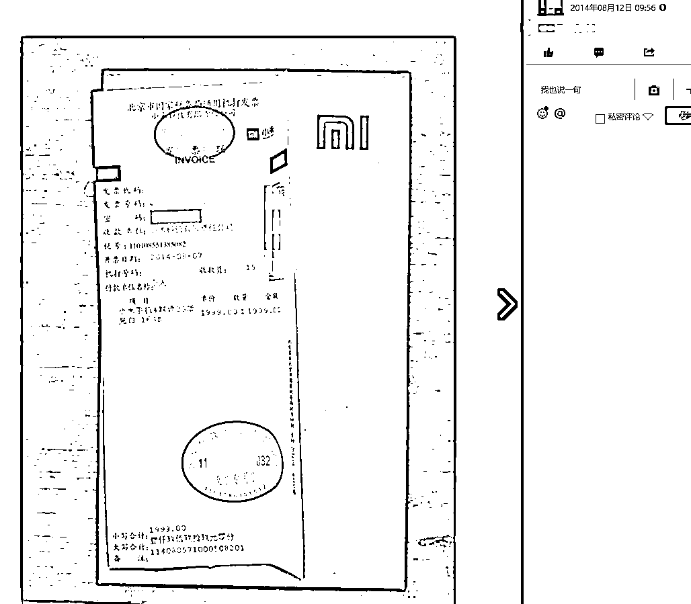
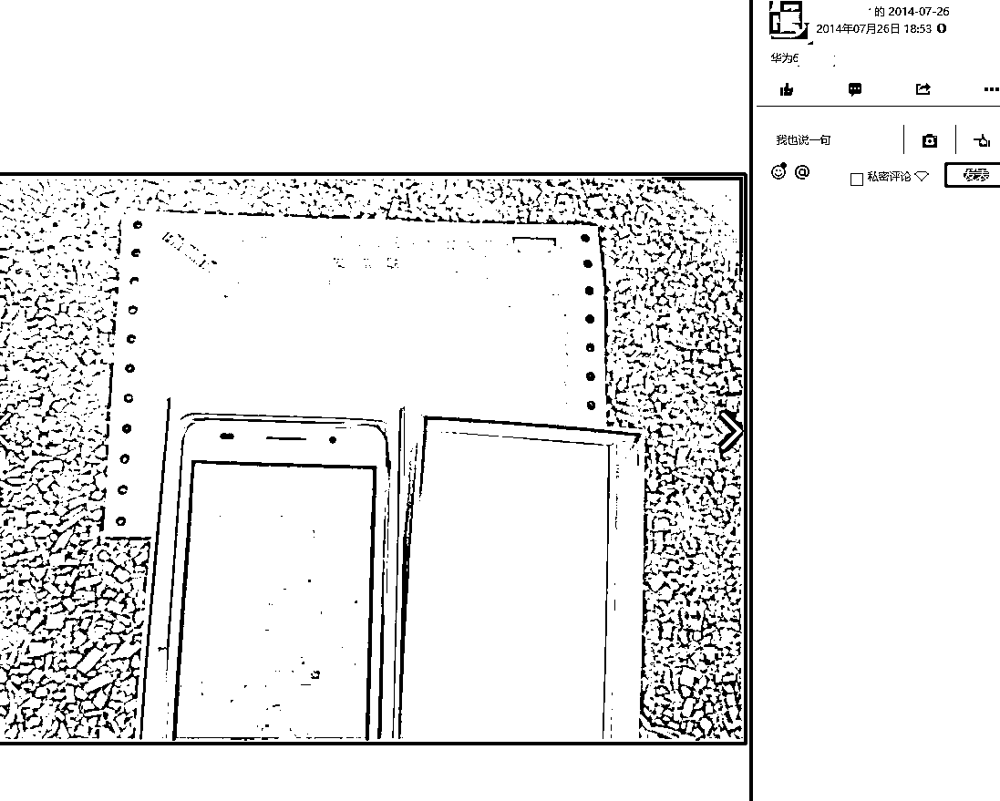

# 撸货行业二出三进，我才想明白这事情原来应该这么干
作者：龙哥

2013年前后，我靠倒腾手机赚到人生第一笔“信息差”的钱。那会儿还在初中，懵懵懂懂就摸到了黄牛的门道。市场机制很简单，只要有人买不到，就有人愿意加价求货。

## 开局靠“腿勤”

那年代的搬砖市场还属于小众情报战，不像眼下，视频、图文、社交平台随手一搜全是经验分享。真正难的不是抢，而是抢回来卖给谁。

我老家在县城，出货全靠熟人和地推：

- 同班同学——🐧空间吼一嗓子
- 家附近的长辈关系网——爸妈帮忙牵线
- 县城手机维修摊——挨家挨户问要不要货

当时念书还得盘算哪天请假回趟家，好赶上抢购节点。外面人看着觉得这小子从小就会搞钱，将来肯定有出息，但那会儿付出的代价我后来才尝到滋味。整个中学时代都在追货、囤货、出货的循环里转，最后高考翻车，倒腾进去一整年复读。

## 停手的原因

真正让我收手，是身边的人“长大了”。过去那批熟客，到了大学以后自己就会上网下单了，没人再稀罕从你手里加价拿货。而我也慢慢意识到，每一分钱赚回来，背后都有账本要算。当成本盖不住回报，就不是生意，而是消耗。

大学期间其实我又碰过搬砖，还拉了个学弟一起干。那阵子的“百亿补贴”，规则松得跟没有似的，想买多少买多少。只要肯开口，班里的、社团的全能喊来帮刷单，收益来得特别轻松。

后来的事大家都清楚，人一多，平台就开始收紧：券限量、单子被砍、区域限制，一个接一个冒出来。新手赶上好时候进场，又因为下不了单无奈离场，来去都快。

到了大四，周围的同学全都忙着找实习、投简历，我自己也意识到，今天赚几百，不代表明天还有。手里一个月能有个四五千，但没法保证每个月都这么稳。边想边瞄着别的机会，原来的执着也就慢慢松动了。

***

再说回到后来的“重启”，这次我没急着动手，而是停下来想清楚了一件事：搬砖这个事，光靠勤奋是不够的，得学会算账、看人群、选品类，还要懂一点别人不懂的东西——比如信用卡积分换里程的逻辑，再比如积分收益和商品收益打通的算法。

具体怎么一步步玩转的，放到下篇细聊。