# 2小时半搞定！微软×领英「生成式AI职业证书」速通实操笔记

# 开头先说清

哈喽，我是龙珠圈的飞掌柜。这篇分享讲的是怎么高效拿到微软和领英联合发布的「生成式人工智能职业证书」。全程我只用了 GPT-3.5 和 Claude，完全不依赖 GPT-4，门槛很低。

考试名额只有三次，所以我给大家准备的是一套 2小时30分钟速看视频+过考的打法。但这并不等于走捷径，务必先记住下面三条底线：

1.  视频本体和单元小测本身质量很高，认真刷完真的能学到不少实用的 AI 概念，考过自然顺理成章；
2.  这次我刻意用 Claude 和 ChatGPT 来解题，一是把原本 3小时49分课程 + 30分钟小测 + 1小时40分终考的整天消耗压缩下来；二是顺带验证一下，用生成式 AI 去应付生成式 AI 的题目，命中率到底如何；
3.  工具给出的答案是中文，我建议你一定要过一遍眼睛。翻译、复述、粘贴这几个动作本身就是复习，全程保持思考。实操下来，全神贯注 2个半小时，学完+拿证完全够用。

【考试入口】https://www.linkedin.com/learning/paths/career-essentials-in-generative-ai-by-microsoft-and-linkedin（需🪜，建议用 Google 邮箱或微软邮箱登录）

# 证书是什么来头

2023年7月，微软和领英正式上线了这张生成式 AI 职业证书。

官方定位是这样的：帮你掌握在工作中运用生成式 AI 所需的核心技能。

1.  建立对生成式 AI 模型的认知框架。
2.  了解使用生成式 AI 时的伦理边界。
3.  认识生成式 AI 工具对职业场景的冲击。

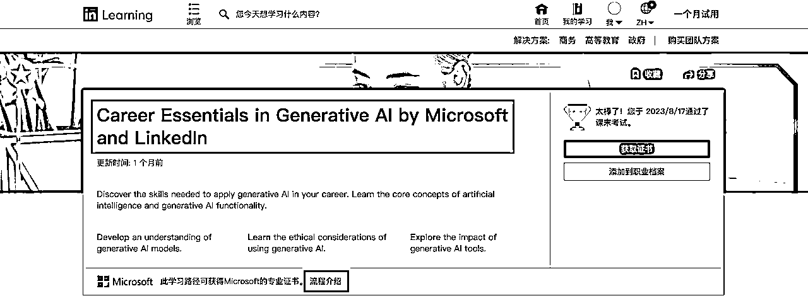

# 拿证只要三步

按官方规则，完成这三件事就能领证：

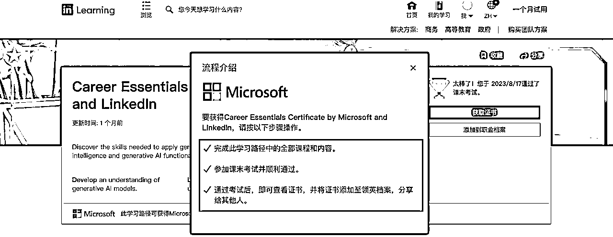

1.  课程全是视频，共 5 个主模块，每个主模块下拆成若干小节；
2.  全部看完后系统会显示完成时长，可一键同步到领英个人档案，同步后档案会显示已收录；
3.  课程清零后可解锁结业考试，正确率 ≥70% 即算通过，可下载 PDF 证书，截图保存即可传播。

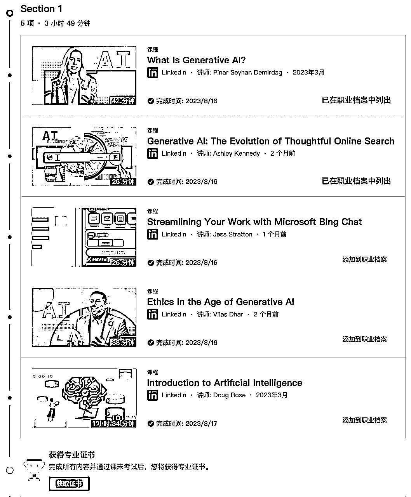

# 视频怎么快看

1.  播放速度调到 2 倍；
2.  字幕切成中文；
3.  开启自动连播：视频会自动进入下一条，但第一单元结束后会弹出【试用领英会员一个月】和【观看免费视频】两个选项，必须手动点【观看免费视频】，之后就不再打断。

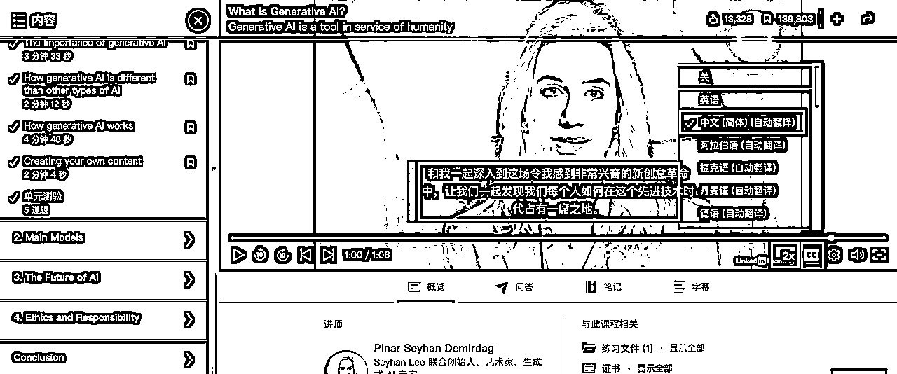

# 单元测验速刷法

1.  看完单元最后一个视频会自动弹出测验，屏幕会出现倒计时。别慌，时间走完也不影响拿证。你可以先把整单元视频看完再统一做；
2.  做对做错都不影响证书发放，可无限重做，还能看标准答案和解析；
3.  用工具提效：我用 Claude 辅助，实测正确率约 95%。操作举例：

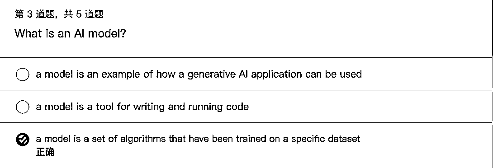

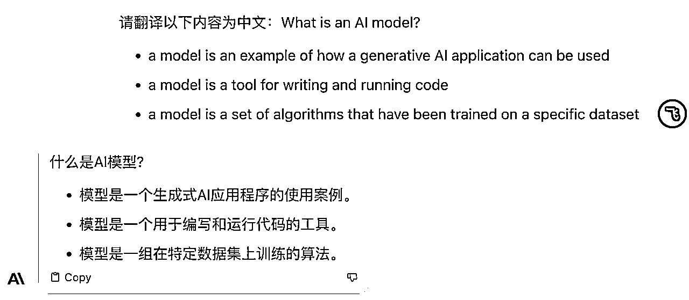

1.  上面这种方式基本等于只做翻译，我按视频内容选 C，太费劲；
2.  改成下面这套指令，模型会直接给出正确答案并附带解释。我只要看到「第三个选项」四个字就点选，后续解释还没生成完我就已经在发下一题的指令了；

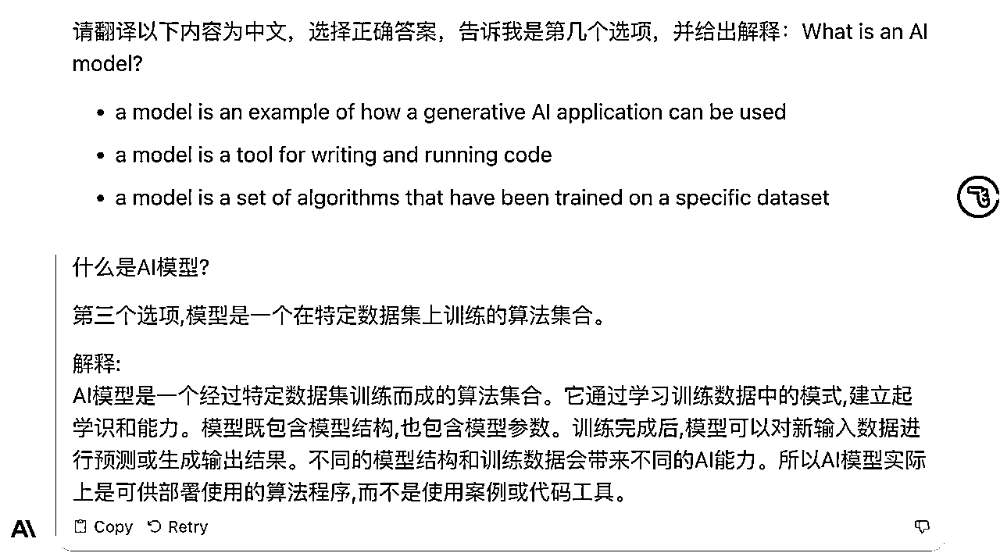

1.  这已经不只是翻译，是把 AI 当学习搭子。我们考的就是生成式 AI，用 Claude 这种生成式工具去解题，体验真的很顺；
2.  按此节奏把所有单元测验刷完，合计约 10 分钟；
3.  官方显示的课程时长是 3小时49分钟，倍速不改变显示时长，所以实际我用时不到 2 小时；
4.  如果你愿意手动做也没关系，可重复刷，错了还能立刻看到正确答案，反复记忆效果更好。

# 终极考试 15 分钟通关

终考仅有 3 次机会，要求正确率 >70%。按我的流程，15 分钟就能稳过。

1.  复制题目：考题页面不支持直接复制文本，我用的是截图 + 图片转文字。常用组合是 iShot 截图 + CamScanner 识别。
2.  丢给 ChatGPT 作答：指令模板同上，我用的是 3.5 版本，你也可以试 4.0。模型会直接点出正确答案，实测准确率约 90%，一次过没问题。

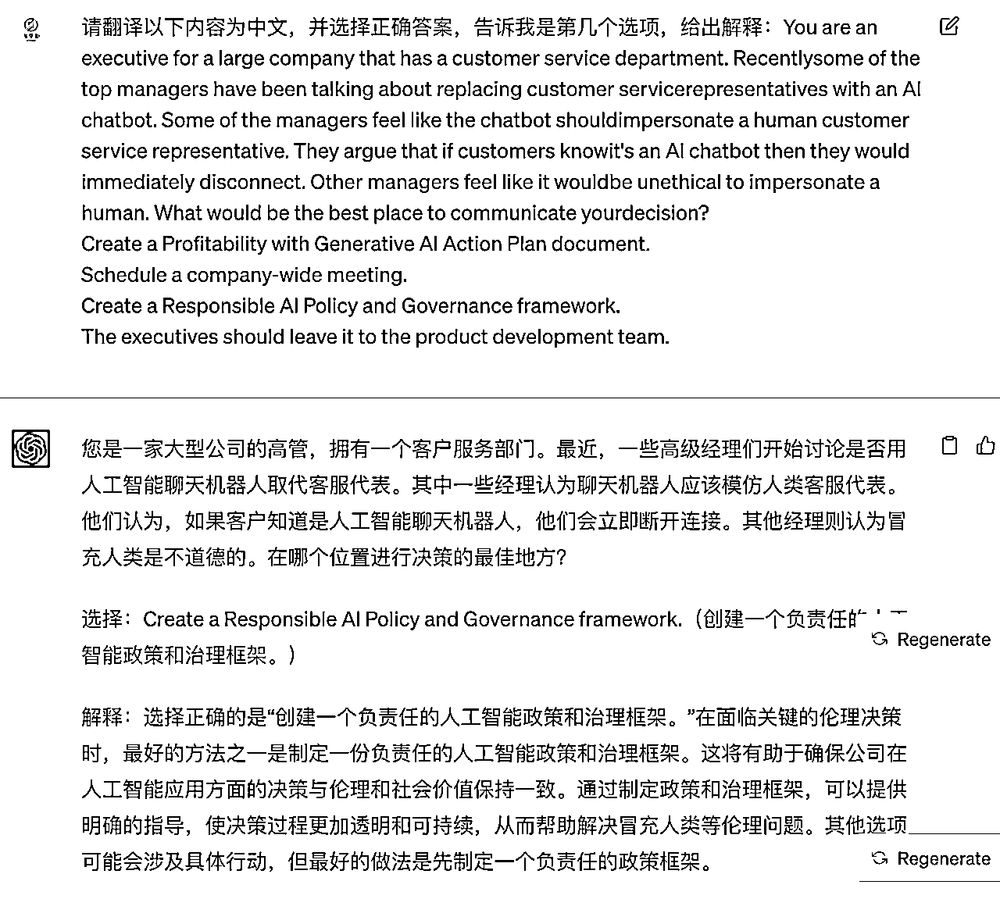

# 两种证书怎么区分

1.  课程完成证书在学习页面的右下角，只有领英 LOGO。5 门课全部打卡后即可下载，适合和主证书一起晒朋友圈；
2.  考试合格证书在考试通过页和课程主页都能下载，证书上同时带有领英和微软的双 LOGO。

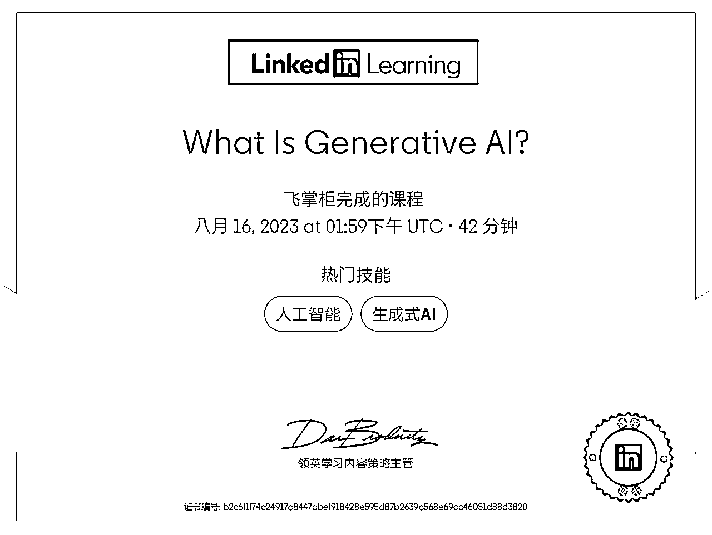

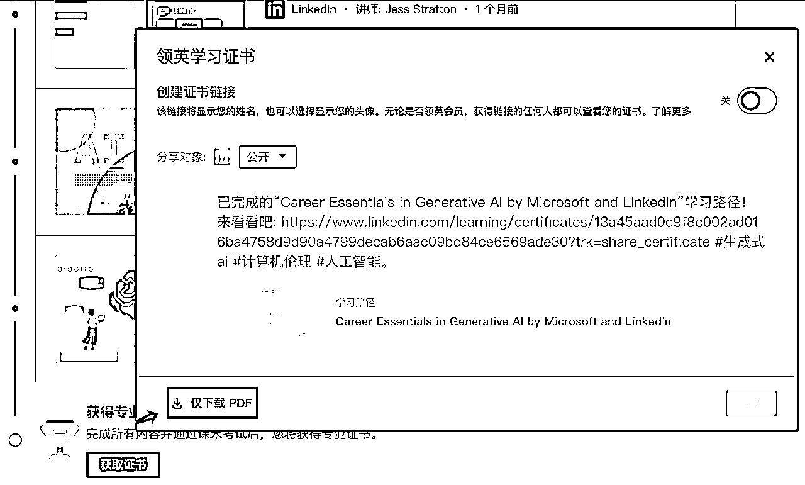

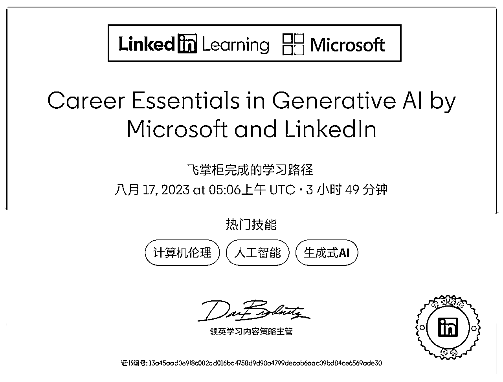