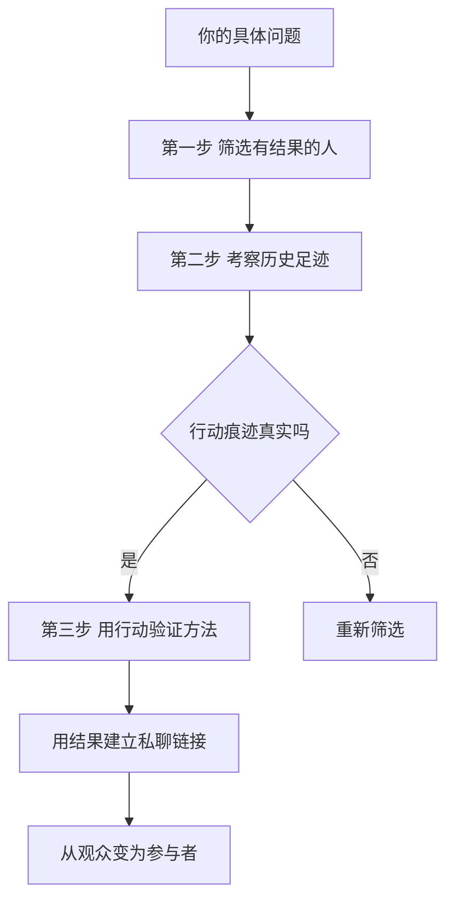
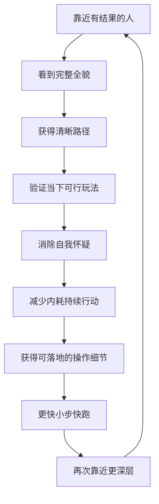

# 第 5 章 行动与向高手靠近——从高认知穷人到知行合一

## 学习目标

- 理解当下有结果的人的精准定义并能区分其与泛泛头部大V的本质差异
- 掌握行动痕迹的判定标准并将其作为筛选考察靠近对象的客观依据
- 完整复述并熟练运用三步靠近法实现从旁观者到参与者的身份转化
- 识别高认知穷人的陷阱理解认知与行动脱节的核心原因及危害
- 能够阐释靠近的复利收获的三层结构并据此设计自己的靠近行动计划

## 5.1 生活类比

向高手靠近是一场拜师学艺的旅程。想象你初入武林，想学一套剑法——这时你最需要的不是一位名满天下的剑圣，而是一位恰好精通你正在练的那套剑法的侠客。**当下有结果的人**，就是这位恰好擅长你当下课题的侠客；**行动痕迹**，是侠客练武场上的木桩——那些刀剑留下的砍痕证明他真实地练过、战过，而非只是嘴上谈兵；**三步靠近法**，则是你拜师的完整路径：先筛选出最合适的侠客，再观察他的练武足迹，最后自己先练出几分样子再上门求教。而观众在台下鼓掌欢呼，永远无法成为舞台中央的表演者。只有亲身参与的实践，才能完成从认知到行动的跨越。

## 5.2 概念地图

```
行动与向高手靠近——从高认知穷人到知行合一
├── 第一部分 识人辨材：当下有结果的人与行动痕迹
│   ├── 当下有结果的人：解决你具体问题而非泛泛大V
│   └── 行动痕迹：可追踪可验证的过去行动证据链
├── 第二部分 三步靠近法：从旁观到入局
│   ├── 第一步：初步筛选解决你问题的人
│   ├── 第二步：点开头像考察历史足迹
│   └── 第三步：用行动验证价值后私聊链接
└── 第三部分 认知跃迁：高认知穷人与复利收获
    ├── 高认知穷人：知而不行是成长的隐形陷阱
    └── 靠近的复利收获：全貌、信心与细节的三重回报
```

## 5.3 当下有结果的人——找对人比找对道理更重要

> [P001, p.1] "有结果的人是在解决你正在遭遇的这些问题上有结果的人"

这是整章的地基。我们首先要分辨一个常见的认知偏差：**把"有结果"等同于"名气大"**。你刷到的百万粉丝博主、行业领袖、成功学导师，他们或许在很多领域都有建树，但他们未必解决过**你正在遭遇的那个具体问题**。

> **当下有结果的人**定义（来源：《靠近有结果的人》）

> 一个在"解决你当前正面临的具体问题"上已经取得实际成果，并且其成果可以被追溯验证的人。

这个定义有三个关键属性，我们用一张表来拆解：

| 属性 | 含义 | 反例 |
|------|------|------|
| 针对性 | 解决的是你的具体问题，而非泛泛而谈 | 行业大V谈的是通用方法论，不针对你的赛道 |
| 可验证性 | 成果伴随可审查的行动痕迹 | 只晒收益截图，无过程记录 |
| 真实性 | 结果可追溯，而非包装人设 | 转载、转发、晒书单不等于亲自做过 |

为什么我们要把"针对性"放在第一位？因为人的精力有限。你今天面临的可能是"小红书冷启动没流量"的问题，也可能的是"自媒体变现路径不清晰"的问题。一位财经大V纵然才华横溢，但他没做过小红书，他的建议对你就是"正确的废话"——听起来都对，做起来无用。

再来关注"可验证性"。这一步是筛选的**客观标尺**。仅凭自我介绍和头衔无法判断一个人是否真有结果——头衔可以包装，自我介绍可以美化，但一个人过去几个月甚至几年的公开行为轨迹很难造假。

> [P001, p.2] "你面临的不仅是项目技术问题"

作者在这里提醒我们：你遇到的往往不只是单一的技术难题，而是一整个情境。所以你需要的人，是在这个**完整情境**中走过来的人。这也是为什么泛泛大V不适用——他们离你的真实战场太远。

最后是**边界**：有结果不等同于大V，更不等同于成功学导师。一个每天输出正能量语录的人，可能自己并没有在你要做的方向上取得任何进展。你要找的，是那个已经在你向往的战场上淌过水、踩过坑、拿到过结果的人。

## 5.4 行动痕迹——让靠近从直觉变成证据链

> [P001, p.3] "靠近的核心是看到更多有结果的人的行动痕迹"

有了筛选标准，我们接下来要建立一个用来考察的**证据体系**——行动痕迹。

> **行动痕迹**定义（来源：《靠近有结果的人》）

> 可通过公开渠道追踪到的、反映一个人过去真实行动的可验证证据集合，包括但不限于帖子、评论、历史实战日志、项目复盘等。

这里我们要区分三种"伪靠近"与"真靠近"：

| 行为类型 | 是否构成靠近 | 原因 |
|----------|--------------|------|
| 点赞 | ❌ | 零成本、零信息交换 |
| 加好友 | ❌ | 只是建立连接，未验证价值 |
| 考察历史足迹并行动验证 | ✅ | 产生了真实的互动与信息获取 |

行动痕迹为什么可靠？因为它同时满足三个特性：

**第一，可验证性。** 公开渠道的历史记录难以篡改，造假成本极高。一个人如果说自己"做过100个小红书账号"，那他的主页应该能看到对应的运营记录、数据截图、复盘笔记。

**第二，连续性。** 行动痕迹反映的是一段时间的行为轨迹，而非一次性的高光时刻。你看到的是他三个月前、半年前、一年前的记录——这些记录拼凑出来的，才是真实的行动曲线。

**第三，它是三步靠近法第二步的核心考察对象。** 这个我们会在下一节详细展开。

> [P001, p.3] "第二步点开头像看历史足迹"

这句朴实的话背后有一个深刻的道理：**头像和简介是"人设"，历史足迹才是"人格"**。人设是精心设计的展示面，而历史足迹是日积月累的真实行为——两者之间的差距，恰恰是判断一个人是否值得靠近的关键。正如作者所言：

> [P001, p.4] "给有结果的人点赞不算靠近加好友也不算靠近"

围观者的点赞与加好友，本质上是"观众席上的鼓掌"——你为自己的焦虑寻求了一丝慰藉，却没有真正获得对方的价值。真正的靠近，必须建立在考察行动痕迹并产生真实互动的基础上。

## 5.5 三步靠近法——从观众席走向舞台中央的操作手册

> [P001, p.4] "第一步初步筛选你可能需要解决的问题上有结果的人"

知道要找有结果的人，只是认知层面的升级；但要真正落地，你需要一套可执行的操作路径。这就是三步靠近法。

> **三步靠近法**方法（来源：《靠近有结果的人》）

```
1. 第一步：初步筛选——找到在解决你当前问题上已有结果的人
2. 第二步：考察足迹——点开头像，查看其历史帖子、评论、实战记录
3. 第三步：行动验证——先用行动验证其方法的可行性，再私聊建立链接
```

这段伪代码展示了一个**递进式**的靠近路径。每一步都是下一步的资格前提：没筛选就考察会浪费精力；没考察就链接是盲目社交；没验证就咨询是单向索取。

我们来逐一解析每一步的操作要点：

**第一步：筛选。** 筛选的依据是上一节的定义——有结果的人。你需要列出自己当前最紧迫的1-3个具体问题，然后针对每个问题去寻找解决了它的人。注意筛选的颗粒度：不是"做自媒体的人"，而是"在小红书冷启动阶段做到1万粉的人"。

**第二步：考察。** 这一步是把候选对象从"看起来有结果"验证为"真的有结果"。你需要翻阅他的历史足迹，回答三个问题：

| 考察问题 | 判定标准 |
|----------|----------|
| 他是否真实做过？ | 有过程记录、实战日志、阶段复盘 |
| 他的行动是否连续？ | 足迹分布在时间轴上而非一次性爆发 |
| 他的结果是否可验证？ | 有数据截图、成果展示或第三方背书 |

**第三步：行动验证后链接。** 这是最容易被忽略也最关键的一步。作者强调的是"了解并用行动验证后"再添加私聊咨询。也就是说，你要先自己动手——按照对方的方法做一遍，有了真实的体验、反馈甚至小成果之后，再带着问题去链接。这时候你的提问才是有质量的，你的链接才不是索取而是交流。

> [P001, p.4] "第三步了解并用行动验证后可以添加私聊咨询"

这句话的结构值得我们画一个数据流图来理解整个方法的流转逻辑：



这个流程图揭示了整个方法的底层逻辑：**每一步都在增加你的沉没成本，而沉没成本恰恰是让你从"围观"走向"参与"的动力**。当你付出了筛选的精力、考察的时间、行动的验证，你就自然地完成了从旁观者到参与者的身份转变——因为你已经投入了，你已经"在局中"了。

## 5.6 高认知穷人——知道得越多越要警惕做得越少

> [P001, p.5] "很多人成为高认知穷人是因为只听道理却不做"

这是一个令人不安但必须面对的真相：**你可能就是那个高认知穷人**。学了很多课、读了很多书、收藏了很多帖子，但生活并没有实质性的改变。

> **高认知穷人**定义（来源：《靠近有结果的人》）

> 只明白道理却不通过实践转化为动作的人，其认知水平与行动水平之间存在显著落差。

这个定义揭示了一个成长的悖论：你学习得越多，就越容易陷入一种**"认知舒适区"**——因为你知道了很多概念，大脑产生了"我掌握了"的错觉，于是更不愿意去动手。

高认知穷人有两大特征，我们逐一剖析：

**第一，不作为性。** 他们停留在听道理、记笔记的阶段，却迟迟不落地为具体动作。笔记记了三本，项目一个没做；课程听了十门，作品一个没发。认知的输入远大于行动的输出。

**第二，遮蔽性。** 高认知反而制造了改变的错觉。因为你懂了很多理论，你觉得自己"已经领先别人了"，于是这种优越感成为拒绝行动的借口——"我知道方法了，只是还没时间做"。这句话的潜台词是：我把"知道"当成了"完成"。

我们用一个对照表来审视这个陷阱：

| 维度 | 高认知穷人的状态 | 知行合一的状态 |
|------|------------------|----------------|
| 学习方式 | 囤积知识、收藏帖 | 学一个用一 |
| 对道理的态度 | 点头认同、记笔记 | 动手验证、调整 |
| 时间分配 | 大量输入、少量输出 | 输入输出交替循环 |
| 心理状态 | 懂了很多，但焦虑 | 做了一点，但笃定 |

> [P001, p.5] "通过一次次实践调整认知和动作最终达到知行合一"

作者在这里给出了解药：**知行合一不是一次性顿悟，而是一次次微小实践的累积**。你不需要等到"完全想通"再行动——事实上，你永远等不到那一刻。你需要的是，在一个大致方向的指引下，先做出第一个动作，然后根据反馈调整认知，再调整下一个动作。如此循环。

真正的转化在于实践，而不是多学一个概念。"高认知穷人"是成长路上最大的障碍，它看似无害——毕竟你在学习、在进步啊——但实际上它在用"认知的忙碌"掩盖"行动的懒惰"。认清这一点，是你走出困境的第一步。

## 5.7 靠近的复利收获——一次靠近三重回报

> [P001, p.6] "1看到更完整的项目全貌；2看到当下可行的玩法不自我怀疑；3看到落地性强的操作细节"

靠近有结果的人需要投入时间与行动，你自然要问：**这值得吗？** 作者给出的答案是肯定的，并且不止一个理由——靠近有结果的人会带来三重叠加的复利收获。

> **靠近的复利收获**发现（来源：《靠近有结果的人》）

> 真正靠近有结果的人，可以获得三层递进价值：看清项目全貌、验证可行玩法免于内耗、获得可落地的操作细节。

我们来拆解这三层收获的层次结构：

**第一层：看到更完整的项目全貌。** 当你还在外围围观时，你看到的只是项目的冰山一角——光鲜的成果、漂亮的数字。但当你走近，你会看到完整的路径图：他是怎么开始的、中间经历了哪些失败、什么阶段做了什么决策。这种全貌视野，是你规划自己路径的地图。

**第二层：看到当下可行的玩法，不自我怀疑。** 很多人的内耗源于不确定："这条路真的走得通吗？""是不是我方法不对？"当你看到有人正在用一套具体的玩法跑通你的目标时，你的焦虑会大幅缓解。"原来这么做是可以的"——这个确认本身就是巨大的价值。

**第三层：看到落地性强的操作细节。** 全貌是战略层面的，细节是战术层面的。只有真正靠近，你才能看到那些从公开内容中无法获知的执行细节：具体用的工具、时间安排的节奏、遇到卡点时的处理方式。这些细节，才是让你"从知道到做到"的最后一步。

我们用一张数据流图来展示三层收获如何构成复利效应：



这个循环展示了"复利"的含义：**三层收获互相强化**。看清全貌让你有信心行动；信心减少内耗让你能持续行动；持续行动让你获得更多细节；而更多细节又让你更加接近核心圈层——于是你进入了一个正反馈的上升螺旋。

但请注意边界：**这些收获的前提是真正的靠近，而非点赞加好友的围观姿态**。作者最后用一句话做了总结：

> [P001, p.6] "观众只会焦虑参与者才能走近舞台"

这句话道破了本章的核心命题——你选择做观众还是参与者，决定了你收获焦虑还是增长。

## 5.8 多源对照

本节涉及的素材均出自同一篇文献（《靠近有结果的人》），但其中涉及多个概念模块，我们将其做内部分解对照，以呈现概念之间的结构关系。

### 共识

所有概念模块共享同一个底层逻辑：**认知必须通向行动**。"当下有结果的人"定义了行动的目标方向；"行动痕迹"提供了行动的客观依据；"三步靠近法"给出了行动的路径；"高认知穷人"警示了认知与行动脱节的危害；"复利收获"则是行动的回报激励。五者构成一条从"识人"到"行动"再到"收获"的完整链条。

### 分歧

| 概念模块关系 | 潜在张力 | 处理方式 |
|--------------|----------|----------|
| "当下有结果的人" vs "高认知穷人" | 前者强调找对人，后者强调自身行动——两者孰先孰后？ | 作者的处理：先找对人（识人辨材），再用行动验证（知行合一），两者是先后递进而非二选一 |
| "三步靠近法"第三步 vs "复利收获" | 第三步要求"先行动验证再私聊"，但行动验证本身可能消耗较多时间 | 作者的处理：行动验证本身就是复利收获的一部分——你在验证中获得了全貌与细节，即使后续链接不成功也不亏 |
| "行动痕迹"的可验证性 vs 现实中的信息噪声 | 并非所有人的公开痕迹都是真实的，可能存在伪装 | 作者的处理：用"连续性"标准过滤——持续的真实行动难以长期伪装，这也是为什么必须看"历史足迹"而非单个帖子 |

## 5.9 设计中的取舍

### 为什么不是直接链接"头部大V"，而是要先筛选"解决你具体问题的人"？

头部大V的优势是显而易见的名气和资源，但这也意味着极高的连接门槛和极低的互动质量。你直接加一位百万粉大V的好友，大概率得到的是"已读不回"。而"解决你具体问题的人"通常还在成长期，他们更愿意分享、更渴望链接、更有可能与你产生真实互动。这个设计的 trade-off 是：你可能放弃了与"最厉害的人"链接的象征性满足感，但换来了"最合适的人"的实际帮助——从解决具体问题的角度，后者价值更高。

### 为什么靠近的第一步是"考察足迹"而不是"直接私聊"？

直接私聊看起来效率更高——省去了考察的时间。但你想想：如果你连对方的真实水平都没有验证过就私聊，你的问题大概率是泛泛而问，对方给出的回答也是泛泛而答，你得到的还是"正确的废话"。而考察足迹的过程，既是对对方的验证，也是你自己学习的过程——你从对方的行动历史中已经能学到很多东西。这个设计的 trade-off 是：考察阶段需要投入时间成本，但换来的是更高质量的提问、更有针对性的互动，以及行动验证后的平等对话资格。时间没有浪费，它转化为你的认知资本。

## 5.10 动手练习

1. **筛选当下有结果的人：拆解你的目标对象**
   设定当前正在遭遇的具体问题，根据三大要素（针对性、可验证性、真实性）筛选 3 个值得靠近对象，列出问题证据与行动痕迹。

2. **设计你的三步靠近行动计划**
   基于筛选的最合适对象，运用三步靠近法制定详细行动计划，明确每一步的时间节点、考察标准与验证方式。

3. **诊断高认知穷人状态：自我复盘与定位**
   回顾 6 个月内学到的 5 个知识，逐一做知行转化自检——区分哪些只是"知道了"，哪些已经"做到了"。

4. **区分围观与参与：重写你的互动方式**
   找出最近点赞、收藏、转发的 3 次经历，分析为何不算靠近，并重新设计参与式互动（行动验证+有价值提问）。

## 5.11 本章小结

这一章我们完整走完了一条从"识人"到"行动"再到"收获"的成长路径。首先，我们定义了**当下有结果的人**——他不是泛泛的头部大V，而是解决你当前具体问题上已有真实成果的人，其成果必须伴随可审查的行动痕迹。其次，我们将**行动痕迹**确立为考察靠近对象的客观证据链——它可验证、连续、造假成本高，是分辨"人设"与"人格"的关键标尺。接着，我们完整学习了**三步靠近法**——从筛选到考察再到行动验证后的链接，每一步都在增加你的参与度，最终完成从旁观者到参与者的身份转化。然后，我们剖析了成长路上最大的隐性障碍**高认知穷人**——知道但不做到，用认知的忙碌掩盖行动的懒惰，其解药不是多学一个概念，而是通过一次次实践循环达到知行合一。最后，我们总结了**靠近的复利收获**——看清全貌、免于内耗、获得可落地细节三层回报互相强化，构成正反馈的上升螺旋。

本章我们一起学习了以下概念：

| 概念 | 解释 |
|------|------|
| 当下有结果的人 | 在解决你正遭遇的具体问题上已有成果的人而非泛泛头部大V |
| 行动痕迹 | 反映一个人真实行动的可追踪证据是靠近和考察的客观依据 |
| 三步靠近法 | 从筛选到验证再到链接的递进路径完成从旁观者到参与者的转化 |
| 高认知穷人 | 只懂道理不落地为动作的人认知与行动严重脱节是成长的最大障碍 |
| 靠近的复利收获 | 真正靠近带来全貌信心与细节三层回报且互相强化 |

下一章中，我们将进入"持续行动与迭代"的主题——在完成了向高手靠近的第一步之后，你将面对如何保持行动节奏、如何应对反馈与调整方向的问题。高手不只给你方向，更给你一套持续逼近目标的方法论。
