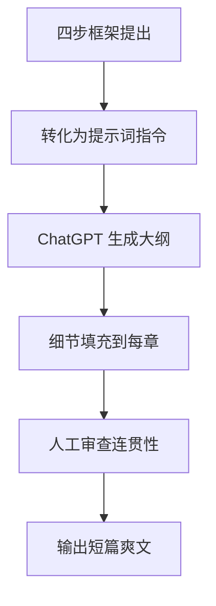
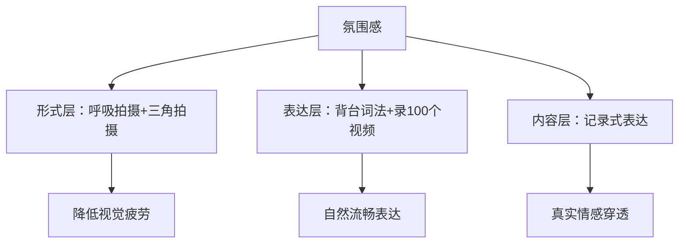

# 第 6 章 内容创作进阶论——从爽文叙事到氛围感传播

## 学习目标

- 理解注意力稀缺时代对内容创作的根本性挑战
- 掌握四步爽文写作框架的结构化拆解与情绪递进逻辑
- 能够运用AI辅助创作方法论并明确其能力边界
- 理解口播3.0从说教式到氛围感转型的核心逻辑
- 掌握营造口播氛围感的实操方法矩阵
- 能根据平台特性和用户偏好选择合适的内容形态与迭代策略

## 6.1 生活类比

内容创作是一场街边小吃摊的竞争。想象一条小吃街，几十个摊位挤在一起，顾客从你面前走过只停留 3 秒。如果摊位的招牌不吸引人、香气不够浓，顾客根本不会停下来——这就是注意力稀缺的残酷现实。爽文四步框架就是一道爆辣小串的烹饪流程：先让顾客闻到香料的气息（感官紧张），再看到辣椒在油锅里翻滚的滋滋声（危险出现），接着辣味窜进喉咙烧到心里（内心紧张），最后递上一杯冰镇酸梅汤（希望曙光）。而口播 3.0 的氛围感，是把喇叭叫卖式的大嗓门，转型为开放式厨房现做现卖——顾客能看见食材在你手里变成美味的过程，比单纯听你喊"好吃"更有说服力。AI 辅助创作的边界，就像请了一个帮厨：AI 能帮你备菜、按你给的食谱炒菜，但它没法替你经营满汉全席。至于记录式表达，则更像是朋友随手拍的 Vlog——画质不高、构图不精，但情感真实，远比精心摆拍的广告更打动人心。

## 6.2 概念地图

```
内容创作进阶论
├── 底层动因：注意力稀缺困境与目标导向创作范式
│   ├── 注意力稀缺：用户耐心下降、完播率走低
│   └── 目标导向：爽文以调动情绪为核心目标
├── 创作方法论：四步爽文写作框架与口播3.0形态进化
│   ├── 四步框架：感官紧张→危险出现→内心紧张→希望曙光
│   └── 口播3.0：形式润色→氛围感营造→用户中心
├── 人机协作边界：AI辅助创作优势区与局限区
│   ├── 优势区：短篇生成、框架内细节填充
│   └── 局限区：长篇连贯性、多人物多线索把控
├── 普适性规律与验证：记录比摆拍更有力量、形式随偏好迭代
│   ├── 记录式表达：真实感驱动的情感穿透力
│   └── 验证方法：案例复盘与大规模实践
```

## 6.3 注意力稀缺困境——内容创作的流量红灯

### 直觉：为什么我们需要谈论注意力稀缺？

在信息爆炸的时代，用户是拿着遥控器扫台的观众。每个内容创作者都在争夺同一双眼睛，而用户对某一种内容形式的耐心正在急剧下降。以抖音为例，曾经风靡的"2.0 口播"——正襟危坐、对镜头说教的专家式表达——正在遭遇越来越高的跳出率。

> [P002, 素材原文] "2.0 口播用户对这种形式已没有耐心完播率 5 秒跳出率越来越高"
>
> ——《抖音口播 3.0 方法论》

这段话揭示了一个关键事实：注意力稀缺不是某种内容的固有属性，而是用户对**特定形式**的耐心耗尽。当我们说内容难做时，真正的问题是——用户已经看腻了你的说话方式。

### 形式化定义：什么是注意力稀缺困境？

> **注意力稀缺困境**定义（来源：《抖音口播 3.0 方法论》）

$$
AttentionScarcity := \lim_{t \to \infty} Patience(Form_t) \to 0
$$

这个公式展示了注意力稀缺的动力学本质：当一种内容形式在时间轴上反复出现（t 趋于无穷），用户对该形式的耐心会趋于零。这解释了我们观察到的现象——**口播 2.0 不是不好，而是"被看腻了"**。

注意力稀缺还有两个关键特征，决定了创作方法论的设计方向：

- **迁移性**：用户的注意力不是消失，而是从乏味的形式转向新颖的形式。这意味着创作者的机会在于**形式创新**，而非内容本身。
- **残酷性**：完播率和 5 秒跳出率是衡量注意力得失的直接指标。你的内容如果在 5 秒内没有抓住用户，那么它在这个用户眼中就不存在。
- **动态性**：用户偏好是流动的，今天有效的形式明天就可能失效。这要求创作者建立**持续迭代**的机制，而不是一次性的方案。

### 具体例子：口播 2.0 的耐心危机

想象你刷到一个视频——一位西装革履的专家端坐在书桌前，背景是满墙的书籍，他用均匀的语速开始"今天我们来聊聊职场沟通的三个误区……"。这种形式第一次看会觉得专业，但当你第十次、第二十次刷到同构视频时，你的拇指已经在本能地向上滑动。这就是注意力稀缺困境的现场——**不是内容不专业，而是形式让用户疲惫**。

## 6.4 爽文——情绪的肾上腺素注射剂

### 直觉：为什么是情绪？

在注意力稀缺的背景下，什么内容能最快抓住用户？答案不是信息量最大的内容，而是**情绪冲击力最强**的内容。这就是爽文存在的意义——它不是给你知识，而是给你一次情绪的过山车。

> [P001, 素材原文] "爽文特点是让读者读起来特别燃能调动情绪"
>
> ——《用 ChatGPT 写爽文四步框架》

**爽文**定义（来源：《用 ChatGPT 写爽文四步框架》）

$$
爽文 := \langle 读者, 燃, 肾上腺素激活 \rangle
$$

$$
EmotionalGoal(爽文) = \max_{t \in [0,T]} \text{读者兴奋度}(t)
$$

第一个公式展示了爽文的本质是一组三元素关系：以读者为中心，以"燃"为手段，以肾上腺素激活为目标。第二个公式则揭示了爽文的创作导向——**故事的每一部分都在服务于让情绪在某个时刻爆发**，而非逻辑的严谨或信息的密度。

爽文的几个特征，决定了它的创作方法论：

- **情绪导向**：故事逻辑服务于情绪爆发点。如果某个情节不能推动情绪升温，它就要被删掉。
- **即时反馈**：追求短时间内强烈情感刺激。爽文不铺垫三章才给高潮，它要求快速进入情绪轨道。
- **可模板化**：燃点的构成可以分解为固定步骤。情绪调动不是玄学，而是可以结构化复现的工程。

### 边界：爽文的适用范围

不过，爽文有它的能力边界。素材中明确提到：

> [P001, 素材原文] "AI 写短篇文章还可以写长篇太为难"
>
> ——《用 ChatGPT 写爽文四步框架》

这里的"短篇"与"长篇"之分，折射出情绪驱动的创作与连贯性驱动的创作之间的根本差异。短篇爽文可以依靠一个强情绪点快速成文；但长篇网文需要多人物、多线索的长期一致性——情绪爆点只是骨架，还需要逻辑的肌肉和世界观的皮肤。

## 6.5 四步爽文写作框架——情绪的四段式过山车

### 直觉：为什么情绪需要框架？

情绪调动如果只靠灵感，那创作者每天都要祈祷运气降临。为了让"燃"这件事可复现、可训练，我们需要一套结构化的方法论。四步爽文写作框架就是为这个问题给出的答案。

> [P001, 素材原文] "从感官上制造紧张氛围；危险出现；内心的紧张；看见一丝曙光"
>
> ——《用 ChatGPT 写爽文四步框架》

**四步写作框架**定义（来源：《用 ChatGPT 写爽文四步框架》）

$$
Frame(X) = Step_1(X) \to Step_2(X) \to Step_3(X) \to Step_4(X)
$$

其中：

$$
Step_1 := \text{感官紧张（氛围制造）}
$$

$$
Step_2 := \text{危险出现（外部威胁）}
$$

$$
Step_3 := \text{内心紧张（心理冲击）}
$$

$$
Step_4 := \text{希望曙光（情绪释放）}
$$

这四个公式合在一起，展示了情绪递进的完整曲线：从外部环境的感官刺激，到客观威胁的出现，再内化为心理紧张，最终以希望的曙光完成情绪释放。这四步构成一个**短促完整的情绪闭环**——读者在几十秒内经历一次从紧张到释放的完整旅程。

四步框架还有两个值得注意的性质：

- **递进性**：四步之间存在明显的情绪递进——从外部刺激到内部心理，从客观存在到主观感受。这意味着框架不能打乱顺序，否则情绪曲线会被破坏。
- **可编程性**：每一步都能翻译成明确的提示词指令，供 AI 理解并生成。这为 AI 辅助创作提供了接口。

### 关键方法：大纲细节填充写作流程

> **大纲细节填充流程**方法（来源：《用 ChatGPT 写爽文四步框架》）

```
1. 用四步框架向 ChatGPT 下达指令，要求先生成小说大纲
2. 基于大纲逐章展开，将细节精确到每一章写什么
3. 每一章内部再次调用四步框架保证局部情绪闭环
4. 人工审查连贯性与情绪曲线是否达标
```

这段伪代码展示了四步框架与 AI 协作的完整管线：框架先约束 AI 生成结构，再让 AI 填充细节，最后人工把关。值得注意的是，这个流程中 AI 始终在**框架内**工作——你给它的指令越清晰，它的输出越符合预期。

### 方法演进与数据流



这张数据流图展示了从方法论到成品的完整管线：框架是源头，提示词是翻译器，AI 是执行引擎，人工是质检员。

## 6.6 AI 辅助创作的边界——创作的想象力与逻辑脑之争

### 直觉：为什么我们既要 AI 又要警惕 AI？

AI 能生成长文、能模拟对话、能按指令执行——那么它能不能替代创作者？这个问题的答案比我们想象的复杂。素材中的案例给出了一组关键证据。

> [P001, 素材原文] "一是没用 4.0 二是希望一步到位加的命令太多三是命令描述不清机器只能盲写四是对故事结构没有规划"
>
> ——《用 ChatGPT 写爽文四步框架》

> [P001, 素材原文] "AI 写短篇还可以写长篇太为难"
>
> ——《用 ChatGPT 写爽文四步框架》

这两段话共同构成了 AI 辅助创作的边界理论。

### 核心定义：AI 的能力边界

**AI 辅助创作边界**定义（来源：《用 ChatGPT 写爽文四步框架》）

$$
AI_{capability}(x) = 
\begin{cases}
\text{高}, & \text{if } x = \text{短篇、框架内填充} \\
\text{低}, & \text{if } x = \text{长篇、多线索一致}
\end{cases}
$$

这个公式展示了 AI 能力的不均衡性，这种不均衡来自它的工作原理：**AI 是根据模式生成文本的引擎**。短篇爽文的框架是清晰的（四步模型），AI 能在这个框架内精准执行；但长篇网文需要跨章节的逻辑一致性，需要人物动机的长线跟踪，这是 AI 难以独立完成的。

### 用户归因定理：AI 不好用是我的问题？

素材中还提出了一个关键的用户归因定理：

- **未用 GPT-4**：工具版本决定了能力上限，用旧版的人不能抱怨 AI 能力不足。
- **指令过多**：希望一步到位导致指令堆叠，AI 处理不过来反而质量下降。
- **描述不清**：机器只能"盲写"，没有明确约束就没有方向。
- **缺乏规划**：没有给 AI 一个结构框架，它只能自由发挥，结果自然发散。

这四项归因合在一起揭示了一个真相：**AI 输出质量的上限，由你输入的质量决定**。就像做饭，帮厨能做多好，取决于你给出的食谱有多清晰。

### 互补性认知：AI 与人类的合作模式

AI 的短板恰好是人类的长项——长线逻辑、连贯性、多线索管理。反过来，AI 的长项（快速生成、大规模填充、模式复现）是人类难以企及的。正确的姿势不是让 AI 独立创作，而是：


这个循环展示了人机协作的最优模式：**人类负责蓝图，AI 负责施工，人类再负责质检**。这样的分工让双方都在自己的优势区内工作。

## 6.7 口播3.0——从讲道理到造氛围的形态进化

### 直觉：为什么口播 2.0 失效？

我们已经知道，用户对说教式口播的耐心正在清空。但"不再说教"不等于"不再说话"——关键在于换一种表达形式。

> [P002, 素材原文] "3.0 版本口播是 2.0 的升级玩法对视频形式进行润色加吸睛元素"
>
> ——《抖音口播 3.0 方法论》

> [P002, 素材原文] "核心是口播氛围感氛围感拉满收获用户注意力"
>
> ——《抖音口播 3.0 方法论》

**口播 3.0**定义（来源：《抖音口播 3.0 方法论》）

$$
口播3.0 := 口播2.0 + 形式润色 + 吸睛元素
$$

$$
Evaluation(口播3.0) := \text{氛围感是否拉满}
$$

第一个公式展示了口播 3.0 的本质——不是对 2.0 的完全否定，而是"加料升级"：在原有的表达基础上，通过改变视频形式来增加吸引力。第二个公式则定义了新的评价标准——不再是"讲得是否清楚"，而是"氛围感是否拉满"。

口播 3.0 的设计哲学是**完全从用户偏好出发**：用户喜欢轻松的内容，你就把语速放慢；用户喜欢看互动，你就切换多机位；用户喜欢被关注，你就直视镜头。氛围感的营造有几个关键抓手，需要我们在下一节展开。

### 口播形态的演进谱系


这个演进图展示了口播形态的三代变迁。值得注意的是，每一次升级都不是推翻重来，而是在前一代基础上**叠加新元素**——3.0 仍然有口播的骨架，但皮肤和表情都换了。

## 6.8 记录式表达——真实感的超链接

### 直觉：为什么摆拍没有记录有力量？

如果说口播 3.0 是形式上的升级，那么"记录式表达"则是内容底色上的革命。

> [P002, 素材原文] "摆拍和剧情演出来的东西绝对没有记录有力量"
>
> ——《抖音口播 3.0 方法论》

> [P002, 素材原文] "记录才是能让人还原真实的最快路径"
>
> ——《抖音口播 3.0 方法论》

**记录式表达**定义（来源：《抖音口播 3.0 方法论》）

$$
Power(记录) > Power(摆拍) \iff \text{真实性}_{记录} > \text{真实性}_{摆拍}
$$

这个公式展示了记录式表达的力量来源：它之所以更有力量，是因为它的**真实性**系数更高。摆拍是"表演的真实"，记录是"存在的真实"，而用户在潜意识里能分辨这两者。

记录式表达有三个核心特征：

- **真实性**：内容来源于生活，非剧本演绎。你拍到的就是真实发生的，这种不可控性反而成为加分项。
- **亲和力**：随手拍的形式天然带有"朋友视角"，容易拉近与用户的距离。
- **感染力**：真实情感的自然流露比表演更有叙事力量。当一个人真的在开心、真的在难过时，镜头捕捉到的细节是演技无法复刻的。

### 实操方法：营造氛围感的技巧矩阵

记录式表达的精神，需要通过具体的拍摄与表达技巧落地。以下四组方法构成了氛围感的实操工具箱：

> **氛围感营造方法矩阵**（来源：《抖音口播 3.0 方法论》）

| 方法 | 核心操作 | 效果目标 |
|------|----------|----------|
| 呼吸拍摄法 | 多机位切换、卡重点放大面部、配特效音效 | 降低视觉疲劳，保持观看节奏 |
| 三角拍摄法 | 看向镜头之外的物体，形成"讲给旁边人听"的三角关系 | 让眼神自然，破除直视镜头的僵硬感 |
| 背台词法 | 预先背熟文案再录制，练出主持人般的自然流畅度 | 消除念稿感，表达自然 |
| 手持拍摄法 | 边走边拍，以记录真实生活为核心 | 还原最真实的情感状态 |

这张表展示了四类方法的分工：前两种解决"看起来自然"的问题，后两种解决"说起来自然"和"内容真实"的问题。这四者叠加，才构成完整的氛围感。

### 氛围感营造的分层架构



这张架构图展示了氛围感的三个层次：形式层解决"看着不累"，表达层解决"听着不假"，内容层解决"走心"。

## 6.9 多源对照

### 共识

两篇素材对"内容创作的核心矛盾"有一致判断：

- **用户注意力是稀缺资源**：P001 通过爽文的情绪导向逻辑、P002 通过口播形式迭代逻辑，共同认定抓住用户注意力是内容创作的第一性原理。
- **形式必须迭代**：P001 认为"情绪调动需要结构化"的框架可以复现和升级；P002 认为"口播形式须随用户偏好迭代"。两者都指向"内容形式是动态变量，不是静态资产"。
- **AI 是工具而非替代品**：P001 明确"AI 写长篇太为难"；P002 虽未直接讨论 AI，但其强调"记录比摆拍更有力量"，暗示真实的人类经验无法被算法生成替代。

### 分歧

- **创作驱动力的来源**：P001 强调"情绪驱动"——通过燃点激活读者；P002 强调"氛围驱动"——通过真实感营造体验。这两种驱动力并非互斥，但在优先级上有微妙差异。
- **方法论适用边界**：P001 的爽文框架适用于叙事类内容（故事、小说）；P002 的方法矩阵适用于表达类内容（口播、短视频）。两者是否能够交叉适用，素材未给出明确答案。
- **AI 的角色定位**：P001 给出了具体的 AI 协作流程（框架+填充）；P002 完全没有讨论 AI，而是强调人的真实感。这种差异可能反映了两篇文章写作语境的不同——一篇是技术教程，一篇是表达方法论。

## 6.10 设计中的取舍

### 为什么不用"教知识"而是"给情绪"？

有人会问：爽文模式是不是太"肤浅"了？为什么不教点真正的知识？答案在于注意力稀缺的语境下，**先要拿到注意力，才有机会给知识**。情绪是注意力的钩子，知识是钩子钓上来的鱼。没有钩子，鱼不会上钩。

### 这种设计的 trade-off 是什么？

情绪导向的爽文框架在换取即时注意力的同时，牺牲了内容的深度与持久价值。读者看完短篇爽文，可能只记得"爽"的感觉，但不记得任何具体信息。记录式表达也在真实性与精致性之间作了取舍——记录的自然是美，但粗糙的画面也会劝退一部分追求质感的用户。这个 trade-off 没有标准答案，取决于你的目标受众和平台特性。

## 6.11 动手练习

- **练习 1：诊断一次注意力流失**——观察一个短视频账号，分析其口播形态与划走原因，提出具体改造方案。
- **练习 2：拆解一个爽点：四步框架实战**——取一个你熟悉的爽文情节，用四步框架拆解其结构，并转译为一段 ChatGPT 提示词。
- **练习 3：AI 能力边界测试：短篇 vs 长篇**——让 AI 分别生成一篇短篇爽文和一篇长篇开头，对比质量差异，并设计一个人机协作方案。
- **练习 4：口播 3.0 改造工作坊**——为一个现有的口播视频设计"呼吸三角拍摄法"的具体执行方案，并改写台词使其呈现"聊天式"语气。
- **练习 5：从理论到复盘：构建个人验证体系**——设计一个两周的内容实验，对比口播 3.0 与 2.0 形态在完播率、互动率上的数据差异。

## 6.12 本章小结

这一章中我们学习了内容创作进阶论的两条主线。首先，我们理解了注意力稀缺困境的成因与表现——用户对特定形式的耐心衰减，是内容方法论成立的前提。其次，我们掌握了目标导向的创作范式，以爽文为例，拆解了"调动情绪"这一核心目标对应的四步写作框架。接着，我们探讨了 AI 辅助创作的边界——AI 擅长框架内执行，但无法独立把控长篇连贯性。随后，我们转向口播 3.0 的方法论，理解了从说教式到氛围感的形态进化，掌握了呼吸拍摄法、三角拍摄法等实操技巧。最后，我们提炼出内容创作的普适规律——记录比摆拍更有力量，形式须随用户偏好迭代。

本章我们一起学习了以下概念：

| 概念 | 解释 |
|------|------|
| 注意力稀缺困境 | 用户对特定内容形式的耐心急剧下降是内容方法论成立的前提 |
| 爽文 | 以调动强烈情绪为目标通过燃点给读者肾上腺素激活快感的小说类型 |
| 四步爽文写作框架 | 感官紧张→危险出现→内心紧张→希望曙光构成短促完整的情绪起伏闭环 |
| AI 辅助创作边界 | AI 擅长短篇框架内生成与细节填充但难以独立把控长篇网文连贯性 |
| 口播 3.0 | 通过形式润色与吸睛元素营造氛围感是口播形态的升级方向 |
| 记录比摆拍更有力量 | 真实记录还原人性最快路径表演和摆拍无法企及的情感穿透力 |

下一章中，我们将进入更宏大的视野，从内容创作的方法论上升到内容传播与用户运营的系统性框架，探索如何将这些创作原则与平台的流量机制深度耦合。
