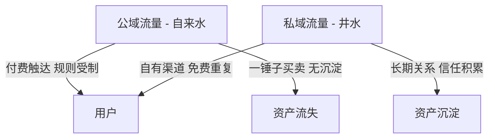
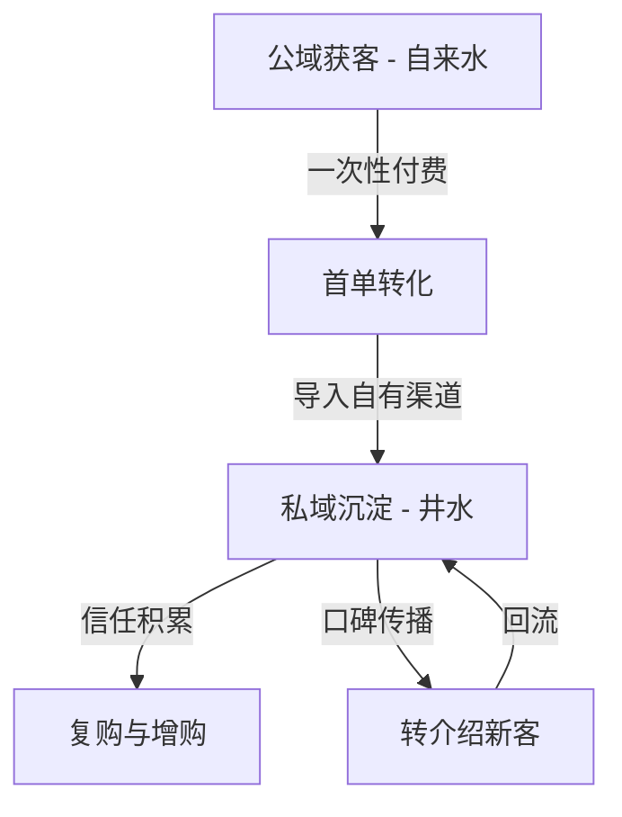

# 第 3 章 私域流量运营——信任驱动的客户关系

## 学习目标

-   理解私域流量定义本质及其与公域流量核心差异
-   掌握信任在私域运营中的核心地位
-   掌握先予后取原则内涵操作要点与边界条件
-   理解私域作为商业模式归宿的原因
-   能通过实证案例理解信任驱动的私域变现闭环

## 3.1 生活类比

私域运营就像自己打井取水。公域流量是自来水，付费即用，不付费即停，你还得时刻受制于平台的定价规则和水管阀门；私域流量则是井水，打井虽然费时费力费钱，但一旦打好，用水免费，旱涝保收，谁也管不着。这口井的水质就是信任关系，看似免费，却需要长期养护才清澈甘甜。先予后取，就是先修渠引水浇灌邻里，邻里自然帮你传扬井名；如果你只顾着抽水卖钱、过度营销，透支了信任，这口井便会干涸，用户退群离你而去，资产瞬间归零。

## 3.2 概念地图

```
私域流量运营方法论
├── 基础概念
│   └── 私域流量：自有、可重复、免费触达的用户池
├── 核心逻辑
│   ├── 信任是运营核心
│   └── 先予后取原则
├── 战略定位
│   └── 私域是商业模式归宿
└── 实证验证
    └── 赏金活动变现案例
```

## 3.3 私域流量——自己打的井才能天天免费喝水

### 3.3.1 为什么你天天去别人家挑水

> [P001, p.1] "私域就是那些你自己拥有、重复、免费触达的用户"

在公域流量时代，你的获客方式是这样的：付广告费，买曝光，用户点进来，成交一单。下一单呢？再付一次广告费。这就像天天去自来水厂挑水，水价由别人定，水管阀门由别人控制，水压不稳时你也毫无办法。

这里我们先给私域流量一个形式化定义：

> **私域流量**定义（来源：《私域流量运营方法论》）

$$P_{\text{私域}} = \{u \in U \mid u \text{ 可被企业} \; \text{免费} \; \wedge \; \text{重复} \; \text{触达}\}$$

这个定义展示了三个核心判据：**自有**（用户资产归属企业而非平台）、**免费**（后续触达无需额外付费）、**重复**（可持续多次触达）。只有同时满足这三个条件，用户才算真正沉淀到你自己的水池里。

### 3.3.2 自来水与井水的三种本质差异

以下是公域与私域的核心差异对照表：

| 维度 | 公域流量（自来水） | 私域流量（井水） |
|------|-------------------|------------------|
| 成本结构 | 付费即用，按次计费，价格平台定 | 打井贵，用水免费，成本沉没在前 |
| 可控制性 | 规则多变，平台说了算 | 自有渠道，规则自主 |
| 用户关系 | 一锤子买卖，无沉淀 | 长期关系，可重复触达 |

**成本结构差异**：公域获客成本持续上涨，平台规则多变，你的每一次触达都要重新付费，这是一条不断升高的成本曲线。[P001, p.2]

**可控制性差异**：传统投放买来的是"过路客"，用户看过即走，无法沉淀为长期资产。而私域里的用户资产沉淀在自有渠道，比如微信群、企业微信、公众号，你可以自主决定触达的内容与节奏。[P001, p.3]

**用户关系差异**：这是最根本的差异。私域流量的本质是长远而忠诚的客户关系，这个"关系"才是价值根基，比任何一次转化的货币价值都更值钱。[P001, p.1]

### 3.3.3 那口井的边界在哪里

我们还要明确私域的边界，否则容易把井挖歪。

**私域不等于用户列表本身**。如果你只是把用户拉进群，但从不经营关系，这份名单就只是一本冷冰冰的通讯录，没有任何价值。名单只是容器，关系才是井水。

**过度营销会导致井水干涸**。持续刷屏、狂发广告，用户会退群、取关、拉黑，你辛辛苦苦攒的私域资产瞬间归零。井水需要养护，不是抽干。



## 3.4 信任为核心的私域逻辑——先有关系后有买卖

### 3.4.1 群发广告为什么失效

> [P001, p.2] "私域运营核心不是为了触达和营销"

很多企业把私域简单等同为"免费群发广告的渠道"。今天推优惠券，明天推新品，后天推直播——结果呢？用户打开率越来越低，退群率越来越高，效果不断衰减。

为什么？因为单纯依靠触达频次无法维持用户留存。你每次触达都在消耗用户的注意力，而注意力是一种稀缺资源。触达次数增加，边际注意力却在下降，最终趋近于零甚至负数——用户开始讨厌你。

### 3.4.2 信任是慢变量，流量是快变量

> **信任为核心**定义（来源：《私域流量运营方法论》）

$$R_{\text{用户留存}} \propto f(\text{信任深度}) - g(\text{触达频次} \cdot \text{营销浓度})$$

这个公式展示了留存率的两个决定性因素：正比于信任深度，反比于营销浓度。当营销浓度上升而信任没有同步增长时，留存率就会下滑。这解释了为什么"免费群发"会逐渐失效。

信任先行，用户购买行为由信任驱动。用户不是因为你的广告来得勤而买，而是因为他信你、觉得你靠谱才买。先有关系，后有买卖，这是顺序问题，也是因果问题。

**抗扰动性提升**：信任关系下，用户对企业失误的容忍度会显著提升。产品偶尔出点小问题，用户会给你解释和弥补的机会；没有信任基础，一次失误就足以让你永久失去这个用户。[P001, p.4]

**去营销化**：用户不是因为你的产品广告而留下，而是因为他在你的关系网络中获得了持续的价值——干货、答疑、福利、共情。价值留存才是长期留存的关键。

### 3.4.3 信任的边界

信任是慢变量，区别于流量获取的快节奏。你不可能通过三天的轰炸就能建立信任，信任需要长期投入和一致性行为来积累。

同样重要的是：**产品本身有问题，信任会加速负面口碑扩散**。信任不是万能的遮羞布，当你辜负了用户的信任，负面口碑的传播速度会更快，因为用户更愿意向信任过你的人抱怨你的背叛。信任是一把双刃剑。

## 3.5 先予后取原则——先给用户甜头再谈自己的收获

### 3.5.1 为什么急着变现会把人吓跑

> [P001, p.3] "不要总想从用户身上获得什么，先想自己能带来什么"

私域运营落地时，企业往往急于变现：拉群第三天就开始推产品，第五天就开始搞促销。结果用户纷纷退群，因为用户加入私域的本质诉求是"给我一个留下来的理由"，而不是"给我一个被推销的理由"。

用户为什么要留在你的群里？是因为这里有价值——干货、福利、解决方案、情感共鸣。如果你只提供推销话术，那用户没有任何留下来的理由。

### 3.5.2 先予后取的算法结构

> **先予后取原则**定义（来源：《私域流量运营方法论》）

$$
\text{用户终身价值} \; (LTV) = \sum_{t=1}^{T} \left[ \underbrace{V_{\text{给予}}(t)}_{\text{用户感知价值}} - \underbrace{C_{\text{获取}}(t)}_{\text{用户被索取成本}} \right] \cdot \mathbb{1}[\text{信任}_t > \theta]
$$

这个公式展示了先予后取原则的数学结构：用户的终身价值等于每个时间点上"你给予的价值"减去"你索取的代价"，再乘以信任是否超过阈值。只有信任足够深（大于 θ），用户才会持续为你创造价值。

**行动前置于思考**：先问自己能解决用户的什么问题，再考虑自己的商业目标。这是顺序上的改变，从"我要卖什么"到"我能帮什么"。

**价值前置**：先输出干货、福利、服务、解决方案，建立专业形象和情感链接，再适时引导付费转化。先存钱，后取钱，这是复利的逻辑。

**可持续性**：给予与回报会在正向循环中不断深化。用户因为我给了价值而信任我，因信任而购买，因购买而更信任，因更信任而持续复购和传播。

### 3.5.3 先予后取的边界

先予不等于无底线免费。你需要平衡成本与服务能力，不能为了"予"而亏本运营，否则不可持续。

后取不等于不取。建立信任后，你应适时自然引导转化。用户期待你在提供价值之后合理变现，这是良性的商业闭环。关键是把握好时机与方式，让转化成为关系深化的自然结果，而非强行割韭菜。

## 3.6 私域作为商业模式归宿——流量终局关系常青

### 3.6.1 增量见顶后的流量困境

> [P001, p.4] "商业模式的尽头一定是私域"

流量的增量时代已经结束。公域获客成本持续攀升，平台流量分发不可控，商业模式过度依赖公域，缺乏稳定性。你今天可以靠着投流买量冲一波业绩，但明天竞价一涨，利润就没了。

"流量红利"退潮后，存量的关系时代开启。竞争的焦点从"获取新客"转向"经营老客"。与其天天去公域捞鱼，不如把自己家的鱼塘养好。

### 3.6.2 私域归宿的三重逻辑

以下是私域作为商业模式归宿的三重逻辑推演：

| 逻辑 | 核心命题 | 推论 |
|------|----------|------|
| 普适性 | 绝大多数行业结合私域运营能事半功倍 | 私域是通用杠杆而非特定行业特权 |
| 杠杆效应 | 私域与成熟商业模式结合 | 放大转化、复购、口碑传播 |
| 必然趋势 | 公域成本上升推动行业转向 | 私域成为战略必选项而非可选 |

**普适性论证**：绝大多数行业——零售、教育、服务、B2B——都可以通过私域运营提高运营效率与用户终身价值。私域不是某个垂直领域的特例，而是通行的商业模式升级路径。这一论断需要更广泛的行业实证支撑，目前素材仅提供单一来源的断言 [需要补充文献]。

**杠杆效应论证**：私域与成熟商业模式结合，会放大转化率、复购率和口碑传播速度。因为熟悉你、信任你的用户，转化成本远低于陌生用户，复购意愿远高于一次性消费者，口碑推荐也更有说服力。

**必然趋势论证**：公域成本上升推动更多行业把私域作为战略必选项。当获取新客的成本超过老客终身价值时，经营私域就从"可选项"变成了"必选项"。

### 3.6.3 私域归宿的边界

私域不能凭空创造需求。如果你的产品本身没有价值，私域只会更快放大失败速度——你不止付了广告费，还搭上了口碑。

品牌初期仍应借公域获取初始流量，再沉淀入私域形成闭环。私域不是无源之水，前期需要通过公域或者自然流量拉新蓄水，再通过私域运营把"过路客"变成"回头客"。



## 3.7 赏金活动变现案例——信任变现三天五万

### 3.7.1 信任到底值多少钱

前面我们一直在讲信任、关系、价值，有人会问：这些东西真的能换来真金白银吗？先予后取，是不是只是空有情怀的利他主义？

这一节我们用一个实证案例来回答：私域里沉淀的信任，到底能变现多少钱。

### 3.7.2 案例拆解：三天五万的变现逻辑

> [P001, p.5] "3天左右额外变现5万+"

这个案例的背景是支付宝的"赚钱红包"放水活动。运营者借助自己已经沉淀好的私域信任关系和社群基础，把平台的福利（免费发放的红包）推荐给用户，用户领取使用，运营者获得佣金奖励。3天左右，额外变现超过5万元。

> **赏金活动变现**方法（来源：《私域流量运营方法论》）

```
1. 依托既有私域社群（已沉淀信任基础）
2. 筛选平台低门槛福利活动（支付宝赚钱红包）
3. 以"分享福利"姿态推送，而非"推销产品"
4. 用户零成本领取红包，获得直观收益
5. 运营者获得平台佣金奖励，完成变现闭环
```

这段伪代码展示了信任变现的执行路径：关键不是你的推销话术有多强，而是用户在信任你之后，愿意打开你发的链接、尝试你推荐的东西。这个"打开率"本身就是信任的货币化体现。

### 3.7.3 零成本高杠杆为什么成立

**零成本高杠杆**：无需额外广告预算，借既有私域信任与社群，触达成本为零，转化又因为信任基础而高于普通投放。

**低决策门槛**：赏金红包参与门槛低、获益直观、无需用户付费，所以用户的行动率极高。这符合心理学中的"损失厌恶"，用户看到的是"不领就亏了"，但前提是你有足够信任让用户愿意点开。

**快速验证性**：这个案例验证了一个关键命题——先予后取积累的长期信任，在适当时机可以快速兑现为金钱回报。信任是慢变量，变现是快变量，慢变量蓄积的能量可以在快变量中释放。

### 3.7.4 案例的边界

**冷启动社群不具备**：这个案例的变现高度依赖私域沉淀的信任基础和用户活跃度。如果你的私域群是新建的、用户不活跃、没有信任沉淀，复制这个玩法大概率会失败。

**收益波动性**：赏金收益随平台活动周期波动，不可作为长期稳定收入。它是一次性杠杆，不是持续现金流。企业不能依赖这种"薅平台羊毛"的方式作为核心商业模式。

## 3.8 多源对照

本节内容主要源自单篇素材《私域流量运营方法论》（编号 20231017_102），因此多源对照部分需要诚实标注：

### 共识

在现有素材范围内，相关概念均由同一来源提出，尚未发现多来源交叉验证。私域流量定义、信任核心逻辑、先予后取原则、私域归宿论断均出自该素材，属于同一理论体系内部的一致性表述。

### 分歧

由于目前仅有单一素材来源，无法进行跨源比较。以下论断需要更多文献交叉验证 [需要补充文献]：

-   "私域是商业模式的归宿"这一断言是否适用于所有行业，需要更多行业案例验证
-   "三天变现5万"的赏金案例是否具有可复制性，需要更多独立实证数据
-   先予后取原则的"给予边界"在实践中的具体操作尺度，目前缺乏量化标准

## 3.9 设计中的取舍

**为什么不用"高频触达"取代"信任构建"？**

高频触达见效快、操作简单、即时可测。群发一条促销信息，立刻能看到转化数据。但这是"涸泽而渔"——每一次触达都在消耗用户的注意力储备，当储备耗尽，用户选择退群，你的触达渠道就彻底归零。信任构建虽然慢，但它是一种复利资产：每增加一份信任，就降低一次转化成本，提高一次复购概率，加速一次口碑扩散。高频触达是"取"，信任构建是"予"，前者是消耗存量，后者是创造增量。

**这个设计的 trade-off 是什么？**

信任构建的代价是时间与耐心。在KPI压力下，运营者很难坚持"先予后取"——因为给予的回报是滞后的，可能需要数周甚至数月才能看到转化提升。高频触达的即时反馈能缓解管理者的焦虑，但代价是用户的耐心和留存。另一个 trade-off 是成本结构：先予后取需要投入内容生产、社群运营、服务资源，这些成本是前置的、账面上看不到即时回报的投入；而高频触达的成本是后置的、且不断上升的。

## 3.10 动手练习

1.  **辨析：自来水与井水的运营启示**——从成本结构、可控制性、用户关系三个维度对比公域与私域，设计打井方案
2.  **判断对错：信任vs触达**——判断五种做法是否体现信任为核心逻辑，提出改进建议
3.  **情景模拟：如何践行先予后取原则**——设计4周先予运营计划，设计后取转化方案，明确给予边界
4.  **论证与批判：私域真的是商业模式归宿吗**——从三个角度论证私域是尽头，并举反例写批判思考
5.  **案例复盘：从赏金活动看信任变现**——分析案例成功要素，分析冷启动社群不具备条件，讨论长期风险

## 3.11 本章小结

这一章中我们学习了私域流量运营的完整方法论。首先我们从"井水与自来水"的类比出发，定义了私域流量是企业自有的、可重复、免费触达的用户池，本质是长远而忠诚的客户关系。其次我们剖析了信任是私域运营的核心，它不是触达和营销，而是先有关系后有买卖的信任构建逻辑。接着我们介绍了先予后取原则，先思考能给用户带来什么，再考虑自己的收获。然后我们论证了私域是商业模式的归宿，绝大多数行业结合私域运营能事半功倍。最后，我们通过支付宝赏金活动三天变现五万的实证案例，验证了信任驱动变现的闭环——信任积累是慢变量，变现兑现是快变量，慢变量的蓄积可以在适当时机快速释放。

本章我们一起学习了以下概念：

| 概念 | 解释 |
|------|------|
| 私域流量 | 企业自有的可重复免费触达的用户池，本质是长远而忠诚的客户关系 |
| 公域vs私域 | 公域是自来水付费即用，私域是井水打井贵但用水免费 |
| 信任为核心的私域逻辑 | 私域运营核心不是触达和营销而是信任构建，先有关系后有买卖 |
| 先予后取原则 | 欲先取之必先予之，先思考能给用户带来什么再考虑自己的收获 |
| 私域是商业模式归宿 | 商业模式的尽头一定是私域，绝大多数行业结合私域运营能事半功倍 |
| 赏金活动变现案例 | 借助既有私域信任，通过低门槛活动实现零成本高杠杆快速变现 |

下一章中，我们将从"为什么做私域"转向"如何搭建私域的运营体系"，学习私域流量的具体承接载体、团队组织架构、用户分层运营策略以及数据驱动的方法，把本章的理念落地为可执行的运营系统。

