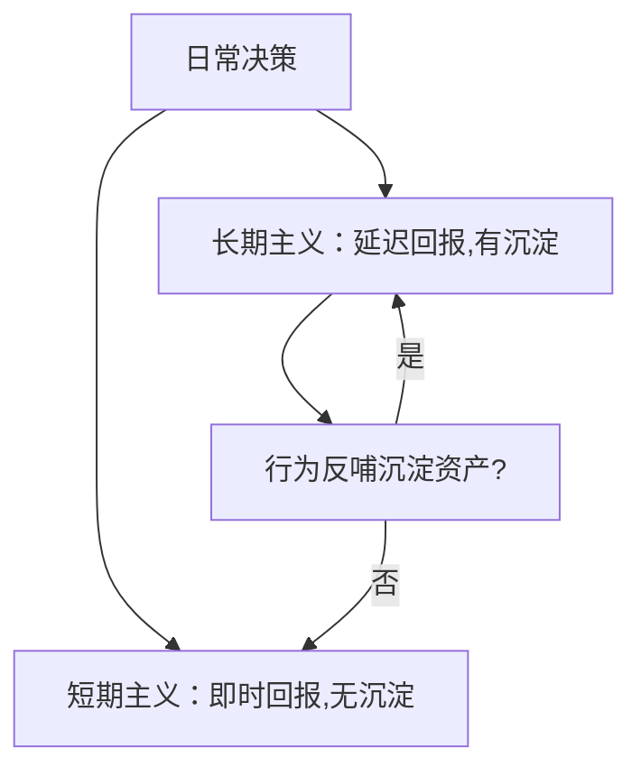
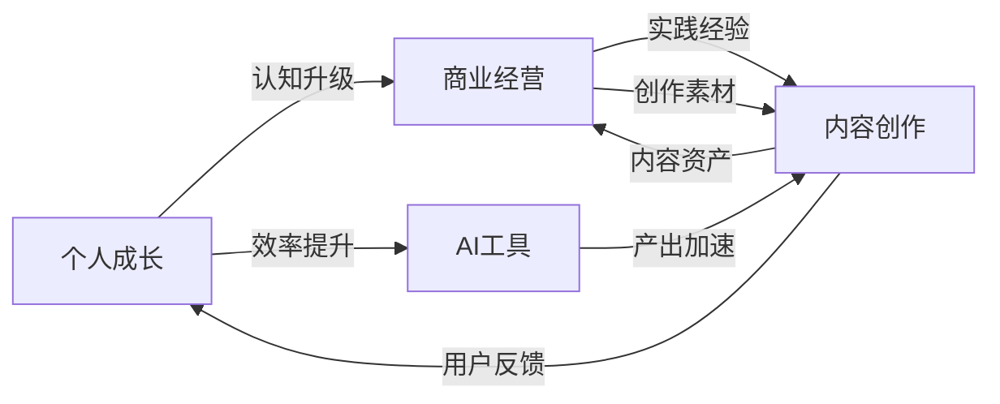

# 第 9 章 短期主义与长期主义——人生与生意的终极分野

## 学习目标

-   理解短期主义与长期主义的本质区别
-   掌握延迟满足与复利思维的心理机制
-   学会用资产而非余额视角评估决策
-   识别长期主义陷阱并建立防御性思维
-   掌握第一桶金性质决定后续命运的逻辑
-   能构建四维长期主义复利系统

## 9.1 生活类比

长期主义是一场种树与摘果的比赛：短期主义是摘下路边的野果，立刻填饱肚子，但明年还得重新寻找；长期主义是种一棵果树，前几年虽然不结果，但第五年起每年都有收成。延迟满足是忍住不吃种子，把它埋进土里；复利思维是果树每年结出的果子，一部分吃掉，一部分留作种子再种下去。沉淀，是果树本身——它不依赖你每天的行动而独立存在；余额则是摘下来的果子，吃完就没了。第一桶金决定论则提醒我们：种子是优质还是劣质，直接决定了这棵树未来的收成规模。

## 9.2 概念地图

```
短期主义与长期主义
├── 本质分野：赚快钱 vs 做沉淀
├── 心理基础：延迟满足与复利思维
├── 判断标准：资产视角而非余额视角
├── 风险陷阱：过度坚守、机会成本、路径依赖
└── 系统构建：四维长期主义复利循环
```

## 9.3 第一单元：短期主义与长期主义的生活分野——赚快钱与做沉淀的两条路

我们每天都会在"眼前收益"与"长远价值"之间做出无数次权衡。要不要接这个急单？要不要做这个一次性项目？要不要追这个风口？这些问题背后，站着两种截然不同的底层逻辑。

> "根本是短期主义和长期主义的较量"
> "一定要做有沉淀的东西"
>
> ——《拼多多无货源系统方法论》

作者明确指出，日常决策中频繁面临眼前收益与长远价值的权衡，而这场较量的核心在于：你是选择赚快钱，还是选择做沉淀。

**短期主义与长期主义定义**（来源：《拼多多无货源系统方法论》）

**短期主义**：追求即时回报的一次性收益行为，不产生可累积的资产。
**长期主义**：追求有沉淀、可复利累积的成果，即使回报周期漫长。

| 特征 | 短期主义 | 长期主义 |
|------|----------|----------|
| 收益速度 | 快 | 慢 |
| 根基深度 | 浅 | 深 |
| 复利性 | 无 | 强 |
| 资产沉淀 | 无 | 有 |

这份对比展现了两种主义在四个维度上的根本差异。短期主义像一颗流星，亮得快也灭得快；长期主义则像一棵扎根的树，成长缓慢但根系越来越深。

这里有一个重要的边界条件：**服务于长期沉淀目标的短期行为，应当被纳入长期主义**。比如，为了积累启动资金而接短期项目，是为了种下第一棵树而摘野果，这个行为本身是长期主义的组成部分。

同样，**长期主义不排斥短期盈利**。关键问题不是"是否赚钱"，而是"盈利是否反哺沉淀资产"。如果每次盈利都能让你积累下一个阶段的基础，哪怕单次盈利很小，也属于长期主义。



这个决策流程图展示了日常决策的分叉路径。每个决策的判别标准，不是收益的大小，而是收益是否创造了可复用的积累。

## 9.4 第二单元：延迟满足与复利思维——让每一次选择都成为下一次的垫脚石

理解长期主义只是第一步，我们需要回答一个更根本的问题：**凭什么相信长期主义值得等待？** 答案由两个互补的机制构成：延迟满足提供心理支撑，复利思维提供机制解释。

> "我们这一生得到的一切都源于我们满足了别人的需求"
> "作者做内容创业五六年越做越好"
>
> ——《需求满足回报论》

延迟满足与复利思维**定义**（来源：《需求满足回报论》）

**延迟满足**：为了获取更大的长期价值，主动放弃即时奖励的心理能力。
**复利思维**：将每个阶段的成果作为下一阶段的基础，使增长呈指数而非线性。

序列 $1, 2, 3, \ldots, n$ 是线性增长；数列 $1, 2, 4, 8, \ldots, 2^n$ 是指数增长。复利思维要求你用后者的眼光来看待自己的积累。

作者五六年"越做越好"的现象，正是复利效应的真实注脚。复利效应最显著的特征是：**前期增长缓慢，但越到后期越陡峭**。很多人放弃长期主义，是因为在前期看不到明显回报，但他们没有意识到，复利曲线的拐点往往在坚持之后才出现。

复利思维还有一个容易被忽视的要求：**连续性**。复利的前提是本金不被清零。如果中断，复利就断裂，前期的积累归零，你要从头开始。这解释了为什么长期主义者格外重视"稳定"。

这里有一个需要明确的边界：**延迟满足的前提是长期方向正确**。如果方向错误，延迟满足就变成了将错误坚持到底的勇气。同时，**复利思维需要足够的时间窗口**，短于一个完整的回报周期，复利无法显现。

> 需求满足回报论（来源：《需求满足回报论》）

$$
\text{一生的所得} = \sum_{\text{每次交互}} \text{满足他人需求的程度}
$$

这个公式把人生收益建模为一次次需求满足的累积。它暗示了一个深层逻辑：你得到的每一分回报，本质上都是因为你在某个时刻、以某种方式满足了别人的需求。长期主义的方向，必须锚定在"持续满足他人需求"上，而不是"持续满足自己"上。

## 9.5 第三单元：有沉淀的选择——用资产而不是余额来评估一件事

长期主义是一个抽象原则，但"我要做长期主义"并不能指导你明天该做什么。我们需要一个可操作的选择标准。

> "无货源沉淀的一定是店铺"
>
> ——《拼多多无货源系统方法论》

这句话揭示了作者的判断框架：**判断一件事的价值，要看它沉淀了什么，而不是它赚了多少。**

**沉淀定义**（来源：《拼多多无货源系统方法论》）

**沉淀**：能脱离单次行为独立存在的、具有复用性和累积性的积累物。

用"资产 vs 余额"的视角来审视，一切选择都可以被分类：

| 类别 | 特征 | 例子 |
|------|------|------|
| 沉淀（资产） | 可复用、可累积、脱离子单次行为独立存在 | 店铺、用户、口碑、课程、系统 |
| 余额（消耗品） | 一次性收益、用完即止 | 单次佣金、一次性项目费、差价 |

这张表格展示了两类收益的本质区别。余额是流量的，花完就没有了；资产是存量的，它在你睡觉的时候仍然存在并产生价值。

那么，如何判断一件事是否值得做？作者给出了一个内部标准：

> 判断沉淀的方法（来源：《拼多多无货源系统方法论》）

```
1. 问自己：三个月后，这件事还值钱吗？
2. 如果还值钱 —— 它就是沉淀，优先做。
3. 如果消失了 —— 它是一次性收益，谨慎做。
4. 如果答案是"能变成更多东西" —— 它是复利资产，持续做。
```

这个检查方法将"长期主义"从一个价值判断转化为一个时间维度的操作判断。"三个月后还值钱吗"击穿了大多数短期行为的本质——风口的流量、单次的佣金、临时的差价，三个月后通常不剩任何东西。而店铺、品牌、系统、知识，三个月后依然在那里，并且可能因为你在这三个月里持续维护它而变得更值钱。

**边界条件**：判断"沉淀"时，必须区分"自己以为的沉淀"和"市场认可的沉淀"。一个无法满足他人需求的沉淀物，只是自我安慰的收藏品。因此，"三个月后还值钱吗"这个问题的下一层追问是："你自己觉得值钱，还是别人也觉得值钱？"

## 9.6 第四单元：长期主义的风险与陷阱——当坚守变成僵化，当复利变成侥幸

长期主义被过度美化之后，反而容易成为一类陷阱：人们把它当作逃避调整、拒绝改变的借口。

> "如果第一笔金带投机行为往后面临大坑"
>
> ——《拼多多无货源系统方法论》
>
> "我们这一生得到的一切都源于我们满足了别人的需求"
>
> ——《需求满足回报论》

长期主义陷阱**定义**（来源：《需求满足回报论》《拼多多无货源系统方法论》）

**长期主义陷阱**：因过度坚守而产生的机会成本、路径依赖与自我合理化。

以下是陷阱的三种主要形态：

| 陷阱 | 表现 | 本质问题 |
|------|------|----------|
| 机会成本 | 长期坚守单一方向，忽略更优路径 | 收益最大化 vs 方向正确性混淆 |
| 路径依赖 | 早期选择已证伪，仍因沉没成本难以放弃 | 成本沉没 vs 止损能力混淆 |
| 伪长期主义 | 把坚持本身当美德，回避对方向的质疑 | 手段 vs 目标倒置 |

这张表格揭示了长期主义失效的三种方式。它们共同的特点是：**坚持本身代替了方向的验证**。

第一桶金决定论则揭示了风险的根源：

> 第一桶金决定论（来源：《拼多多无货源系统方法论》）

$$
\text{第一桶金的性质} \rightarrow \text{后续发展模式}
$$

```
若第一桶金来自投机 → 路径依赖投机 → "坑越挖越大"
若第一桶金来自沉淀 → 路径依赖沉淀 → 越做越深
```

这个决定论说明，第一桶金的性质决定了后续的命运。作者的表述是"往后面临大坑"：如果第一笔金带有投机行为，你会在未来持续重复这个模式，而投机本质上是一种消耗性游戏，坑只会越挖越大。

那么，如何判断你是"健康的长期主义"还是"陷阱中的长期主义"？判断标准不在坚持本身，而在方向是否仍然满足他人需求：

> 方向有效性检验（来源：《需求满足回报论》）

$$
\text{方向有效} \iff \text{该方向上仍有被满足的需求} \land \text{你仍是最优供给者}
$$

这个检验公式给出了一个双条件判断。需求消失了，长期主义就失去了支点；你能被替代，你的长期坚持就只是别人的垫脚石。长期主义不是"永远不转弯"，而是"在方向有效时坚持，在方向失效时转弯"。

## 9.7 第五单元：构建可持续的长期主义系统——让慢成为一种基础设施

单个长期主义决策无法形成合力。真正的持久竞争力来自**系统**——把多个维度的长期行为编织成一个互相强化的整体。

> "根本是短期主义和长期主义的较量"
> "无货源店群底层逻辑：稳定是最好的发展"
>
> ——《拼多多无货源系统方法论》

**长期主义系统定义**（来源：《拼多多无货源系统方法论》《需求满足回报论》）

**长期主义系统**：将个人成长、商业经营、内容创作、AI 工具四个维度纳入同一套沉淀逻辑，形成复利循环。

系统的核心性质在于**正反馈**：一个维度的沉淀会成为另一个维度的输入，形成互相放大。



这个数据流图展示了四维系统之间的正反馈关系。个人成长提供认知基础，商业经营提供实践检验，内容创作沉淀IP资产，AI工具则放大所有环节的效率。

系统中的每个维度都遵循同一个循环：

> 单元循环（来源：《需求满足回报论》）

```
投入 → 沉淀 → 复用 → 再投入
```

我们以内容创作为例展开这个循环。你投入时间写作一篇文章（投入），文章发表在平台上成为可检索的资产（沉淀），读者通过搜索反复阅读它并为你带来关注（复用），这些关注成为你下一篇文章的读者基础（再投入）。整个过程不需要你重复付出同样的时间成本，每次循环都在已有的存量上叠加。

需要强调的是两个边界条件：

-   **AI 工具是放大器，不是引擎。** 系统能否运转的关键在于前三个维度是否形成了有效的沉淀循环。AI 工具的作用是让循环更快，但如果循环本身不存在，AI 什么都放大不了。
-   **系统的持续性依赖外部需求的持续存在。** 一旦需求消失，整个系统就必须重新锚定。这意味着"稳定是最好的发展"的真正含义是：稳定地在正确的需求方向上累积，而不是稳定地重复过去的动作。

## 9.8 多源对照

关于长期主义，两篇核心素材提供了互补又略有分歧的视角。

### 共识

两篇素材都认为"沉淀"是长期主义的核心。无论是个人的能力、店铺的评分、内容的影响力，都必须形成可脱离单次行为独立存在的积累。【P117】的"一定要做有沉淀的东西"与【P009】的"越做越好"指向同一个结论：有沉淀的积累是长期成长的根基。

### 分歧

两篇素材在"长期主义的动力来源"上各有侧重：

-   **【P117】侧重商业模式确定性**：第一桶金决定论表达的是对投机的警惕，它更关注商业模式的基因是否健康。作者认为，如果起点是投机，后续的模式会自我强化。
-   **【P009】侧重外部需求导向**：需求满足回报论把"满足他人需求"作为一切所得的唯一来源，它更关注方向的正确性。如果需求消失，长期主义就失去了支点。

两者的分歧在于：**P117 认为问题出在"起点性质"，P009 认为问题出在"需求方向"**。一个好的长期主义框架应该同时包含这两个维度的检验——既要看自己的起点是否健康，也要不断地审视需求是否还在。

## 9.9 设计中的取舍

**为什么不用"只追求资产"的严格标准？**

如果"只做有沉淀的事"是唯一标准，那么生活中大量必要的、但确实没有沉淀价值的任务（比如一次性的行政事务）就无人处理了。所以，系统允许短期行为存在，约束条件是"短期行为的盈利必须反哺到沉淀资产中"。这不是放宽标准，而是承认现实的复杂性。

**这种设计的 trade-off 是什么？**

这套框架的权衡在于：它用"可检验的沉淀标准"换取了"对短期行为的宽容"。好处是决策标准清晰、可操作，不会因为过于严苛而导致行动瘫痪；代价是，判断"盈利是否反哺资产"仍然需要个体自己完成，框架本身没有提供自动化的判定工具。

**为什么不用"长期主义=永不放弃"？**

如果长期主义等于永不放弃，那就等于没有退出机制。方向失效时，坚持的成本远大于放弃的成本。因此，本框架引入了"需求满足"作为动态检验：长期主义是"在正确方向上坚持"，而不是"坚持本身正确"。

## 9.10 动手练习

1.  **识别你的十个日常决策**：回顾这一周你做过的10个决策（大到是否换工作，小到是否接一个急单），逐一把它们分类为"短期主义"或"长期主义"。对每个决策，追问：它沉淀了什么？三个月后它还值钱吗？如果答案是"否"，它的可调整版本是什么？

2.  **第一桶金审计**：审视你第一次赚到"较大一笔钱"的方式。它是一个投机行为（如赚差价、割韭菜）还是一个沉淀行为（如交付了某个长期产品）？根据第一桶金决定论，你的第二桶金、第三桶金是否继承了第一桶金的基因？如果是投机基因，你能设计一个怎样的"基因改造计划"？

3.  **设计你的四维复利系统**：你当前在个人成长、商业经营、内容创作、AI工具四个维度上分别已经有哪些沉淀？绘制你的数据流图：哪个维度为哪个维度提供输入？哪个环节尚未形成循环？标注你系统的"锚点"——那个一旦稳定就带动全局的环节。最后分析：AI工具在你的系统中起的是放大器作用还是引擎作用？

4.  **长期主义风险压力测试**：找出一个你当前正在坚持的"长期主义方向"。用"需求满足回报论"对它做压力测试：这个方向满足的是谁的需求？这些需求会消失吗？如果需求消失，你的退出机制是什么？再检验：你是在"方向有效时的坚持"，还是陷入了"路径依赖的僵化"？

## 9.11 本章小结

这一章中，我们系统性地完成了对短期主义与长期主义这一终极分野的完整剖析。首先明确定义了两者的本质区别：短期主义追求即时回报、不产生可累积资产，长期主义追求有沉淀、可复利累积的成果；接着深入探讨了长期主义的心理基础——延迟满足提供心理支撑，复利思维提供机制解释；然后建立了一个可操作的判断标准：用"资产还是余额"的视角来评估每一个决策，核心追问是"三个月后还值钱吗"；随后直面长期主义的风险与陷阱，识别出机会成本、路径依赖、伪长期主义三种失效形态，并引入第一桶金决定论揭示投机基因的自我强化机制；最后构建了一整套可持续的长期主义系统框架——以个人成长、商业经营、内容创作、AI工具为四维的复利循环系统，并明确了AI工具是放大器而非引擎的边界条件。

本章我们一起学习了以下概念：

| 概念 | 解释 |
|------|------|
| 短期主义 | 追求即时回报的一次性收益行为，不产生可累积资产 |
| 长期主义 | 追求有沉淀、可复利累积的成果，即使回报周期漫长 |
| 延迟满足 | 为更大长期价值主动放弃即时奖励的心理能力 |
| 复利思维 | 每阶段成果作为下阶段基础，增长呈指数而非线性 |
| 沉淀（资产） | 可脱离单次行为独立存在的复用性积累物 |
| 第一桶金决定论 | 第一桶金性质决定后续命运，投机基因会把坑越挖越大 |
| 需求满足回报论 | 一切所得源于满足他人需求，长期主义需以他人需求为支点 |
| 长期主义系统 | 个人成长、商业经营、内容创作、AI工具四维复利循环 |

下一章中，我们将从"人生取舍"的宏观层面回归到具体的技术世界，探讨在快速迭代的 AI 技术浪潮中，什么样的知识积累与技能培养才是真正的"长期资产"，以及如何在 AI 工具的助力下实现个人的指数级成长。
