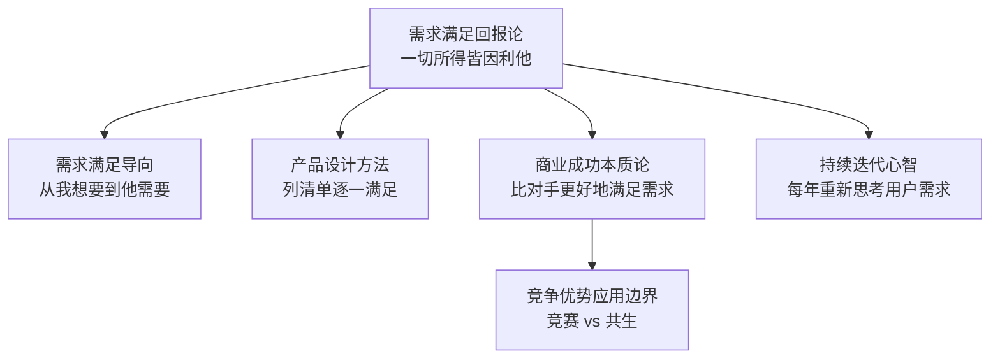
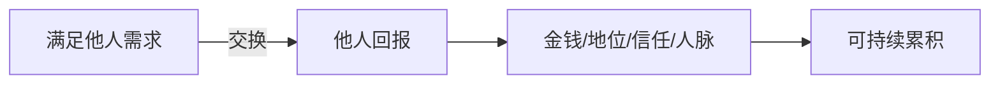
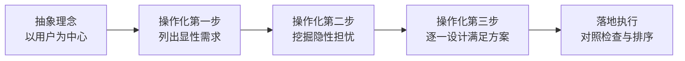
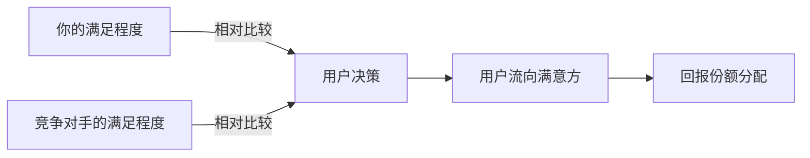
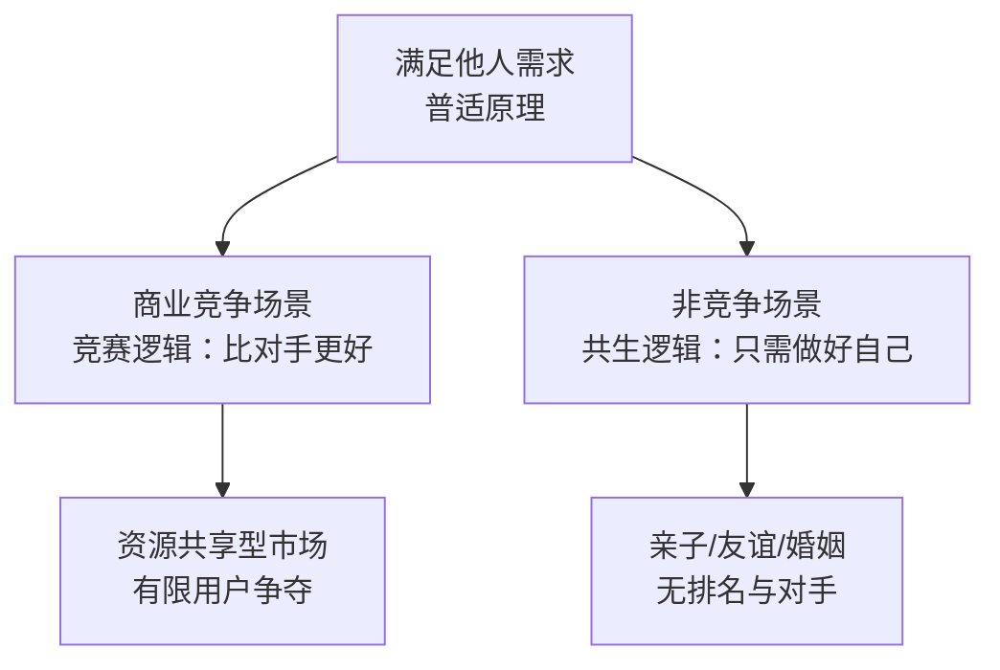
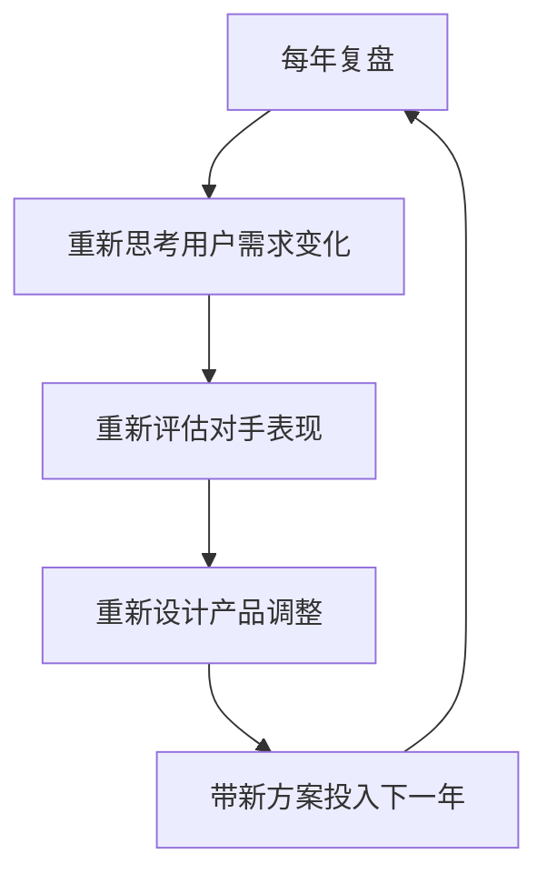

# 第一章 需求满足回报论——一切所得，皆因利他

## 学习目标
- 理解需求满足回报论的逻辑链条：所得源于满足他人需求
- 掌握从我想要到他需要的思维转向及其影响
- 掌握需求满足导向的产品设计方法的操作步骤
- 理解商业成功本质论的核心观点：比对手更好地满足需求
- 能区分竞争优势的适用范围与边界，选择合适的策略
- 理解持续迭代心智在长期实践中的价值

## 1.1 生活类比——街角小餐馆的经营智慧
想象你经营一家街角的小餐馆。傍晚时分，顾客们在店门口徘徊、皱眉看了看菜单又放下、最终走向隔壁——这些细节，正是他们在用行动表达自己还未被满足的需求。你每天站在门口观察顾客的喜好、留意他们皱眉的细节，就是在识别用户的担忧。隔壁新开的餐馆推出了一道招牌菜，那是竞争对手的方案。而你据此改良自家菜品、调整口味与服务，就是比对手更好地满足需求的过程。当老主顾五年间每周都来光顾你家小店，甚至带新朋友入座，这就是持续迭代带来的回报复利。

就像餐馆老板从不问自己想做什么菜，而是天天琢磨顾客想吃什么、隔壁比我好在哪里，需求满足回报论也要求你放下自我执念，把目光投向对方的需求与差距。

## 1.2 概念地图



## 1.3 需求满足导向——从我想要到他需要的思维转向

### 概念定义（来源：《要去满足别人的需求，而不是自己想要什么》）

多数人明明知道"要利他"，却依然做不到。问题的根源在于一种本能的思维惯性：我们从小到大最自然的思考方式是"我想要什么"——我想要更高的薪水、我想要被认可。这种自我中心的出发点，把注意力全部放在自己的欲望上，却忽略了回报的真正来源——别人。

> "我们这一生得到的一切，都源于我们满足了别人的需求。"（[P001]《要去满足别人的需求，而不是自己想要什么》）

需求满足导向，就是从"我想要什么"转向"他需要什么"。这不是道德说教，而是客观的交换规律——个人与社会本质上是交换关系，只有你先给予他人价值，别人才会回报你。

## 1.4 需求满足回报论——一切所得皆因利他

### 定理定义（来源：《要去满足别人的需求，而不是自己想要什么》）

当我们接受了"要关注他人需求"的思维转向后，自然会产生更深的追问：为什么这样做就一定能得到回报？人们常误以为回报来自竞争、掠夺或运气。但需要区分短期套利与长期所得：投机或许能带来一次性收益，但凡是能持续累积的所得——金钱、地位、信任、人脉——底层逻辑都是交换。

> "我们这一生得到的一切，都源于我们满足了别人的需求。"（[P001]《要去满足别人的需求，而不是自己想要什么》）

**核心定理推导**：

$$\text{所得}(x) \iff \text{满足了他人的需求} \quad (x \in \{\text{金钱},\text{地位},\text{信任},\text{人脉},\cdots\})$$

**逐式解释**：

| 符号 | 含义 | 说明 |
|------|------|------|
| 所得(x) | 你获得的具体回报 | x代表金钱、地位、信任、人脉等任何形式的回报 |
| ⟺ | 等价关系 | 所得与满足需求互为充分必要条件 |
| 满足了他人的需求 | 你所提供的价值 | 这是回报的唯一来源 |
| x ∈ {…} | x的取值集合 | 表明该定理适用于一切回报形式 |

**这段话的作用**：这个公式将抽象的"利他"理念转化为可验证的等价关系。它告诉我们，既然我们无法凭空创造价值，那么一切持续性的回报必然对应着某种被满足的需求。当你满足了别人的需求，别人就会以回报相交换——这就是公式成立的底层原因。

这个定理的三个关键属性：

| 属性 | 含义 | 启示 |
|------|------|------|
| 普适性 | 适用于金钱、地位、信任、人脉等一切回报形式 | 没有例外，所有所得都要回到这个根基 |
| 因果性 | 满足需求是因，得到回报是果 | 顺序不可颠倒，先种因后得果 |
| 交换性 | 回报是需求的交换结果 | 你给出的价值决定你收到的回报 |

这个定理奠定了全书的逻辑基石，后续的思维方法、设计方法和竞争策略，都将由它推导展开。



## 1.5 需求满足导向的产品设计方法——把利他变成操作步骤

### 方法定义（来源：《要去满足别人的需求，而不是自己想要什么》）

知道了"要满足他人需求"还远远不够，空泛地喊"以用户为中心"无法落地。这个方法的核心动作是**列清单——逐一攻克**：系统地枚举用户每一层顾虑，然后逐一提供满足方案。

> "以顶峰会发售为例，作者始终在思考用户在分销时可能有哪些需求并逐一满足。"（[P001]《要去满足别人的需求，而不是自己想要什么》）

**操作步骤**（伪代码）：
```
Algorithm: 需求满足导向的产品设计
1. 列出目标对象的全部潜在担忧与顾虑（显性 + 隐性）
2. 将每个担忧转写为对应的需求陈述
3. 针对每个需求设计具体的满足方案
4. 逐条对照检查是否有遗漏
5. 按优先级排序并执行
```

**方法演进图**：



这个方法有两个显著特征：**系统性**（把顾虑分层拆解、不漏项）与**双向性**（既关注显性需求，也关注隐性担忧）。

## 1.6 商业成功本质论——跑赢对手而不是跑赢自己

### 定理定义（来源：《要去满足别人的需求，而不是自己想要什么》）

需求满足回报论解释了回报从哪里来，但没有解释同一个市场里为什么有人赚得多、有人赚得少。答案在于"更"字。

> "比竞争对手更好的满足别人的需求，这是商业成功的本质。"（[P001]《要去满足别人的需求，而不是自己想要什么》）

**核心定理推导**：

$$\text{回报份额}_i \propto \frac{\text{你满足需求的程度}_i}{\text{竞争对手满足需求的程度}_i}$$

**逐式解释**：

| 符号 | 含义 | 说明 |
|------|------|------|
| 回报份额_i | 你在市场i中的回报占比 | 由你的满足程度相对对手的比值决定 |
| ∝ | 正比于 | 比值越大，回报份额越高 |
| 你的满足程度 | 用户对你方案的综合评价 | 包括产品品质、服务体验、价格等多维度 |
| 竞争对手的满足程度 | 用户对对手方案的综合评价 | 关键在相对比较，而非绝对优劣 |

**这段话的作用**：这个公式揭示了商业竞争的数学本质——决定回报的不是你的绝对水平，而是你相对于对手的表现。当用户被更好地满足时，他们就会流向表现更好的一方。



## 1.7 竞争优势的应用边界——区分竞赛与共生

### 概念定义（来源：《要去满足别人的需求，而不是自己想要什么》）

如果把"比对手更好"套用到所有人生场景，会陷入过度竞争和内耗。因此需要明确应用边界：**满足他人需求是更底层的普遍原理**，适用于一切交换关系；比对手更好只是它在商业竞争这一特定场景中的延伸。

> "比对手更好本质适用于商业竞争，满足他人需求原理更普适。"（[P001]《要去满足别人的需求，而不是自己想要什么》）

**场景适用关系图**：



| 场景 | 适用逻辑 | 原因 |
|------|---------|------|
| 两家餐厅竞争顾客 | 竞争逻辑（比对手更好） | 存在明确竞争与排名，回报按相对优劣分配 |
| 母亲满足孩子的需求 | 满足逻辑（无需比较） | 没有对手排名，只需做好自己 |

## 1.8 设计中的取舍

### 为什么不是"得到回报的唯一途径是竞争"？
竞争只是商业这一特定场景下的运作方式，更底层的规律永远是"满足需求"。如果把竞争逻辑泛化到所有关系——比如婚姻、友谊、亲子——就会把共生关系错当成竞赛关系。

### 这种取舍的代价是什么？
选择"满足需求"作为底层原理的代价是：它比"竞争"更难衡量、更难以快速见效，但从长远来看，满足需求带来的信任与复利远超短期竞争带来的收益。

## 1.9 持续迭代的心智——用五年时间验证一个定理

### 心智定义（来源：《要去满足别人的需求，而不是自己想要什么》）

需求满足回报论与商业成功本质论适用于当下，但需回答这些规律在长期是否依然成立。持续迭代的心智正是对这一疑虑的回答。

> "作者做内容创业做知识付费五六年来越做越好。"（[P001]《要去满足别人的需求，而不是自己想要什么》）

**持续迭代循环图**：



**演进逻辑**：这不是一次性策略，而是逐年复盘、不断逼近最优满足方式的循环。每年问自己三个问题：用户的需求变了吗？对手的做法变了吗？我的方案还最优吗？

## 1.10 动手练习

1. 自检你的思维模式：从我想要到他需要——回顾最近一次主动请求未获回应经历，写下三个我想要，转换视角找出对应他需要，对比思维转向如何改变做事方式。
2. 从定理到案例拆解：以顶峰会发现售为样本——列出老用户分销5个潜在担忧并逐一设计满足方案，整理成担忧-方案对照清单。
3. 竞争逻辑与满足逻辑的场景切换实验——判断四个场景优先采用哪种逻辑，分析套用错误逻辑的偏差。
4. 设计一份五年迭代计划表——把核心定理用到熟悉实体业务上，逐年填写如何比对手更好满足用户需求。

## 1.11 本章小结

这一章中我们学习了需求满足回报论——一切所得皆因利他。

| 概念 | 解释 |
|------|------|
| 需求满足导向 | 遇到任何事先问对方需求是什么，而非我能得到什么 |
| 需求满足回报论 | 我们这一生得到的一切，都源于满足了别人的需求，是全书核心定理 |
| 产品设计方法 | 把利他操作化：逐一识别用户担忧并针对性提供满足方案 |
| 商业成功本质论 | 同一需求市场中，比竞争对手更好地满足需求的人获得更多回报 |
| 竞争优势的边界 | 比对手更好适用于商业竞争；满足需求是更底层的普遍原理 |
| 持续迭代心智 | 在长期实践中每年重新思考用户需求，累积形成护城河 |

下一章我们将深入探讨"竞争优势——商业成功的本质是比别人更好"。届时会具体拆解相对优势的形成机制，学习如何量化评估自己与对手的差距，掌握将满足需求的底层逻辑转化为竞争策略的操作框架，并练习在真实业务场景中诊断竞争格局、设计差异化方案。通过理论与案例的结合，你将建立起一套完整的竞争分析工具箱，为后续的产品迭代与个人发展路径设计打下坚实基础。