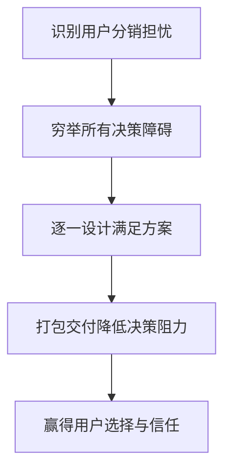
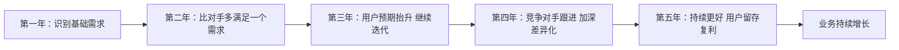
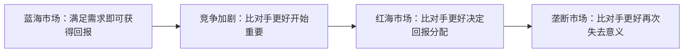

# 第 2 章 竞争优势——商业成功的本质是比别人更好

## 学习目标
- 理解需求满足回报论：一切所得皆源于满足他人需求
- 掌握从我想要到他需要的思维转向
- 理解竞争优势概念：商业成功的本质是比对手更好地满足需求
- 能运用需求满足导向方法识别并满足用户需求
- 能辨析竞争优势的适用边界

## 2.1 生活类比
想象你正在筹备一场自助餐派对。大多数人筹划派对时会遇到同样的陷阱：你可能自然而然地做一桌自己爱吃的菜——你偏好红烧肉就做红烧肉，你偏好重口味就加重辣椒。这就是"从我想要"出发的决策方式：你的出发点是你自己的愿望和口味，而客人是否爱吃，你并没真正思考。

然后转折来了：站在客人中间你开始观察，有人不爱吃辣，有人对海鲜过敏，有位素食主义者站在肉菜前不知所措。这时你走进厨房重新做菜。这就是"他需要"——你的决策出发点从满足自己愿望，切换为满足每位客人被看见的真实偏好。而你端出的每一道菜，都是对被满足需求的回报。

但请再想象一个场景：假设这条街不是只有你一家派对，而是一条热闹的美食街，街上有十位厨师同时在办同样风格的派对。这时你意识到：仅仅"满足了需求"不再够用。客人们会选择菜品更精致的厨师、服务体验更好的那家，会选择一一记住他们忌口的东道主。这时候"比对手更好"就成了决定回报流向的关键。

但请注意适用边界：如果这条街上只有你一家店，客人们别无选择，那么你端出家常菜，甚至勉强能入口的饭菜，他们也会光顾。你仍在"满足需求"，但不需要"比对手更好"就能获得回报。只有在美食街这样竞争充分的环境里，做得好还远远不够——你必须比十条街之外的厨师做得更好。这，就是竞争优势的雏形。

## 2.2 概念地图
- 需求满足回报论
- 思维转向：从我想要到他需要
- 竞争跃迁：从满足需求到更好满足
- 商业成功本质论
- 实战方法：顶峰会发售策略
- 实证验证：内容创业五年
- 适用边界

## 2.3 从我想要到他需要——思维转向的第一性原理
我们每个人都天然地从满足自身愿望出发做决策。你想赚更多钱，你想获得更多认可。这些"我想要"非常自然、非常顺手，但它们几乎从不带来预期的回报。为什么？因为回报并不来自你想要的，而来自你满足的——别人需要的。

> [P001, 素材原文] "我们这一生得到的一切都源于我们满足了别人的需求。"（来源：《要去满足别人的需求，而不是自己想要什么》020231017_009）

这句话是整章的基石。它说明了一个朴素的因果链：你得到回报，是因为你满足了别人的需求，而不是因为你满足了自己的愿望。

> **思维转向**定义（来源：《要去满足别人的需求，而不是自己想要什么》）

```
决策出发点切换：
从「我想要的」---> 到「他需要的」
原思维起点：我渴望得到什么 → 我如何得到它
转向后起点：别人需要什么 → 我如何满足它
```

这段伪代码展示了一个简单但反直觉的操作：把决策的第一问从"我"换成"他"。方向的改变是杠杆性的——同一个人的行动力和资源不变，仅仅把出发点从自身切换到他人，行动效率和回报率就会显著放大。这个方向与直觉相反，需要刻意练习。

这条法则具有普适性。但请注意边界：它解决的是思维方向的问题，不提供具体操作步骤。方向正确是第一步，不代表能直接到达终点。

## 2.4 需求满足回报论——一切所得皆因利他
有了思维转向作方向指引，我们还需要一个根本性的理论框架来解释"为什么这样做就会得到回报"。

> "我们这一生得到的一切都源于我们满足了别人的需求。"（来源：《要去满足别人的需求，而不是自己想要什么》）

这是全章最核心的定理。凡是能从市场、从他人、从社会获得的回报——金钱、口碑、信任、机会、地位——背后都有一条需求被满足的链条。

> **需求满足回报论**（来源：《要去满足别人的需求，而不是自己想要什么》）

$$\text{回报} = f(\text{满足他人需求的数量} \times \text{满足他人需求的质量})$$

这个公式展示了回报的因果结构：回报不是凭空产生的，而是需求被满足的函数。你赚到的每一分钱，本质上是某个人的某个需求被你满足之后，他愿意把货币作为回报交给你。

需求满足回报论有四个关键属性：

| 属性 | 内涵 |
|------|------|
| 因果性 | 回报是结果，满足需求是因 |
| 普适性 | 适用于一切人类互动场景 |
| 可操作性 | 指明行动方向：识别并满足他人需求 |
| 边界性 | 满足需求是必要不充分条件 |

普适性意味着你不必只在商业场景运用这套逻辑。但要注意边界：满足需求是必要不充分条件。你满足了别人的需求，不一定必然获得回报——可能对手满足得更好，可能市场没有形成定价机制，可能时机不对让回报打折。它奠定了正确的基础，竞争因素会让回报分配发生偏移。

## 2.5 从满足需求到更好满足——竞争中的位移跃迁
需求满足回报论解释了"为什么满足需求就能得到回报"，但它无法回答一个更尖锐的问题：同一个市场上有很多人都在满足需求，为什么回报分配如此不同？

> "最终赢得用户最多的本质就是比竞争对手更好的满足了用户需求。"（来源：《要去满足别人的需求，而不是自己想要什么》）

现实情况是，几乎所有有回报可图的需求，市场上都已经存在竞争者。这时候，仅凭"满足需求"已经不足以解释回报的分配差异。

> **竞争跃迁**（来源：《要去满足别人的需求，而不是自己想要什么》）

$$\text{用户选择} = \arg\max_{i \in \{\text{所有竞争者}\}} \left[ \text{满足需求程度}_i \right]$$

这个公式展示了用户选择的本质：当面对多个都能满足同一需求的选项时，用户会选择满足程度最高的那个。你满足了需求，只是获得了入场资格；你比对手更好地满足需求，才赢得了用户的选择。

竞争跃迁有三个核心特征：相对性（决定回报的是你比别人满足得更好）、动态性（今天的"更好"可能是明天的"及格线"）、杠杆性（小幅的"更好"可能在用户选择中被放大成决定性优势）。

## 2.6 商业成功本质论——比对手更好地满足需求
有了相对竞争的标尺，我们可以得到一个更精确的定理：什么才算商业成功？

> "比竞争对手更好的满足别人的需求，这是商业成功的本质。"（来源：《要去满足别人的需求，而不是自己想要什么》）

> **商业成功本质论**（来源：《要去满足别人的需求，而不是自己想要什么》）

$$\text{商业成功} \iff \text{比同时代同赛道的对手更好地满足用户需求}$$

这个公式展示了商业成功的最简判定标准：在同一个赛道上，面对同一批用户，你是否比对手更好地满足了需求。如果是，回报会向你倾斜。

商业成功本质论有三个层次的内涵：竞争性（比较对象是同时代同赛道的对手）、用户导向性（判定"更好"的裁判是用户）、可持续性（只有持续保持"比对手更好"才能持续获得回报）。

边界同样重要："更好"指的是用户可感知的改进。你用顶级供应链降低成本5%，用户对此毫无感知，这不构成优势；你改进了产品打开速度、简化了使用流程，用户真切感知到了差异，这才构成"更好"。可感知是竞争优势成立的前提。

## 2.7 顶峰会发售策略——需求识别到满足的实战样板
理论必须在项目中落地。顶峰会发售给出了一个完整的需求满足导向的实战样板。

> "以顶峰会发售为例，作者逐一识别用户在分销时可能有的需求并逐一满足。"（来源：《要去满足别人的需求，而不是自己想要什么》）

> **需求满足导向产品设计方法**（来源：《要去满足别人的需求，而不是自己想要什么》）

```
1. 系统识别用户在决策链路中的每一个担忧
2. 穷举式排查，不遗漏任何一个阻碍决策的环节
3. 为每一个担忧设计对应的满足方案
4. 打包交付，使用户的决策阻力降到最低
```

这套方法的要点不在任何单一步骤的聪明，而在"穷举"和"逐一"。它要求你把用户的分销决策看作一条完整的决策链，链上的每一环都可能是用户拒绝的原因。要点包括：系统性（识别"用户在什么环节会犹豫"）、穷举式（把纯靠直觉容易遗漏的担忧列出来）、针对性（每个担忧有对应方案）、可迭代性（随环境变化持续重做）。



## 2.8 内容创业五年验证——竞争优势的时间检验
顶峰会发售是一个项目层面的验证，但一个理论的真正价值需要更长时间的检验。

> "作者做内容创业做知识付费五六年来越做越好，本质是每年都思考如何比对手更好满足用户。"（来源：《要去满足别人的需求，而不是自己想要什么》）

为什么五六年时间对验证这个理论如此重要？长期性（跨越短期波动）、自我归因性（作者将增长归因于逐年优化满足度，存在偏差风险）、可复制性（这套方法可被其他创业者完整复制）。



## 2.9 竞争优势的适用边界——从相对回到绝对的回归
"比对手更好"并非放之四海而皆准的铁律，它有明确的适用边界。

> "需求满足回报论是更普适的原理，适用于所有互动场景。"（来源：《要去满足别人的需求，而不是自己想要什么》）

| 概念 | 适用场景 | 地位 |
|------|---------|------|
| 满足需求 | 一切人类互动，无论是否有竞争 | 第一层底层法则 |
| 比对手更好 | 存在充分竞争的存量市场 | 第二层附加条件 |

层级性：满足需求是第一层法则，比对手更好是第二层附加条件，没有第一层第二层毫无意义。条件性：竞争压力大时优势决定生存。动态性：市场从蓝海走向红海时竞争优势重要性递增。

用三个场景理解：无人竞争蓝海（满足需求即可获得回报）、20家对手成熟市场（满足需求只能进候选清单，比对手更好才能被选中）、垄断市场（即便敷衍用户也别无选择）。



## 2.10 设计中的取舍
- **为什么不用"做得更好"这个说法，而强调"比对手更好"？**
"做得更好"是绝对标准，"比对手更好"是相对标准。商业竞争的本质一开始就是相对的——用户永远面对多个选项，他选择的不是"你的产品好不好"，而是"在所有选项中你最好不好"。但"比对手更好"是"做得更好"的结果：你先做到自己能做到的最好，再以此为基础与对手比较。两者是递进关系。

- **这种设计的 trade-off 是什么？**
强调"比对手更好"有两个代价：一是竞争近视（过于关注对手可能忽略用户本身更深层的需求）；二是持续焦虑（优势是动态的，对手随时会跟进超越）。取舍方式是：始终以用户为导向，把对手当作拉开差距的参照物而非模仿对象。

## 2.11 动手练习
1. 识别你的需求盲区——回忆最近做某事的思考出发点，列出5个最关心问题，改写为面向他人版本，对比差异。
2. 用需求满足回报论分析一次成功与失败——选取一成一败事件，分析满足了谁的需求、为何失败。
3. 设计一份用户担忧排查清单——假设推广付费课程需用户分销，穷举8个担忧并设计满足方案。
4. 辨析竞争优势的适用场景——分析蓝海、20家对手成熟市场、垄断市场三种场景，判断哪个更重要。

## 2.12 本章小结
这一章中我们完整讨论了"商业成功的本质是比别人更好"这一核心命题。我们首先完成了从我想要到他需要的思维转向；其次建立了底层框架需求满足回报论；接着从满足需求跃迁到更好满足，认识到需求市场是一场竞赛；随后确立了商业成功本质论；然后通过顶峰会发售策略和内容创业五年验证看到了理论在项目层面和长期时间尺度上的落地效果；最后辨析了竞争优势的适用边界。

| 概念 | 解释 |
|------|------|
| 从我想要到他需要 | 将决策出发点从满足自身愿望切换为满足他人需求的认知转向 |
| 需求满足回报论 | 我们这一生得到的一切都源于满足了别人的需求 |
| 从满足需求到更好满足 | 需求市场是竞赛，回报属于满足得更好的人 |
| 商业成功本质论 | 赚更多钱和得到更多回报的本质是比对手更好满足别人需求 |
| 顶峰会发售策略 | 系统性识别用户担忧并逐一满足从而赢得用户选择 |
| 内容创业五年验证 | 五六年业务持续向好归因于每年思考如何比对手更好满足用户 |
| 竞争优势适用边界 | 满足需求是普适底层法则，比对手更好适用于充分竞争存量市场 |

下一章中，我们将继续深入，把"比对手更好"的总体原则拆解为可执行的策略框架，探讨如何在具体项目中系统性识别用户痛点、设计差异化方案，建立可持续的竞争优势。