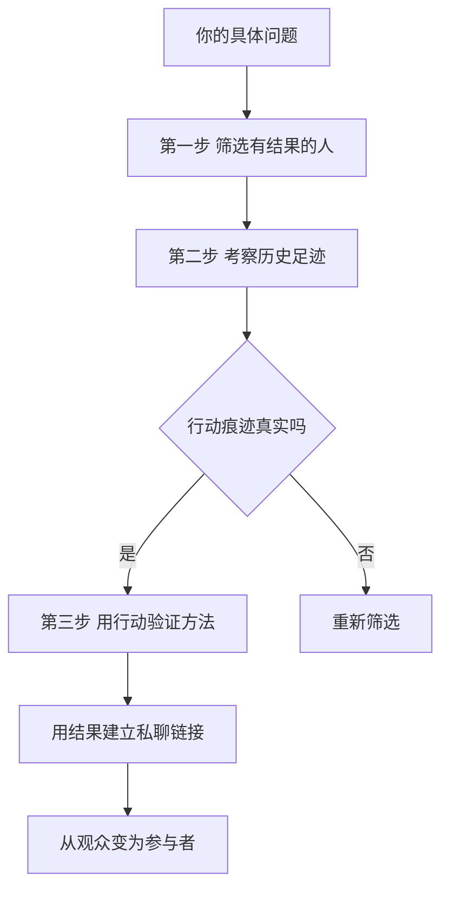
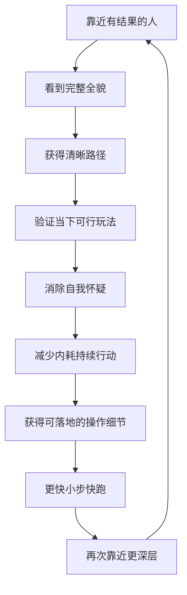

# 第 5 章 行动与向高手靠近——从高认知穷人到知行合一

## 学习目标
- 理解当下有结果的人的精准定义并能区分其与泛泛头部大V的本质差异
- 掌握行动痕迹的判定标准并将其作为筛选考察靠近对象的客观依据
- 完整复述并熟练运用三步靠近法实现从旁观者到参与者的身份转化
- 识别高认知穷人的陷阱理解认知与行动脱节的核心原因及危害
- 能够阐释靠近的复利收获的三层结构并据此设计自己的靠近行动计划

## 5.1 生活类比
向高手靠近是一场拜师学艺的旅程。想象你初入武林，想学一套剑法——这时你最需要的不是一位名满天下的剑圣，而是一位恰好精通你正在练的那套剑法的侠客。**当下有结果的人**，就是这位恰好擅长你当下课题的侠客；**行动痕迹**，是侠客练武场上的木桩——那些刀剑留下的砍痕证明他真实地练过、战过；**三步靠近法**，则是你拜师的完整路径：先筛选出最合适的侠客，再观察他的练武足迹，最后自己先练出几分样子再上门求教。而观众在台下鼓掌欢呼，永远无法成为舞台中央的表演者。只有亲身参与的实践，才能完成从认知到行动的跨越。

## 5.2 概念地图
```
行动与向高手靠近——从高认知穷人到知行合一
├── 第一部分 识人辨材：当下有结果的人与行动痕迹
│   ├── 当下有结果的人：解决你具体问题而非泛泛大V
│   └── 行动痕迹：可追踪可验证的过去行动证据链
├── 第二部分 三步靠近法：从旁观到入局
│   ├── 第一步：初步筛选解决你问题的人
│   ├── 第二步：点开头像考察历史足迹
│   └── 第三步：用行动验证价值后私聊链接
└── 第三部分 认知跃迁：高认知穷人与复利收获
    ├── 高认知穷人：知而不行是成长的隐形陷阱
    └── 靠近的复利收获：全貌、信心与细节的三重回报
```

## 5.3 当下有结果的人——找对人比找对道理更重要
> "有结果的人是在解决你正在遭遇的这些问题上有结果的人"（来源：《靠近有结果的人》）

这是整章的地基。我们首先要分辨一个常见的认知偏差：**把"有结果"等同于"名气大"**。你刷到的百万粉丝博主、行业领袖、成功学导师，他们或许在很多领域都有建树，但他们未必解决过**你正在遭遇的那个具体问题**。

> **当下有结果的人**定义（来源：《靠近有结果的人》）

> 一个在"解决你当前正面临的具体问题"上已经取得实际成果，并且其成果可以被追溯验证的人。

这个定义有三个关键属性：

| 属性 | 含义 | 反例 |
|------|------|------|
| 针对性 | 解决的是你的具体问题 | 行业大V谈通用方法论，不针对你的赛道 |
| 可验证性 | 成果伴随可审查的行动痕迹 | 只晒收益截图，无过程记录 |
| 真实性 | 结果可追溯，而非包装人设 | 转载、晒书单不等于亲自做过 |

为什么把"针对性"放在第一位？因为人的精力有限。你今天面临的可能是"小红书冷启动没流量"，也可能是"自媒体变现路径不清晰"。一位财经大V纵然才华横溢，但他没做过小红书，他的建议对你就是"正确的废话"——听起来都对，做起来无用。

> "你面临的不仅是项目技术问题"（来源：《靠近有结果的人》）

作者提醒我们：你遇到的往往不只是单一的技术难题，而是一整个情境。你需要的人，是在这个**完整情境**中走过来的人。这也是为什么泛泛大V不适用。

最后是**边界**：有结果不等同于大V，更不等同于成功学导师。你要找的，是那个已经在你向往的战场上淌过水、踩过坑、拿到过结果的人。

## 5.4 行动痕迹——让靠近从直觉变成证据链
> "靠近的核心是看到更多有结果的人的行动痕迹"（来源：《靠近有结果的人》）

> **行动痕迹**定义（来源：《靠近有结果的人》）

> 可通过公开渠道追踪到的、反映一个人过去真实行动的可验证证据集合，包括帖子、评论、历史实战日志、项目复盘等。

区分三种"伪靠近"与"真靠近"：

| 行为类型 | 是否构成靠近 | 原因 |
|----------|--------------|------|
| 点赞 | ❌ | 零成本、零信息交换 |
| 加好友 | ❌ | 只是建立连接，未验证价值 |
| 考察历史足迹并行动验证 | ✅ | 产生了真实的互动与信息获取 |

行动痕迹为什么可靠？三个特性：**可验证性**（公开历史记录难篡改、造假成本极高）、**连续性**（反映一段时间行为轨迹而非一次性高光）、它是**三步靠近法第二步的核心考察对象**。

> "第二步点开头像看历史足迹"（来源：《靠近有结果的人》）

这句朴实话的背后是：**头像和简介是"人设"，历史足迹才是"人格"**。人设是精心设计的展示面，历史足迹是日积月累的真实行为。正如作者所言："给有结果的人点赞不算靠近加好友也不算靠近"——围观者的点赞与加好友，本质上是"观众席上的鼓掌"，你为自己焦虑寻求了一丝慰藉，却没有真正获得对方的价值。

## 5.5 三步靠近法——从观众席走向舞台中央的操作手册
> "第一步初步筛选你可能需要解决的问题上有结果的人"（来源：《靠近有结果的人》）

> **三步靠近法**方法（来源：《靠近有结果的人》）

```
1. 第一步：初步筛选——找到在解决你当前问题上已有结果的人
2. 第二步：考察足迹——点开头像，查看其历史帖子、评论、实战记录
3. 第三步：行动验证——先用行动验证其方法的可行性，再私聊建立链接
```

这是一个**递进式**的靠近路径。每一步都是下一步的资格前提：没筛选就考察会浪费精力；没考察就链接是盲目社交；没验证就咨询是单向索取。

**第一步：筛选。** 依据"有结果的人"的定义，列出自己当前最紧迫的1-3个具体问题，然后针对每个问题去寻找解决了它的人。注意颗粒度：不是"做自媒体的人"，而是"在小红书冷启动阶段做到1万粉的人"。

**第二步：考察。** 翻阅历史足迹，回答三个问题：

| 考察问题 | 判定标准 |
|----------|----------|
| 他是否真实做过？ | 有过程记录、实战日志、阶段复盘 |
| 他的行动是否连续？ | 足迹分布在时间轴上而非一次性爆发 |
| 他的结果是否可验证？ | 有数据截图、成果展示或第三方背书 |

**第三步：行动验证后链接。** 作者强调"了解并用行动验证后"再添加私聊咨询。你要先自己动手——按照对方的方法做一遍，有了真实体验和反馈后，再带着问题去链接。这时候你的提问才是有质量的。



这个流程图的底层逻辑：**每一步都在增加你的沉没成本，而沉没成本恰恰是让你从"围观"走向"参与"的动力**。

## 5.6 高认知穷人——知道得越多越要警惕做得越少
> "很多人成为高认知穷人是因为只听道理却不做"（来源：《靠近有结果的人》）

> **高认知穷人**定义（来源：《靠近有结果的人》）

> 只明白道理却不通过实践转化为动作的人，其认知水平与行动水平之间存在显著落差。

这个定义揭示了一个成长的悖论：你学习得越多，就越容易陷入一种**"认知舒适区"**——因为你知道了很多概念，大脑产生了"我掌握了"的错觉，于是更不愿意去动手。

高认知穷人有两大特征：**不作为性**（停留在听道理记笔记，不落地为具体动作）与**遮蔽性**（高认知反而制造改变错觉，成为拒绝行动的借口）。

| 维度 | 高认知穷人的状态 | 知行合一的状态 |
|------|------------------|----------------|
| 学习方式 | 囤积知识、收藏帖 | 学一个用一 |
| 对道理的态度 | 点头认同、记笔记 | 动手验证、调整 |
| 时间分配 | 大量输入、少量输出 | 输入输出交替循环 |
| 心理状态 | 懂了很多，但焦虑 | 做了一点，但笃定 |

> "通过一次次实践调整认知和动作最终达到知行合一"（来源：《靠近有结果的人》）

作者在这里给出了解药：**知行合一不是一次性顿悟，而是一次次微小实践的累积**。你不需要等到"完全想通"再行动——你永远等不到那一刻。你需要的是，在一个大致方向指引下，先做出第一个动作，然后根据反馈调整认知，再调整下一个动作。真正的转化在于实践，而不是多学一个概念。

## 5.7 靠近的复利收获——一次靠近三重回报
> "1看到更完整的项目全貌；2看到当下可行的玩法不自我怀疑；3看到落地性强的操作细节"（来源：《靠近有结果的人》）

> **靠近的复利收获**发现（来源：《靠近有结果的人》）

> 真正靠近有结果的人，可以获得三层递进价值：看清项目全貌、验证可行玩法免于内耗、获得可落地的操作细节。

**第一层：看到更完整的项目全貌。** 当你还在外围围观时，你看到的只是冰山一角。但当你走近，你会看到完整路径图：他怎么开始的、中间经历了哪些失败、什么阶段做了什么决策。

**第二层：看到当下可行的玩法，不自我怀疑。** 很多人的内耗源于不确定。当你看到有人正用一套具体玩法跑通你的目标时，焦虑大幅缓解。"原来这么做是可以的"——这个确认本身就是巨大价值。

**第三层：看到落地性强的操作细节。** 只有真正靠近，你才能看到那些从公开内容中无法获知的执行细节：具体工具、时间节奏、处理卡点的方式。这些细节才是让你"从知道到做到"的最后一步。



这个循环展示"复利"的含义：**三层收获互相强化**。但请注意边界：**这些收获的前提是真正的靠近，而非点赞加好友的围观姿态**。作者总结道："观众只会焦虑参与者才能走近舞台"——你选择做观众还是参与者，决定了你收获焦虑还是增长。

## 5.8 多源对照
本节涉及的素材出自同一篇文献，其中涉及多个概念模块，做内部分解对照以呈现概念之间的结构关系。

### 共识
所有概念模块共享同一个底层逻辑：**认知必须通向行动**。"当下有结果的人"定义了行动的目标方向；"行动痕迹"提供了客观依据；"三步靠近法"给出了行动路径；"高认知穷人"警示认知与行动脱节的危害；"复利收获"则是行动的回报激励。五者构成从"识人"到"行动"再到"收获"的完整链条。

### 分歧与内部张力
- "当下有结果的人"vs"高认知穷人"：前者强调找对人，后者强调自身行动——作者处理为先找对人再用行动验证，先后递进而非二选一。
- "三步靠近法"第三步 vs"复利收获"：行动验证本身可能消耗时间，但作者认为行动验证本身就是复利收获的一部分。
- "行动痕迹"可验证性 vs 信息噪声：用"连续性"标准过滤——持续的真实行动难以长期伪装。

## 5.9 设计中的取舍
**为什么不是直接链接"头部大V"，而是先筛选"解决你具体问题的人"？**
头部大V名气大，但也意味着极高的连接门槛和极低的互动质量。而"解决你具体问题的人"通常还在成长期，更愿意分享、更可能与你产生真实互动。trade-off 是：你可能放弃与"最厉害的人"链接的象征满足，但换来"最合适的人"的实际帮助——从解决具体问题角度后者价值更高。

**为什么靠近第一步是"考察足迹"而不是"直接私聊"？**
直接私聊看起来省时，但如果你连对方真实水平都没验证，问题就是泛泛而问，得到的也是泛泛而答。考察足迹的过程既是对对方的验证，也是你自己的学习。trade-off 是：考察需投入时间，但换来更高质量的提问和行动验证后的平等对话资格。

## 5.10 动手练习
1. **筛选当下有结果的人**——设定当前问题，根据三大要素筛选3个对象，列出问题证据与行动痕迹。
2. **设计你的三步靠近行动计划**——基于最合适对象，运用三步靠近法制定详细行动计划。
3. **诊断高认知穷人状态**——回顾6个月内学到的5个知识，逐一做知行转化自检。
4. **区分围观与参与**——找出最近点赞收藏的3次经历，分析为何不算靠近，重新设计参与式互动。

## 5.11 本章小结
这一章我们完整走完了从"识人"到"行动"再到"收获"的成长路径。首先定义了**当下有结果的人**——不是泛泛大V而是解决你当前具体问题上已有真实成果的人；其次将**行动痕迹**确立为考察的客观证据链；接着完整学习了**三步靠近法**——从筛选到考察再到行动验证后的链接，完成从旁观者到参与者的身份转化；然后剖析了成长路上最大的隐性障碍**高认知穷人**——知道但不做到，解药是通过一次次实践循环达到知行合一；最后总结了**靠近的复利收获**——三层回报互相强化构成正反馈螺旋。

| 概念 | 解释 |
|------|------|
| 当下有结果的人 | 在解决你正遭遇的具体问题上已有成果的人而非泛泛头部大V |
| 行动痕迹 | 反映一个人真实行动的可追踪证据是靠近和考察的客观依据 |
| 三步靠近法 | 从筛选到验证再到链接的递进路径完成从旁观者到参与者的转化 |
| 高认知穷人 | 只懂道理不落地为动作的人认知与行动严重脱节是成长的最大障碍 |
| 靠近的复利收获 | 真正靠近带来全貌信心与细节三层回报且互相强化 |

下一章中，我们将进入"持续行动与迭代"的主题——高手不只给你方向，更给你一套持续逼近目标的方法论。