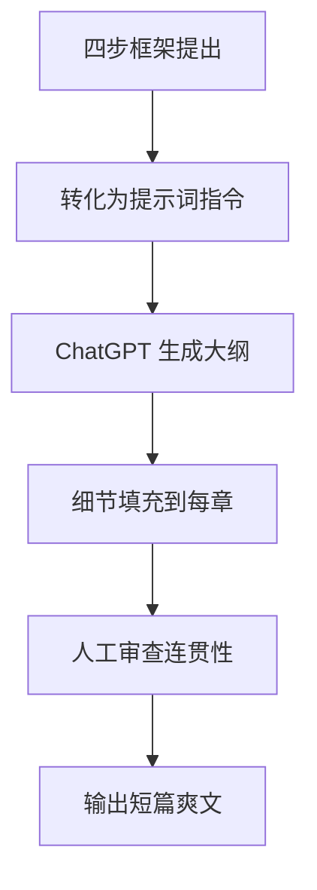
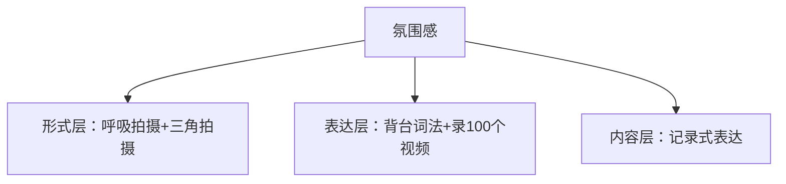

# 第 6 章 内容创作进阶论——从爽文叙事到氛围感传播

## 学习目标
- 理解注意力稀缺时代对内容创作的根本性挑战
- 掌握四步爽文写作框架的结构化拆解与情绪递进逻辑
- 能够运用AI辅助创作方法论并明确其能力边界
- 理解口播3.0从说教式到氛围感转型的核心逻辑
- 掌握营造口播氛围感的实操方法矩阵
- 能根据平台特性和用户偏好选择合适的内容形态与迭代策略

## 6.1 生活类比
内容创作是一场街边小吃摊的竞争。想象一条小吃街，几十个摊位挤在一起，顾客从你面前走过只停留3秒。如果摊位的招牌不吸引人、香气不够浓，顾客根本不会停下来——这就是注意力稀缺的残酷现实。爽文四步框架就是一道爆辣小串的烹饪流程：先让顾客闻到香料的气息（感官紧张），再看到辣椒翻滚的滋滋声（危险出现），接着辣味窜进喉咙烧到心里（内心紧张），最后递上一杯冰镇酸梅汤（希望曙光）。而口播3.0的氛围感，是把喇叭叫卖式的大嗓门，转型为开放式厨房现做现卖——顾客能看见食材在你手里变成美味的过程。AI辅助创作的边界，就像请了一个帮厨：AI能帮你备菜、按你给的食谱炒菜，但它没法替你经营满汉全席。至于记录式表达，则更像是朋友随手拍的Vlog——画质不高但情感真实，远比精心摆拍的广告更打动人心。

## 6.2 概念地图
```
内容创作进阶论
├── 底层动因：注意力稀缺困境与目标导向创作范式
│   ├── 注意力稀缺：用户耐心下降、完播率走低
│   └── 目标导向：爽文以调动情绪为核心目标
├── 创作方法论：四步爽文写作框架与口播3.0形态进化
│   ├── 四步框架：感官紧张→危险出现→内心紧张→希望曙光
│   └── 口播3.0：形式润色→氛围感营造→用户中心
├── 人机协作边界：AI辅助创作优势区与局限区
│   ├── 优势区：短篇生成、框架内细节填充
│   └── 局限区：长篇连贯性、多人物多线索把控
└── 普适性规律与验证：记录比摆拍更有力量、形式随偏好迭代
```

## 6.3 注意力稀缺困境——内容创作的流量红灯
在信息爆炸的时代，用户是拿着遥控器扫台的观众。每个内容创作者都在争夺同一双眼睛，而用户对某一种内容形式的耐心正在急剧下降。以抖音为例，曾经风靡的"2.0口播"——正襟危坐、对镜头说教的专家式表达——正在遭遇越来越高的跳出率。

> "2.0口播用户对这种形式已没有耐心完播率5秒跳出率越来越高"（来源：《抖音口播3.0方法论》）

AttentionScarcity := lim_{t→∞} Patience(Form_t) → 0

这个公式展示了注意力稀缺的动力学本质：当一种内容形式在时间轴上反复出现，用户对该形式的耐心会趋于零。注意力稀缺有三个关键特征：
- **迁移性**：用户的注意力会从乏味形式转向新颖形式，机会在于形式创新。
- **残酷性**：完播率、5秒跳出率是衡量注意力得失的直接指标，5秒没抓住用户就不存在。
- **动态性**：用户偏好是流动的，要求创作者建立持续迭代机制。

## 6.4 爽文——情绪的肾上腺素注射剂
在注意力稀缺背景下，最快抓住用户的是**情绪冲击力最强**的内容。爽文存在的意义就是给你一次情绪的过山车。

> "爽文特点是让读者读起来特别燃能调动情绪"（来源：《用ChatGPT写爽文四步框架》）

爽文 := ⟨读者, 燃, 肾上腺素激活⟩。它的特征：**情绪导向**（故事逻辑服务于情绪爆发点）、**即时反馈**（追求短时间内强烈情感刺激）、**可模板化**（燃点可分解为固定步骤）。

爽文有它的能力边界：素材明确提到"AI写短篇文章还可以写长篇太为难"。短篇爽文可依靠一个强情绪点快速成文，但长篇网文需要多人物、多线索的长期一致性——情绪爆点只是骨架，还需要逻辑和世界观。

## 6.5 四步爽文写作框架——情绪的四段式过山车
情绪调动如果只靠灵感，那创作者每天都要祈祷运气降临。为了让"燃"可复现、可训练，需要结构化方法论。

> "从感官上制造紧张氛围；危险出现；内心的紧张；看见一丝曙光"（来源：《用ChatGPT写爽文四步框架》）

**四步写作框架**定义（来源：《用ChatGPT写爽文四步框架》）
- Step1：感官紧张（氛围制造）
- Step2：危险出现（外部威胁）
- Step3：内心紧张（心理冲击）
- Step4：希望曙光（情绪释放）

四步构成一个短促完整的情绪闭环，有**递进性**（从外部刺激到内部心理）和**可编程性**（每步可翻译为提示词指令）。

**大纲细节填充写作流程**（来源：《用ChatGPT写爽文四步框架》）
```
1. 用四步框架向ChatGPT下达指令，先生成小说大纲
2. 基于大纲逐章展开，将细节精确到每一章写什么
3. 每一章内部再次调用四步框架保证局部情绪闭环
4. 人工审查连贯性与情绪曲线是否达标
```



## 6.6 AI辅助创作的边界——创作的想象力与逻辑脑之争
> "一是没用4.0二是希望一步到位加的命令太多三是命令描述不清机器只能盲写四是对故事结构没有规划"（来源：《用ChatGPT写爽文四步框架》）

AI能力不均衡：短篇、框架内填充时能力高，长篇、多线索一致时能力低。AI是根据模式生成文本的引擎，短篇爽文框架清晰，AI能精准执行；长篇小说需要跨章节逻辑一致性和人物动机长线跟踪，AI难以独立完成。

**用户归因定理**：AI输出质量的上限，由你输入的质量决定。未用GPT-4、指令过多、描述不清、缺乏规划，都会导致生成效果不佳。

人机协作的最优模式：人类负责蓝图，AI负责施工，人类再负责质检。


## 6.7 口播3.0——从讲道理到造氛围的形态进化
"不再说教"不等于"不再说话"——关键在于换一种表达形式。

> "3.0版本口播是2.0的升级玩法对视频形式进行润色加吸睛元素""核心是口播氛围感氛围感拉满收获用户注意力"（来源：《抖音口播3.0方法论》）

口播3.0 := 口播2.0 + 形式润色 + 吸睛元素。Evaluation(口播3.0) := 氛围感是否拉满。设计哲学是**完全从用户偏好出发**。


## 6.8 记录式表达——真实感的超链接
> "摆拍和剧情演出来的东西绝对没有记录有力量""记录才是能让人还原真实的最快路径"（来源：《抖音口播3.0方法论》）

Power(记录) > Power(摆拍) ⟺ 真实性记录 > 真实性摆拍。摆拍是"表演的真实"，记录是"存在的真实"，用户潜意识能分辨这两者。特性：**真实性**、**亲和力**、**感染力**。

**氛围感营造方法矩阵**（来源：《抖音口播3.0方法论》）

| 方法 | 核心操作 | 效果目标 |
|------|----------|----------|
| 呼吸拍摄法 | 多机位切换、卡重点放大面部、配特效音效 | 降低视觉疲劳，保持观看节奏 |
| 三角拍摄法 | 看向镜头之外的物体，形成"讲给旁边人听"的三角关系 | 让眼神自然，破除直视镜头的僵硬感 |
| 背台词法 | 预先背熟文案再录制，练出主持人般的自然流畅度 | 消除念稿感，表达自然 |
| 手持拍摄法 | 边走边拍，以记录真实生活为核心 | 还原最真实的情感状态 |



## 6.9 多源对照
### 共识
两篇素材对内容创作的核心矛盾有判断：**用户注意力是稀缺资源**、**形式必须迭代**、**AI是工具而非替代品**。
### 分歧
- **创作驱动力的来源**：P001强调"情绪驱动"（燃点激活读者），P002强调"氛围驱动"（真实感营造体验）。
- **方法论适用边界**：P001的爽文框架适用于叙事类内容，P002的方法矩阵适用于表达类内容。
- **AI的角色定位**：P001给出具体AI协作流程，P002强调人的真实感。

## 6.10 设计中的取舍
**为什么不用"教知识"而是"给情绪"？**
在注意力稀缺语境下，先要拿到注意力才有机会给知识。情绪是注意力的钩子，知识是钩子钓上来的鱼。
**trade-off是什么？**
情绪导向的爽文框架在换取即时注意力的同时，牺牲了内容深度与持久价值。记录式表达也在真实性与精致性之间作取舍。这个取舍没有标准答案，取决于目标受众和平台特性。

## 6.11 动手练习
1. **诊断一次注意力流失**——观察一个短视频账号，分析其口播形态与划走原因，提出改造方案。
2. **拆解一个爽点：四步框架实战**——取一个熟悉的爽文情节，用四步框架拆解并转译为ChatGPT提示词。
3. **AI能力边界测试：短篇vs长篇**——让AI分别生成短篇爽文和长篇开头，对比质量差异，设计人机协作方案。
4. **口播3.0改造工作坊**——为一个口播视频设计呼吸三角拍摄法执行方案，改写台词呈现聊天式语气。
5. **从理论到复盘：构建个人验证体系**——设计两周内容实验，对比口播3.0与2.0在完播率、互动率上的差异。

## 6.12 本章小结
这一章学习了内容创作进阶论的两条主线。理解了注意力稀缺困境的成因与表现；掌握了目标导向创作范式，以爽文为例拆解四步写作框架；探讨了AI辅助创作的边界；掌握了口播3.0的氛围感营造实操技巧；最后提炼出记录比摆拍更有力量、形式须随偏好迭代的普适规律。

| 概念 | 解释 |
|------|------|
| 注意力稀缺困境 | 用户对特定内容形式的耐心急剧下降是内容方法论成立的前提 |
| 爽文 | 以调动强烈情绪为目标通过燃点给读者肾上腺素激活快感的小说类型 |
| 四步爽文写作框架 | 感官紧张→危险出现→内心紧张→希望曙光构成短促完整的情绪起伏闭环 |
| AI辅助创作边界 | AI擅长短篇框架内生成与细节填充但难以独立把控长篇网文连贯性 |
| 口播3.0 | 通过形式润色与吸睛元素营造氛围感是口播形态的升级方向 |
| 记录比摆拍更有力量 | 真实记录还原人性最快路径表演和摆拍无法企及的情感穿透力 |

下一章中，我们将进入更宏大的视野，从内容创作的方法论上升到内容传播与用户运营的系统性框架，探索如何将这些创作原则与平台的流量机制深度耦合。